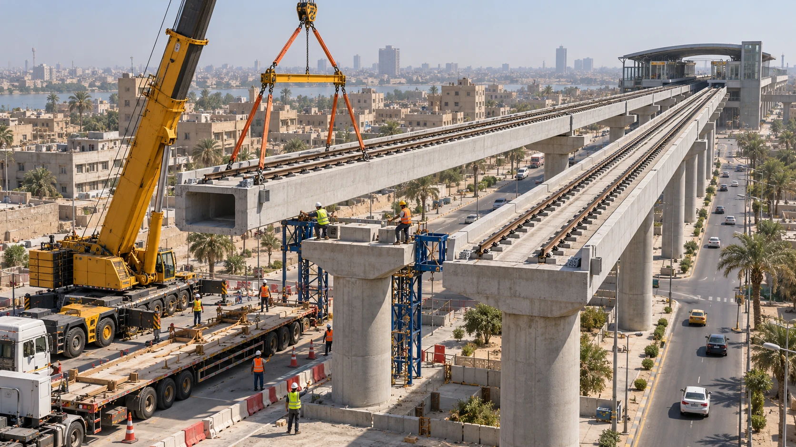
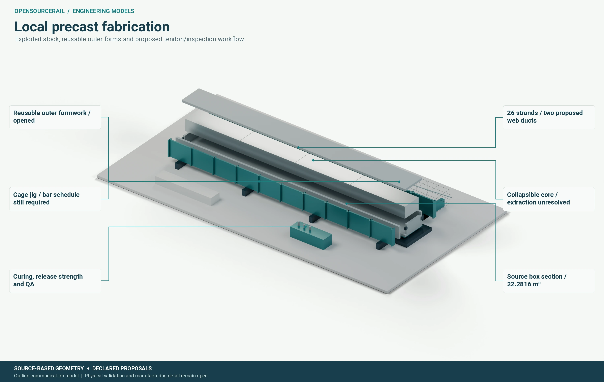

# Stations, structures and construction

The reference railway uses conventional rails carried by concrete structures.
Mostly elevated, prefabricated construction is intended to reduce occupation
of busy streets and to make repeatable local production possible. A structure
still needs to be designed for its particular ground, water, utilities,
access, loads and construction method. Repetition can lower cost only after
the repeated unit itself is complete and safe.

*Concept illustration. The lift, crane, restraints, traffic management and
temporary stability must be designed for each installation.*

## Follow loads to the ground

A train load reaches the rails, fasteners, beam or deck, bearings, piers and
foundations. Each interface can govern the answer. A span that looks
efficient in bending may have a difficult rail seat, bearing reaction or
joint. A light beam may need expensive erection equipment or a larger
maintenance closure. Moving axle positions, crowd cases, braking forces,
temperature, fatigue, drainage and access must be considered together.

The project has explored a representative 20-metre precast span and several
alternative civil forms. One recent numerical control used the reference
train's 24 axle positions, a declared dynamic factor and finite bearing
patches. Two independent mechanics routes gave very close displacements in
that model; the fine result was about 10 millimetres. A refinement difference
of roughly 2.7% passed a diagnostic threshold, while mesh independence,
material and joint behaviour, actual rail support and site foundation
evidence remained open. Agreement between solvers is valuable, but both can
agree on a model that omits a real load path.

## Construction is part of the design

The precast concept asks a local yard to make repeatable beams with controlled
forms, reinforcement, prestressing where selected, curing, lifting points and
inspection. Transport then constrains length and mass. At the site, the crane
must have enough capacity at the *actual lift radius*, after allowing for
rigging, ground bearing and the temporary state of the span. A nominal crane
capacity at zero radius does not answer that question. Bearings, joints and
rail installation follow, along with the inspection and replacement route.

*The illustrated yard shows reusable forms and proposed handling. It does
not establish production rate, qualified prestressing or finished beam cost.*

An overhead launching gantry is an alternative where a conventional crane
cannot work easily. It changes temporary works, plant cost and construction
sequence. Both methods need a complete erection study before one is selected.

Stations add their own structures and interfaces: platform loads, lifts,
stairs, fire and evacuation routes, shelters, power equipment, maintenance
rooms, drainage and public-realm connections. Their footprints cannot be
inferred from a single platform length. A compact station is only affordable
if access, safety and constructability survive the full design. The Samawah
station pair illustrates why even a small map edit can open these larger
questions.
