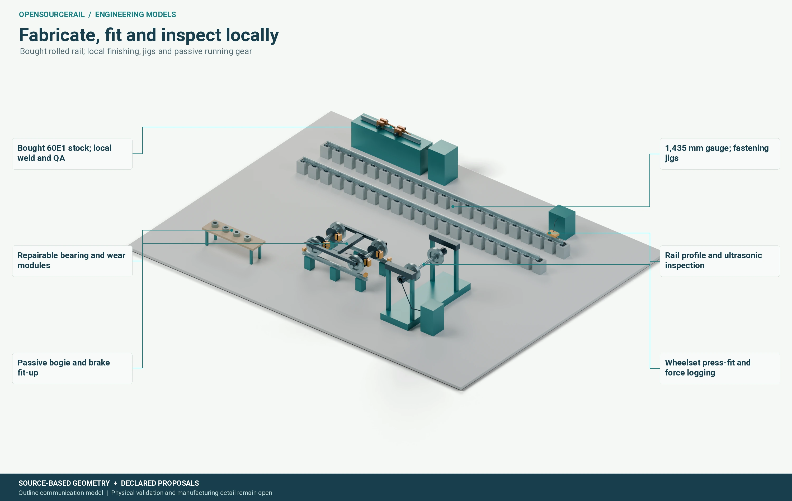

# Local manufacture and sourcing

A railway can be designed for local work without pretending every specialist
part will be made locally. The useful question is which knowledge and
production steps can be established, inspected and sustained in a particular
place. OpenSourceRail's vehicle inventory and civil studies provide a starting
bill of materials. The next step is to turn each relevant item into controlled
stock, process, assembly and quality information.

## Make, buy and qualify

A structural member may begin as an extrusion or folded sheet. Its useful
description includes grade, stock size, cut length, joining method, surface
treatment, dimensional datums and inspection. A bought bearing needs a
qualified specification and an incoming check, even if its internal design
is left to the supplier. A door sensor or battery cell adds electrical,
environmental and safety requirements. The make-or-buy choice should therefore
be recorded item by item, including original material and component origin,
instead of applying one local-content percentage to the train.

Candidate processes include concrete precasting, metal cutting and forming,
structural fabrication, composite panels, interiors, wiring and final
assembly. Proposed local capability does not itself prove a factory's yield,
rate, tooling cost or skill base. A workshop may be able to make a prototype
while still needing investment and training to supply a whole railway. The
cost comparison should include that investment and the value of later repair
and renewal work.

*Illustrated workstation. Wheel, bearing and bogie manufacture or inspection
would require controlled processes, qualified equipment and recorded checks.*

## From stock to an assembled train

The current six-car breakdown identifies 605 named leaf-part types in 40
assemblies. It includes the running gear, car structures, seats, doors,
glazing, HVAC, service batteries, lighting, wiring and many joints and
fasteners. That level of counting makes hidden work visible. It does not
replace the next stage: a drawing that establishes mating dimensions and
tolerances, an operation sequence, a jig, an inspection plan and a safe
removal route.

A plausible vehicle assembly starts with a datum-controlled underframe, then
adds body frame, roof and floor, bogies, equipment, panels, doors, glazing,
interior and inter-car connections. At each stage the assembly must still be
accessible for inspection. A late-discovered interference between a cable
tray and a door mechanism is much more expensive than a revised source model
before stock is cut. This is why the candidate's geometry, inventory and
work instructions need to agree.

For the representative door module, the count of 694 pieces per opening is
useful only if the header, carriage, guide, drive, sensor and body interfaces
can be made and assembled as described. The 97 proposed locally fabricated
pieces are a production opportunity, not a completion certificate. Standard
purchases and qualified purchases have distinct incoming requirements.

## Repair is a production route in reverse

A module's design should also describe how a technician diagnoses it, isolates
power, removes it, fits a replacement, checks it and returns the train to
service. The same drawings and part identities should support both factory
assembly and depot repair. This helps a local operator keep knowledge after
the original builder has left and gives later suppliers a clear interface to
compete against.
