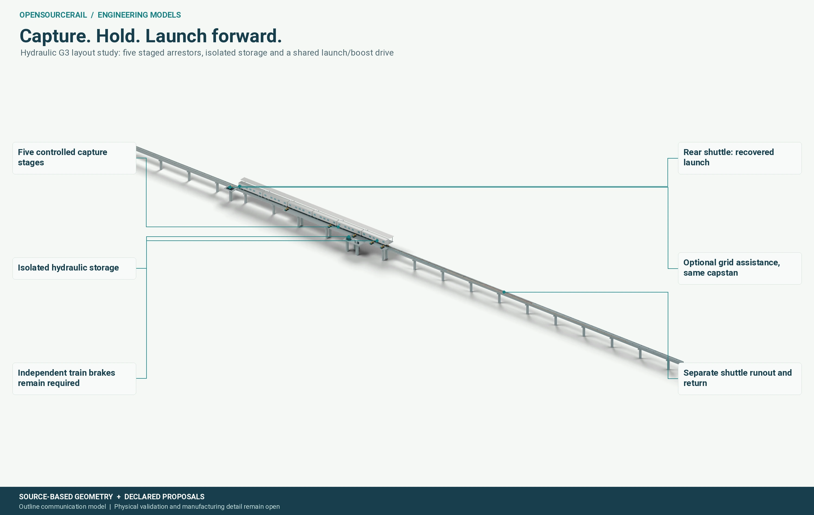

# Control and passenger protection

A safe passenger railway needs more than a train that can move under normal
conditions. It needs clear authority for every movement, protection from
conflicting movements, reliable detection, a response to faults and means to
bring people to safety. OpenSourceRail researches open control software
alongside the physical railway, but the current software is a research and
simulation platform without live movement authority.

## Separate normal service from protection

The service plan describes when a train is intended to depart, stop and
arrive. Protection limits where it is permitted to move and how it must stop
if the service plan or equipment fails. Station launch equipment may drive a
train in the normal journey, but independent onboard brakes must remain able
to stop it when station power or communication is unavailable. A protected
headway requires validated braking, position, supervision, platform and
terminal assumptions, not just dividing an hour by a planned interval.

The reference system must consider train detection, route setting, station
dispatch, doors, platform interface, overspeed, emergency stops and recovery.
Degraded cases include a missed station handoff, a stopped train, sensor
disagreement, loss of power or an occupied section. The response has to fit
the actual physical train and route. A correct software test with idealised
braking data does not prove the corresponding wet-rail stop.

## Open control needs a clear boundary

Rust research software provides a place to define state machines,
interfaces and deterministic checks. Simulations can expose contradictory
authority, unsafe transitions and unexpected restart behaviour. They can be
reviewed independently and rerun as designs change. The resulting evidence
is valuable for engineering, but deployment would need qualified sensors,
actuators, communication, operating procedures, safety analysis, testing
and the approvals applicable to the actual railway.

*Communication model of a station-side equipment arrangement. The final
drive, protection hardware and maintenance access are candidate-specific.*

FUXA and the project gateway are explored for equipment observations, alarms,
trends and review-linked records. Observation is not the same as commanding a
train. A live deployment would need authenticated device bindings, a
commissioned network, permissions, fail-safe interfaces and maintenance
procedures. The Workbench is a design and review interface; it cannot grant
movement authority.

Passenger protection must also shape the physical station and vehicle. A
control response is only useful when the doors, platform, evacuation route,
communications and rescue method allow people to be cared for. The project
therefore keeps control, operations, braking and civil design attached to the
same candidate and the same emergency scenarios.
