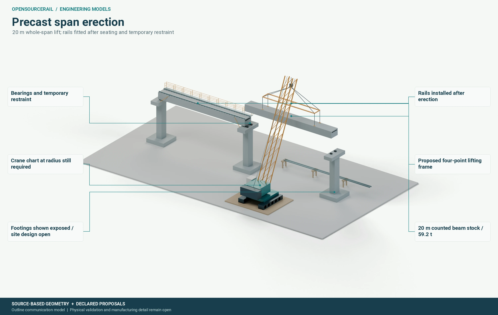

# Engineering tools and evidence

The open engineering platform is meant to keep a railway decision coherent
as it passes from city planning to geometry, structural analysis, inventory,
cost, manufacture and maintenance. Its value lies in the connections. If a
station moves, the dependent service and cost results should update; an
unchanged vehicle model should remain available. If a carbody changes, mass,
clearance, braking, civil load and factory quantities must be reconsidered.

## A design has more than one kind of identity

The physical candidate describes the geometry, material, components and
interfaces of the proposed railway. A numerical evaluation describes the
model, assumptions, loads, tool and conditions used to test it. A selection
records which candidate is preferred for a stated purpose and why. Keeping
these separate prevents a new calculation from pretending to be a new train,
and prevents an old result from being attached to a changed design.

The tools keep both successful and failed evaluations. A body that does not
meet an applicable screen can still teach the team about a load path. A
nonconverged numerical solve may reveal a modelling problem. An interrupted
run should not disappear, because its partial evidence and resource use can
guide the next experiment. Reuse is valuable only when the relevant source,
candidate, model, load and tool conditions still match.

## Models at several levels

Early design uses geometry and analytic checks to discard clear definition
failures cheaply. More promising candidates can progress to coarse numerical
models, then refined and coupled studies. SolidCraft is being used for
candidate geometry and assembly work; FieldCraft for matched mechanics
studies. Independent FreeCAD and CalculiX routes provide useful comparisons
where their methods apply. RustGIS carries native city edits in the tested
domain. A tool's name does not establish that it can represent every joint,
material law, electromagnetic transient or railway operating condition.

*A model helps make interfaces visible. The real lift still requires the
chosen beam, crane chart, ground, rigging and temporary-works design.*

CAD is particularly useful when a part must fit another part or be removed
from an installed assembly. FEA can test a declared load path and compare
mesh and solver sensitivity. GIS can bring a station edit back into the
costed corridor. None of these operations automatically proves manufacture,
structural safety or route approval. Each output must state what was
represented and what remained outside its model.

## A readable result

The Workbench should make the relationship visible to a planner, engineer or
reviewer. One project view should show the corridor edit, chosen vehicle,
civil option, quantities, costs, drawings and unresolved findings together.
The reader should be able to tell whether a result is a proposal, a checked
calculation, a verified software workflow or an accepted physical result. A
held or stale result is still useful history, but it must be clearly marked
and kept out of the supported decision path until renewed.
