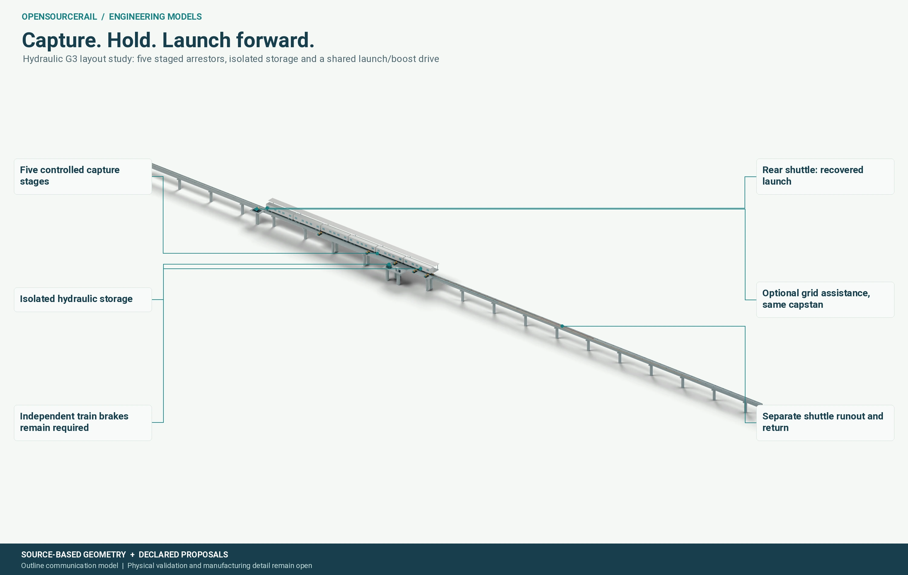

# Stations and the streets around them

A station is a connection between the railway and the city, not simply a
point on a line. Its success depends on whether a person can find it, reach
it safely, enter without unnecessary effort, wait comfortably and transfer
to the next part of the journey. The arrangement must also give staff safe
access to the railway, its power equipment and its structure.

## The journey begins outside the platform

An elevated line can save street space, but height creates access work.
Entrances, lifts, stairs, ramps where feasible, wayfinding and emergency
routes have to connect both sides of any road barrier. A station placed a
short distance from a market may still be a poor choice if the legal and
accessible walking route takes a long detour. Heat, shade, lighting,
drainage, crossing safety and the availability of local transport belong in
the station brief from the start.

Platform length must follow the selected train and its stopping tolerance.
The current reference formation is roughly 104.5 metres long under the
proposed inter-car gap assumption; a 120-metre platform is the planning
control used in the Samawah comparison. That allowance cannot be treated
as a complete platform design. End clearances, doors, accessible boarding
positions, sightlines, egress, structures and future operating choices must
still be resolved. Changing the formation after setting the station layout
would change much more than a vehicle drawing.

*The concept shows a connection between rail and street. It does not settle
the site's land, access, fire or structural design.*

## A stop and a station complex are not the same thing

City source data may contain several markers for what people understand as
one destination. In Samawah, two markers were found about 80 metres apart,
closer than the platform planning assumption. Their merger reduces the
raw marker count from 26 to 25 while the operational station-complex count
remains 25. That distinction matters: the data cleanup can be useful even
when a model says that the number of built stations is unchanged.

The midpoint of two markers is a comparison device, not automatically the
best entrance location. One side may have better walking access; the other
may have poorer ground or a utility corridor. A real station choice requires
an accessible-catchment study, land and ground checks, utility information,
public-realm design and engagement with people who will use it. The
calculated capital and travel-time changes in the Samawah chapter help
frame that inquiry; they cannot decide it alone.

## The station as a maintained asset

Platforms, lifts, lighting, fire systems, drains, signs, communications and
power cabinets need inspection and replacement space. A design that can be
built only by closing a major street for months, or maintained only by
blocking both tracks, may cost more over its life than a slightly larger
initial structure. Access for cleaning, repair vehicles, emergency services
and safe isolation should be tested before the layout is fixed.

A station proposal can move through increasing levels of evidence. First
comes the city outline and the passenger purpose. Then come surveyed
geometry, access routes, ground and utilities, a matched train and service,
and a civil concept. Detailed fire, egress, structural, electrical and
operational reviews follow. The Workbench's value is to retain those links
and show what a station edit changes, while displaying missing evidence
plainly. It should never make an unsurveyed map look like an approved site.
