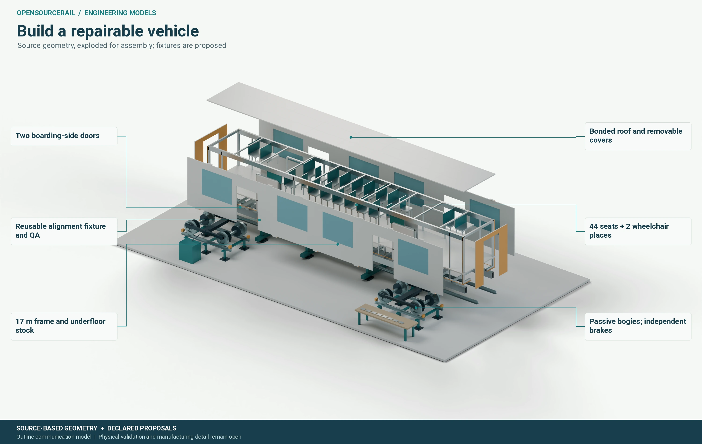
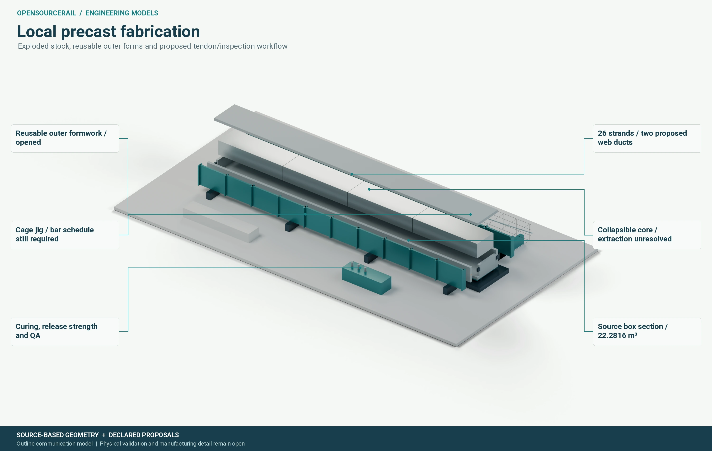

# From factory to finished corridor

An affordable railway is partly a construction problem. A design that uses
little material can still be expensive if it demands scarce equipment,
specialized long-distance shipments, repeated traffic closures or difficult
site adjustment. OpenSourceRail aims to make vehicles, stations and civil
parts that local teams can produce, inspect, install and eventually repair.
That objective has to be tested against the actual site and available
workshops, not inferred from the apparent simplicity of a drawing.

## Decide what is made locally

Local manufacture begins with a useful division of work. Some parts may
be cut, welded, machined or cast in regional facilities. Others are better
purchased as qualified standard items. Safety-relevant bought parts may
need supplier testing, traceability and incoming inspection even when they
look routine. A train bill of materials must carry these choices for every
physical item, including joints, fasteners, seals, wiring, cooling and
protective equipment. Omitting the small parts makes both local-content
and cost estimates misleading.

The project has a detailed vehicle inventory and proposed process routes.
It identifies the door operator as a particularly useful representative
module: local fabrication, standard purchase, qualified purchase, electrical
integration and future replacement all meet in a compact assembly. The
counts are a starting map for work packages. Before manufacture, workshops
need released drawings, mating dimensions, material and process
specifications, inspection points and a way to record deviations. The
fabrication sequence must match the actual vehicle structure, including
distortion control, corrosion protection and safe lifting.

*A shop can make and repair substantial portions of the railway, once the
design and quality process are proved for its equipment and staff.*

## Precast work changes the site problem

The civil studies explore repeatable precast guideway components. Casting
off site offers controlled dimensions and inspections while potentially
reducing work above a busy road. But the finished element still has to be
transported, lifted, supported, connected and maintained. Its production
size should follow road access, factory moulds, lifting points, transport
constraints and the crane that can reach the installation position.

*A repeatable span is only one part of a complete support and erection
system.*

For a representative span, the construction method should state the
temporary support, lifting gear, crane radius and capacity at that radius,
traffic or railway closures, bearing installation, post-tensioning or other
connections, survey adjustment and safe release of the lifting gear.
The span also needs a load path through piers and foundations for normal,
crowd, wind, accident and construction conditions. A finite-element result
for the finished beam cannot establish the stability of a half-built span.

## Delivery is a sequence of approvals and handoffs

The city's outline comes first, followed by survey, geotechnical work,
land and utility decisions, a matched service and vehicle candidate, and
construction staging. Procurement should identify long-lead items and
alternative suppliers while preserving the approved technical interfaces.
Factory tests, site inspection, commissioning and staff training then
establish whether the built system matches the design. Passenger service
requires its own independent safety and operational approvals.

The platform's project and business tools can help keep these handoffs
together. A proposed bill of materials can become a production plan, a
received component can be inspected, and a fitted module can enter a
maintenance record. Existing demonstrations show parts of that digital
route, including a synthetic business-system example. The full candidate
linked transaction for a real door module remains to be completed. The
software should make omissions and conflicting revisions visible before
someone orders, builds or fits the wrong part.

## Repairability affects the first drawing

A replaceable unit needs reachable fixings, a safe isolation procedure,
clearance to remove it, lifting provisions if it is heavy, and enough
space to inspect its neighbours. These are geometric facts, not afterthoughts
for a manual. A door guide that cannot be extracted through the available
opening may force a larger body change. A power cabinet that blocks a
crane route may change a station layout. Testing repair sequences early
can reduce future service disruption and can inform the cost comparison
before a design is selected.
