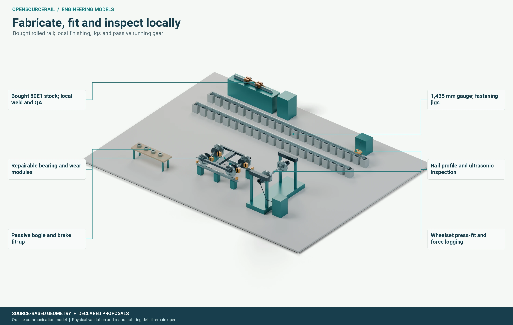

# Inside the vehicle

Passengers see a floor, seats, windows and doors. Beneath those surfaces is
an arrangement that must carry people safely and let maintainers reach the
equipment. The body, bogies, batteries, ventilation, wiring, couplers and
interior are one installed vehicle. Their combined geometry and mass decide
what the track and structures experience, how the train stops and how easily
it can be repaired.

## The body is a load path with openings

A railway car must transfer vertical, longitudinal and lateral forces among
floor, sides, roof, bogie connections and couplers. Doors and windows remove
material from the sides just where a simple continuous beam model might
expect it. The remaining structure may need frames, skins, joints and local
reinforcement. Seats and equipment also impose attachment loads, while
thermal movement and fatigue test the joints over time.

OpenSourceRail explores different structural grammars and materials rather
than fixing every member before analysis. A braced frame, a bonded shell
and a rigid jointed body cannot be judged by exactly the same simplified
mechanism test. Their manufacturing routes also differ. A lighter panel
may need more costly curing or a more demanding repair process; a familiar
metal route may be easier to inspect and source locally. The appropriate
comparison includes installed stock, joining, fire response, fatigue,
corrosion and replacement, not a single material's strength-to-weight ratio.

## The bogie carries more than weight

For the reference six-car train, twelve passive bogies and 24 wheelsets
support the formation. They guide the wheels along the rail, transmit
braking and lateral forces, and isolate the body from track irregularities.
Bearings, springs, dampers, brake components, sensors and safety restraints
need their own mounting and access. Wheel profile and rail contact affect
wear, noise and adhesion. A body that fits over a bogie in a static drawing
may still foul it on a curve, during suspension movement or when a wheel
is worn.

*An engineering model of the running interface. Dynamic clearance, wear,
braking and maintenance need their own checks.*

An alternative powered-wheel bogie may simplify station-side propulsion
while adding motors, gearing, converters, cooling and protection beneath
each car. That changes unsprung or sprung mass, clearances, energy, braking
and workshop tasks. The passive reference and the powered alternative
should therefore have separate, complete vehicle and service results.

## Space is an engineering resource

Seats, wheelchair places and circulation compete with equipment cupboards,
ducts, structural members and emergency routes. The same underfloor region
may be proposed for batteries, cables and removal access. A large unit
that fits in its installed position may still be impossible to take out
without removing a bogie or blocking the platform. A useful three-dimensional
model shows both the operating envelope and the maintenance envelope.

The current parts proposal names 605 leaf-part types in 40 assemblies and
over 110,000 expanded pieces across a formation. These counts expose the
many connections behind a simple visual concept. They are not a released
manufacturing bill: some masses are allowances, some fit positions remain
generic and some supplier internals are not fully counted. A complete
installed mass must reconcile the physical item, its quantity, location,
fixings, protection and replacement route. The low, base and high stock
allowances are useful for sensitivity, but the selected vehicle must be
weighed and checked at the relevant build stages.

## The interior deserves its own tests

An accessible passenger place is more than a marked rectangle. Boarding
gap and step, turning area, securement, handholds, reach, emergency egress,
lighting and communication all matter. The one-sided two-door arrangement
must suit the chosen platform side and station layout. A crowded structural
test does not set the normal seating policy, but it does remind the team to
consider misuse, unusual loads and evacuation. Passenger feedback and
physical mock-ups can reveal problems that a detailed CAD model misses.
