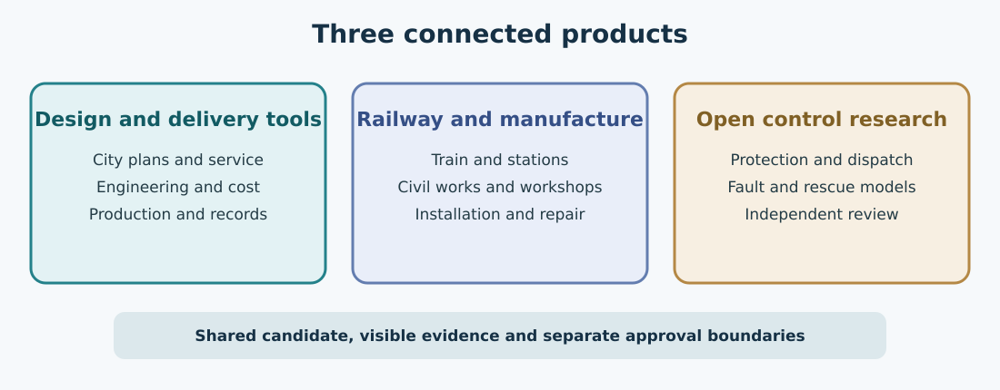

# Three connected products

OpenSourceRail is easier to understand when its three products are seen
together. One is a set of open tools for planning and delivering a railway.
The second is a proposed train, civil structure and local manufacturing
system. The third is research into open train control. Each has a different
level of maturity. The published software can support a useful planning
conversation today, while a passenger railway still needs site evidence,
hardware, tests and the approvals of the people responsible for operating it.

*The products exchange design and evidence. Their software and physical
approval boundaries remain separate.*

## Design and delivery tools

The software begins with a city and a transport question. A planner can
inspect mapped corridors, stops, street context and assumptions; compare
service patterns; and calculate outline fleet, energy, civil quantities and
costs. The Workbench brings these records into one view and shows the source
of a result and any hold that limits it. An engineering team can move from
that proposal into a vehicle, propulsion and structure candidate, then
develop parts, factory work and delivery drafts against the same design.

The important feature is continuity. A route edit should change the service
and cost accounts that depend on it. It should not cause the body of an
unchanged train to become a different vehicle, or let a cost from one drive
architecture appear under another. In the released v0.6.1 software, the
Samawah city journey demonstrates a fresh calculation, a repeated unchanged
request and a changed-demand request. In v0.7 development, the Samawah
station comparison carries a specific stop edit through service, costs and
a revised dossier. Both demonstrate software behavior within their own
declared limits, not a surveyed construction design.

## Railway and manufacturing system

The physical reference is a six-car, wheel-supported train on conventional
rails carried by concrete. The preference for relatively simple cars,
repeatable civil parts and local repair is a design hypothesis to be tested
against cost and passenger service. The project retains competing research
architectures, including powered wheels and station energy recovery. Every
physical option needs its own installed mass, force, braking, civil, factory
and whole-life comparison. No attractive component study by itself selects
the whole railway.

The manufacturing product extends beyond a train drawing. It includes
material and supplier choices, tooling, inspection, assembly sequence,
transport, construction staging, access for replacement and records of what
was actually built. Local content is genuine domestic work and value added,
with imported materials and specialist components named honestly. A local
workshop can make a useful part only when the drawings, process, tests and
quality responsibilities match its equipment and skills. The current
catalogues and draft packages show much of this structure; controlled
production and physical qualification remain open.

## Open controls and supervision

The control research studies how a train receives movement authority, how
routes are protected, and how dispatch, doors, braking and faults interact.
Rust software makes some state and refusal behavior testable and reviewable.
These are research and simulation results. They are not a commissioned
automatic train-control system or permission to run a passenger service.

Equipment observation is a separate function. The optional FUXA and
gateway integrations can represent alarms, trends and maintenance events
for a configured deployment. Observing a cabinet temperature or logging a
door fault must not be confused with commanding a train. A real installation
would need authenticated equipment bindings, tested communications,
operating procedures and independent safety review.

## Why the products meet

A city's choice of stations and headway changes fleet and power demand. The
chosen train changes platform dimensions, structure loads, parts and repair
work. A component's inspection result can alter the maintenance plan and
possibly the service. The three products are connected so those consequences
can be seen together, yet each approval boundary remains explicit. A good
software result makes the next physical question clearer. It never makes
that question disappear.
