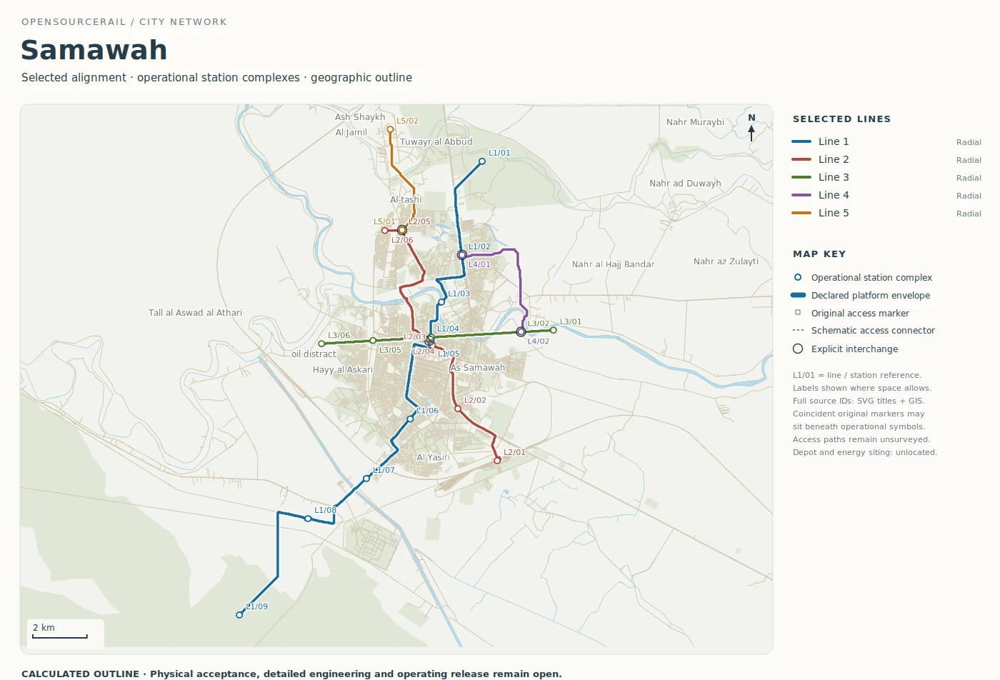
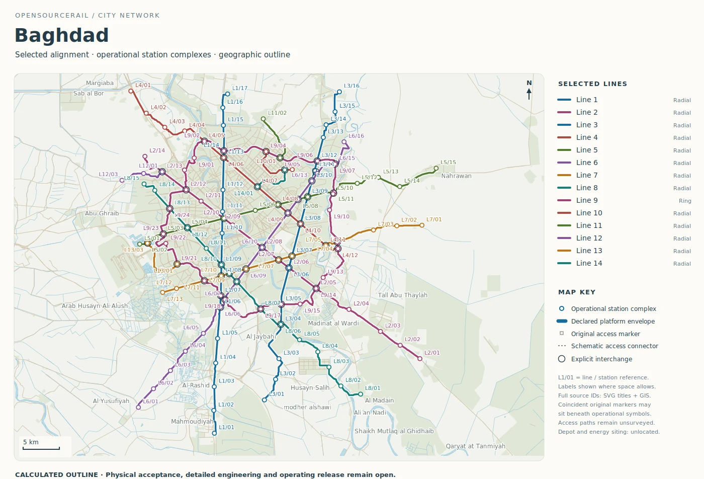

# Samawah and Baghdad: two scales of inquiry

Samawah and Baghdad are the clearest pair for understanding how the same
platform can serve different questions. The Samawah outline is small enough
to follow a single station revision through the entire city study. Baghdad
tests a much larger network, with more transfers, competing route choices
and greater pressure to keep each line's assumptions distinct.

## Samawah: resolve one local decision

The retained Samawah map has five lines over about 57.87 route kilometres,
with 25 operational platform groups and four explicit interchange
references. Its 81 six-car trainsets include modelled reserves. The longest
line is about 26.6 kilometres, crossing the study area from northeast to
southwest; shorter routes connect other directions and bring the lines into
one planned transfer group. These are calculated outline quantities. The
map does not tell us that every station entrance or transfer path is
accessible on the ground.

*Calculated Samawah route outline. Alignment and access are unsurveyed;
this is a comparison map, not a construction design.*

Two raw markers on the selected line sit about 80 metres apart, closer than
the 120-metre platform planning assumption. The v0.7 comparison merges
them at a midpoint. It reduces raw markers from 26 to 25, but the earlier
study already treated the pair as one operational station complex, so the
operational count remains 25. The route and modelled fleet also remain the
same. A reader can therefore see an important distinction: cleaning a
source map may be necessary even when a headline count does not change.

The comparison's small capital decrease and larger whole-life increase
show why first cost is only one part of the decision. Energy and access
allowances respond to the changed stop hypothesis. A city should now
test the actual pedestrian catchment, road crossings, land, utilities,
platform fit and station entrance before preferring the midpoint to either
original location. The software can make those alternatives traceable;
people in Samawah must establish which place works.

## Baghdad: keep a large network intelligible

The Baghdad catalogue outline is about 494.43 route kilometres over 14
lines, with 157 operational platform groups and 45 explicit interchange
references. Its modelled fleet including reserve is 533 six-car trainsets.
One ring is about 96.79 kilometres long, while several cross-city lines
reach beyond the central cluster. The map makes the transfer problem
visible: the apparent density of coloured routes is useful only if
passengers can make practical, accessible connections and if the service
pattern supports them.

*Calculated Baghdad route outline. Alignment and access are unsurveyed;
the interchange symbols do not approve station construction.*

The size of the Baghdad proposal multiplies uncertainty. A model can
calculate line times, fleet and cost for its declared network, but a city
decision would need observed travel patterns, river and bridge options,
ground and utility information, station access, road impacts and land
rights. A long ring deserves its own demand case: it may relieve journeys
that would otherwise cross the centre, or it may be a costly route with
few useful transfers. The outline alone cannot settle that choice.

In the published v0.6.1 software, Baghdad is a retained, read-only atlas
comparison. It should not be described as a fresh Baghdad calculation
from that release. Later development has exercised a native map-edit and
reprice cycle on a Baghdad line, but that is still digital workflow
evidence, not a surveyed alignment. The city's source-bound maps and
calculations remain valuable because they expose exactly which next
local investigation would make the planning result more credible.

For a city team, a workable Baghdad pilot would begin by naming one
passenger corridor and its alternatives. The selected study would need
measured trips, terminal and interchange opportunities, a chosen train
formation and a station pattern. Only then would it make sense to compare
construction quantities and fleet requirements under equal service. A
cost from the larger outline cannot be divided by kilometres and called
the price of that pilot: a short stage may carry depot, power or factory
costs that the network total spreads across many lines.

## What the pair teaches

Samawah rewards a detailed before-and-after examination of one stop. Baghdad
tests whether the same discipline survives a larger network. Both need
the same kinds of evidence before building: local demand, access, survey,
ground, utilities, a selected train and protected service. The number of
lines does not change the standard of proof. It changes how carefully
the study must track which part of the network a revision actually affects.

It also changes the conversation with the public. In Samawah, residents
could compare walking routes to three nearby station positions. In
Baghdad, several districts may be affected by a line choice, a transfer
or a proposed ring. A clear map can bring those choices into view, but
the people who would use the railway must help decide what counts as
a useful and accessible journey.
