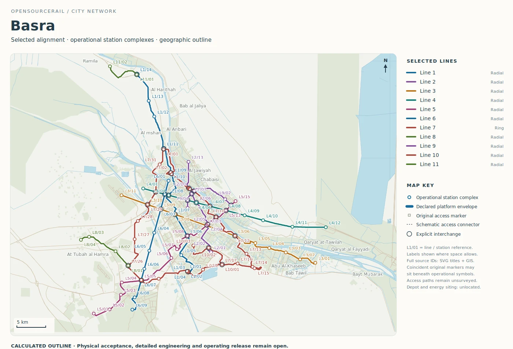
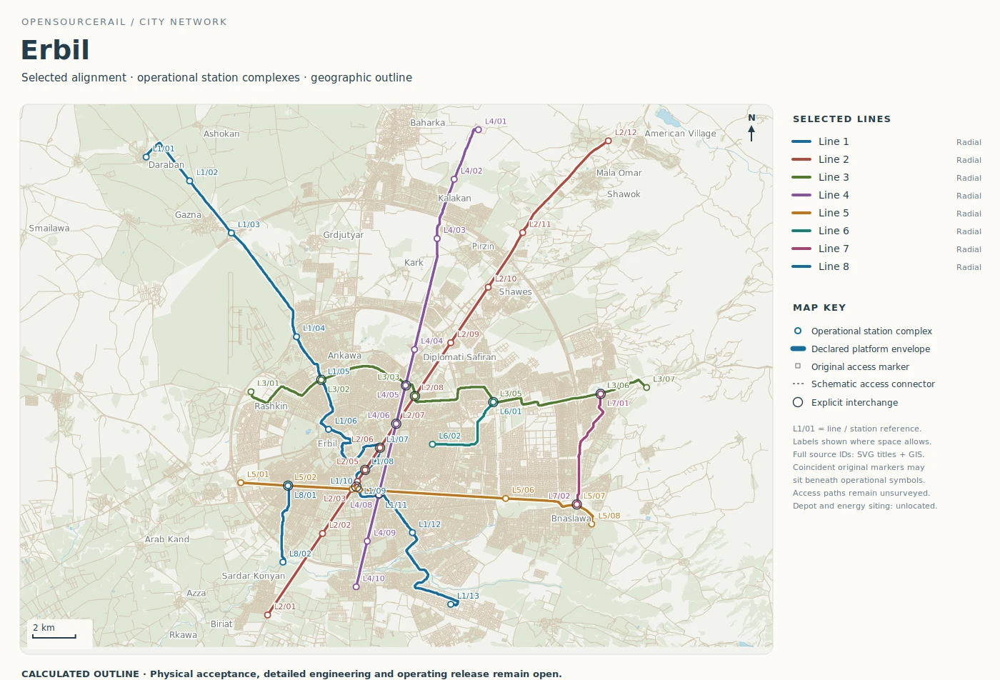

# Basra and Erbil: different network shapes

Basra and Erbil show why a standard train does not imply a standard city
railway. Their retained outlines use the same broad planning vocabulary,
yet the proposals differ in length, number of lines, transfer structure
and the physical questions likely to dominate the next study. A useful
comparison reads the map and the service assumptions together without
claiming either city has chosen this system.

## Basra: a long network with an orbital question

The Basra catalogue maps eleven lines over about 341.45 route kilometres.
It groups stops into 120 operational platform locations and records 26
explicit interchange references. The modelled fleet is 369 six-car
trainsets including reserve. The longest line is a ring of about 94.55
kilometres with 31 platform groups. The ring is visually prominent, but
its value depends on real journeys: whether it connects districts people
travel between, shortens transfers, or simply offers a long circumferential
route under a generic demand brief.

*Calculated Basra route outline. Route, access and ground are unsurveyed;
the map is not an approved construction alignment.*

Basra's map invites a closer look at the relationship between routes and
water, built districts and major transport corridors. A coloured crossing
is a planning line, not a bridge design or a confirmation that a suitable
right of way exists. A local study would need ground and flood evidence,
utility records, crossing and drainage concepts, station frontage and the
actual walking network. These facts can change the alignment, civil form,
erection method and cost much more than an early vehicle price change.

The ring also asks an operating question. A long line takes time to
complete a circuit; fleet size depends on that time and the proposed
headway. If local demand is concentrated on a few radial journeys, a
shorter staged build could serve people sooner. If many trips are
cross-town, the ring may have a different case. The model helps calculate
each scenario once the city supplies a credible demand and interchange
brief; it cannot infer those journeys from a population total.

Construction staging is similarly specific. A useful first route might
avoid the most difficult crossing, or it might need that crossing to reach
the passengers it is meant to serve. The choice should include temporary
traffic arrangements, transport of precast components, access for cranes
and future maintenance. A map can show the crossing location; the cost
and practicality come from a surveyed construction method.

## Erbil: shorter network, close transfer decisions

Erbil's outline is about 145.24 route kilometres across eight lines,
with 56 operational platform groups and twelve explicit interchange
references. Its modelled reserve-inclusive fleet is 168 trainsets. Unlike
Basra's long ring, the longest listed Erbil line is a roughly 38.02-kilometre
cross-city route. This gives a different planning emphasis: where the
crossing lines meet, which station entrances can work together, and how
much local coverage the smaller set of platform groups offers.

*Calculated Erbil route outline. Stations and access are unsurveyed;
the map does not establish buildable platforms or transfers.*

The dossier records the mapped network and its modelled service, but the
actual transfer quality still depends on platform arrangement, level
changes, safe pedestrian crossings, accessible circulation and the
surrounding street. A line drawn across difficult ground may require a
different civil section or station approach. Such choices belong to a
surveyed corridor study, not a generic per-kilometre allowance.

Erbil also illustrates why a city should distinguish total network size
from the first useful project. A smaller integrated corridor can test
real demand, walking access and local construction capability. Its train,
station and guideway candidate could then be extended if the evidence
supports it. The platform's catalogue is a menu of questions for that
staging conversation, not a mandate to build every coloured line at once.

The station study should also ask what a transfer feels like. A short
map distance between lines can hide a long climb, a road crossing or a
platform change without step-free access. Those details alter the
passenger benefit and may require a larger station than the planning
allowance. A corridor comparison should include the entrance and
interchange arrangement, not just the line centreline.

## A shared next step

Both cities need local origin–destination evidence, surveyed alignments,
ground and utility information, accessible station concepts and a selected
service. Their published diagrams are calculated planning outlines under
declared assumptions. Comparing them is useful precisely because it
shows that the same engineering method must remain sensitive to different
city forms rather than force every place into one layout.
