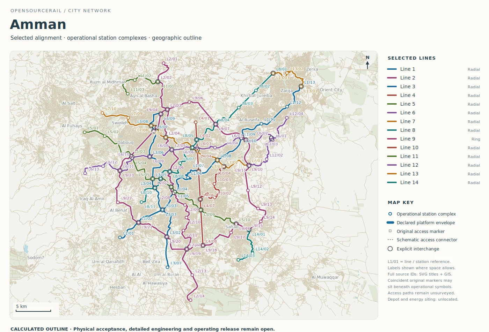
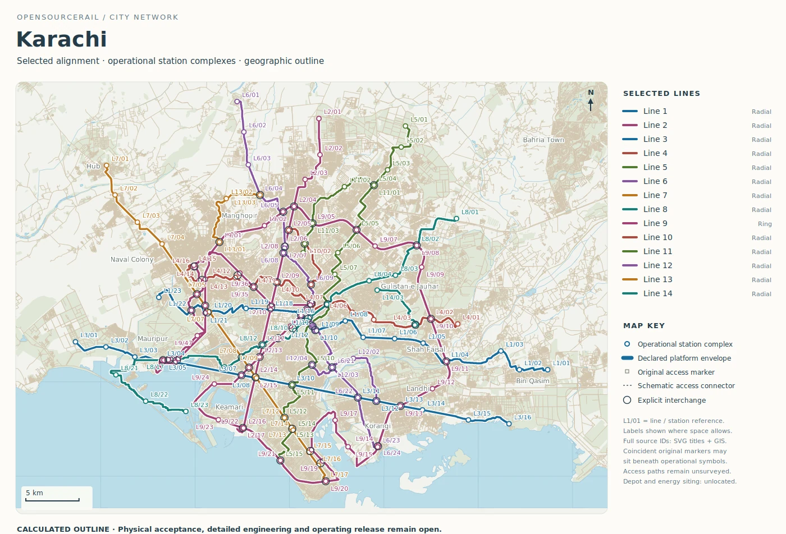

# Amman and Karachi: scale and geography

Amman and Karachi occupy very different physical and urban settings, yet
their catalogue outlines can be read with the same questions: which trips
are served, how the lines connect, what a station needs from its street,
and which geographic obstacles could change the engineering. The mapped
figures are intentionally provisional. They can expose a design decision
before a city commits money to detailed investigation.

## Amman: a network through a demanding landscape

The Amman outline records fourteen lines and about 412.73 route kilometres,
with 128 operational platform groups and 39 explicit interchange
references. Its modelled fleet including reserve is 469 six-car trainsets.
One ring is about 82.33 kilometres long and crosses the network at several
points. The map helps a reader see possible connections between radial and
orbital journeys. It does not show that every drawn route can meet railway
grade, curve, station and construction requirements in Amman's actual
landscape.

*Calculated Amman route outline. Grades, access and ground are unsurveyed;
this is not a construction route or station plan.*

For a hilly corridor, the vertical profile may matter as much as the plan
view. A proposed station could be close in map distance to homes but far
away by an accessible walking route. A guideway might need long approaches,
retaining structures, difficult foundations or a different arrangement at
an interchange. The candidate vehicle's acceleration, braking and recovery
also depend on grade. These questions should be tested on the same surveyed
alignment rather than answered separately by a flat-map cost and a generic
journey model.

The ring invites an equal-service comparison. A different pattern of
transfers or a shorter set of lines might offer similar useful journeys
with less guideway, or it might leave important cross-town trips unserved.
The city needs observed travel demand, walking and feeder connections to
decide. The outline gives a structured starting point for comparing those
options.

The selected vehicle matters to that comparison. On a steep or closely
stopped route, a propulsion concept that performs well on level ground
may need a different powered length, supply or recovery plan. Independent
braking must be shown for the actual gradients. A price estimate based on
one vehicle and a journey time based on another would make the ring look
more credible than either complete candidate permits.

## Karachi: a much larger transfer problem

Karachi's retained map has fourteen lines over about 551.34 route
kilometres. It lists 221 operational platform groups and 58 explicit
interchange references, with 618 modelled trainsets including reserve.
The longest line is a ring of about 143.62 kilometres with 52 platform
groups. Those are large planning quantities. They are not a procurement
programme, and the population context in the dossier is not a measured
rail demand forecast.

*Calculated Karachi route outline. Route, station access and capacity
remain unsurveyed and unapproved; the map supports comparison only.*

The density of route and station marks raises questions that a simple
network total hides. Which interchanges would actually allow short,
accessible transfers? Where would a station fit without cutting off a
busy street or market? What are the effects of a long ring on journey
time, fleet and maintenance? Could a staged corridor meet a defined
transport need before the whole mapped network is studied in detail?

Climate, drainage, land and utility records also affect the design.
Assuming one civil cost per kilometre would conceal places where a
foundation, crossing or terminal is much harder than a typical span.
Similarly, applying one peak demand brief to every line cannot describe
different times and directions of travel. The platform can compare
candidate service packages, but Karachi's local travel and site evidence
must set the brief.

At this scale, the order of building becomes a service decision. A
partially built network may have few useful transfers even when its final
map has many. The city would need to test each stage as a stand-alone
travel offer: where people board, how often trains arrive, which depot
and power facilities are required, and what remains to be built later.
Such staging can avoid presenting the cost of an unfinished but
unusable network as an affordable first step.

## What the comparison is for

Amman stresses three-dimensional alignment and access; Karachi stresses
network scale and interchange practicality. Both challenge the idea that
a catalogue figure is a finished city design. A meaningful next project
would select one corridor in each city, validate its passengers and site,
then carry the same candidate through train, structure, power, station,
construction and whole-life cost. The map tells a reader where to begin
that work, while its missing facts remain visible.
