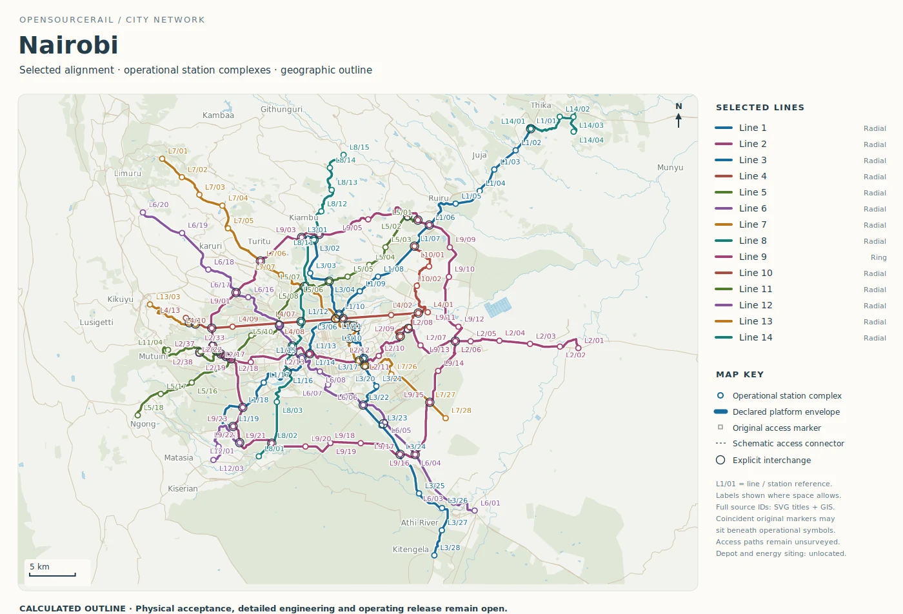
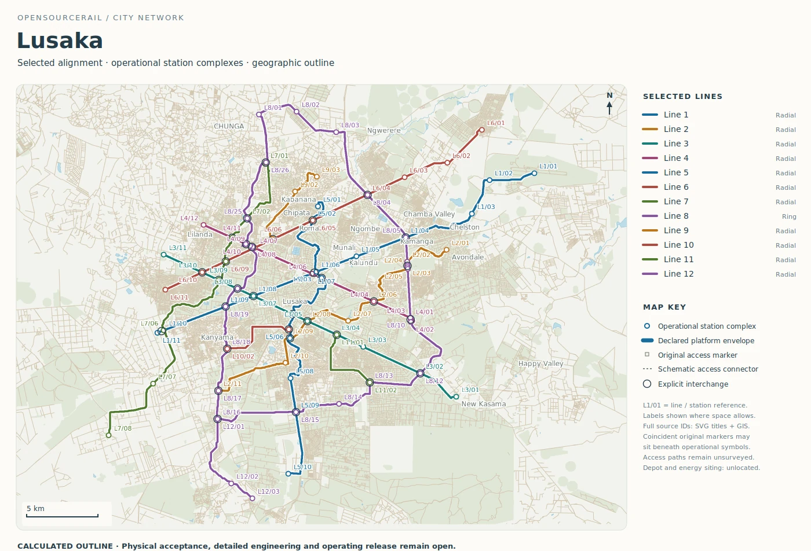

# Nairobi and Lusaka: service across a wider city

Nairobi and Lusaka show how a route drawing can prompt different questions
about reach, frequency and transfer. Both maps extend beyond one central
district. Their line lengths and fleet totals are calculated from a common
planning method, so the numbers are useful for examining consequences.
They do not prove the corridors will attract the assumed passengers or
fit every road, river and neighbourhood they cross.

## Nairobi: many destinations, many transfers

The Nairobi catalogue outline covers about 578.33 route kilometres across
fourteen lines. It has 243 operational platform groups and 51 explicit
interchange references. The modelled fleet including reserve is 655
six-car trainsets. One ring is roughly 107.86 kilometres with 44 platform
groups, while long radial and cross-city routes reach many parts of the
study area. The resulting map is a rich hypothesis about connectivity,
not a verified construction programme.

*Calculated Nairobi route outline. Alignment, access and interchange
quality are unsurveyed; no route shown is a construction design.*

The high count of platform groups makes station access especially
important. A passenger wants to know whether a stop is reachable on a
safe, direct walking route, whether a transfer can be made without a long
detour, and whether the offered frequency matches when they travel. A
symbol at a road junction does not answer any of those questions. Local
origin–destination data, pedestrian networks, feeder services and
accessibility review are needed before a station pattern can be selected.

At the engineering level, a long network crosses different ground and
street conditions. Repeating one span or station price everywhere is a
starting approximation; bridge sites, utilities, construction traffic and
depot access must be surveyed. The modelled fleet is sensitive to round-trip
time and headway. If a line is shortened, joined or given a different
stopping pattern, its train requirement and passenger usefulness should
be recalculated together.

Nairobi also highlights how a ring and radial lines should meet in time,
not only on a map. A passenger who waits a long time for the second leg
may receive little benefit from a geometrically short interchange. A
study of a first corridor should therefore include transfer time and
reliability, crowding at the connection, and a practical response when
one line is disrupted. These are service choices that can change the
value of an expensive station.

## Lusaka: a smaller outline with an orbital link

Lusaka's retained proposal has twelve lines and about 293.18 route
kilometres. It identifies 110 operational platform groups and 32 explicit
interchange references, with a modelled fleet of 340 six-car trainsets
including reserve. A ring of about 74.93 kilometres gives the proposal
an orbital component, while shorter lines connect to it and across the
mapped area. It is a different scale of study from Nairobi, even though
the same kind of passenger and civil questions apply.

*Calculated Lusaka route outline. Alignment and station access are
unsurveyed; this drawing does not approve a civil or operating plan.*

The map can help the city ask whether an orbital journey should be served
by one continuous ring, by transfers between shorter lines, or by another
transport mode at an early stage. Each option changes waiting time,
reliability, fleet and construction scope. The answer depends on where
people actually travel, not on how symmetrical a network appears on the
page.

A first corridor could also be a test of local production and maintenance.
Which structures can be made with available workshops? How would spans be
transported and lifted? Where could a depot and power equipment be
maintained without disrupting surrounding streets? The catalogue's
costs and schedules are planning scenarios; local suppliers, ground and
workforce evidence are needed to turn them into a delivery decision.

The orbital choice can be tested with several passenger stories. A
journey between two outer districts may be shorter on the ring; a trip
from an outer district to the centre may not use it at all. A rider
with limited mobility may prefer a slightly longer in-train journey to
a difficult transfer. Those examples should be checked against observed
travel rather than inferred from the circular shape alone.

## Read the shared assumptions openly

The Nairobi and Lusaka dossiers use declared demand, occupancy, availability
and service-span assumptions. They are not local travel surveys or approved
rosters. Their value is that a reader can see what follows when those
assumptions are held consistent across a map. A city can then replace
them with better observations and see whether the preferred routes,
stations and train fleet change. That is how a broad catalogue becomes a
useful local conversation rather than a claim that hundreds of cities
already have finished railways.
