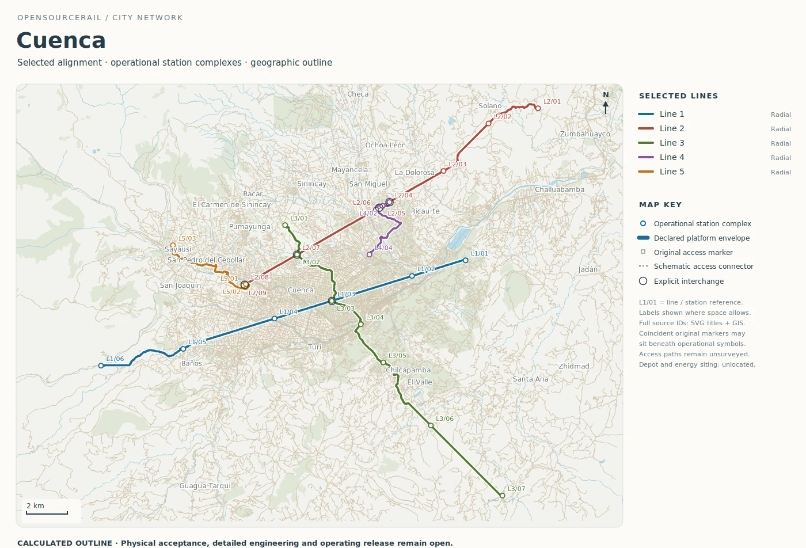
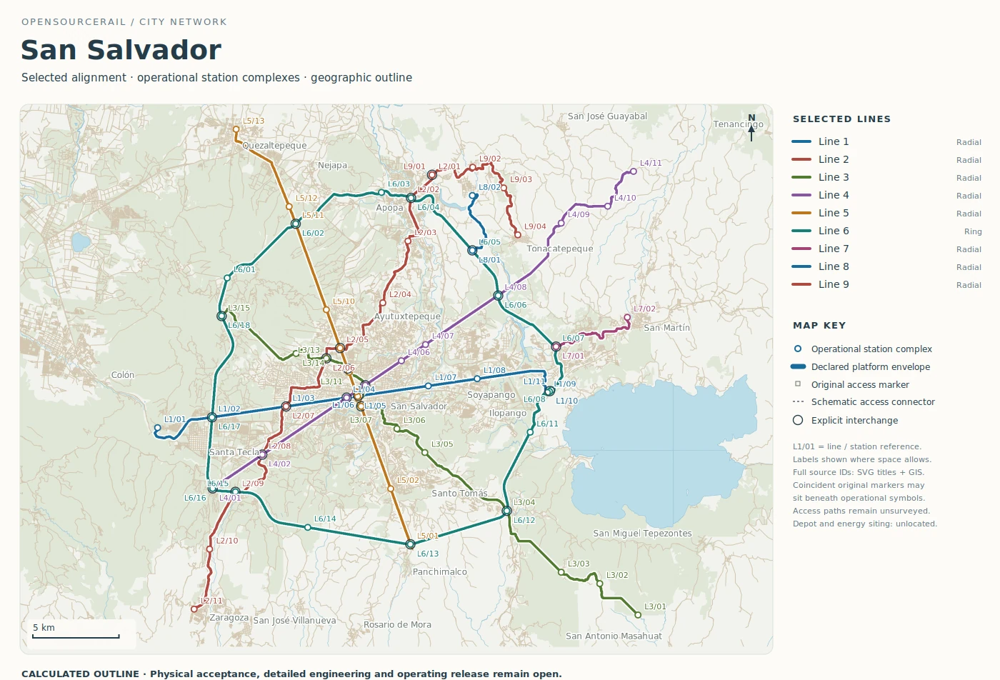

# Cuenca and San Salvador: choosing the first corridor

Cuenca and San Salvador are useful final examples because their mapped
networks differ sharply in scale. Cuenca's outline is a compact set of
five lines; San Salvador has a larger nine-line proposal and a long
orbital route. Neither city should begin by treating every coloured line
as a committed project. A first corridor ought to solve a clear passenger
problem and be testable against local land, access and construction facts.

## Cuenca: a compact, legible proposal

The Cuenca catalogue records five lines over about 74.15 route kilometres,
with 29 operational platform groups and five explicit interchange
references. Its modelled reserve-inclusive fleet is 105 six-car trainsets.
The longest line is about 21.92 kilometres, and several shorter routes
meet the main corridors. This size makes the network relatively easy to
read on one map, but the small number of interchanges also makes each
one important to the usefulness of the whole proposal.

*Calculated Cuenca route outline. Alignment, grade and accessible access
are unsurveyed; this is not a construction or operating design.*

Cuenca's map invites a closer look at terrain and the actual walking
routes to stations. A station can be near a destination in plan yet
require a difficult climb, crossing or level change. A surface feature
that seems minor at network scale can set the height, length and cost of
an elevated approach. The city would need surveyed vertical geometry,
land, utilities, drainage, accessible routes and passenger origins before
preferring one alignment or platform location.

Because the network is compact, a sensible first study might compare
two corridors with different station patterns while holding the passenger
objective constant. A more direct route could shorten trips but miss an
important destination; extra stops could improve access while lengthening
ride time and adding station work. The software can expose the fleet and
cost consequences of each option. It cannot decide which journey local
people value most without their evidence.

The compact scale also makes a physical prototype question easier to
frame. A representative station, span and vehicle module could be tested
against one selected alignment and a real site. That would reveal
whether the proposed interfaces can be built and maintained locally.
It would still be one corridor's evidence, not a shortcut to approving
every other line in the mapped city network.

## San Salvador: a larger pattern to stage

San Salvador's retained outline has nine lines and about 271.61 route
kilometres. It groups stops into 87 operational platform locations and
records 22 explicit interchange references. The modelled fleet including
reserve is 302 six-car trainsets. The longest line is an approximately
74.76-kilometre ring with 18 platform groups. The map shows several
cross-city connections as well as this orbital proposal.

*Calculated San Salvador route outline. Route and station access are
unsurveyed; the diagram is not an approved construction programme.*

For a first project, the most useful question may be whether a selected
line or interchange can demonstrate a strong travel benefit and a
buildable site. A complete ring can appear attractive as a finished
network, but its capital, fleet and operating commitments are large.
An early stage might serve different trips at lower first cost, or it
might fail to deliver the connections that make the later ring worthwhile.
Demand by corridor and time of day, accessible transfers and a realistic
construction sequence are needed to compare those choices fairly.

The map also cannot resolve local ground, utility or road
interfaces. Those site questions belong in survey and civil design before
one candidate's whole-life price is presented as a city budget. A
modelled service can still be valuable now: it shows what each extra
station and kilometre asks of the fleet, energy and maintenance plan.

The same discipline applies to construction sequence. A line that looks
simple as a coloured path may need a depot, a power connection and
workshop arrangements before its first passenger can ride. If those
common assets are assigned only to a later network stage, the early
stage's cost will be understated. Conversely, a shared facility should
not be charged repeatedly to every future corridor. The scope of each
stage must be explicit.

## From an atlas to one decision

Cuenca and San Salvador illustrate a common discipline. Start from the
passenger journey, then choose the smallest corridor study that can test
the most important uncertainty. Keep the planning map, survey, train,
service, structure and cost linked to that one revision. The catalogue
can broaden imagination and make quantities visible; it should not
substitute for the city's own evidence or approval.
