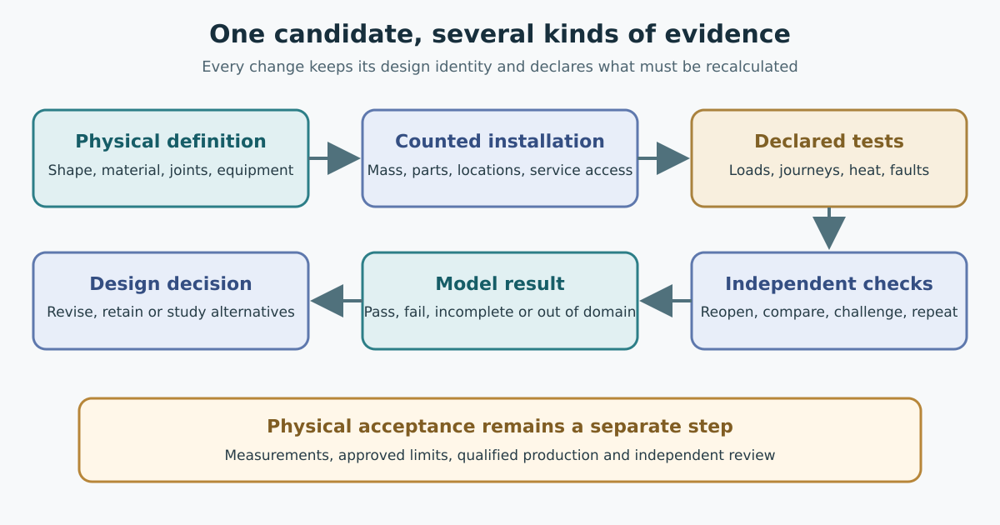

# A digital twin of one candidate

The phrase *digital twin* can suggest a complete virtual railway. Here it has
a more useful, narrower meaning: a connected description of one proposed
physical arrangement, with calculations and delivery records that refer back
to that arrangement. The value is not that every unanswered question has
been solved. It is that the unanswered questions are visible beside the
geometry, mass and service claims that depend on them.

OpenSourceRail has generated a research twin for a six-car passive-wheel
vehicle, five short wayside accelerator banks, and one directional journey
between two berths. Three body families were each tried at two berth
spacings, producing six digital research cases. The selected v0.6 development
reference remains a separate selection; generating this study does not
replace it. The test cell is neither an entire return line nor a city
network. It omits the depot, full station buildings, the complete fleet and
surveyed foundations.

*The diagram shows how a proposed change moves through the digital work.
Physical acceptance remains a separate step requiring measurements and
review.*

## Follow one choice through the system

Suppose a designer changes the body structure. The stock geometry changes,
then its counted material and mass may change. The changed mass affects axle
loads and the force demanded of propulsion and brakes. The guideway must
carry the new train, while the workshop may need different stock and joining
operations. Costs should respond to those same changed quantities. A
connected twin makes it possible to see that chain and to reject a record
that quietly borrows the earlier body's result.

In the research cell, each candidate can produce a geometric scene, located
and unlocated inventory, mass account, engineering and manufacturing bills
of material, proposed assembly and procurement records, motion demand,
fault and load calculations, civil quantities, construction prerequisites,
control interfaces and a list of physical tests still required. These are
different views of one proposal. A consistent set is useful because a
reader can ask whether the same train appears in the beam calculation, the
parts list and the cost outline.

The distinction between *located* and *unlocated* items is especially
important. A body frame may have explicit three-dimensional positions,
while equipment such as cooling, wiring or a supplier's internal parts may
still have only a quantity or allowance. The twin retains that difference.
It must not place an unknown item at the origin or give it zero mass merely
because a model needs a number. The account makes retained unknowns visible;
it cannot quantify full installed mass until missing equipment is defined.

## A journey demand is not an available journey

The cell can calculate the motion needed to travel 1.5 or 2 kilometres and
the forces that a proposed accelerator would have to supply. That does not
prove that an actual motor can provide those forces at the relevant speed,
air gap, temperature and electrical limit. The five modelled banks contain
a defined length of primary faces and counted stock, yet finished windings,
converters, feeders, cooling and protection remain open. An older motor
method with a different active length cannot be substituted as though the
hardware matched.

The same boundary applies to the arrival. A candidate may model independent
friction receiving and adverse grades, but a physical train still needs
validated braking, wheel-slide behaviour, recovery from a stop outside a
powered zone and passenger evacuation. A software journey can show a
requirements gap. It cannot turn that gap into a safe timetable.

## Test the digital package itself

The twin's verification has two layers. First, it checks that the files and
calculations agree with the declared candidate: dimensions, materials,
positions, volume, mass, bills, costs and downstream results. Second, it
tries to reject deliberate inconsistencies, such as a changed part hidden
inside an otherwise plausible package or a claim of acceptance without the
evidence required for it. This protects the digital record from accidental
mixing and easy tampering.

One two-kilometre case also produced native IFC and editable solid geometry,
then reopened the exported models independently. That checks whether the
geometric information survives a real interchange. The exported shape
contains only the stock that was actually located. Reopening a valid solid
does not prove that joints, clearances, fatigue, materials, installation or
cost are complete.

A useful twin therefore has an honest stopping point. It can be digitally
consistent while its physical completion check remains open. The next step
is to obtain the missing motor, body, brake, site, supplier and test evidence
and attach each result to the exact candidate and evaluation it supports.

The most useful public view of this work is a readable comparison: what was
changed, which conclusions moved, which conclusions were reused, and which
questions remain. A twin that can explain those four things helps a city,
manufacturer or reviewer take part in the design without treating a large
model as a mysterious authority.
