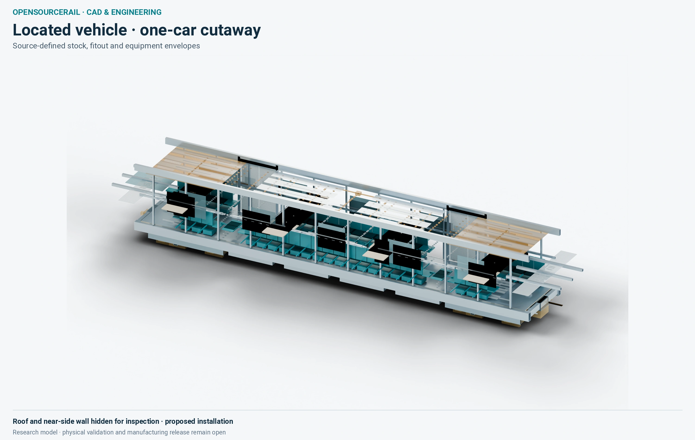
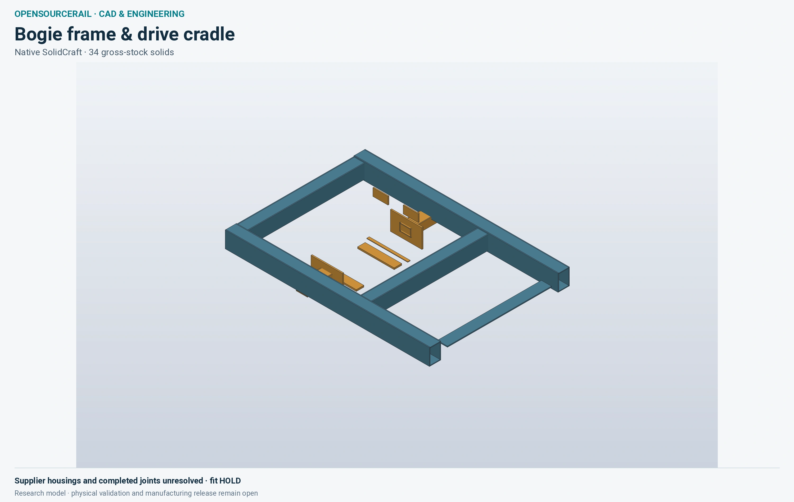

# The train in engineering views

A concept rendering shows what passengers might see. An engineering view
should let a designer ask a harder question: Which physical part occupies
this space, what supports it, what does it weigh, and how can it be fitted or
removed? The project has both kinds of images. Keeping them distinct lets a
reader enjoy the visual proposal without mistaking it for a finished train.

## One car and its counted stock

The cutaway below comes from a located research car. Its roof and near side
are opened for presentation so the reader can inspect the main body,
interior and equipment arrangement. The displayed cuts are not construction
openings. Source stock, purchased items and provisional equipment envelopes
have different meanings even when rendered in similar colours.

*A source-derived research cutaway, with display-only openings. Installed
equipment, joints and physical fit are not approved.*

The reference railway uses six 17-metre cars and passive bogies on
conventional rails. Its passenger brief prioritises fixed seats, wheelchair
places and no planned standing. The body must hold those interiors while
transferring loads to the bogies and couplers. Door and window openings
interrupt the sides; underfloor equipment competes with access and the
running gear envelope. A structural body family cannot be selected from an
isolated stiffness number if its joints, floor fixings and maintenance
routes are still unknown.

An exploded view can make a complicated car understandable, but the
explosion is a presentation device. Downloaded geometry may preserve the
source positions instead. The engineering gallery identifies thousands of
located source parts in one vehicle view, while warning that their stock
mass is not complete car tare. Unlocated HVAC, wiring, internal supplier
hardware, mounts and protection must still be added or bounded. A car's
centre of gravity and inertia cannot be inferred from a neat inventory
subtotal alone.

## The bogie is an interface, not a decorative support

The next view is a proposed frame and cradle subset for a powered-bogie
research candidate. It is shown here to explain the kind of mechanical
fit that a complete running-gear design must resolve. It is **not** the
passive bogie installed beneath the selected reference train, and its
mass or performance must not be transferred to that reference.

*Native geometry for a research bogie from the same located vehicle study. Supplier housings, joints
and complete fit remain unresolved.*

A wheelset needs a defined contact with the rail, bearings and axleboxes
with inspectable loads, suspension motion, brakes and restraints. Wheel
diameter changes through wear. The bogie moves relative to the body on
curves, gradients and rough track. A box that fits on a static drawing can
interfere with cables or a door mechanism when the suspension travels.
The relevant question is the swept envelope in operation and during
maintenance, not simply whether two parts overlap in the saved CAD pose.

The reference has twelve passive bogies, 24 wheelsets and 48 axleboxes
across the six-car formation. That count helps define a maintenance
programme: every wheelset and bearing has an identity, inspection route,
removal method and replacement consequence. A different bogie family may
offer benefits, but it changes mass, drive, braking, electrical, parts and
service work for the whole candidate.

## Move from view to design decision

A useful design review puts the image beside a list of questions. Can the
carbody carry its real installed loads? Do equipment and passengers fit
without blocking evacuation? Can the workshop lift the car, roll out a
bogie and reach its fasteners? Are fire, corrosion, fatigue and crash
scenarios represented? Which dimensions are controlled, and which are
currently only presentation envelopes?

The project can now produce impressive source-derived scenes and editable
models. Those views are valuable because they expose conflicts early. Their
engineering value grows when a particular candidate, part location and
test result are connected. A photograph-like view by itself neither
qualifies a body nor fixes the train that a city should buy.

## Read the space around the train

The train has to fit the railway in more than one position. At a platform,
the passenger step, door threshold and platform edge define a narrow
accessibility interface. On a curve, car ends swing outward while the
centre moves inward. Under braking and suspension travel, the body and
bogie move relative to each other. A drawing of the straight, unloaded
train cannot show all of those clearances. The selected corridor must
therefore be tested with a swept vehicle envelope, including worn wheels
and credible installation tolerances.

The roof and underfloor space have similar conflicts. Air equipment needs
an intake and a place for condensate to go. Batteries need restraint,
ventilation, isolation and a removal route. Braking equipment needs heat
rejection and inspection. Cables need segregation, protection and slack
where parts move. The volume occupied by a coloured box in a concept view
is only the start of that layout. Its mounting, service clearance and
connections may be larger than the device itself.

This is also why the six-car formation matters. A car design is not six
identical isolated objects: end cars carry different equipment and cab
interfaces; intermediate cars share couplers, gangways and supply paths.
Changing an end-car mass or door arrangement can affect stopping position,
platform fit and maintenance stocking. The reader should expect every
revision of the displayed train to carry a formation-level mass and
interface account, not merely an attractive replacement picture.
