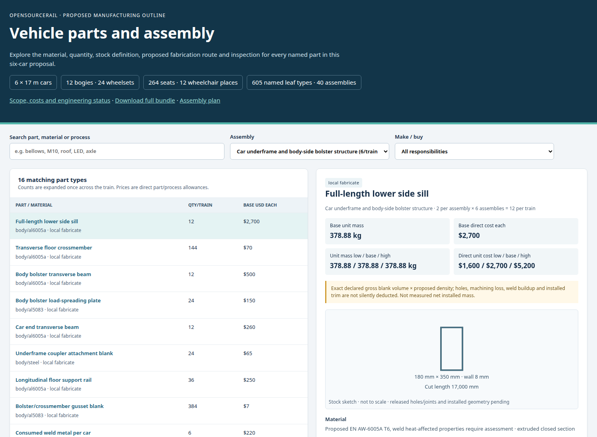
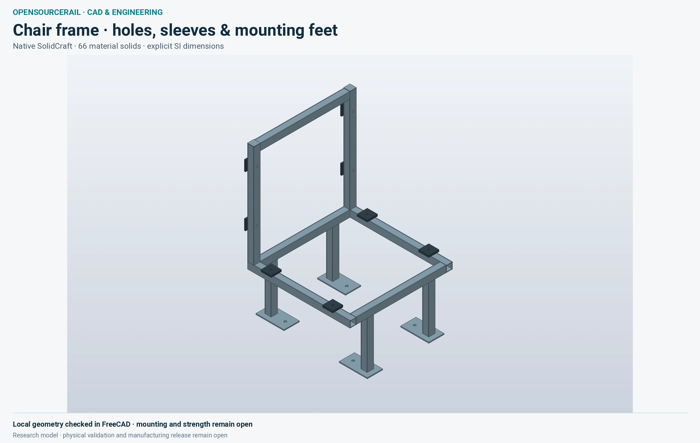

# Doors, seating and accessible interiors

The interior is where the engineering meets the passenger. The proposed
layout must support comfortable ordinary travel, wheelchair use, simple
boarding, circulation, emergency movement and quick cleaning. Behind a
calm cabin view are hundreds of door parts and many seat and service
attachments. A successful design must fit both the passenger and the
mechanic who will repair it.

## Count what the image hides

The parts catalogue below shows how a visual vehicle can be opened into
named assemblies and individual items. A counted proposal for one passenger
door opening contains 74 part definitions and 694 pieces. They include
leaves, header, rail, carriage, drive, belt, pulleys, sensors, glazing,
seals, fasteners and electrical work. The make-or-buy proposal assigns
some pieces to local fabrication, others to standard purchase, and a
smaller set to purchase subject to qualification. These counts expose the
production and spares problem; they do not make the door build-ready.

*A real interface for inspecting proposed parts. Counted items and search
views are planning aids, not released fabrication drawings.*

The door operator currently illustrates an honest engineering hold.
Several items have generic positions near the middle of the header rather
than fully mated locations. The proposed two-metre extraction route is
shorter than a 2.9-metre guide stock item. A car may show a beautifully
animated pair of leaves and still lack the space to replace its guide.
Before controlled manufacture, the design needs shared datums, tolerances,
drive and sensor placement, motion envelopes, cable routing, inspection
limits and a physically plausible removal sequence.

## Accessibility is a spatial design

The six-car reference names 44 fixed seats and two wheelchair places per
car. Their numbers form a clear normal accommodation policy, but the cabin
must also support the route between the platform and those places. The
boarding gap, doorway clear width, turning space, securement, nearby
handholds and reach of communication equipment matter. A one-sided door
layout must match every station platform in the chosen service. If the
layout or train formation changes, the platform, stopping and civil
consequences need to change with it.

The chair pictured below is a detailed local manufacturing proposal. It
can help a team discuss structure, upholstery, joining and replacement,
but it is a separate item study until tied to a controlled vehicle seat
mount and passenger tests. Seat count alone does not resolve fire,
vibration, impact, cleaning or accessibility.

*A proposed finished component. Its mounting, qualification and actual
vehicle installation require separate evidence.*

## The cabin is a service environment

Lighting, ventilation and communication must work during an ordinary
journey and in a degraded one. Doors opening repeatedly in a hot climate
can dominate cooling loads. Windows and roof surfaces admit solar heat.
The location of ducts, fans and batteries affects both passenger space
and maintenance access. An illustration of a bright cabin cannot
establish illumination, glare, air movement or hot-weather endurance;
these require defined limits and tests with the selected equipment.

Emergency conditions also challenge the interior. A crowd structural
case can exceed the intended seating load, yet it does not change the
normal passenger policy. An evacuation must work for people with a range
of mobility, perhaps when the train is stopped away from a station. The
door release, step, gangway, communications and rescue route need to be
studied together. Clear passenger instructions and accessible staff
procedures are part of the system design.

The v0.7 door module work is deliberately specific: one opening, one
vehicle candidate, controlled geometry and a route through manufacture,
inspection, installation, service and replacement. Closing that route
would teach the project how to apply the same discipline to seats, HVAC,
lighting and the other items passengers rely on every day.

## Design for daily use and replacement

The opening cycle is a useful way to examine the whole door. People approach
from different directions, sometimes with luggage, mobility aids or
children. The door must detect an obstruction, communicate its state and
avoid trapping a passenger. It must also hold its required position when
power is lost and allow a controlled release when evacuation is necessary.
Each feature needs a defined test condition, a limit and a way to inspect
the result after years of wear. A polished animation cannot answer how
the seal behaves with dirt, heat or a slightly displaced leaf.

The same design review should follow a fitter replacing a worn roller or
drive belt. Can the part be reached while the vehicle is in the depot?
Which panels must be removed? Are lifting points, isolation and test access
provided? Can the replacement be adjusted using a documented datum, or
does it depend on the memory of the person who built the prototype? These
questions turn a general aim of repairability into actual vehicle space
and controlled assembly work.

Interior finishes deserve this discipline as well. A seat should be
comfortable and cleanable, but its mount also carries normal, emergency
and impact loads into the floor. Repeated removal must not damage that
floor. Finishes and adhesives must be selected for fire behaviour and
durability, while replacement parts remain obtainable. A locally made
chair can be an excellent starting point once these interfaces and tests
are included in the same vehicle candidate.
