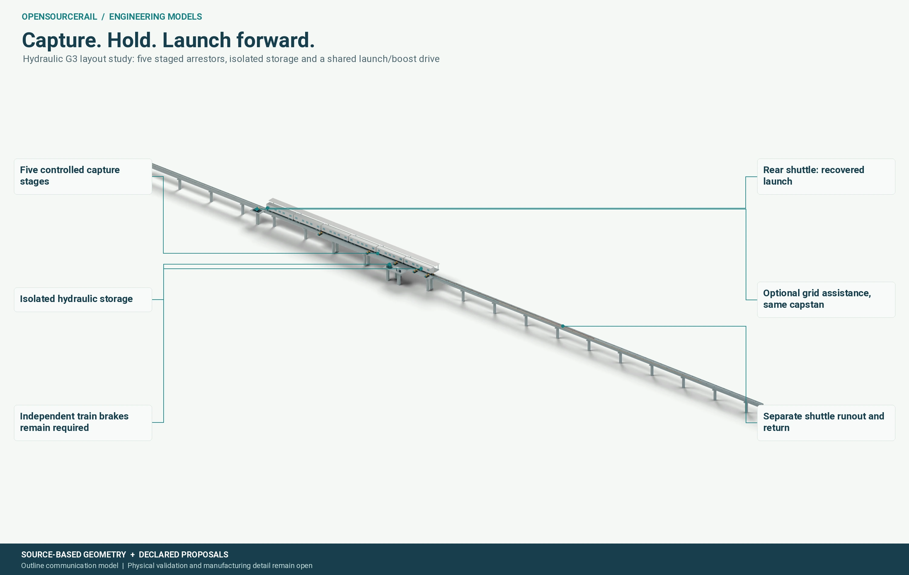
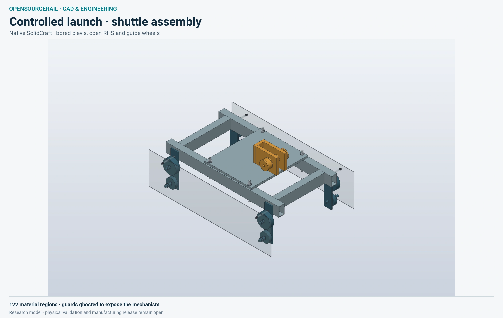
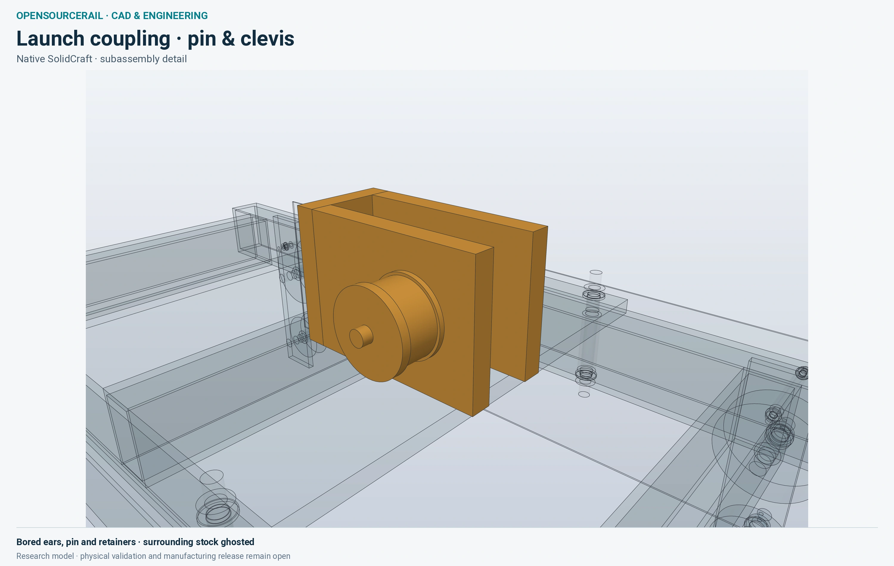

# Station drive and launch alternatives

The wheel-supported reference places the train's weight on ordinary rails
and explores ways to supply traction near stations. Keeping heavy traction
equipment off the car may simplify the vehicle, but it moves power,
cooling, maintenance and failure handling into the station. The project
keeps several propulsion families open: wayside linear motors, mechanical
launch and recovery, powered wheels, rollers and other explicit research
configurations. Their pictures are alternatives, not parts of one
combined installation.

## A station is an energy exchange

In a station-powered concept, a departing train receives energy while
passing a driven zone, then coasts or uses another declared means to reach
the next station. Near arrival it must be received or stopped safely. The
idea invites useful questions: How much force is needed at each speed?
How long must the active equipment be? Where does loss heat go? How does
the train stop if the receiving equipment has failed? What happens on a
hill, with a crowded train or during a power interruption?

One visual research layout considers a controlled mechanical capture,
temporary energy store and a shuttle that helps launch the next train.
The view below shows a proposed set of assemblies and maintenance
envelopes. Its calculated travel distances are not the lengths of
validated hardware. Guards, sensors, brakes and energy isolation would
need to be part of a complete machine.

*A source-derived research layout for one mechanical station concept. It
does not select the installed drive for the passive-wheel reference.*

Energy recovery has practical limits. The arriving and departing trains
must be timed so that a recovered store can be used. The capture process
loses energy in friction, pumping and conversion. Storage must be safe
while charged and while isolated for maintenance. If the next departure
is delayed, the railway needs another energy path or a way to dissipate
the stored energy. A complete economic comparison counts those losses,
standby equipment, inspection and replacement.

## What a detailed launch view can show

The launch-shuttle study below is a distinct physical research candidate.
Its native geometry resolves many material regions, bores and wheel
surfaces. That makes fit and manufacture questions easier to identify.
The pictured guards are ghosted so the mechanism can be seen; they are
not absent from a future safety requirement.

*Detailed native CAD for a separate launch proposal. Mated contact,
fatigue, protection and operating capability remain unqualified.*

The clevis and pin detail focuses the question further. A pin can carry
large repeated forces, but its actual load path depends on contact,
clearance, retention, material, joining and lubrication. A valid solid
is the beginning of a mechanical study, not its final answer. Surrounding
ghosted parts in a presentation image do not prove their joints.

*A mating-area study for the launch candidate. Weld, contact and fatigue
qualification remain open.*

A wayside linear-motor alternative has different questions. Its passive
vehicle element must fit between the rails throughout wheel and body
movement. A useful motor map has force, normal force, current, voltage,
heat and cooling across speed and position. A short ideal-field method
cannot stand in for a manufactured unit with slot ends, inverter limits,
feeders and a complete thermal system. Powered length is therefore a
candidate result, not a fixed number drawn from a concept image.

Each alternative should be compared at the same passenger service and
with independent braking and rescue. A low onboard mass is attractive
only if the station, electrical, civil and whole-life consequences are
also credible. This is why the image gallery presents mechanisms as
research questions rather than a ready-to-install propulsion package.

## Make the comparison at railway scale

The drive is only one part of a departure. A station also has to admit
the arriving train, hold it, open the correct doors, exchange passengers
and dispatch it with safe separation. If an accelerator requires a longer
straight platform, additional protection or a larger electrical room,
those requirements belong in the same corridor comparison as the motor.
If a train relies on several powered zones, the spacing and condition of
those zones govern what happens after a failure. The selection must be
made for a whole service, including recovery, rather than by comparing
isolated peak thrust figures.

Energy is equally dependent on the timetable. A brief peak may be easy
to demonstrate once and difficult to repeat every two minutes in summer.
Transformer, converter and cable losses become heat at a specific place.
Power demand must be compared with feeder capacity, cooling and the
availability expected of a public service. Where braking can return
energy, the electrical network needs somewhere safe and useful for it to
go; where it cannot, the heat and wear have to be carried elsewhere.

The pictured mechanisms make these trade-offs tangible. The shuttle
asks whether moving contact hardware can survive repeated duty and be
replaced without long closures. A fixed linear motor asks whether an
air gap and force map can be maintained across real wheel wear, track
tolerance and weather. Both need protection from people and debris in a
station. These are testable questions for separate candidates, and the
answers may depend on the chosen city alignment and service pattern.
