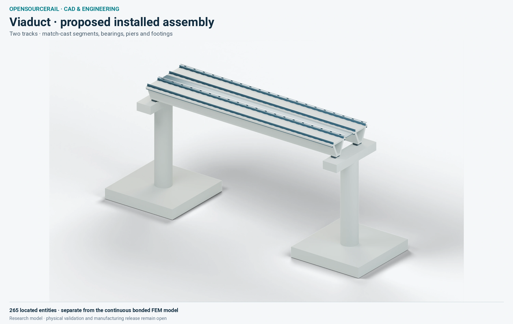
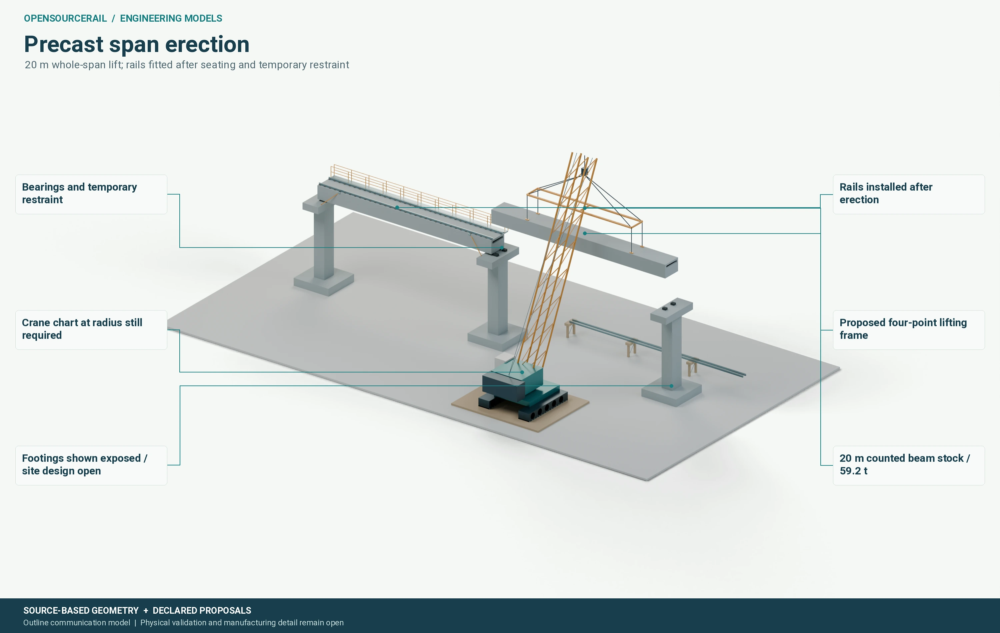
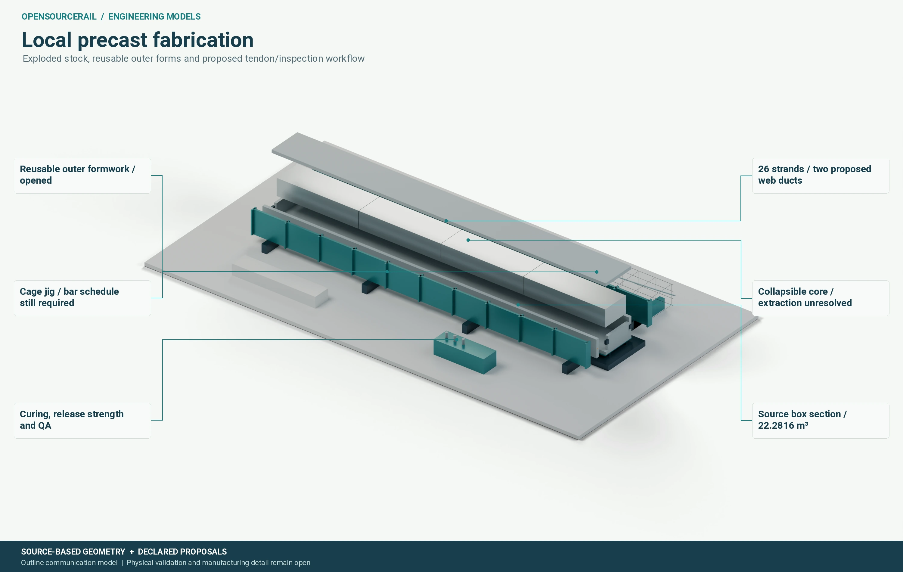

# Civil assemblies and construction

An elevated railway becomes a line of structures through a city. The
guideway supports rails, vehicles, stations and maintenance access; it
must also be buildable above streets, utilities and people. The civil
gallery makes the work tangible by showing precast spans, bearings,
supports, transport and erection ideas. It should be read as a set of
candidate studies, not a completed bridge package.

## A span is more than its beam

The load path begins at the wheel and continues through rail, fastener,
deck or beam, bearings, piers and foundations. Each handoff can govern
the design. A beam with a good bending result may need a difficult rail
seat. A compact deck may make bearing access or drainage harder. A
lighter span may demand more temporary restraint during erection. The
comparison therefore needs moving loads, crowd and accidental cases,
thermal movement, fatigue, rail alignment and maintenance, not just
the material volume of the beam.

The segmented civil image below shows a proposed two-track assembly with
segments, rails, bearings, piers and footing envelopes. Several joint,
reinforcement and foundation details are still hypotheses. This image
belongs to a separate civil candidate and is **not** the assembled form
of the ideal continuous beam in the finite-element image in the next
chapter.

*Located research geometry for one civil proposal. Segment joints,
bearing contact and site foundations remain unverified.*

## Erection changes the design

Precasting can shift labour from a street site to a controlled yard. A
yard can use repeatable forms, inspections and planned curing. The
resulting unit still needs a road route, lifting points, a crane or
gantry, safe temporary support and a final connection. Its size and
weight should follow what the city and its workshops can actually
handle. A crane's useful capacity is its capacity at the required
working radius, with rigging and ground bearing accounted for, not the
largest number printed on the machine.

*A proposed erection sequence. Actual lift, temporary restraint,
traffic management and ground capacity need site-specific design.*

An overhead launching gantry is another possible method. It can reduce
dependence on a large crane at constrained streets, but introduces its
own plant, support reactions, launching sequence and inspection needs.
The appropriate method may differ from corridor to corridor. Choosing
it late can force changes to the span's lifting points and geometry,
so construction should influence the first civil family comparison.

## Forms and foundations have their own lives

Reusable forms can lower cost if the candidate is repeated enough times,
the form can be stripped reliably and the factory can meet the curing
cycle. Proposed tendon ducts and cage fixtures need real bar schedules,
anchorage, cover and quality tests. The cost model should count forms,
lifting gear, transport and rejected pieces, not just concrete and steel.
Where soil and utility conditions change, a standard beam may still
sit on very different piers or foundations.

*A proposed production route, not an established cycle time or qualified
prestressing process.*

For a public owner, these images help ask what the elevated line will
mean on the ground. Which roads will be occupied, for how long? How
will stations connect to pavements and crossings? Can a damaged bearing
be inspected and changed? Which details must be agreed before land or
utility work starts? The engineering answer needs the exact corridor,
ground and candidate, with construction and maintenance represented as
part of the same design.

## The corridor changes the structure

A repeated span can help a factory learn and improve, but repetition does
not remove local design. Each support meets a particular street, utility
network and ground condition. A road crossing may need a longer clear
opening; a constrained junction may have no safe crane location. Near a
station, the deck may widen, carry different rail equipment or meet a
building entrance. These variations should be visible in the quantity
and programme, so a standard-span price is not silently applied to every
metre of route.

The order of construction changes what the beam must resist. It may be
stressed in a yard, lifted from only two points, transported with
temporary supports, set onto bearings, then loaded with rails and trains.
The largest local stress can occur before the first passenger service.
Temporary stability of a pier or half-finished station deserves the same
care as the completed structure. A design package must tell the builder
which supports and restraints are required at each stage.

Long life brings other interfaces. Bearings must accommodate movement
and remain replaceable. Drainage should keep water away from reinforcement,
fasteners and public space below. Rail supports need access for adjustment
and renewal. Expansion joints can cause noise and recurring maintenance,
so their number and position should be an explicit design choice. These
details influence whole-life cost more than an image of a clean concrete
deck can convey. The civil gallery is most valuable when it starts these
conversations before a corridor is frozen.
