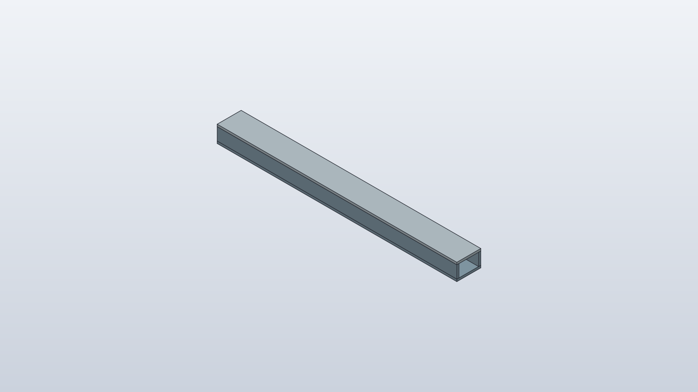
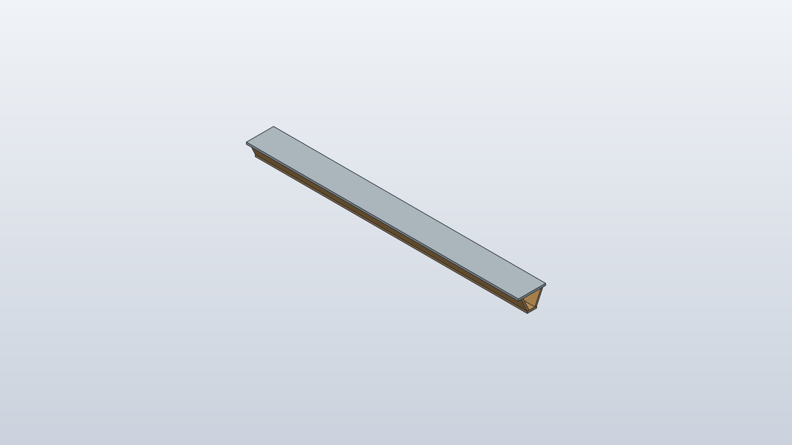
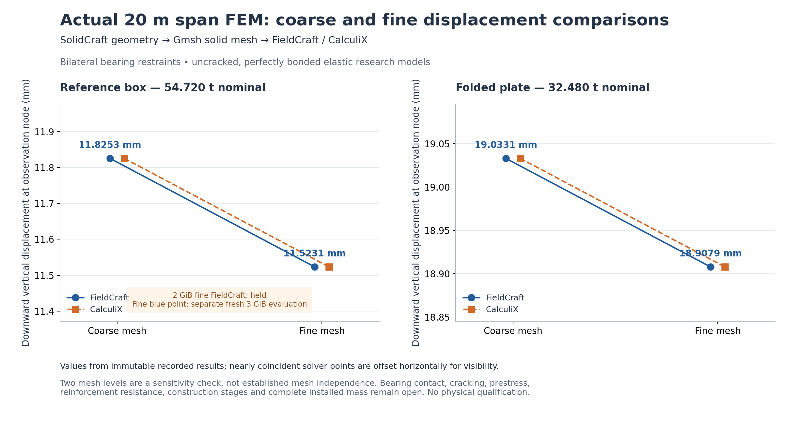

# What structural tests show

A structural image is most informative when it shows both the proposed
shape and the question asked of that shape. A coloured stress or
displacement field can look decisive, but its meaning depends on the
material, support, load, mesh and failure modes represented. The
OpenSourceRail civil comparisons make that distinction explicit.

## Compare forms under a shared question

The portfolio contains twelve proposed twenty-metre span geometries
across six structural families. Their native CAD solids have been
reopened and measured in an independent CAD system. The box and folded
plate below are two examples. Their forms distribute material
differently and would require different mould, reinforcement, lifting
and bearing details. A lower stock mass alone cannot rank them as
installed structures.

*One actual CAD study of a box family. It is a portfolio geometry,
separate from the selected beam and not a complete installed span.*

*A distinct candidate form. Geometry validity does not establish
cracking, fatigue, reinforcement or erection capability.*

Two matched forms were then solved with both FieldCraft and CalculiX; each
form used matched coarse and fine meshes. The displacement changes from the coarse
to fine box model were about 2.6%; for the folded plate, about 0.7%.
Both met the experiment's declared force-balance, refinement and
cross-solver screens. The agreement increases confidence that the two
numerical routes represent the chosen model in a comparable way. It
does not prove that the chosen model includes the real bearing, rail
seat, reinforcement, cracks, prestress and construction stages.

*Displacement results for stated idealized models and loads. Two mesh
levels are diagnostic; they are not full mesh independence or physical
acceptance.*

The fine box analysis originally exceeded a smaller memory request. Its
successful result belongs to a later, larger resource allocation, not
to the failed trial. Keeping both records is useful: the failure
estimates the practical cost of refinement and prevents a later report
from hiding the experiment's limits. The beam study also uses ideal
bilateral support patches, which can carry tensile reactions that a
real bearing may not. That is an explicit model limitation, not a
discovered property of the construction.

## A deformed beam is not a test of every part

The plotted displacement makes the numerical result easier to see, but
the physical member may contain joints and local details outside that
model. The segmented civil assembly on the preceding pages has its own
joints and support questions. A continuous-beam result cannot be used to
qualify those segments, their fasteners or their foundations.

The next engineering steps are therefore physical and geometric: model
rail and fastener support, contact and bearing compliance, reinforcement
and anchorage, moving and accidental loads, fatigue and the temporary
lift state. Site ground and utility conditions must enter the chosen
corridor. Material certificates, fabrication QA and prototype tests can
then be compared with numerical predictions. Until then, the best use
of the plots is to choose which uncertainty or candidate deserves
attention next, while retaining alternatives that remain credible.

## Follow the load path beyond the plot

For a rail beam, the wheel load first reaches the running rail. Fasteners
and pads spread that load into a seat or slab, then the main member takes
it to bearings, piers and ground. A finite-element picture of only the
main member answers only one part of this chain. A rail seat can crack,
a fastening can loosen or a bearing can move even if the main beam's
ideal elastic stress remains modest. The next model must follow the
interface at which the open decision actually lies.

Concrete also changes with time. Prestress can be lost; shrinkage and
creep move the structure; temperature changes its length and curvature.
Repeated trains can bring fatigue into reinforcement, joints and
attachments. Drainage and corrosion can shorten life. These mechanisms
need material choices, detailing and inspection plans, not simply a
finer version of the first mesh. For an alternative steel or composite
form, the decisive issues may instead be welding, local buckling,
bonding or fire protection. Different families deserve different
models, even when they share the same comparison loads.

Independent numerical agreement is especially useful when the models
are genuinely independent and their common assumptions are visible.
Two solvers that both hold down an ideal bearing may agree closely while
both miss real lift-off. A physical test can then check the most
important predictions: deflection under known loads, strain near a
critical interface, dynamic response, and how the member recovers after
unloading. Measurements should be compared with the predicted range,
not chosen afterward to make the model look right.

The purpose of the portfolio is to narrow uncertainty without losing
useful alternatives. A heavier form may be easier to manufacture and
inspect; a lighter one may need difficult reinforcement or lifting
equipment. Structural performance, construction, repair and price need
to be considered together for the same corridor and candidate. Only
then can a coloured field contribute to a railway decision.
