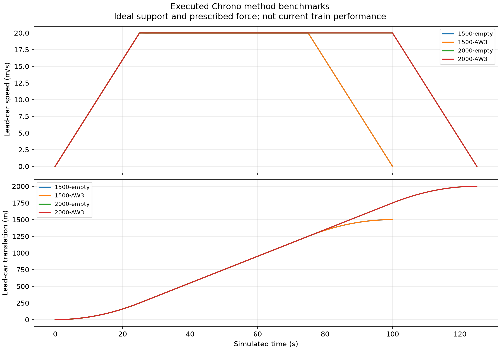

# Journey, control and fault tests

The vehicle, guideway, station drive and control system must work as a
journey, including when something goes wrong. A digital model can help
identify interactions that are hard to see in a static drawing: a longer
dwell changes the next departure; extra mass changes both braking and
structure loads; a failed station drive changes rescue and headway. The
result is valuable only when the modelled equipment can actually provide
the force and protection the calculation assumes.

## Start with the demand for motion

For a named corridor, a first calculation can ask how fast a train must
accelerate, how much energy it needs, how it coasts over gradients and
where it must brake. That produces required force, power and stopping
envelopes. It does not provide an available motor map. The next step
must connect the proposed device's actual position, speed, current,
voltage and temperature limits to those demands. A large idealized force
entered into a journey model can make almost any timetable look feasible;
the engineering task is to show the source and repeated duty of that
force.

The sparse-wayside research twin explicitly stops at this boundary. It
counts five short banks and computes the motion they would have to
support, but lacks a validated operating-force map for their completed
electrical and thermal installation. Its digital package can pass
consistency checks while an attempted physical-completion check remains
open. This is a productive result: it tells the team which component
evidence is needed next instead of inventing an arrival.

## Faults belong beside normal service

Suppose the receiving equipment at a station is unavailable. The train
must still stop with independent brakes. If adhesion is poor, stopping
distance grows and wheel-slide protection becomes important. If the
train stops outside a powered zone, it may need a protected tow or
other rescue provision. A fault can affect the following trains as
well as the stopped one, so timetable reliability and safe separation
cannot be based only on normal dry-rail departures.

The software can test contradictions in the control logic: a train
requesting a route that is already occupied, a door state that conflicts
with dispatch, or a loss of a necessary signal. Refusal is an important
outcome. It shows that the model did not convert missing or inconsistent
information into permission to move. A simulator result is still tied
to its assumed sensors, actuators and brake behaviour; it is not a
commissioned automatic train-control system.

## A method plot has a history

The traces below come from a retained earlier magnetic-railway numerical
method study. They show how an ideal, prescribed-force benchmark can
check a dynamics integration and its time step. They are **not** a
journey of the current wheel-supported train and do not establish a
magnetic support or propulsion map. Their inclusion illustrates why
plots must be read with the candidate and model named.

*A numerical-method control from a separate historical research
configuration. The forces were prescribed; no current train journey or
physical performance is proved.*

The earlier study completed benchmark trajectories while holding its
integrated physical journey for missing equipped mass, flexible-body and
force-map evidence. That distinction matters. A close numerical match
to a chosen ideal target can establish that a solver follows its
equations. It cannot establish that the manufactured train and motor
follow the target.

## What a complete journey review would join

The selected vehicle would need an installed mass and inertia range, an
available propulsion map, actual braking and wheel-rail limits, gradients
and curves from the selected alignment, station dwell and access
assumptions, thermal endurance, fault response and protected separation.
Passenger accessibility, emergency power and evacuation are part of
the same review. The output should show normal and adverse cases with
their boundaries, rather than a single appealing travel time.

OpenSourceRail's models can already expose many of these dependencies.
The next physical work is to measure or justify the missing equipment
behaviour, independently review the worst relevant cases and keep the
software result linked to that exact candidate. A journey model is a
way to ask precise questions; it is not a substitute for the answers.

For a city reader, the useful report is therefore more than a journey
time. It should show the station spacing, speed and dwell assumptions,
energy and peak demand, the normal and adverse stopping distances, and
how a disabled train is cleared. It should say which values come from
measured equipment and which remain design requests. Only then can
different propulsion ideas be compared at the same passenger service
without moving the unresolved risks out of sight.

The comparison should also keep the passenger experience visible. A
shorter run time may come from sharper acceleration, but that raises
questions about comfort, standing during an exceptional load, wheelchair
securement and the repeated electrical duty. A longer dwell may be
necessary for accessible boarding and can alter fleet size. Operations,
engineering and accessibility therefore belong in one journey review,
with each proposed change carried through the same formation and corridor.
