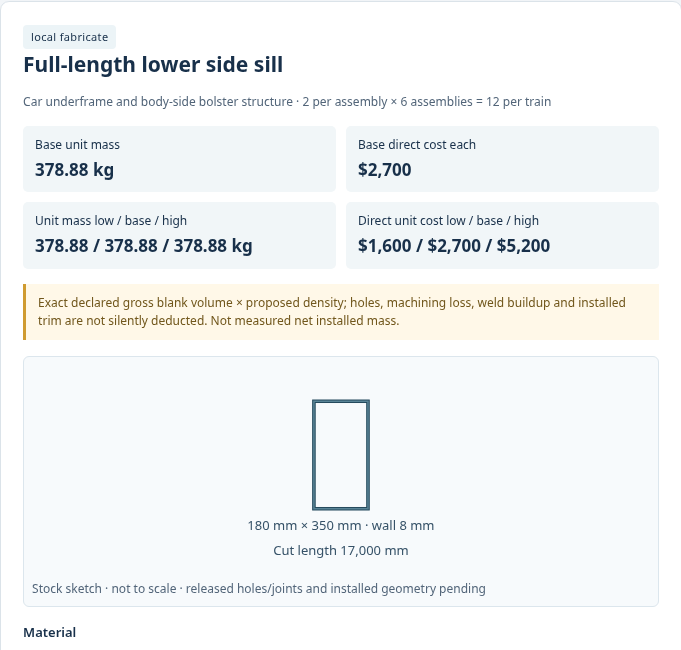
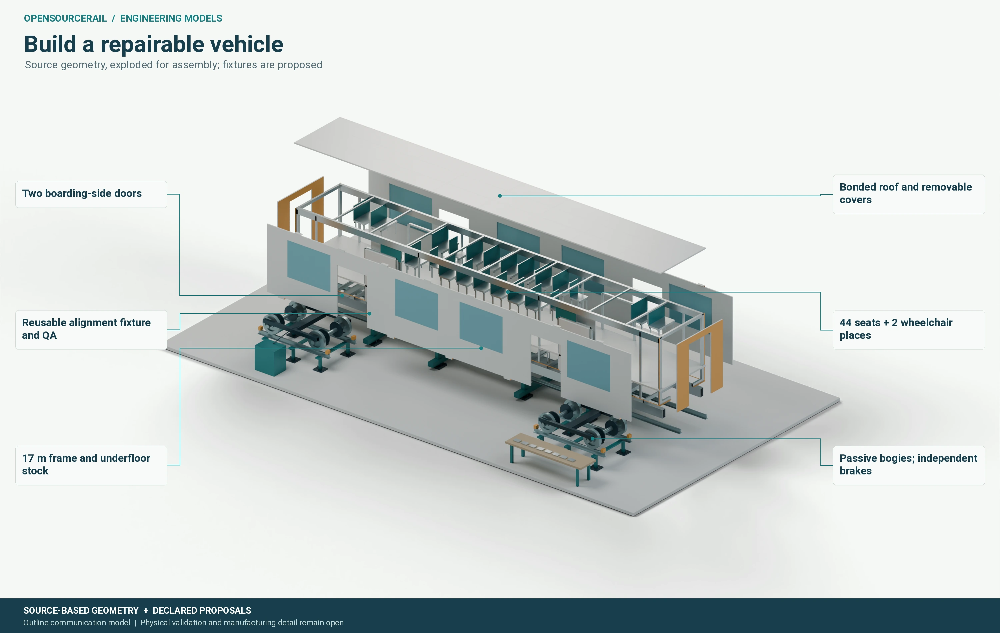

# Manufacturing details and assembly

Making a railway locally requires much more than permission to download
a drawing. The workshop needs stock forms it can source, tools it can
use, operations it can repeat, dimensions it can inspect and a record
of which part went into which train. A digital assembly becomes
practically useful when those decisions can be made from it without
guessing at hidden interfaces.

## Start with a countable structure

The proposed vehicle catalogue names 605 leaf-part types in 40
assemblies across the six-car train. It reaches from bogie frames,
wheelsets and body members to seats, doors, batteries, HVAC, lighting,
couplers and service hardware. Individual fasteners, cut strips and
bought subcomponents expand the bill into many more units. That is a
serious attempt to account for the work behind a train, but it is
still a proposal: bought equipment internals, finished joint details,
installation positions and complete as-built mass need further
evidence.

The stock-detail image below makes one important distinction visible.
A blank or envelope can be counted before its holes, joining faces,
clearances and inspection limits are released. The first count helps
with sourcing and factory planning; the controlled drawing makes a
repeatable part. A tolerance chosen without a matching assembly
function can make a product expensive without making it safer or
easier to maintain.

*A detailed stock and process view. Mating geometry and acceptance limits
remain subject to controlled drawings and tests.*

The assembly sequence begins with a datum-controlled underframe,
followed by body members, roof and floor, bogies, equipment, panels,
doors, glazing, passenger fitout and inter-car connections. Each
subassembly needs the tools and inspection opportunities that suit its
materials. A welded frame may distort; a bonded panel needs a
qualified preparation and cure; a purchased bearing needs traceable
receipt and fitting. An open design can enable local work only when
these process controls are as clear as the nominal shape.

*An assembly communication model. Fixtures and stations are proposed;
the image is not a measured production rate or released shop instruction.*

## Make, buy and qualify are different routes

Local fabrication can include cut and formed members, body panels,
interior fittings, some castings and assembly operations. Specialist
items such as bearings, cells, electronics or railway glazing may be
bought. Their local installation still creates value, but the source
and certification of the bought item must remain visible. A supplier's
sales address is not proof of domestic manufacture. The bill should
distinguish standard purchase from purchase that needs additional
qualification for the railway duty.

The door opening illustrates the mix. Some components can be made
locally, many are bought to a standard description, and a smaller set
needs specific qualification. A complete module then requires its
own assembly drawing, tooling, electrical checks, motion test, incoming
inspection and serial or lot custody. It must also be removable after
years of service. A part that can be installed only before the body
is closed is not necessarily a repairable railway part.

## Cost the route, not just the material

The project calculates provisional low, base and high direct parts and
process allowances. These help compare design families, but the amount
for a stock item is not a finished train purchase price. Factory space,
shared tooling, final assembly, rejected work, qualification, delivery,
warranty and renewal may sit outside a narrow subtotal. Production
hours are hypotheses until a real workshop measures them. A lower
piece price may be offset by difficult fitting or a long imported repair
channel.

A candidate-linked manufacturing package should make these boundaries
readable to a buyer. Which parts have a drawing? Which materials have
an approved grade and source? Which operations are measured and which
are estimates? Where will quality hold the work? What equipment can be
changed without disassembling half a car? Such questions turn an
engineering image into a practical programme for local production and
long-term repair.

## Build a route from prototype to fleet

An early prototype can reveal access and tolerance problems while changes
are still affordable. A pilot build then tests whether ordinary workers,
tools and suppliers can repeat the process with controlled quality. Only
after that should a fleet plan rely on stable production hours and yield.
The stages need different records: prototype measurements and anomalies,
pilot work instructions and inspection results, then serial histories
and change control for production vehicles.

This route also protects local capability. If a factory can make a body
member but must import a long-lead bearing, the schedule and spares plan
should state that dependency. If a supplier changes a material or
connector, the affected geometry, tests and maintenance documents must
be reviewed before installation. Open drawings enable more people to
contribute, but shared knowledge is most valuable when it includes the
reasons for tolerances, test limits and assembly choices.

A workshop should be able to answer two practical questions from the
finished package: how is this train built, and how is it restored to
service after a failure? Designing those answers together can avoid
special tools that are needed only to reach one buried part or an
assembly sequence that prevents later replacement. The result is a
railway that can be maintained locally, not only assembled locally.
