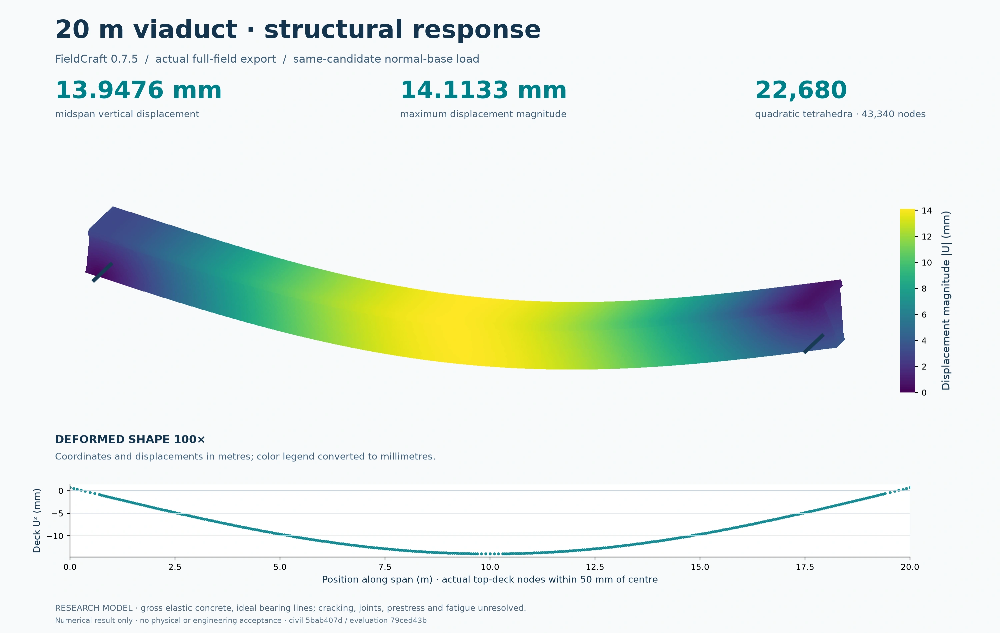

# What twin verification can and cannot prove

A trustworthy digital twin should refuse to make a claim that its own
records cannot support. This is different from proving the physical
railway safe. The first task is internal consistency: does the beam
geometry match the quantity and cost? Does the mass used by braking
match the counted vehicle? Does the candidate in a delivery draft
match the candidate that was analysed? The second task is physical
evidence: are the material, support, motor and brake assumptions true
for the item that will be built? The project has made progress on
the first task while keeping much of the second open.

## Verify the same candidate across views

An engineering model may appear as a geometric scene, CAD solid,
bill of materials, factory task, civil quantity, journey model and
cost estimate. Each view has a different purpose. Verification
checks that they describe the same physical revision, or clearly
state when one is a separate research alternative. A body revision
that changes mass should reach load, braking and civil calculations.
A change to a local price may change the cost estimate without
moving any structure. The dependency is part of the evidence.

The sparse-wayside twin generates six research packages and
reconstructs their semantic outputs during checking. Deliberately
altered geometry, part counts, mass, cost or control claims are
rejected rather than trusted because an archive carries a plausible
label. A native IFC and solid-model round trip in one case checks
that located stock survives export and reimport. The five other
cases did not request native geometry, so the one successful
round trip is not represented as six executions.

## Digital consistency has a limit

Suppose a box beam and two independent solvers produce nearly the
same displacement. That may show that the implementations agree
under the chosen elastic material, supports and loads. If the real
bearing can lift off while the model holds it down, the agreement
does not answer the physical question. Suppose a door part appears
in every bill and CAD scene. If its guide cannot be removed through
the body opening, completeness of the list has not solved
maintenance. The next model or test must address the actual
interface.

This distinction also protects cost. A complete calculation under
assumed labour and material rates may be useful for comparing
candidates, but it is not a supplier quotation. An unlocated battery,
unknown cooling duty or missing site foundation must not become a
zero-cost account. A broad range with explicit gaps is more useful
than a precise total that silently drops required work.

| Digital question | What it can establish | Physical evidence still needed |
|---|---|---|
| Do geometry and inventory agree? | Consistent declared dimensions, positions and counted stock | Fitted interfaces, tolerances, supplier internals and as-built mass |
| Do two models give similar results? | Agreement within a stated idealization | Real material, load, contact, fatigue and calibration |
| Does a journey calculation complete? | Behavior under its declared available forces and faults | Measured force, braking, thermal duty and protected operation |
| Does a business draft connect? | Candidate and document continuity in software | Reviewed transactions, QA and actual installed serial records |

The field picture below is a useful example of that boundary. Its
deformation is exaggerated so a reader can see the shape of a predicted
response. The underlying test is an ideal continuous elastic beam under
a defined load. It does not verify the joints, fasteners or foundation
of the separately pictured segmented civil proposal. The image becomes
trustworthy when its question and its excluded details travel with it.

*An ideal continuous-beam field view with exaggerated deformation. It
does not qualify the segmented civil assembly shown elsewhere in this
book.*

## Give failure its correct name

A computational job can finish successfully and still fail an
engineering screen. A mesh can fail to converge, a candidate can
exceed a limit, and a model can be outside its domain. These are
different outcomes. Keeping the original inputs and the reason
for each outcome lets another team learn from the work without
mistaking failure for a missing file or a hidden success.

The twin's completion gate currently remains open for such matters
as an available motor map, full installed mass, structural joints,
braking, site works and complete prices. That is the honest state
of the research. As measurements, supplier information and physical
tests arrive, each can be attached to its exact candidate and
reviewed independently. A digitally consistent project is a strong
foundation for that work; it is not the final permission to
manufacture or operate a railway.

## Let a reader challenge the claim

The strongest assurance record is one a second person can interrogate.
If a cost falls after a design revision, the reader should be able to
see whether material quantity changed, a price assumption changed, or
a required item disappeared. If a beam receives a passing numerical
screen, the reader should be able to see the support and load conditions
that made it pass. If a journey is shorter, the reader should find the
acceleration and dwell assumptions that changed. This kind of access
turns a polished dossier into a reviewable argument.

It also makes honest progress possible. A failed test may eliminate a
weak proposal. An unpriced component can point to a supplier task. A
nonconverged structural model can show where a better idealization or
measurement is needed. None of these outcomes has to be disguised to
make the project look complete. The digital twin earns trust by keeping
the boundary between proposal, calculation, test and accepted railway
clear as the work advances.
