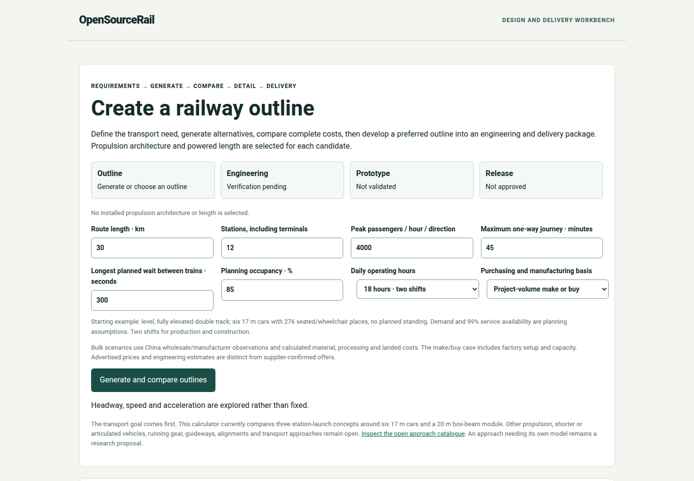

# The current Workbench

The Workbench is the project's common reading room. It brings city plans,
candidate engineering, status and delivery results into a browser so a
person can follow a design question without opening every research archive.
Its strongest role is to show the relationship among a proposed route, the
train used in its calculation, the resulting service and the evidence still
needed. The screen is an engineering review interface, not a railway
operator's desk.

*A real browser view of the current development Workbench. Visible cards and
holds describe software and engineering status; they grant no physical or
operating approval.*

## Begin with the object being studied

A reader should first locate the selected development reference and the city
or study under review. The passive-wheel reference is a defined train
arrangement, while propulsion alternatives are separate research
candidates. A city plan has a route and station proposal of its own. The
Workbench should make those scopes distinguishable before displaying a
price or travel time. A number without a clear object is easy to carry into
the wrong discussion.

The published v0.6.1 software gives an accessible first journey in Samawah.
It can calculate a bounded city study and show the input assumptions,
fleet, energy, civil quantities and fourteen cost scopes. Other panels
expose retained research and links to engineering material. Some attractive
global views remain held where their source binding is stale. Keeping a
card visibly unavailable is a useful behavior: it tells the reader which
conclusion the software cannot support at this revision.

Later v0.7 development adds a project comparison that follows a specific
Samawah station-marker edit through updated service, cost and delivery.
This is a stronger continuity test than simply displaying two unrelated
reports. The browser shows what changed, what was reused, and what cannot
yet be assembled into a complete installed-candidate dossier. The
development view should not be described as a feature of the fixed
v0.6.1 release.

## Read a panel in three passes

First ask **what is selected**: city, route, vehicle and study revision.
Next ask **what was calculated**: a map, a fleet, a cost scenario, a
structural result or a delivery draft. Finally ask **what limits the
claim**: transferred rates, unpriced site work, a missing force map, an
unmated assembly or a withheld global card. This order is more useful than
looking for a single green or red symbol. A result can be a successfully
completed calculation while its engineering screen remains open.

The Workbench links to downloadable records for readers who need deeper
evidence. A city owner may use the summary to decide what to survey next;
an engineer may inspect the exact load and candidate; a workshop may
follow a module into its parts and inspection proposal. These different
uses should lead back to the same declared design. The interface makes
the handoff visible, but the people responsible for a physical decision
must still review its evidence.
