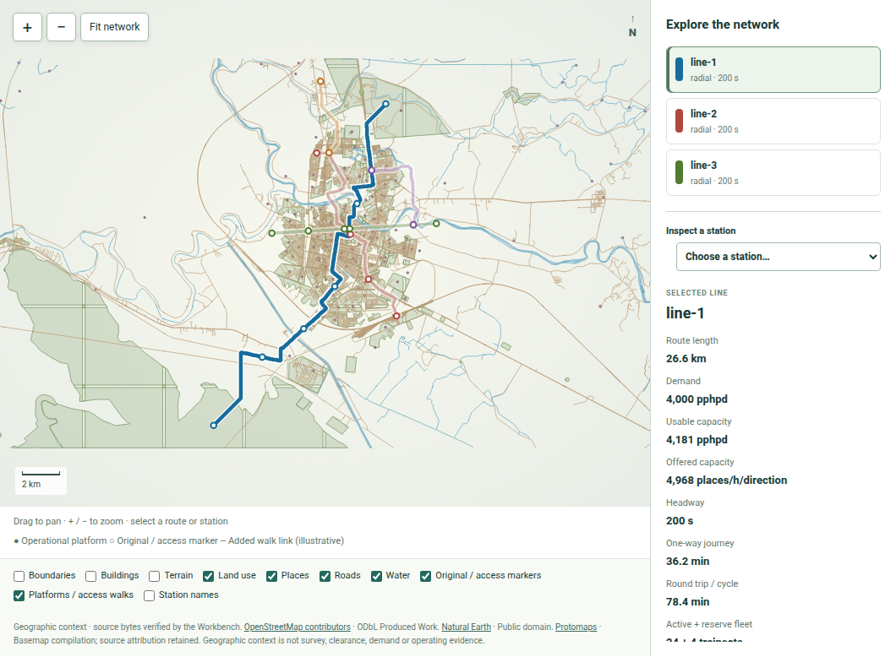

# Planning and maps on screen

A planning screen helps a city team discuss geography together. A coloured
line shows where a proposed service might go; circles and markers show
operational station groups, original access points and interchanges. Those
symbols are useful only when the reader understands the distinction between
a source location, a planning edit and a calculated result. The map should
invite questions about walking, land, utilities, flood risk and transfer,
not persuade an owner that a corridor has already been surveyed.

*The current city atlas displays the mapped planning case and its source
context. The image is a browser screenshot, not a measured alignment or
station design.*

## From an idea to a study

The ordinary planning workspace lets a user propose route, stop, service
and origin–destination changes. The saved proposal records the declared
change and its source context. It does not by itself contain a recalculated
train, guideway or budget. A calculated study is the next step. It applies
an identified vehicle, service and cost basis, then reports fleet, energy,
civil quantity classes, capital and whole-life scenarios. Keeping those
two stages separate prevents an edited marker from looking like an
engineered station.

The city atlas is broad, with 266 planning cases and many different line
patterns. Readers can compare a compact five-line outline in Samawah with
the more extensive Baghdad network, or look at the maps later in this
book for other regions. The scale of the drawing is not a measure of
readiness. A large, polished map can still rely on common demand and price
assumptions; a small corridor with good local survey may support a more
confident decision.

## What a map click should lead to

A useful station view should answer where the proposed stop sits, what line
serves it, how it connects to other lines and which source marker or edit
produced it. It should also show what remains unknown: actual accessible
walking routes, platform footprint, land, ground, utilities and the safe
construction method. For a line, the reader needs route length, stop
pattern, headway assumption and the train used in the service calculation.

The current GIS return path adds a stronger editing loop in development.
A planner can request an editable native project, revise permitted route
or station information and submit the saved project with an author and
reason. The returning study retains the original city for comparison and
recalculates affected service and cost outputs. Automated native cycles
have been exercised on Samawah and Baghdad; the book does not treat them
as proof of a fully tested desktop user journey or surveyed geometry.

The safest way to discuss the screen is to pair every coloured route with
one sentence about its maturity. These are calculated planning outlines.
They help choose surveys and compare alternatives. They are not
construction drawings or operating timetables.
