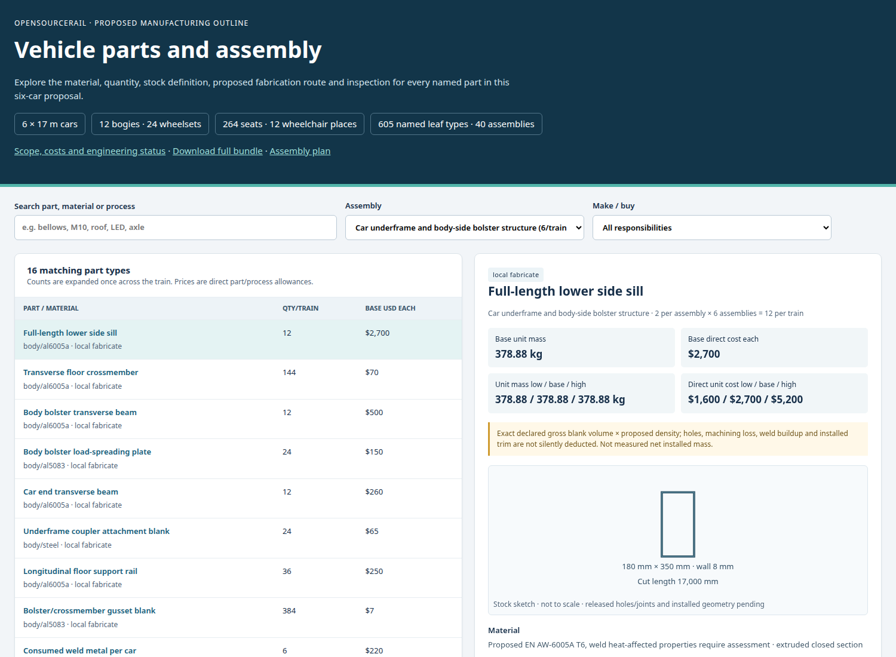
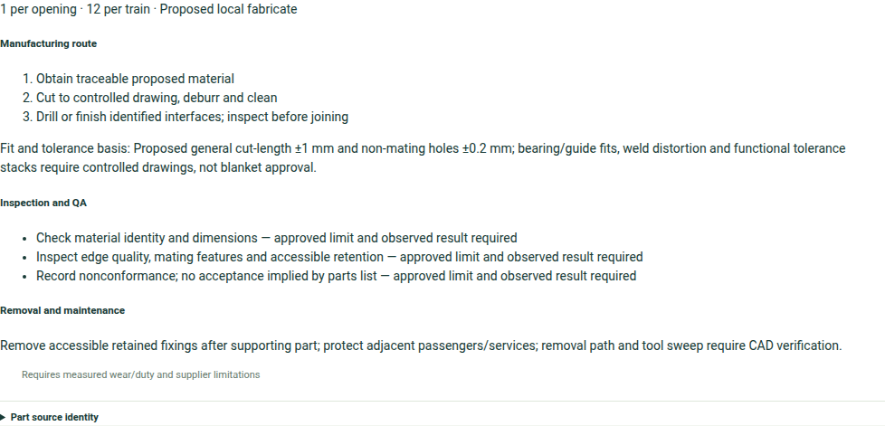

# Parts and lifecycle on screen

A product image tells a workshop what a module might look like. A useful
parts interface goes further: it lets a reader identify each item, its
proposed material and source, the assembly that uses it, and the work still
needed before it can be made or purchased. The vehicle parts catalogue
is one of the project's practical bridges from a railway concept to
local manufacturing and repair.

*The searchable parts interface exposes counted proposed items and their
assembly relationships. It is a genuine product view, while its estimates
and drawings remain subject to the stated engineering holds.*

## Search by an assembly, then follow its children

The door operator is a good example. One opening contains a counted
proposal of 74 part types and 694 individual pieces. The inventory
distinguishes parts proposed for local fabrication, standard purchase and
purchase subject to qualification. A reader can move from the familiar
word “door” to a header, guides, carriages, belt, motor, sensors,
leaves, seals and many fasteners. That detail matters because every
child part needs a fitting position, source, inspection and eventual
replacement route.

The view must not make a counted list look like an installed door. Several
operator items still occupy a generic header zone, and a shortened removal
proxy does not represent the full guide. A controlled module needs mating
dimensions, tolerances, wiring and safe access. If the user asks whether a
part can be removed, the answer must come from the actual geometry and
procedure, not from its presence in a bill of materials.

*An actual Workbench part-detail view shows proposed manufacturing, inspection
and removal questions. The panel is clipped below its source-identity line;
none of its displayed suggestions is an approved drawing or test limit.*

## Follow the same item beyond design

Once a module is engineered, the owner needs to know how it moves through
receipt, incoming inspection, assembly, installation, condition monitoring,
repair and replacement. The optional business integrations can draft the
corresponding records. In v0.7 development, software contracts have begun
to check serialized child custody and reviewed inspection for a counted
assembly. The complete door has not yet been carried through a native
business-system transaction, so this is a development pathway rather than
a finished operational feature.

The supervision side raises a related question. An alarm is meaningful
only when it identifies the actual installed item and its position. The
optional equipment gateway and FUXA integration can help represent
observations and maintenance handoffs in a configured environment. They
do not grant live train control. A repair record should lead back to the
source design and supplier or production lot so engineers can decide
whether the fault is local wear, installation, environment or a broader
design issue.

For a workshop, the practical test of the screen is simple: can it identify
the part that must be made or replaced, the exact design it belongs to,
the evidence for its dimensions and quality, and the next responsible
reviewer? Where an answer is missing, the interface should say so. That
honesty is what makes an open parts catalogue useful rather than merely
impressive.
