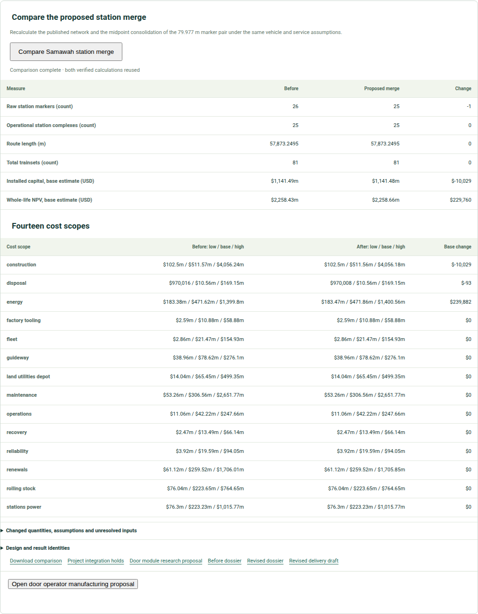

# Reading status and holds

An engineering Workbench can display a great many results. The reader needs
a small vocabulary for judging each one. **Proposed** means a design idea
or edit has been recorded. **Calculated** means a declared model has run.
**Verified digital evidence** means the result and its source relationship
have passed the checks that apply to that software method. **Physically
accepted** would require appropriate hardware, measurements, approved
limits and independent review. The first three states can be useful while
the fourth remains open.

*A current development comparison gives both sides of a station edit and
its outstanding questions. Its numerical deltas are planning results, not
site measurements or construction approval.*

## A visible hold is information

The v0.6.1 Workbench keeps an older integrated dossier and its portfolio
selector held because their source binding does not match the release.
That is a specific software evidence limit. It does not invalidate every
city input or the separately checked Samawah journey. Conversely, a
successful Samawah journey does not repair the held global dossier.
The interface should let a reader see both statements at once.

The same discipline applies to a physical finding. A door may have a
complete count but unresolved fit. A beam may pass an idealized finite
element comparison while its bearing and erection remain open. A city
cost may be complete within a declared model while its ground, land and
supplier prices remain provisional. Treating those as separate statuses
helps the next experiment target a real gap instead of repeating a
calculation that already succeeded.

## Compare before and after with the same scope

In the Samawah development comparison, the raw marker count falls from
26 to 25, while operational station groups and trainsets remain fixed.
Capital and whole-life costs move in different directions. A reader
should ask which assumptions and cost scopes actually changed, whether
the vehicle and civil quantities stayed the same, and which local facts
could overturn the provisional ranking. The report's zero changes are
part of the evidence: they show that unaffected work was preserved.

A different candidate demands a separate comparison. A powered-wheel
research result cannot be used to fill a station-drive force gap in the
passive-wheel reference. A detailed manufacturing child with a different
inter-car gap cannot inherit its parent's platform, fleet and cost results.
The Workbench's candidate and revision identity protects against those
errors when a project moves from one screen to another.

## Take the right next step

For a city planner, a hold may call for a survey, demand count or access
review. For a vehicle designer it may call for a mated drawing or a removal
mock-up. For a civil engineer it may call for a bearing, foundation or
construction-stage model. For a workshop it may call for a supplier
qualification and inspection definition. For an operator it may call for
measured braking and fault-response evidence. The interface is most useful
when it names that next piece of work instead of presenting a vague
“not ready” label.

The final approval remains with the organizations responsible for a real
railway. The Workbench can make the design history clearer and the missing
evidence harder to overlook; it cannot approve manufacture or movement
because a screen looks complete.
