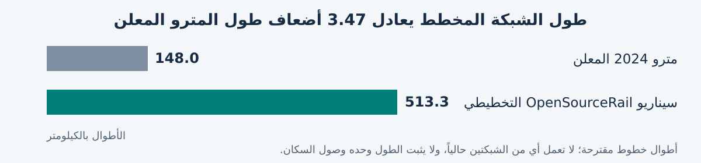

# Baghdad rail options and the case for Iraqi production

**OpenSourceRail policy and investment brief · 17 October 2026**

**English and Arabic in one document · [النسخة العربية الكاملة](#arabic-version)**

For Baghdad Mayoralty, Iraqi transport and finance authorities, industrial partners and prospective lenders. All monetary amounts are USD unless marked IQD. [Shareable PDF](baghdad-rail-options-2026-10-17.pdf).

## The decision for Baghdad

Baghdad needs affordable rail that expands access and builds Iraqi productive capacity. OpenSourceRail proposes **513.3 km across 14 lines**, Iraqi civil production and vehicle assembly, selective component manufacture, and funding arranged around deliverable stages. It deserves a funded, independent feasibility comparison with the conventional metro proposal.

The network is **3.47 times the announced 148 km metro length**, adding **365.3 km of planned lines**. Iraqi production could retain equipment, skills and maintenance capability. These potential advantages require demonstrated delivery, economic returns and funding.

| Measure | Announced 2024 Baghdad Metro | Current OpenSourceRail planning case |
| --- | --- | --- |
| Network length | About 148 km | 513.336 km |
| Lines | 7 | 14 |
| Stations | 64 announced | 159 unique planned stations |
| Headline capital figure | About $18bn announced estimate | $8.667bn unquoted planning allowance |
| Financial status | Offers subsequently failed launch requirements | Facilities modelled; none committed |
| Industrial approach | International consortium; detailed local share unresolved | Iraqi works, assembly and selected component processes proposed |

**The capital difference is not a verified saving:** scope and price bases differ, and OSR has unpriced installed scope. Lengths count lines, not individual running rails; shared corridors and operating distances need reconciliation. Station interchange conventions may differ. [2024 scope and estimate](https://channel8.com/english/news/17595) · [Current Baghdad basis](../../cities/catalogue/west-asia/Iraq/Baghdad/README.md).

Length alone does not establish population access or ridership. Entrances, walking routes, buses, fares and destinations determine usefulness. OSR's 800 m radial catchment contains **1.13 million residents on a 2020 population raster**, not a current census or walking-access result. No equivalent audited catchment is available here for the 148 km proposal.

<!-- pagebreak -->

## European cities combine metro tram and suburban rail

**A metropolitan railway is a network of complementary modes, not just the lines marketed as “metro”.** London and Paris combine urban metro with substantial suburban rail; Berlin, Vienna, Budapest and Prague also use tramways for dense urban coverage. Comparing Baghdad's entire proposed railway only with another city's metro omits much of the transport that makes those cities work.

| City and evidence date | Published rail extent and modes | Interpretation for Baghdad |
| --- | --- | --- |
| London, documented January 2009 baseline | Underground 402 km; National Rail within Greater London 788 km; DLR 31 km; tram 28 km. Overground is part of the rail category, not an additional 788 km. | Even this historical baseline contains over 1,200 modal network-km. It is not a current or fully deduplicated total. Elizabeth line and today's rail services must be assessed in a current network inventory. |
| Paris / Île-de-France, 2024 authority brochure | 2,186 km of metro, RER, suburban train and tram network in the authority's published total. | This is the wider region, not the central municipality. Its suburban and orbital layers are essential to the comparison. |
| Berlin, 2024 operator data | U-Bahn 155 km of service lines; tram 320 km of service lines. The separate S-Bahn network is 340 km and reaches Brandenburg. | Tram service-line lengths reuse corridors. These figures are not summed into a physical network total or divided by Berlin city population. |
| Vienna, 2025 regional authority data | 83 km U-Bahn and 171 km tram network; S-Bahn and regional trains provide another layer. | The 254 km urban subset already exceeds 148 km, for a city of about 2.03 million residents. Wider regional rail is excluded from that subtotal. |
| Budapest, current authority network map | Four metro lines, an extensive tram network, five HÉV suburban lines and connections to mainline suburban services. | About 1.7 million city residents use a layered system. No unverified kilometre total is assigned here. |
| Prague, 2024 operator report | 148.8 km of tram network alone; three metro lines and regional rail are additional. | The tram network alone is approximately the length of the entire 148 km Baghdad proposal, in a city of about 1.40 million residents. |

Sources: [TfL network inventory, report page 189](https://tfl.gov.uk/cdn/static/cms/documents/travel-in-london-report-1-.pdf); [Île-de-France Mobilités 2024 brochure](https://www.iledefrance-mobilites.fr/medias/portail-idfm/ZmcJM5m069VX1mlx_A4_Fiches_DP_2024_78.pdf); [BVG 2024 statistics](https://www.bvg.de/dam/jcr:27ceb5b8-a738-400e-b288-0044d523d050/2025-05-05-bvg-in-zahlen-2024.pdf) and [S-Bahn Berlin](https://sbahn.berlin/en/plan-a-journey/); [VOR report, 2025 figures](https://www.vor.at/fileadmin/CONTENT/Dokumente/VOR_Jahresbericht_2024_digital.pdf); [BKK rail network map](https://bkk.hu/en/journey-planning/maps/fixed-rail-and-trolleybus-network/) and [Budapest authority profile](https://www.emta.com/network/budapest/); [Prague operator report 2024](https://www.dpp.cz/cs/data/V%C3%BDro%C4%8Dn%C3%AD%20zpr%C3%A1vy/Annual%20report/dpp_vz_2024_eng_05.pdf).

These systems developed over decades and combine different service frequencies and capital histories. Their lesson is the **breadth and integration of the network**, not a requirement that Baghdad copy their infrastructure, technology or historic spending. A tram corridor can provide frequent local access; suburban rail can provide longer-distance reach; a metro can serve the busiest corridors. The appropriate mode follows demand and right of way.

<!-- pagebreak -->

## Asian networks show the scale and the limits of comparison

Singapore and Hong Kong show how rail can structure a compact city when integrated with frequent buses. Chinese cities show the scale of rail development across much larger municipal territories. The dated figures below are operating networks, not promised extensions.

| City and snapshot | Published operating extent | Modes and boundary |
| --- | --- | --- |
| Singapore, end 2024 | 271.3 km: 242.5 km MRT and 28.8 km LRT | Island-wide rail, with bus integration. Automated LRT is a feeder mode, not a street tram. |
| Hong Kong, 2024 government overview | About 271 km in the official MTR headline | The overview covers local rail, airport, light rail and the Hong Kong high-speed section. Street trams also operate. Separate light-rail figures are not added again; this mixed headline is excluded from the density calculation. |
| Shanghai, end 2024 | 896 km of reported operating rail transit | Metro and the new suburban Airport Link are included in the reported total; it is not a metro-only comparison. |
| Beijing, end 2024 | 879 km of urban rail | An urban-rail headline, rather than the full national or regional railway network. |
| Guangzhou, end 2024 | 727.1 km: 705 km metro and 22.1 km tram | Municipal transport authority's urban-rail scope; other regional rail is not added here. |
| Shenzhen, end 2024 | 595 km of urban rail | Municipal statistical bulletin's scope; not all railways in the wider Greater Bay Area. |

Sources: [Singapore LTA annual rail lengths](https://www.lta.gov.sg/content/dam/ltagov/who_we_are/statistics_and_publications/statistics/pdf/Rail_Length_2025.pdf); [Hong Kong Transport and Logistics Bureau](https://www.tlb.gov.hk/eng/publications/transport/publications/railwaynetworkMay2024.html); [Shanghai government](https://english.shanghai.gov.cn/en-Latest-WhatsNew/20241230/c2e1f804b3294e588fcb4b4d413be7e0.html); [Beijing development commission](https://fgw.beijing.gov.cn/fzggzl/2025lh/bgjd/2024jd/202501/t20250114_3988046.html); [Guangzhou transport authority](https://jtj.gz.gov.cn/xwdt/gzdt/content/post_10225093.html); [Shenzhen statistical bulletin](https://www.sz.gov.cn/cn/xxgk/zfxxgj/tjsj/tjgb/content/post_12190855.html).

**A large network is not evidence of financial success by itself.** These examples do not establish that every extension is productive or that debt and operating subsidies are affordable. Service frequency, destinations served, utilisation, maintenance and the public subsidy all matter.

Singapore's transport authority aims for roughly **80% of households to be within a ten-minute walk of a train station by the 2030s**. That is a useful accessibility benchmark, not a universal minimum rail length. Baghdad should publish comparable walking-access and feeder-access results separately, using real entrances and streets. A network drawing or a circle around a station cannot establish that result. [Singapore LTA expansion and access policy](https://www.lta.gov.sg/content/ltagov/en/newsroom/2025/3/news-releases/expanding_our_rail_network_and_strengthening_rail_reliability.html).

<!-- pagebreak -->

## Baghdad needs a network plan beyond a single metro package

Population-normalised rail provision gives a useful first scale check. The following index divides the specified rail extent by the population of the named territory. **It is not a deduplicated GIS density or a minimum design standard.** Municipal boundaries, suburban commuters, tourism and built-up density differ; the Chinese municipalities include large outer areas. Detailed appraisal must also measure unique rail-km per 100 km² of built-up area and actual ten-minute walking access; administrative areas are not substitutes for that geography.

| Territory and rail scope | Population used, million | Rail km | Km per million people |
| --- | ---: | ---: | ---: |
| Vienna, metro and tram only, 2025 | 2.0283 | 254.0 | 125.2 |
| Prague, tram only, 2024 | 1.3979 | 148.8 | 106.4 |
| Singapore, MRT and LRT, 2024 | 6.0400 | 271.3 | 44.9 |
| Shanghai, reported urban rail, 2024 | 24.8026 | 896.0 | 36.1 |
| Beijing, urban rail, 2024 | 21.8320 | 879.0 | 40.3 |
| Shenzhen, urban rail, 2024 | 17.9895 | 595.0 | 33.1 |
| Baghdad, announced proposal, planning denominator | 9.7804 | 148.0 | 15.1 |
| Baghdad, OSR proposal, same denominator | 9.7804 | 513.336 | 52.5 |

Population sources: [Vienna city statistics, January 2025](https://www.wien.gv.at/en/administration/statistics); [Czech Statistical Office, Prague end 2024](https://csu.gov.cz/pha/pohyb-obyvatelstva-v-hl-m-praze-v-roce-2024); [Singapore government, June 2024](https://www.population.gov.sg/media-centre/population-in-brief-2024-key-trends/); [Shanghai government overview](https://arabic.shanghai.gov.cn/ar-Overview/20240320/b31815452f5d49b1a127673eae231144.html); [Beijing statistics](https://www.beijing.gov.cn/renwen/bjgk/rk/202503/t20250325_4043973.html); [Shenzhen statistics](https://www.sz.gov.cn/cn/xxgk/zfxxgj/zwdt/content/post_12011800.html). Baghdad uses the repository's **9,780,429 planning population**, not a newly verified census or a harmonised urban boundary.

The 148 km figure is the announced metro package, not an audited inventory of all Baghdad rail. Existing railway corridors and any suburban services must be inventoried before identifying additional infrastructure.

At an alternative Baghdad planning population of 8–10 million, the 148 km proposal gives **14.8–18.5 km per million**, versus **51.3–64.2** for OSR. The contrast survives that denominator sensitivity. The exact coverage requirement still depends on Baghdad's settlement pattern, destinations and corridor loads.

**Treat 148 km as a possible backbone or first programme, not demonstrated citywide completion.** Prepare a multimodal master plan of several hundred kilometres, combining the strongest rail corridors with orbital links, local distribution, suburban access and buses. OSR's 513.3 km proposal is a scale to test, not proof that 513.3 km is optimal or that its service is accepted.

Appraise **500, 750 and 1,000 km long-term network scenarios**, with common population boundaries, unique corridors, station access, passenger demand and whole-life costs. The 750 and 1,000 km options are proposed study cases, not designed or funded OSR extensions. These cases concern total useful urban rail: identify existing, rehabilitated and new corridors separately rather than assume every kilometre must be built anew. Select useful phases within the preferred plan. Smaller cities' extensive tram and suburban networks show why a Baghdad strategy should seek **broad access through several modes**, rather than equate an expensive metro contract with a complete urban transport system.

<!-- pagebreak -->

## A broader network needs lower capital and foreign currency exposure

Test a lower **$10bn capital envelope** alongside an **$18bn reference envelope**. The former is an affordability target below the announced metro estimate, not a proven saving. As network reach rises, the average installed cost ceiling falls. Mechanically extending the announced $18bn / 148 km intensity shows why those procurement economics cannot simply be repeated across a much broader network.

| Network study case | Capital at announced intensity, USD bn | $10bn envelope, USD m/km | $18bn envelope, USD m/km |
| --- | ---: | ---: | ---: |
| 500 km | 60.811 | 20.0 | 36.0 |
| 750 km | 91.216 | 13.3 | 24.0 |
| 1,000 km | 121.622 | 10.0 | 18.0 |

These are **budget and scaling arithmetic, not engineering estimates or price forecasts**. Neither envelope represents available funding. Scaled capital uses the unrounded $18bn / 148 km ratio. Tunnels, stations, demand, ground, land and the balance of metro, tram and suburban rail change actual costs; there is no assumption that every kilometre needs the same infrastructure.

If the illustrative 750 km, $91.216bn amount were entirely borrowed in USD at 7% for 20 years, equal annual debt payments would be about **$8.61bn before operations**. This is a stress illustration, **not the disclosed financing terms of the previous metro proposal**. It shows the exposure created by combining a high capital intensity with a large foreign-currency loan.

Here **hard-currency capital** means imported invoices and other obligations payable in currencies such as USD, EUR or GBP; it is distinct from total fixed investment. Baghdad needs both a lower complete capital cost and a lower dependence on these external payments. IQD borrowing still creates repayment obligations and can crowd out other spending.

The procurement and financing brief should require:

- **Useful access for each dollar:** compare metro, protected tram or light rail, suburban upgrades and feeder services by passenger access, capacity and whole-life cost. Avoid a heavy metro specification where a lower-cost mode can meet the accepted duty.
- **Iraqi production where it pays:** qualify local civil works, precast, assembly and maintenance; import productive machinery and essential inputs selectively. Buy components when local production is uneconomic or unqualified.
- **A complete installed budget and a foreign-currency ledger:** price land, utilities, grid connections, rolling stock, factories, depots, contingency, replacements and operating support; identify imported invoices, foreign debt service and every state guarantee separately.
- **Financeable phases:** approve capped development first, then a useful operating phase with placed financing and funded downside support. Expand only against accepted service, demand, costs and available fiscal capacity.

OSR's retained model assigns **$2.016bn, or 23.27% of capital, to imported invoices**, but that share and its $8.667bn total remain unquoted and omit installed scope. They are targets to validate, not a completed funding solution. British-made tooling and qualifying engineering could support Iraqi productive capacity through defined export-finance packages; those loans still require repayment. The desired advantage is **more useful network and retained capability per unit of public money and foreign-currency exposure**, demonstrated in contracts and operation.

<!-- pagebreak -->

## What happened to earlier Baghdad metro proposals

Baghdad's recurring problem has been converting announcements into a technically complete, financially acceptable railway programme. The causes differ between periods; it would be inaccurate to attribute every earlier failure to funding alone.

| Period | Proposal or milestone | What the record establishes |
| --- | --- | --- |
| Late 1970s and 1980s | Early Baghdad metro planning | War interrupted the early programme; these were different historical circumstances from the recent financing review. |
| 2011 | Systra basic design and tender preparation for two lines, about 22 km and 18 km | A reported $3bn project and intended municipal funding. Design appointment did not establish financed construction. |
| December 2017 | Alstom memorandum for a 20 km Baghdad elevated railway | A cooperation framework covering trains, systems, track and civil works. The separately announced Basra routes were not Baghdad kilometres. |
| October 2020 | Alstom and Hyundai Engineering and Construction letter of intent | A 20 km, 14 station elevated railway proposal; a letter of intent was not financial close. |
| July 2024 | International consortium accredited for the expanded metro opportunity | About 148 km, seven lines and 64 stations, with an approximately $18bn estimate. Accreditation was followed by negotiations over contract details. |
| July 2025 and January 2026 | Financial reassessment and project review | Most financial offers were inadequate to support contracting; the subsequent review found proposals did not satisfy launch conditions. |

Sources: [MEED, 24 May 2011](https://www.meed.com/systra-to-design-baghdad-metro/); [Alstom, 6 December 2017](https://www.alstom.com/press-releases-news/2017/12/alstom-and-the-iraqi-government-sign-a-memorandum-of-understanding-for-the-development-of-urban-transport); [Alstom, 20 October 2020](https://www.alstom.com/press-releases-news/2020/10/alstom-and-iraqi-ministry-transport-sign-letter-intent-implementation); [National Investment Commission consortium announcement](https://investpromo.gov.iq/prime-minister-mohammed-shia-al-sudani-receives-the-accreditation-of-the-winning-consortium-for-the-baghdad-metro-investment-opportunity/).

On **2 July 2025**, transport adviser Nasser Al-Assadi told the Iraqi News Agency that technically capable companies had participated, but most financial offers had not provided enough confidence to proceed with contracts. He explicitly said the metro remained under study. **The investment attempt failed to secure an acceptable financial basis; permanent cancellation of the wider metro project is not established.** [Iraqi News Agency](https://ina.iq/ar/local/237738-.html).

A **4 January 2026** report, attributed to the Prime Minister's Office, described a further review of technical, financial and implementation risks and preparation of a revised investment package, potentially with IFC or European Investment Bank involvement. Those institutions' possible advisory involvement was not a lending commitment. [Iraq Business News](https://www.iraq-businessnews.com/2026/01/04/baghdad-metro-project-under-review/).

On **10 October 2026**, Iraqi News reported that Baghdad Mayoralty was managing the metro's private investment tendering process. The same report's mainline railway funding arrangements concerned the separate Development Road programme and do not establish metro finance. [Iraqi News](https://www.iraqinews.com/iraq/iraq-turkey-oil-funding-agreement-development-road-railway-2026/).

The lesson is to require a workable investment structure before another launch announcement. The 2024 opportunity already contemplated private investment and financing: OpenSourceRail's distinction must be **better scope, affordability and delivery arrangements**, rather than simply attaching a new financing label to the same challenge.

<!-- pagebreak -->

## How Iraqi production could accelerate the economy

The economic objective is reliable access to work, education, markets and services, combined with production capability that remains useful in Iraq. OpenSourceRail proposes to connect these objectives through repeatable civil structures, vehicle assembly and selective local manufacture. Open designs can improve competition and repairability where the relevant intellectual property and interfaces are actually available; bought components still require contractual rights and qualified suppliers.

| Mechanism | Proposed Baghdad application | Evidence needed to establish the benefit |
| --- | --- | --- |
| More useful journeys | Radial and ring connections, integrated fares and feeder services | Surveyed origin and destination demand, accessible entrances, passenger journey times and reliable service |
| Local industrial orders | Qualify Iraqi precast capacity; assemble trains and selected components locally | Delivered quotations, local value added, yields, first articles and accepted production capacity |
| Retained skills and wages | Train production workers, maintenance staff and operators | Recruitment, accredited competence, realistic payroll and a sustainable workload |
| Repeatable delivery | Standardise accepted parts and package successive operating sections | Complete civil and vehicle designs, site adaptation, quality control and measured cycle times |
| Lower supplier dependence | Competitive spares, repair information and interoperable interfaces | Enforceable rights, alternative supply, obsolescence plans and whole-life costs |

The current staffing scenario contains **3,523 permanent operating FTE**, plus **1,733 factory production and support FTE for 59 paid months**. The factory figure is a production establishment during the modelled order, not a promise of permanent employment afterward. Construction employment is separate and incompletely scheduled; these figures should not be multiplied into an unsupported national jobs claim. [Workforce and production basis](../../cities/catalogue/west-asia/Iraq/Baghdad/engineering/programme-recalculation/README.md).

Localisation should pass a commercial test. In the matched OpenSourceRail cases, selective manufacture reduces the capital allowance from **$8.795bn to $8.667bn**, approximately **$128m**, and imported invoice exposure from **$2.358bn to $2.016bn**, approximately **$342m**. These are modelled differences within comparable OSR scope, before supplier validation. Window manufacture has a negative Baghdad-only whole-order margin and remains a bought component. Battery pack assembly retains imported cells and controls; bogie manufacture retains imported wheels, axles and bearings. [Make or buy appraisal](../../cities/catalogue/west-asia/Iraq/Baghdad/engineering/programme-recalculation/component-make-buy.csv).

The resulting **23.27% imported invoice share** is a procurement-model measure. Its complement is not an Iraqi GDP contribution: local invoices can contain imported inputs, distribution costs and profit. The 2024 metro's comparable import share is unknown, so no quantified bilateral import saving is established.

Economic acceleration would come from productive orders during construction and useful transport after opening, followed by lower barriers to working and trading across the city. It requires real service and competitive production. Supplier sales, payroll, land appreciation and fare receipts cannot all be added together as independent economic benefits. A social cost-benefit appraisal must avoid transfers and double counting; factory exports and future Iraqi city orders should remain upside cases until contracted.

<!-- pagebreak -->

## Capital cost and the risk to public finances

The **$8.667bn OSR allowance** includes about $4.058bn for civil works and bearings, $1.270bn for stations and core access, $1.220bn for trains, $416m for assembly and component plants, $290m for depots, $874m for solar and charging, and $539m for signalling and programme overhead. It remains an unquoted comparator. Land, utilities, site-specific foundations, special structures, installed grid and charging upgrades, and the complete accelerated delivery scope still require pricing. Financing costs, reserves and operating cash deficits must be funded alongside capital. [Controlled Iraq basis](../../cities/catalogue/west-asia/Iraq/CURRENT-PLANNING-BASIS.json).

Dividing the published figures gives approximately **$121.6m per route-km** for the $18bn / 148 km announcement and **$16.9m per route-km** for the OSR allowance. This arithmetic does **not** establish a sevenfold cost advantage: scope, design maturity, stations, land, risk allocation, escalation and financing boundaries differ. A procurement decision requires both options repriced against the same passenger service, site evidence, cost date and whole-life boundary.

Iraq should avoid commitments whose debt service, guarantees and replacement imports can overwhelm the transport budget or displace essential spending. The French Treasury's country assessment, updated **13 October 2026**, describes a budget receiving roughly 90% of revenue from hydrocarbons. This makes long-term obligations sensitive to oil and fiscal shocks. [French Treasury](https://www.tresor.economie.gouv.fr/Pays/IQ/situation-economique-et-financiere-de-l-irak).

### Illustrative foreign currency debt exposure

If an entire **$18bn** programme were borrowed in USD and repaid through equal annual payments over **20 years**, the following arithmetic would apply. **These are assumed stress cases, not the 2024 proposal's disclosed financing terms.** No fees, construction interest, grace period, inflation or operating costs are included.

| Assumed annual interest | Annual principal and interest | Total payments over 20 years |
| --- | ---: | ---: |
| 5% | $1.444bn | $28.887bn |
| 7% | $1.699bn | $33.981bn |
| 9% | $1.972bn | $39.437bn |

Calculation: annual payment = principal × interest / (1 − (1 + interest)^−20), with end-of-year payments and full amortisation.

At 7%, the project would need roughly **$1.70bn each year for debt alone**, before operating costs. IQD fares would leave a currency mismatch unless hedged or supported by dependable foreign currency receipts. A private concession can retain public exposure through availability payments, revenue guarantees, termination compensation or exchange-rate protection; these belong in the fiscal assessment.

An $18bn railway does not, by itself, establish that Iraq would become bankrupt. The defensible objection is **unaffordable and poorly allocated public risk**. A white elephant is an expensive asset whose actual usefulness fails to justify its life-cycle burden. Imported equipment is not automatically such an asset, and the documented metro proposals are not shown to be unproven “gadgetbahn” technology. The same affordability and usefulness tests must apply to OpenSourceRail.

<!-- pagebreak -->

## Funding OpenSourceRail without hiding the shortfall

The retained OSR model combines public capital, domestic IQD borrowing, a proposed foreign supplier-credit channel and a conditional grant. Using IQD obligations for IQD revenues could reduce the currency mismatch on those facilities. It does not eliminate interest, inflation, refinancing risk or the effect of large public borrowing on other Iraqi investment.

| Capital source in the retained model | USD equivalent bn | Status |
| --- | ---: | --- |
| Government capital, including import cash | 2.167 | Assumed appropriation; 25% of capital |
| Proposed Chinese import credit | 1.008 | Origin, eligibility and lender acceptance unconfirmed |
| Ordinary IQD bonds | 3.217 | Unplaced |
| Green IQD bonds | 0.883 | Unplaced; eligibility and terms unconfirmed |
| Senior IQD bank capital credit | 1.367 | Uncommitted |
| Conditional climate grant | 0.025 | Unawarded |
| **Capital total** | **8.667** | **Planning sources and uses only** |

Amounts are rounded; the ledger uses a historical planning conversion of **IQD 1,300 per USD**, not a current exchange-rate quote. The government's 25% capital contribution is **not a ceiling on total public exposure**. Additional gap credit, debt costs, reserve requirements and any guarantees remain separate. [Capital sources and monthly cashflows](../../cities/catalogue/west-asia/Iraq/Baghdad/engineering/programme-recalculation/README.md).

The current case is not yet financeable on demonstrated terms. Its **company NPV before finance is negative $3.246bn** at the model's assumed discount rate. That is a project financial result, not a social economic NPV. The scenario clears debt only with assumed facilities, including **uncommitted concessional gap funding at 2%**, and assumed indexed fares and additional receipts. Moving gap funding to the commercial sensitivity increases the peak IQD gap from **5.033tn to 12.041tn**.

Demand is equally consequential. The revenue reference treats one boarding as one paid journey, an upper-bound assumption for integrated fares. At **1.5 boardings per paid journey**, the model retains **IQD 10.554tn terminal debt and IQD 0.406tn unfunded support**. The proposed railway cannot promise repayment from capacity figures. Validated paid demand, affordable fares and funded public service obligations must replace those assumptions. [Financial and transfer sensitivities](../../cities/catalogue/west-asia/Iraq/Baghdad/engineering/programme-recalculation/README.md).

The practical funding improvement is to **reduce the amount that must be credibly committed at each decision**. Establish an Iraqi project entity with transparent procurement and independently reviewed accounts; select a useful first operating corridor; price all its infrastructure, factory needs and operating support; and place its financing before construction. Later tranches should depend on accepted costs, demand evidence and production results. A first phase must work as transport on its own, with its feeder connections and depot, rather than depend on an unfunded network to become useful.

Grants replace borrowing only when awarded. Green bonds remain repayable debt. Guarantees improve credit support but do not provide a second pot of cash. Land development receipts require legal authority, net costs and realistic absorption; speculative uplift cannot close a funding gap.

<!-- pagebreak -->

## British equipment and a realistic export finance route

Britain can support Iraqi production through selected machine tools, process equipment, engineering, inspection and training. Prioritise **equipment manufactured in Britain**, identifying the offered factory and configuration. Use Iraqi construction and fabrication where qualified and competitive, with critical imports selected for function, lifetime support and value. The objective is to acquire durable capability rather than import every building and finished component.

The existing [37-case British supplier assessment](baghdad-uk-factory-suppliers-2026-10-15.md) provides enquiry candidates for machining, welding, lifting, metrology, precast moulds and prestressing. It distinguishes British manufacture from UK distribution of machinery made elsewhere. These are supplier leads; no quoted package, approved production rate or Baghdad service contract is established.

### What UKEF could support

| Route | Possible Baghdad use | Published boundary |
| --- | --- | --- |
| Early Project Services Guarantee | A defined UK feasibility, design or engineering services package | Contracts anticipated up to £30m, with larger cases possible; excludes physical project work; repayment within two years after services delivery |
| Buyer Credit Facility | Eligible UK equipment and services purchased by the Iraqi buyer | Contract normally at least £5m; loan up to 85% of contract value; buyer pays at least 15% directly to the exporter before repayment starts |

The early-services facility also requires at least 15% buyer payment before the facility is used. These products guarantee an acceptable bank's lending; **the Iraqi buyer borrows and the UK supplier delivers**. Approval, premiums, borrower credit, environmental and social review and eligible content remain transaction-specific. Early-services borrowing has a short repayment obligation even if the later railway is not financed. [UKEF early services](https://www.gov.uk/guidance/early-project-services-guarantee) · [UKEF buyer credit](https://www.gov.uk/guidance/buyer-credit-facility).

UKEF's standard foreign-content principle requires **20% UK content**, with other principles assessed separately. Genuine UK engineering and other qualifying services can count; a UK registration or invoicing margin alone does not establish the required economic activity. Physical manufacturing origin and UKEF content are separate assessments. [UKEF foreign-content policy](https://www.gov.uk/government/publications/ukefs-approach-to-foreign-content/ukefs-approach-to-foreign-content).

As published on **17 October 2026**, UKEF lists **£1bn–£2bn market risk appetite for Iraq**, medium and long-term cover available for consideration, and a location-care condition. This is a country-level policy indication, **not an allocation to OpenSourceRail or a commitment to finance this network**. [Country cover policy](https://www.gov.uk/guidance/country-cover-policy-and-indicators).

A proposed new UK OpenSourceRail company could coordinate a defined package with experienced engineering and equipment partners, subject to delivery capability and bank acceptance. An established prime contractor may be preferable where risk allocation requires it. Every invoice needs a named origin, eligible scope, payer and financing source. A UK-supported equipment package would **replace the matching assumed supplier-credit source in a revised model**, rather than add a second loan against the same invoice. IQD availability must be confirmed with the lender; local-currency support elsewhere does not establish IQD terms.

<!-- pagebreak -->

## Conditions for a railway Baghdad can actually deliver

OpenSourceRail's proposed advantage is strongest when a first operating section is useful, its industrial investment is proportionate, and its full public cost is affordable under downside conditions. The six-car Baghdad vehicle, civil structures, power system and production routes remain provisional. Current design studies do not constitute certified designs or authority to manufacture. The chronological energy study reports service shortfalls; an annual solar balance does not establish reliable operation. [Design maturity](../design-engine/hierarchical-development-2026-10-17.md) · [Connected construction and energy study](../../cities/catalogue/west-asia/Iraq/Baghdad/engineering/connected-build/README.md).

| Decision | Required deliverable | Release condition |
| --- | --- | --- |
| Authorise bounded development | Funded feasibility scope, independent advisers, accountable Iraqi sponsor and data access | A capped development budget with no automatic obligation to build the whole network |
| Select a first corridor | Comparable rail and bus options; surveyed demand, walking access and affordability; usable service and depot plan | Superior economic value and deliverable right of way, rather than maximum kilometres alone |
| Freeze engineering and production | Ground and utility investigations, approved loads and structures, vehicle safety design, heat and dust qualification, energy and timetable validation | Independent technical acceptance and complete manufacturing responsibility |
| Contract the first phase | Installed quotations, contingencies, industrial working capital, lifecycle replacements and operating support | Committed sources cover uses; downside debt service and total public exposure fit the approved fiscal envelope |
| Open and expand | Tested assets, trained operators, accepted reliability and measured passenger use | Extend only when performance and finance justify the next tranche |

Existing Iraqi precast and fabrication capacity should be assessed before building duplicate facilities. Factory expansion must follow qualified products and economic order sizes. A smaller first phase may support fewer production lines than the full network model; reprice that industrial programme rather than spreading full-network factory savings across a small order.

An independent appraisal should publish discounted economic benefits and costs, passenger time and reliability changes, distribution of access, net local value added, and the government's yearly exposure to capital, subsidy, debt and guarantees. Compare OpenSourceRail, a revised conventional metro, and practical bus or staged rail alternatives against the same demand and service needs. OpenSourceRail should win that comparison through evidence.

**The recommended decision is a funded, bounded development programme for an Iraqi production railway, with competitive comparison and firm release gates.** The present proposal offers a much wider planned network and a more explicit route to retained industrial capability. Demonstrating affordable delivery of a useful first corridor would give Baghdad a stronger basis for expansion than another announcement dependent on unresolved whole-network finance.

### Source basis

OSR quantities and financial results use the [Baghdad programme](../../cities/catalogue/west-asia/Iraq/Baghdad/README.md) and [controlled Iraq planning basis dated 6 October 2026](../../cities/catalogue/west-asia/Iraq/CURRENT-PLANNING-BASIS.json), as held at repository revision **4340afc026**. The retained capital case is distinct from the unpriced complete accelerated scope. External sources are linked beside the claims they support. This brief does not amend the engineering acceptance status or the controlled financial assumptions.

<!-- pagebreak -->

# خيارات النقل السككي في بغداد ومبررات الإنتاج العراقي

**مذكرة سياسات واستثمار من OpenSourceRail · 17 تشرين الأول 2026**

**نسخة عربية كاملة ضمن الوثيقة نفسها، تلي النص الإنكليزي**

موجّهة إلى أمانة بغداد والجهات العراقية المعنية بالنقل والمالية والشركاء الصناعيين والمقرضين المحتملين. جميع المبالغ بالدولار الأميركي ما لم يُذكر الدينار العراقي صراحةً. [نسخة PDF للمشاركة](baghdad-rail-options-2026-10-17.pdf).

## القرار المطروح أمام بغداد

تحتاج بغداد إلى نقل سككي ميسور التكلفة يوسّع الوصول إلى الخدمات والفرص ويبني القدرة الإنتاجية العراقية. يقترح OpenSourceRail شبكة بطول **513.3 كم موزعة على 14 خطاً**، مع إنتاج عراقي للأعمال المدنية وتجميع القطارات وتصنيع مكونات مختارة وتمويل يرتبط بمراحل قابلة للتنفيذ. ويستحق هذا المقترح دراسة جدوى مستقلة ومموّلة تقارنه بمقترح المترو التقليدي.

يبلغ طول الشبكة **3.47 أضعاف طول المترو المعلن البالغ 148 كم**، أي بزيادة **365.3 كم من الخطوط المخططة**. ويمكن للإنتاج العراقي أن يترك داخل العراق معدات ومهارات وقدرة على الصيانة. وتظل هذه المزايا المحتملة مشروطة بإثبات قابلية التنفيذ والعوائد الاقتصادية وإمكان تأمين التمويل.

| المعيار | مترو بغداد المعلن عام 2024 | السيناريو التخطيطي الحالي لـ OpenSourceRail |
| --- | --- | --- |
| طول الشبكة | نحو 148 كم | 513.336 كم |
| عدد الخطوط | 7 | 14 |
| المحطات | 64 محطة معلنة | 159 محطة مخططة غير مكررة |
| الرقم الرأسمالي الإجمالي المعلن | تقدير معلن بنحو 18 مليار دولار | مخصص تخطيطي قدره 8.667 مليارات دولار، لا يستند إلى عروض أسعار |
| الوضع التمويلي | لم تستوفِ العروض لاحقاً متطلبات الإطلاق | تسهيلات مفترضة في النموذج؛ لا توجد التزامات تمويلية مؤكدة |
| النهج الصناعي | تحالف دولي؛ الحصة المحلية التفصيلية غير محسومة | أعمال عراقية وتجميع وعمليات تصنيع مكونات مختارة |

**الفرق بين الرقمين الرأسماليين ليس وفراً مثبتاً:** فنطاق العمل وأسس الأسعار مختلفان، ولا تزال أعمال مركبة ومتكاملة ضمن OSR غير مسعّرة. تقيس الأطوال امتداد الخطوط، ولا تجمع أطوال القضبان المنفردة؛ وتحتاج الممرات المشتركة ومسافات التشغيل إلى تسوية. كما قد تختلف طريقة احتساب محطات التبادل. [نطاق مقترح 2024 وتقديره](https://channel8.com/english/news/17595) · [الأساس الحالي لبغداد](../../cities/catalogue/west-asia/Iraq/Baghdad/README.md).

لا يثبت الطول وحده مدى وصول السكان أو حجم الإقبال. فالمداخل ومسارات المشي والحافلات والأجور والوجهات هي التي تحدد المنفعة. تضم دوائر نطاق الخدمة حول محطات OSR، بنصف قطر 800 م، **1.13 مليون نسمة وفق شبكة سكانية مكانية لعام 2020**؛ وهذا ليس تعداداً حديثاً أو قياساً لإمكان الوصول مشياً. ولا تتوافر هنا نتيجة مدققة مماثلة لمقترح الـ 148 كم.

<!-- pagebreak -->

## المدن الأوروبية تجمع المترو والترام وقطارات الضواحي

**النقل السككي في المدينة الكبرى شبكة من وسائل متكاملة، وليس الخطوط التي تحمل اسم «المترو» وحدها.** تجمع لندن وباريس المترو الحضري مع شبكات واسعة لقطارات الضواحي؛ وتستخدم برلين وفيينا وبودابست وبراغ الترام لتوسيع التغطية داخل المدينة. ومقارنة كامل شبكة بغداد المقترحة بمترو مدينة أخرى وحده تستبعد جزءاً كبيراً من النقل الذي يخدم تلك المدينة.

| المدينة وتاريخ البيانات | الامتداد السككي المنشور والوسائل | الدلالة لبغداد |
| --- | --- | --- |
| لندن، أساس موثق في كانون الثاني 2009 | مترو بطول 402 كم؛ سكك وطنية داخل لندن الكبرى بطول 788 كم؛ قطار دوكلاندز الخفيف 31 كم؛ وترام 28 كم. شبكة أوفرغراوند جزء من فئة السكك، وليست 788 كم إضافية. | يتضمن هذا الأساس التاريخي أكثر من 1,200 كم بجمع امتدادات الوسائل. وليس إجمالياً حالياً أو منزوع التكرار بالكامل. ويلزم إدراج خط إليزابيث والخدمات الراهنة في حصر حديث للشبكة. |
| باريس وإيل دو فرانس، كتيب الهيئة لعام 2024 | إجمالي منشور قدره 2,186 كم من المترو وقطارات RER وقطارات الضواحي والترام. | المقصود الإقليم الأوسع، وليس بلدية باريس المركزية. وتُعد طبقاته الضاحوية والحلقية أساسية للمقارنة. |
| برلين، بيانات المشغل لعام 2024 | مترو بطول خطوط خدمة 155 كم؛ وترام بطول خطوط خدمة 320 كم. ولشبكة إس بان المنفصلة امتداد 340 كم يصل إلى براندنبورغ. | تتشارك خطوط الترام ممرات، لذلك لا تُجمع هذه الأرقام كإجمالي لشبكة مادية، ولا تُقسم على سكان مدينة برلين. |
| فيينا، بيانات الهيئة الإقليمية لعام 2025 | مترو بطول 83 كم وشبكة ترام بطول 171 كم؛ وتضيف قطارات إس بان والقطارات الإقليمية طبقة أخرى. | يبلغ مجموع المترو والترام وحدهما 254 كم، متجاوزاً 148 كم، لمدينة تضم نحو 2.03 مليون نسمة. ولا تدخل السكك الإقليمية في هذا المجموع. |
| بودابست، خريطة شبكة الهيئة الحالية | أربعة خطوط مترو وشبكة ترام واسعة وخمسة خطوط ضواحٍ HÉV واتصالات بخدمات الضواحي على السكك الرئيسية. | تخدم منظومة متعددة الطبقات مدينةً تضم نحو 1.7 مليون نسمة. ولا يُنسب إليها هنا إجمالي كيلومترات غير متحقق منه. |
| براغ، تقرير المشغل لعام 2024 | شبكة ترام بطول 148.8 كم وحدها؛ وتضاف إليها ثلاثة خطوط مترو وسكك إقليمية. | يعادل الترام وحده تقريباً كامل مقترح بغداد البالغ 148 كم، في مدينة تضم نحو 1.40 مليون نسمة. |

المصادر: [حصر شبكات هيئة نقل لندن، صفحة التقرير 189](https://tfl.gov.uk/cdn/static/cms/documents/travel-in-london-report-1-.pdf)؛ [كتيب هيئة نقل إيل دو فرانس لعام 2024](https://www.iledefrance-mobilites.fr/medias/portail-idfm/ZmcJM5m069VX1mlx_A4_Fiches_DP_2024_78.pdf)؛ [إحصاءات BVG لعام 2024](https://www.bvg.de/dam/jcr:27ceb5b8-a738-400e-b288-0044d523d050/2025-05-05-bvg-in-zahlen-2024.pdf) و[إس بان برلين](https://sbahn.berlin/en/plan-a-journey/)؛ [تقرير VOR وبيانات 2025](https://www.vor.at/fileadmin/CONTENT/Dokumente/VOR_Jahresbericht_2024_digital.pdf)؛ [خريطة شبكة BKK](https://bkk.hu/en/journey-planning/maps/fixed-rail-and-trolleybus-network/) و[تعريف هيئة نقل بودابست](https://www.emta.com/network/budapest/)؛ [تقرير مشغل براغ لعام 2024](https://www.dpp.cz/cs/data/V%C3%BDro%C4%8Dn%C3%AD%20zpr%C3%A1vy/Annual%20report/dpp_vz_2024_eng_05.pdf).

تطورت هذه المنظومات على مدى عقود، وتختلف ترددات خدماتها وتواريخ استثماراتها. والدرس هو **اتساع الشبكة وتكاملها**، لا إلزام بغداد بنسخ بنيتها أو تقنيتها أو إنفاقها التاريخي. فقد يوفر ممر ترام وصولاً محلياً متكرراً، وتوفر قطارات الضواحي امتداداً لمسافات أطول، ويخدم المترو المحاور الأشد ازدحاماً. ويتحدد النمط الملائم بحسب الطلب وحق المرور.

<!-- pagebreak -->

## الشبكات الآسيوية توضح الحجم وحدود المقارنة

توضح سنغافورة وهونغ كونغ كيف ينظم النقل السككي مدينة متراصة عندما يتكامل مع حافلات متكررة. وتوضح المدن الصينية حجم التوسع السككي في أقاليم بلدية أكبر كثيراً. وتمثل الأرقام المؤرخة أدناه شبكات عاملة، لا تمديدات موعودة.

| المدينة وتاريخ الحصر | الامتداد التشغيلي المنشور | الوسائل والحدود |
| --- | --- | --- |
| سنغافورة، نهاية 2024 | 271.3 كم: منها 242.5 كم مترو MRT و28.8 كم نقل خفيف LRT | سكك تغطي الجزيرة وتتكامل مع الحافلات. والنقل الخفيف الآلي وسيلة تغذية، وليس تراماً يسير في الشارع. |
| هونغ كونغ، العرض الحكومي لعام 2024 | نحو 271 كم وفق الرقم الإجمالي المعلن لمنظومة MTR | يشمل العرض السكك المحلية وقطار المطار والنقل الخفيف ومقطع القطار السريع داخل هونغ كونغ. ويعمل الترام أيضاً. ولا تُضاف أرقام النقل الخفيف مرة أخرى؛ ويُستبعد هذا الرقم المختلط من حساب الكثافة. |
| شانغهاي، نهاية 2024 | 896 كم من النقل السككي التشغيلي المعلن | يتضمن الإجمالي المترو وخط ربط المطارين الضاحوي الجديد، وليس مقارنة للمترو وحده. |
| بكين، نهاية 2024 | 879 كم من السكك الحضرية | رقم للسكك الحضرية، وليس كامل الشبكة الوطنية أو الإقليمية. |
| غوانغجو، نهاية 2024 | 727.1 كم: منها 705 كم مترو و22.1 كم ترام | نطاق السكك الحضرية وفق هيئة النقل البلدية؛ ولا تُضاف هنا السكك الإقليمية الأخرى. |
| شنجن، نهاية 2024 | 595 كم من السكك الحضرية | نطاق النشرة الإحصائية البلدية، وليس جميع سكك منطقة الخليج الكبرى الأوسع. |

المصادر: [أطوال السكك السنوية لهيئة النقل البري السنغافورية](https://www.lta.gov.sg/content/dam/ltagov/who_we_are/statistics_and_publications/statistics/pdf/Rail_Length_2025.pdf)؛ [مكتب النقل واللوجستيات في هونغ كونغ](https://www.tlb.gov.hk/eng/publications/transport/publications/railwaynetworkMay2024.html)؛ [حكومة شانغهاي](https://english.shanghai.gov.cn/en-Latest-WhatsNew/20241230/c2e1f804b3294e588fcb4b4d413be7e0.html)؛ [لجنة التنمية في بكين](https://fgw.beijing.gov.cn/fzggzl/2025lh/bgjd/2024jd/202501/t20250114_3988046.html)؛ [هيئة نقل غوانغجو](https://jtj.gz.gov.cn/xwdt/gzdt/content/post_10225093.html)؛ [النشرة الإحصائية لشنجن](https://www.sz.gov.cn/cn/xxgk/zfxxgj/tjsj/tjgb/content/post_12190855.html).

**لا يثبت حجم الشبكة وحده نجاحها المالي.** ولا تثبت هذه الأمثلة إنتاجية كل تمديد أو القدرة على تحمّل ديونه ودعم تشغيله. فتردد الخدمة والوجهات والاستخدام والصيانة والدعم العام كلها عوامل مهمة.

تستهدف هيئة النقل في سنغافورة أن يكون نحو **80% من الأسر على مسافة مشي لا تتجاوز عشر دقائق من محطة قطار خلال ثلاثينيات هذا القرن**. وهذا معيار مفيد لإمكان الوصول، لا حد عالمي أدنى لأطوال السكك. وينبغي لبغداد نشر نتائج الوصول مشياً والوصول بالنقل المغذي منفصلةً، بالاستناد إلى مداخل وشوارع فعلية. فلا تثبت خريطة الشبكة أو دائرة حول محطة تحقق ذلك. [سياسة التوسع والوصول في سنغافورة](https://www.lta.gov.sg/content/ltagov/en/newsroom/2025/3/news-releases/expanding_our_rail_network_and_strengthening_rail_reliability.html).

<!-- pagebreak -->

## بغداد تحتاج خطة شبكة تتجاوز حزمة مترو واحدة

يوفر قياس الامتداد السككي نسبةً إلى السكان اختباراً أولياً مفيداً للحجم. ويقسم المؤشر التالي طول السكك المحدد على سكان الإقليم المذكور. **وهو ليس كثافة مكانية محسوبة بعد إزالة التكرار، ولا معياراً أدنى للتصميم.** فالحدود البلدية والتنقل الضاحوي والسياحة وكثافة العمران تختلف؛ وتشمل البلديات الصينية مناطق خارجية واسعة. ويجب أن يقيس التقييم التفصيلي أيضاً طول السكك غير المكرر لكل 100 كم² من العمران المتصل والوصول الفعلي مشياً خلال عشر دقائق؛ فلا تحل المساحات الإدارية محل هذه الجغرافيا.

| الإقليم ونطاق السكك | السكان المستخدمون، بالمليون | طول السكك، كم | كم لكل مليون نسمة |
| --- | ---: | ---: | ---: |
| فيينا، المترو والترام فقط، 2025 | 2.0283 | 254.0 | 125.2 |
| براغ، الترام فقط، 2024 | 1.3979 | 148.8 | 106.4 |
| سنغافورة، MRT وLRT، 2024 | 6.0400 | 271.3 | 44.9 |
| شانغهاي، السكك الحضرية المعلنة، 2024 | 24.8026 | 896.0 | 36.1 |
| بكين، السكك الحضرية، 2024 | 21.8320 | 879.0 | 40.3 |
| شنجن، السكك الحضرية، 2024 | 17.9895 | 595.0 | 33.1 |
| بغداد، المقترح المعلن، بمقام سكاني تخطيطي | 9.7804 | 148.0 | 15.1 |
| بغداد، مقترح OSR، بالمقام نفسه | 9.7804 | 513.336 | 52.5 |

مصادر السكان: [إحصاءات مدينة فيينا، كانون الثاني 2025](https://www.wien.gv.at/en/administration/statistics)؛ [الإحصاء التشيكي، براغ نهاية 2024](https://csu.gov.cz/pha/pohyb-obyvatelstva-v-hl-m-praze-v-roce-2024)؛ [حكومة سنغافورة، حزيران 2024](https://www.population.gov.sg/media-centre/population-in-brief-2024-key-trends/)؛ [نظرة عامة لحكومة شانغهاي](https://arabic.shanghai.gov.cn/ar-Overview/20240320/b31815452f5d49b1a127673eae231144.html)؛ [إحصاءات بكين](https://www.beijing.gov.cn/renwen/bjgk/rk/202503/t20250325_4043973.html)؛ [إحصاءات شنجن](https://www.sz.gov.cn/cn/xxgk/zfxxgj/zwdt/content/post_12011800.html). ويُستخدم لبغداد **عدد سكان تخطيطي من المستودع قدره 9,780,429 نسمة**، وليس تعداداً جرى التحقق منه حديثاً أو حدوداً حضرية موحّدة للمقارنة.

يمثل رقم 148 كم حزمة المترو المعلنة، وليس حصراً مدققاً لجميع سكك بغداد. ويجب حصر الممرات السككية القائمة وأي خدمات ضواحٍ قبل تحديد البنية الإضافية المطلوبة.

وبافتراض بديل لسكان بغداد يتراوح بين 8 و10 ملايين، يوفر مقترح 148 كم **من 14.8 إلى 18.5 كم لكل مليون نسمة**، مقابل **من 51.3 إلى 64.2 كم** لمقترح OSR. ويستمر الفرق مع هذا التغير في المقام السكاني. أما متطلبات التغطية الدقيقة فتتوقف على نمط الاستيطان والوجهات وأحمال الممرات في بغداد.

**ينبغي التعامل مع 148 كم كعمود فقري محتمل أو برنامج أول، لا كدليل على اكتمال التغطية على مستوى المدينة.** وتُعد خطة رئيسية متعددة الوسائل بطول عدة مئات من الكيلومترات تجمع المحاور السككية الأقوى والروابط الحلقية والتوزيع المحلي والوصول إلى الضواحي والحافلات. ومقترح OSR البالغ 513.3 كم حجم يستحق الاختبار، لا إثبات بأن هذا الطول هو الأمثل أو أن خدمته مقبولة تشغيلياً.

تُقيّم **سيناريوهات طويلة الأجل بطول 500 و750 و1,000 كم**، بحدود سكانية وممرات غير مكررة ووصول للمحطات وطلب ركاب وتكاليف دورة حياة قابلة للمقارنة. وخيارا 750 و1,000 كم حالتا دراسة مقترحتان، وليسا تمديدات OSR مصممة أو مموّلة. وتخص هذه الحالات إجمالي السكك الحضرية المفيدة؛ فتُحدد الممرات القائمة والمعاد تأهيلها والجديدة منفصلةً بدلاً من افتراض بناء كل كيلومتر من الصفر. وتُختار مراحل مفيدة ضمن الخطة المفضلة. وتوضح شبكات الترام والضواحي الواسعة في مدن أصغر لماذا ينبغي لبغداد السعي إلى **وصول واسع بوسائل متعددة** بدلاً من مساواة عقد مترو باهظ بمنظومة نقل حضري مكتملة.

<!-- pagebreak -->

## الشبكة الأوسع تحتاج رأس مال أقل وتعرضاً أقل للعملات الصعبة

يُختبر **سقف رأسمالي أقل قدره 10 مليارات دولار** إلى جانب **سقف مرجعي قدره 18 مليار دولار**. الأول هدف للقدرة على تحمّل التكلفة أدنى من تقدير المترو المعلن، وليس وفراً مثبتاً. وينخفض متوسط التكلفة المركبة المسموح به كلما ازداد امتداد الشبكة. ويوضح التوسع الحسابي بمعدل 18 مليار دولار لكل 148 كم سبب عدم إمكان تكرار اقتصاديات الشراء نفسها على شبكة أوسع بكثير.

| حالة دراسة الشبكة | رأس المال بمعدل المقترح المعلن، بمليارات الدولارات | سقف 10 مليارات، مليون دولار للكم | سقف 18 ملياراً، مليون دولار للكم |
| --- | ---: | ---: | ---: |
| 500 كم | 60.811 | 20.0 | 36.0 |
| 750 كم | 91.216 | 13.3 | 24.0 |
| 1,000 كم | 121.622 | 10.0 | 18.0 |

هذه **حسابات سقف موازنة وتوسيع حجم، وليست تقديرات هندسية أو توقعات أسعار**. ولا يمثل أي من السقفين تمويلاً متاحاً. وتستخدم حسابات التوسع النسبة غير المقربة، أي 18 مليار دولار لكل 148 كم. وتغير الأنفاق والمحطات والطلب والتربة والأراضي ومزيج المترو والترام وقطارات الضواحي التكلفة الفعلية؛ ولا يُفترض أن يحتاج كل كيلومتر إلى البنية نفسها.

إذا اقترضت حالة 750 كم التوضيحية، البالغة 91.216 مليار دولار، كامل المبلغ بالدولار بفائدة 7% لمدة 20 عاماً، فستبلغ الأقساط السنوية المتساوية نحو **8.61 مليارات دولار قبل التشغيل**. وهذا مثال ضغط، **وليس شروط التمويل المعلنة لمقترح المترو السابق**. ويوضح المخاطر الناتجة عن الجمع بين تكلفة رأسمالية مرتفعة للكيلومتر وقرض كبير بالعملة الأجنبية.

يُقصد بـ **رأس المال المطلوب بالعملة الصعبة** هنا فواتير الاستيراد والالتزامات الأخرى المستحقة بعملات مثل الدولار واليورو والجنيه الإسترليني؛ وهو يختلف عن إجمالي الاستثمار الثابت. وتحتاج بغداد إلى خفض التكلفة الرأسمالية الكاملة والاعتماد على هذه المدفوعات الخارجية معاً. ويبقى الاقتراض بالدينار منشئاً لالتزامات سداد، وقد يزاحم إنفاقاً آخر.

ينبغي أن يشترط موجز المشتريات والتمويل:

- **وصولاً مفيداً مقابل كل دولار:** مقارنة المترو والترام أو النقل الخفيف في مسارات محمية وتحديث سكك الضواحي والنقل المغذي بحسب الوصول والطاقة الاستيعابية وتكلفة دورة الحياة. وتُتجنب مواصفات المترو الثقيل حيث يلبي نمط أقل تكلفة متطلبات التشغيل المقبولة.
- **إنتاجاً عراقياً حيث تثبت جدواه:** تأهيل الأعمال المدنية والخرسانة مسبقة الصب والتجميع والصيانة محلياً، واستيراد الآلات الإنتاجية والمدخلات الأساسية انتقائياً. وتُشترى المكونات عندما لا يكون إنتاجها المحلي اقتصادياً أو مؤهلاً.
- **موازنة كاملة للتنفيذ وسجلاً للعملات الأجنبية:** تسعير الأراضي والخدمات والربط الكهربائي والقطارات والمصانع والمستودعات والاحتياطيات والاستبدالات ودعم التشغيل؛ وتحديد فواتير الاستيراد وخدمة الدين الأجنبي وكل ضمان حكومي منفصلةً.
- **مراحل قابلة للتمويل:** إجازة تطوير محدود التكلفة أولاً، ثم مرحلة تشغيل مفيدة بتمويل مؤمّن ودعم مموّل للحالات الأضعف. ويجري التوسع مقابل خدمة وطلب وتكاليف مقبولة وقدرة مالية عامة متاحة.

يخصص نموذج OSR المحتفظ به **2.016 مليار دولار، أو 23.27% من رأس المال، لفواتير الاستيراد**، لكن هذه الحصة وإجماليه البالغ 8.667 مليارات دولار لا يستندان إلى عروض أسعار ولا يشملان كامل التنفيذ المركب. وهما هدفان للتحقق، لا حل تمويلي مكتمل. وقد تدعم المعدات المصنّعة في بريطانيا والهندسة المؤهلة قدرة إنتاجية عراقية من خلال حزم تمويل صادرات محددة؛ وتظل هذه القروض واجبة السداد. والميزة المنشودة هي **شبكة أكثر فائدة وقدرة محتفظ بها أكبر مقابل كل وحدة من المال العام والتعرض للعملات الأجنبية**، مثبتةً في العقود والتشغيل.

<!-- pagebreak -->

## ما الذي حدث لمحاولات مترو بغداد السابقة

تتمثل مشكلة بغداد المتكررة في تحويل الإعلانات إلى برنامج سككي مكتمل فنياً ومقبول تمويلياً. وتختلف الأسباب بين المراحل؛ لذلك لا يصح إرجاع كل تعثر سابق إلى التمويل وحده.

| الفترة | المقترح أو الحدث | ما يثبته السجل |
| --- | --- | --- |
| أواخر السبعينيات والثمانينيات | التخطيط المبكر لمترو بغداد | عطّلت الحرب البرنامج المبكر؛ وهي ظروف تاريخية تختلف عن مراجعة التمويل الأخيرة. |
| 2011 | إعداد سيسترا التصاميم الأساسية ووثائق العطاء لخطين بطول نحو 22 كم و18 كم | مشروع قُدرت تكلفته، بحسب التقارير، بـ 3 مليارات دولار مع توجّه إلى تمويل بلدي. تعيين المصمم لا يثبت تمويل التنفيذ. |
| كانون الأول 2017 | مذكرة تفاهم لألستوم بشأن قطار بغداد المرتفع بطول 20 كم | إطار تعاون يشمل القطارات والأنظمة والسكة والأعمال المدنية. خطوط البصرة التي أُعلنت منفصلة لا تُحتسب ضمن أطوال بغداد. |
| تشرين الأول 2020 | خطاب نوايا لألستوم وهيونداي للهندسة والإنشاءات | مقترح قطار مرتفع بطول 20 كم و14 محطة؛ خطاب النوايا لا يعني الإغلاق المالي. |
| تموز 2024 | اعتماد تحالف دولي لفرصة الاستثمار في مشروع المترو الموسّع | نحو 148 كم و7 خطوط و64 محطة، بتقدير يقارب 18 مليار دولار. أعقبت الاعتماد مفاوضات لاستكمال تفاصيل العقد. |
| تموز 2025 وكانون الثاني 2026 | إعادة تقييم التمويل ومراجعة المشروع | لم تكن معظم العروض المالية كافية للتعاقد؛ وخلصت المراجعة اللاحقة إلى عدم استيفاء المقترحات شروط الإطلاق. |

المصادر: [ميد، 24 أيار 2011](https://www.meed.com/systra-to-design-baghdad-metro/)؛ [ألستوم، 6 كانون الأول 2017](https://www.alstom.com/press-releases-news/2017/12/alstom-and-the-iraqi-government-sign-a-memorandum-of-understanding-for-the-development-of-urban-transport)؛ [ألستوم، 20 تشرين الأول 2020](https://www.alstom.com/press-releases-news/2020/10/alstom-and-iraqi-ministry-transport-sign-letter-intent-implementation)؛ [إعلان هيئة الاستثمار الوطنية بشأن التحالف](https://investpromo.gov.iq/prime-minister-mohammed-shia-al-sudani-receives-the-accreditation-of-the-winning-consortium-for-the-baghdad-metro-investment-opportunity/).

في **2 تموز 2025**، أوضح مستشار شؤون النقل ناصر الأسدي لوكالة الأنباء العراقية أن شركات كفوءة فنياً قد شاركت، لكن معظم العروض المالية لم توفر ثقة كافية للمضي في التعاقد. وأكد صراحةً أن المترو لا يزال قيد الدراسة. **لم تنجح المحاولة الاستثمارية في تأمين أساس مالي مقبول؛ ولا يثبت ذلك إلغاء مشروع المترو الأوسع نهائياً.** [وكالة الأنباء العراقية](https://ina.iq/ar/local/237738-.html).

ووصف تقرير مؤرخ في **4 كانون الثاني 2026**، منسوب إلى المكتب الإعلامي لرئيس مجلس الوزراء، مراجعة إضافية للمخاطر الفنية والمالية والتنفيذية، وإعداد حزمة استثمارية معدّلة مع احتمال مشاركة مؤسسة التمويل الدولية أو بنك الاستثمار الأوروبي. واحتمال تقديم هذه المؤسسات المشورة لا يُعد التزاماً بالإقراض. [أخبار الأعمال العراقية](https://www.iraq-businessnews.com/2026/01/04/baghdad-metro-project-under-review/).

وفي **10 تشرين الأول 2026**، أفاد موقع «إيراكي نيوز» بأن أمانة بغداد تتولى إجراءات طرح المترو للاستثمار الخاص. أما ترتيبات تمويل السكك الرئيسية الواردة في التقرير نفسه فتخص مشروع طريق التنمية المنفصل، ولا تثبت تمويل المترو. [إيراكي نيوز](https://www.iraqinews.com/iraq/iraq-turkey-oil-funding-agreement-development-road-railway-2026/).

الدرس هو اشتراط هيكل استثماري قابل للتنفيذ قبل إعلان إطلاق جديد. فقد تضمنت فرصة عام 2024 أصلاً الاستثمار والتمويل الخاصين؛ لذا يجب أن يتميز OpenSourceRail بـ **تحسين نطاق المشروع والقدرة على تحمّل تكلفته وترتيبات تنفيذه**، بدلاً من الاكتفاء بإطلاق تسمية تمويلية جديدة على التحدي نفسه.

<!-- pagebreak -->

## كيف يمكن للإنتاج العراقي أن يسرّع النشاط الاقتصادي

الهدف الاقتصادي هو الوصول الموثوق إلى العمل والتعليم والأسواق والخدمات، مع قدرة إنتاجية تبقى مفيدة داخل العراق. ويقترح OpenSourceRail ربط هذه الأهداف بمنشآت مدنية قابلة للتكرار وتجميع القطارات والتصنيع المحلي الانتقائي. ويمكن للتصاميم المفتوحة تحسين المنافسة وقابلية الإصلاح حين تتوافر فعلياً حقوق الملكية الفكرية والواجهات المعنية؛ أما المكونات المشتراة فتبقى بحاجة إلى حقوق تعاقدية ومورّدين مؤهّلين.

| آلية الأثر | التطبيق المقترح في بغداد | الأدلة اللازمة لإثبات المنفعة |
| --- | --- | --- |
| رحلات أكثر فائدة | وصلات شعاعية وحلقية وأجور متكاملة وخدمات نقل مغذّية | مسوح طلب تحدد منشأ الرحلات ووجهاتها، ومداخل ميسّرة، وأزمنة سفر وخدمة موثوقة |
| طلبات تصنيع محلية | تأهيل قدرات الخرسانة العراقية مسبقة الصب؛ وتجميع القطارات ومكونات مختارة محلياً | عروض أسعار شاملة التسليم، وقيمة مضافة محلية، ومردود الإنتاج، وعينات أولية، وطاقة إنتاجية مقبولة |
| الاحتفاظ بالمهارات والأجور | تدريب عمال الإنتاج وموظفي الصيانة والتشغيل | توظيف وكفاءات معتمدة وأجور واقعية وحجم عمل مستدام |
| تنفيذ قابل للتكرار | توحيد الأجزاء المقبولة وتجهيز مقاطع تشغيلية متتابعة | تصاميم مكتملة للأعمال المدنية والمركبات، ومواءمة الموقع، وضبط الجودة، وأزمنة دورات إنتاج مقاسة |
| خفض الاعتماد على المورّد | قطع غيار تنافسية ومعلومات إصلاح وواجهات متوافقة | حقوق قابلة للإنفاذ ومصادر بديلة وخطط للتعامل مع تقادم المعدات وتكاليف دورة الحياة |

يتضمن سيناريو القوى العاملة الحالي **3,523 وظيفة تشغيل دائمة محسوبة بمكافئ الدوام الكامل**، إضافة إلى **1,733 وظيفة إنتاج ودعم في المصانع بمكافئ الدوام الكامل لمدة 59 شهراً مدفوعة الأجر**. ويمثل رقم المصانع ملاكاً إنتاجياً خلال الطلبية المفترضة، وليس وعداً بوظائف دائمة بعدها. وتُحسب عمالة الإنشاء منفصلةً ولم تُستكمل جدولتها؛ ولا ينبغي مضاعفة هذه الأرقام لإطلاق ادعاءات غير مسندة عن الوظائف على المستوى الوطني. [أساس القوى العاملة والإنتاج](../../cities/catalogue/west-asia/Iraq/Baghdad/engineering/programme-recalculation/README.md).

ينبغي أن يجتاز التوطين اختبار الجدوى التجارية. ففي حالات OpenSourceRail المتطابقة في النطاق، يخفض التصنيع الانتقائي المخصص الرأسمالي من **8.795 إلى 8.667 مليارات دولار**، أي نحو **128 مليون دولار**، ويخفض قيمة فواتير الاستيراد من **2.358 إلى 2.016 مليار دولار**، أي نحو **342 مليون دولار**. وهذه فروق ناتجة عن النموذج ضمن نطاقات OSR قابلة للمقارنة، قبل التحقق بعروض المورّدين. ولتصنيع النوافذ هامش سلبي على إجمالي طلبية بغداد وحدها، لذلك تبقى مكوّناً مشترى. ويعتمد تجميع حزم البطاريات على خلايا ووحدات تحكم مستوردة؛ كما يبقى تصنيع عربات حمل القطار «البوجيات» معتمداً على عجلات ومحاور ومحامل مستوردة. [تقييم التصنيع أو الشراء](../../cities/catalogue/west-asia/Iraq/Baghdad/engineering/programme-recalculation/component-make-buy.csv).

تمثل **حصة فواتير الاستيراد البالغة 23.27%** مقياساً في نموذج المشتريات. ولا تمثل النسبة المتبقية مساهمة في الناتج المحلي العراقي؛ فقد تتضمن الفواتير المحلية مدخلات مستوردة وتكاليف توزيع وأرباحاً. وحصة الاستيراد المقابلة لمترو 2024 غير معلومة، لذلك لا يوجد وفر استيراد كمي مثبت بين المشروعين.

يمكن أن ينشأ تسارع النشاط الاقتصادي من الطلبات الإنتاجية أثناء الإنشاء والنقل النافع بعد الافتتاح، ثم من تيسير العمل والتجارة داخل المدينة. ويتطلب ذلك خدمة فعلية وإنتاجاً تنافسياً. ولا يجوز جمع مبيعات المورّدين والأجور وارتفاع أسعار الأراضي وإيرادات التذاكر بوصفها منافع اقتصادية مستقلة. ويجب أن يتجنب تقييم المنافع والتكاليف الاجتماعية التحويلات والاحتساب المزدوج؛ وتبقى صادرات المصانع وطلبيات المدن العراقية المستقبلية فرصاً إضافية إلى أن تصبح تعاقدات فعلية.

<!-- pagebreak -->

## التكلفة الرأسمالية والمخاطر على المالية العامة

يتضمن **مخصص OSR البالغ 8.667 مليارات دولار** نحو 4.058 مليارات للأعمال المدنية والمساند، و1.270 مليار للمحطات ومرافق الوصول الأساسية، و1.220 مليار للقطارات، و416 مليوناً لمصانع التجميع والمكونات، و290 مليوناً للمستودعات، و874 مليوناً للطاقة الشمسية والشحن، و539 مليوناً للإشارات والمصاريف العامة للبرنامج. وهو سيناريو مقارن لا يستند إلى عروض أسعار. ولا تزال الأراضي وتحويلات الخدمات والأساسات الخاصة بالمواقع والمنشآت الخاصة وتجهيزات الربط بالشبكة والشحن وكامل نطاق التنفيذ المعجّل بحاجة إلى تسعير. ويجب تمويل تكاليف التمويل والاحتياطيات والعجز النقدي التشغيلي إلى جانب رأس المال. [أساس التخطيط العراقي المضبوط في المستودع](../../cities/catalogue/west-asia/Iraq/CURRENT-PLANNING-BASIS.json).

تعطي قسمة الأرقام المنشورة نحو **121.6 مليون دولار لكل كيلومتر مسار** لإعلان 18 مليار دولار و148 كم، مقابل **16.9 مليون دولار لكل كيلومتر مسار** في مخصص OSR. ولا تثبت هذه العملية الحسابية **تفوقاً في التكلفة بمقدار سبعة أضعاف**؛ فنطاق العمل ونضج التصميم والمحطات والأراضي وتوزيع المخاطر وتصاعد الأسعار وحدود التمويل مختلفة. ويتطلب قرار الشراء إعادة تسعير الخيارين وفق خدمة ركاب وأدلة موقع وتاريخ أسعار وحدود تكلفة لدورة الحياة متطابقة.

ينبغي للعراق تجنب التزامات يمكن أن تستنزف فيها خدمة الدين والضمانات والواردات اللازمة للاستبدال موازنة النقل أو تزاحم الإنفاق الأساسي. ويصف تقييم الخزانة الفرنسية، المحدّث في **13 تشرين الأول 2026**، موازنةً يأتي نحو 90% من إيراداتها من الهيدروكربونات. وهذا يجعل الالتزامات الطويلة الأجل حساسة للصدمات النفطية والمالية. [الخزانة الفرنسية](https://www.tresor.economie.gouv.fr/Pays/IQ/situation-economique-et-financiere-de-l-irak).

### مثال توضيحي للتعرض لديون بالعملة الأجنبية

إذا اقترض برنامج بقيمة **18 مليار دولار كاملةً** بالدولار الأميركي وسدّد بقسط سنوي ثابت على مدى **20 عاماً**، فستنتج الأرقام التالية. **هذه حالات ضغط افتراضية، وليست شروط التمويل المعلنة لمقترح 2024.** ولا تشمل الرسوم أو فوائد فترة الإنشاء أو السماح أو التضخم أو تكاليف التشغيل.

| الفائدة السنوية المفترضة | القسط السنوي لأصل الدين والفائدة | إجمالي المدفوعات خلال 20 عاماً |
| --- | ---: | ---: |
| 5% | 1.444 مليار دولار | 28.887 مليار دولار |
| 7% | 1.699 مليار دولار | 33.981 مليار دولار |
| 9% | 1.972 مليار دولار | 39.437 مليار دولار |

طريقة الحساب: القسط السنوي يساوي أصل القرض مضروباً في معدل الفائدة، مقسوماً على واحد ناقص القيمة الحالية لوحدة نقدية بعد 20 عاماً بالمعدل نفسه. ويُفترض السداد في نهاية كل سنة والإطفاء الكامل لأصل الدين.

عند فائدة 7%، يحتاج المشروع إلى نحو **1.70 مليار دولار سنوياً لخدمة الدين وحدها** قبل التشغيل. وتترك الأجور المحصّلة بالدينار العراقي عدم تطابق في العملات ما لم يُتحوّط له أو يُغطَّ بإيرادات موثوقة من العملة الأجنبية. وقد يُبقي عقد الامتياز الخاص مخاطر على الدولة من خلال مدفوعات الإتاحة أو ضمان الإيرادات أو تعويض إنهاء العقد أو الحماية من تقلب الصرف؛ ويجب إدراجها في التقييم المالي العام.

لا يثبت مشروع سككي بقيمة 18 مليار دولار، بمجرد حجمه، أن العراق سيُفلس. والاعتراض القابل للدفاع عنه هو **مخاطر على المال العام لا يمكن تحمّلها أو تُوزّع توزيعاً سيئاً**. ويُطلق وصف «الفيل الأبيض» على أصل باهظ لا تبرر منفعته الفعلية عبء تكاليفه طوال عمره. ولا تصبح المعدات المستوردة كذلك تلقائياً، كما لا تثبت المقترحات الموثقة أنها أنظمة نقل استعراضية غير مجرّبة من نوع «gadgetbahn». ويجب إخضاع OpenSourceRail لاختبارات القدرة على تحمّل التكلفة والمنفعة نفسها.

<!-- pagebreak -->

## تمويل OpenSourceRail مع إظهار العجز كاملاً

يجمع نموذج OSR المحتفظ به بين رأس مال حكومي واقتراض محلي بالدينار وقناة مقترحة لائتمان المورّد الأجنبي ومنحة مشروطة. وقد يقلل استخدام التزامات بالدينار مقابل إيرادات بالدينار عدم التطابق في العملة لهذه التسهيلات. لكنه لا يلغي الفائدة أو التضخم أو مخاطر إعادة التمويل أو أثر الاقتراض العام الكبير في الاستثمارات العراقية الأخرى.

| مصدر رأس المال في النموذج | المعادل بمليارات الدولارات | الوضع |
| --- | ---: | --- |
| رأس المال الحكومي، بما فيه النقد المخصص للاستيراد | 2.167 | تخصيص مفترض؛ 25% من رأس المال |
| ائتمان استيراد صيني مقترح | 1.008 | المنشأ والأهلية وقبول المقرض غير مؤكدة |
| سندات عادية بالدينار العراقي | 3.217 | لم تُطرح وتُكتتب فعلياً |
| سندات خضراء بالدينار العراقي | 0.883 | لم تُكتتب؛ الأهلية والشروط غير مؤكدة |
| ائتمان رأسمالي مصرفي ذو أولوية السداد بالدينار العراقي | 1.367 | غير ملتزم به |
| منحة مناخية رأسمالية مشروطة | 0.025 | لم تُمنح |
| **إجمالي رأس المال** | **8.667** | **مصادر واستخدامات تخطيطية فقط** |

الأرقام مقربة؛ ويستخدم السجل تحويلاً تخطيطياً تاريخياً قدره **1,300 دينار عراقي للدولار**، وليس سعراً حالياً للصرف. ولا تمثل مساهمة الحكومة البالغة 25% من رأس المال **حداً أقصى لإجمالي تعرض الدولة**. فتبقى تسهيلات تغطية العجز وتكاليف الدين والاحتياطيات وأي ضمانات بنوداً منفصلة. [المصادر الرأسمالية والتدفقات النقدية الشهرية](../../cities/catalogue/west-asia/Iraq/Baghdad/engineering/programme-recalculation/README.md).

لم تُثبت بعد قابلية تمويل الحالة الحالية بشروط فعلية. ويبلغ **صافي القيمة الحالية للشركة قبل التمويل سالب 3.246 مليارات دولار** وفق معدل الخصم المفترض في النموذج. وهذه نتيجة مالية للمشروع، لا صافي قيمة حالية اقتصادية اجتماعية. ولا يسدد السيناريو الدين كاملاً إلا بافتراض تسهيلات تشمل **تمويلاً ميسّراً للعجز بفائدة 2% غير ملتزم به**، وافتراض ربط أجور النقل بمؤشرات الأسعار وإيرادات إضافية. ويرفع اختبار التمويل التجاري للعجز ذروة الفجوة بالدينار من **5.033 إلى 12.041 تريليون دينار**.

وللطلب أثر حاسم أيضاً. يفترض مرجع الإيرادات أن كل صعود إلى قطار يساوي رحلة مدفوعة واحدة، وهو افتراض حد أعلى عند استخدام أجور متكاملة. وعند **1.5 عملية صعود لكل رحلة مدفوعة**، يُبقي النموذج **10.554 تريليونات دينار من الديون في نهاية الأفق و0.406 تريليون دينار من الدعم غير المموّل**. ولا يجوز الوعد بسداد التمويل استناداً إلى الطاقة الاستيعابية. ويجب استبدال هذه الافتراضات بطلب مدفوع متحقق منه وأجور ميسورة والتزامات خدمة عامة مموّلة. [اختبارات حساسية التمويل والتحويل بين الخطوط](../../cities/catalogue/west-asia/Iraq/Baghdad/engineering/programme-recalculation/README.md).

التحسين العملي للتمويل هو **خفض حجم الالتزام الواجب تأمينه بصورة موثوقة عند كل قرار**. يُنشأ كيان عراقي للمشروع بمشتريات شفافة وحسابات تخضع لمراجعة مستقلة، ويُختار ممر تشغيلي أول مفيد، وتُسعّر جميع بنيته التحتية واحتياجات مصانعه ودعم تشغيله، ويُؤمّن تمويله قبل الإنشاء. وترتبط الدفعات اللاحقة بتكاليف مقبولة وأدلة الطلب ونتائج الإنتاج. ويجب أن تعمل المرحلة الأولى كنقل مفيد بذاته، مع وصلات النقل المغذية ومستودعها، بدلاً من اعتماد منفعتها على شبكة لم يُموّل إنشاؤها بعد.

لا تحل المنح محل الاقتراض إلا بعد منحها فعلياً. وتبقى السندات الخضراء ديوناً واجبة السداد. وتعزز الضمانات الملاءة الائتمانية، لكنها لا تنشئ مبلغاً نقدياً ثانياً. وتتطلب إيرادات تطوير الأراضي صلاحيات قانونية واحتساب صافي التكاليف وقدرة سوقية واقعية على الاستيعاب؛ ولا تسد الزيادة الافتراضية في قيمة الأرض فجوة التمويل.

<!-- pagebreak -->

## المعدات البريطانية ومسار واقعي لتمويل الصادرات

يمكن لبريطانيا دعم الإنتاج العراقي بآلات تشغيل ومعدات عمليات وخدمات هندسة وفحص وتدريب مختارة. وتُعطى الأولوية لـ **معدات مصنّعة في بريطانيا** مع تحديد المصنع والتجهيز المعروضين. وتُستخدم قدرات البناء والتصنيع العراقية متى كانت مؤهلة وتنافسية، وتُختار الواردات الأساسية بحسب الوظيفة والدعم طوال العمر والقيمة. والهدف اكتساب قدرة مستدامة بدلاً من استيراد كل مبنى وكل مكوّن نهائي.

يوفر [تقييم المورّدين البريطانيين الذي يغطي 37 حالة](baghdad-uk-factory-suppliers-2026-10-15.md) أسماء أولية لطلب العروض في التشغيل المعدني واللحام والرفع والقياس وقوالب الخرسانة مسبقة الصب والشد المسبق. ويميّز التصنيع البريطاني من توزيع شركات بريطانية معدات مصنّعة في الخارج. وهذه خيارات للاستفسار؛ فلا توجد حزمة مسعّرة أو معدلات إنتاج معتمدة أو عقود خدمة لبغداد.

### ما الذي قد تدعمه هيئة تمويل الصادرات البريطانية

| الأداة | الاستخدام المحتمل لبغداد | الحدود المنشورة |
| --- | --- | --- |
| ضمان خدمات المراحل المبكرة للمشروعات | حزمة بريطانية محددة لدراسة الجدوى أو التصميم أو الهندسة | يُتوقع دعم عقود حتى 30 مليون جنيه إسترليني، مع إمكان دراسة قيم أكبر؛ لا يشمل الأعمال المادية للمشروع؛ السداد خلال سنتين بعد تسليم الخدمات |
| تسهيل ائتمان المشتري | معدات وخدمات بريطانية مؤهلة يشتريها المشتري العراقي | قيمة العقد عادةً لا تقل عن 5 ملايين جنيه؛ قرض حتى 85% من قيمته؛ يدفع المشتري 15% على الأقل للمصدّر مباشرةً قبل بدء السداد |

يتطلب تسهيل الخدمات المبكرة أيضاً دفع المشتري 15% على الأقل قبل استخدامه. وتضمن هذه الأدوات قرض بنك مقبول؛ **المشتري العراقي يقترض والمورّد البريطاني ينجز التوريد والخدمات**. وتبقى الموافقة وأقساط ضمان الائتمان وملاءة المقترض والمراجعة البيئية والاجتماعية والمحتوى المؤهل خاصةً بكل معاملة. ويلتزم المشتري بسداد تمويل الخدمات المبكرة خلال مدة قصيرة حتى لو لم يُموّل المشروع السككي اللاحق. [ضمان الخدمات المبكرة](https://www.gov.uk/guidance/early-project-services-guarantee) · [ائتمان المشتري](https://www.gov.uk/guidance/buyer-credit-facility).

يشترط المبدأ القياسي للمحتوى الأجنبي لدى الهيئة **محتوى بريطانياً بنسبة 20%**، مع تقييم المبادئ الأخرى منفصلةً. ويمكن احتساب الهندسة البريطانية الفعلية والخدمات المؤهلة الأخرى؛ ولا يكفي تسجيل شركة بريطانية أو هامش على الفاتورة وحده لإثبات النشاط الاقتصادي المطلوب. ويُقيّم منشأ التصنيع الفعلي ومحتوى UKEF كلٌ على حدة. [سياسة المحتوى الأجنبي](https://www.gov.uk/government/publications/ukefs-approach-to-foreign-content/ukefs-approach-to-foreign-content).

وفق المنشور في **17 تشرين الأول 2026**، تحدد الهيئة **نطاق استعداد لتحمّل مخاطر السوق العراقية بين مليار وملياري جنيه إسترليني**، مع إمكان النظر في تغطية متوسطة وطويلة الأجل وشرط عناية خاص بالموقع. وهذا مؤشر سياسة على مستوى البلد، **وليس تخصيصاً لـ OpenSourceRail أو التزاماً بتمويل هذه الشبكة**. [سياسة التغطية حسب البلد](https://www.gov.uk/guidance/country-cover-policy-and-indicators).

قد تنسق شركة OpenSourceRail بريطانية جديدة مقترحة حزمة محددة مع شركاء ذوي خبرة في الهندسة والمعدات، رهناً بقدرتها على التنفيذ وقبول البنك. وقد يكون متعهد رئيسي قائم أنسب حيث يقتضي توزيع المخاطر ذلك. ويجب تحديد المنشأ والنطاق المؤهل والجهة الدافعة ومصدر التمويل لكل فاتورة. **تحل حزمة معدات مدعومة بريطانياً محل مصدر ائتمان المورّد المفترض المقابل في نموذج معدّل**، ولا تضيف قرضاً ثانياً على الفاتورة نفسها. ويجب تأكيد توافر التمويل بالدينار مع المقرض؛ فدعم العملات المحلية في بلدان أخرى لا يثبت شروطاً للتمويل بالدينار العراقي.

<!-- pagebreak -->

## شروط إنجاز شبكة سككية قابلة للتنفيذ في بغداد

تقوى الميزة المقترحة لـ OpenSourceRail عندما يكون المقطع الأول مفيداً تشغيلياً، والاستثمار الصناعي متناسباً، والكلفة العامة الكاملة ميسورة حتى في حالات الأداء الأضعف. وتبقى قطارات بغداد المؤلفة من ست عربات ومنشآتها المدنية ومنظومة طاقتها ومسارات إنتاجها تصاميم أولية. ولا تُعد الدراسات الحالية تصاميم مصدّقة أو إذناً بالتصنيع. وتسجل دراسة الطاقة المتتابعة زمنياً قصوراً في الخدمة؛ فلا يثبت التوازن السنوي للطاقة الشمسية موثوقية التشغيل. [نضج التصميم](../design-engine/hierarchical-development-2026-10-17.md) · [دراسة الإنشاء والطاقة المتكاملة](../../cities/catalogue/west-asia/Iraq/Baghdad/engineering/connected-build/README.md).

| القرار | المخرج المطلوب | شرط الانتقال إلى التنفيذ |
| --- | --- | --- |
| إجازة تطوير محدود النطاق | نطاق دراسة جدوى مموّل ومستشارون مستقلون وجهة عراقية مسؤولة وإتاحة البيانات | سقف لموازنة التطوير دون التزام تلقائي ببناء الشبكة كلها |
| اختيار الممر الأول | بدائل سكك وحافلات قابلة للمقارنة؛ مسوح طلب ووصول مشياً وقدرة على دفع الأجور؛ خطة خدمة ومستودع قابلة للاستخدام | قيمة اقتصادية أفضل وحق مرور قابل للتأمين، بدلاً من تعظيم الكيلومترات وحده |
| تثبيت التصميم والإنتاج | تحريات التربة والخدمات، وأحمال ومنشآت معتمدة، وتصميم سلامة المركبة، وتأهيل للحرارة والغبار، والتحقق من الطاقة والجدول | قبول فني مستقل وتحديد كامل لمسؤولية التصنيع |
| التعاقد على المرحلة الأولى | عروض شاملة التركيب واحتياطيات ورأس مال عامل صناعي واستبدالات طوال العمر ودعم التشغيل | مصادر ملتزم بها تغطي الاستخدامات؛ خدمة الدين في الحالات الأضعف والتعرض العام ضمن السقف المالي المعتمد |
| الافتتاح والتوسع | أصول مختبرة ومشغلون مدربون وموثوقية مقبولة واستخدام ركاب مقاس | التوسع فقط عندما يبرر الأداء والتمويل الشريحة التالية |

ينبغي تقييم قدرات الخرسانة مسبقة الصب والتصنيع العراقية القائمة قبل بناء منشآت مكررة. ويجب أن يأتي توسع المصانع بعد تأهيل المنتجات والتحقق من أحجام طلبيات اقتصادية. وقد لا تبرر مرحلة أولى أصغر كل خطوط الإنتاج المفترضة للشبكة الكاملة؛ لذا يُعاد تسعير البرنامج الصناعي بدلاً من توزيع وفورات مصانع الشبكة كلها على طلبية صغيرة.

ينبغي أن ينشر تقييم مستقل المنافع والتكاليف الاقتصادية المخصومة، والتغير في زمن الرحلة والموثوقية، وتوزيع الوصول إلى الفرص، وصافي القيمة المضافة المحلية، والتعرض الحكومي السنوي لرأس المال والدعم والدين والضمانات. وتُقارن OpenSourceRail بمترو تقليدي معدّل وببدائل حافلات أو سكك مرحلية عملية على أساس احتياجات الطلب والخدمة نفسها. وينبغي أن يستند تفوق OpenSourceRail في هذه المقارنة إلى الأدلة.

**القرار الموصى به هو برنامج تطوير مموّل ومحدود النطاق لنقل سككي قائم على الإنتاج العراقي، مع مقارنة تنافسية وشروط انتقال حازمة.** يقدم المقترح الحالي شبكة مخططة أوسع كثيراً ومساراً أكثر وضوحاً للاحتفاظ بالقدرة الصناعية. ومن شأن إثبات تسليم ممر أول مفيد وميسور التكلفة أن يمنح بغداد أساساً أقوى للتوسع من إعلان جديد يعتمد على تمويل غير محسوم للشبكة بأكملها.

### أساس البيانات والمصادر

تستند كميات OSR ونتائجه المالية إلى [برنامج بغداد](../../cities/catalogue/west-asia/Iraq/Baghdad/README.md) و[الأساس العراقي المضبوط للتخطيط المؤرخ في 6 تشرين الأول 2026](../../cities/catalogue/west-asia/Iraq/CURRENT-PLANNING-BASIS.json)، كما وردا في مراجعة المستودع **4340afc026**. وتختلف الحالة الرأسمالية المحتفظ بها عن كامل نطاق التنفيذ المعجّل الذي لم يُسعّر بعد. وتُربط المصادر الخارجية بجانب الادعاءات التي تسندها. ولا تعدّل هذه المذكرة حالة القبول الهندسي أو الافتراضات المالية المضبوطة.

