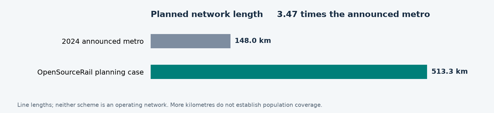

# Baghdad rail options and the case for Iraqi production

**OpenSourceRail policy and investment brief · 17 October 2026**

For Baghdad Mayoralty, Iraqi transport and finance authorities, industrial partners and prospective lenders. All monetary amounts are USD unless marked IQD. [Shareable PDF](baghdad-rail-options-2026-10-17.pdf).

## The decision for Baghdad

Baghdad needs affordable rail that expands access and builds Iraqi productive capacity. OpenSourceRail proposes **513.3 km across 14 lines**, Iraqi civil production and vehicle assembly, selective component manufacture, and funding arranged around deliverable stages. It deserves a funded, independent feasibility comparison with the conventional metro proposal.

The network is **3.47 times the announced 148 km metro length**, adding **365.3 km of planned lines**. Iraqi production could retain equipment, skills and maintenance capability. These potential advantages require demonstrated delivery, economic returns and funding.

| Measure | Announced 2024 Baghdad Metro | Current OpenSourceRail planning case |
| --- | --- | --- |
| Network length | About 148 km | 513.336 km |
| Lines | 7 | 14 |
| Stations | 64 announced | 159 unique planned stations |
| Headline capital figure | About $18bn announced estimate | $8.667bn unquoted planning allowance |
| Financial status | Offers subsequently failed launch requirements | Facilities modelled; none committed |
| Industrial approach | International consortium; detailed local share unresolved | Iraqi works, assembly and selected component processes proposed |

**The capital difference is not a verified saving:** scope and price bases differ, and OSR has unpriced installed scope. Lengths count lines, not individual running rails; shared corridors and operating distances need reconciliation. Station interchange conventions may differ. [2024 scope and estimate](https://channel8.com/english/news/17595) · [Current Baghdad basis](../../cities/catalogue/west-asia/Iraq/Baghdad/README.md).

Length alone does not establish population access or ridership. Entrances, walking routes, buses, fares and destinations determine usefulness. OSR's 800 m radial catchment contains **1.13 million residents on a 2020 population raster**, not a current census or walking-access result. No equivalent audited catchment is available here for the 148 km proposal.

<!-- pagebreak -->

## What happened to earlier Baghdad metro proposals

Baghdad's recurring problem has been converting announcements into a technically complete, financially acceptable railway programme. The causes differ between periods; it would be inaccurate to attribute every earlier failure to funding alone.

| Period | Proposal or milestone | What the record establishes |
| --- | --- | --- |
| Late 1970s and 1980s | Early Baghdad metro planning | War interrupted the early programme; these were different historical circumstances from the recent financing review. |
| 2011 | Systra basic design and tender preparation for two lines, about 22 km and 18 km | A reported $3bn project and intended municipal funding. Design appointment did not establish financed construction. |
| December 2017 | Alstom memorandum for a 20 km Baghdad elevated railway | A cooperation framework covering trains, systems, track and civil works. The separately announced Basra routes were not Baghdad kilometres. |
| October 2020 | Alstom and Hyundai Engineering and Construction letter of intent | A 20 km, 14 station elevated railway proposal; a letter of intent was not financial close. |
| July 2024 | International consortium accredited for the expanded metro opportunity | About 148 km, seven lines and 64 stations, with an approximately $18bn estimate. Accreditation was followed by negotiations over contract details. |
| July 2025 and January 2026 | Financial reassessment and project review | Most financial offers were inadequate to support contracting; the subsequent review found proposals did not satisfy launch conditions. |

Sources: [MEED, 24 May 2011](https://www.meed.com/systra-to-design-baghdad-metro/); [Alstom, 6 December 2017](https://www.alstom.com/press-releases-news/2017/12/alstom-and-the-iraqi-government-sign-a-memorandum-of-understanding-for-the-development-of-urban-transport); [Alstom, 20 October 2020](https://www.alstom.com/press-releases-news/2020/10/alstom-and-iraqi-ministry-transport-sign-letter-intent-implementation); [National Investment Commission consortium announcement](https://investpromo.gov.iq/prime-minister-mohammed-shia-al-sudani-receives-the-accreditation-of-the-winning-consortium-for-the-baghdad-metro-investment-opportunity/).

On **2 July 2025**, transport adviser Nasser Al-Assadi told the Iraqi News Agency that technically capable companies had participated, but most financial offers had not provided enough confidence to proceed with contracts. He explicitly said the metro remained under study. **The investment attempt failed to secure an acceptable financial basis; permanent cancellation of the wider metro project is not established.** [Iraqi News Agency](https://ina.iq/ar/local/237738-.html).

A **4 January 2026** report, attributed to the Prime Minister's Office, described a further review of technical, financial and implementation risks and preparation of a revised investment package, potentially with IFC or European Investment Bank involvement. Those institutions' possible advisory involvement was not a lending commitment. [Iraq Business News](https://www.iraq-businessnews.com/2026/01/04/baghdad-metro-project-under-review/).

On **10 October 2026**, Iraqi News reported that Baghdad Mayoralty was managing the metro's private investment tendering process. The same report's mainline railway funding arrangements concerned the separate Development Road programme and do not establish metro finance. [Iraqi News](https://www.iraqinews.com/iraq/iraq-turkey-oil-funding-agreement-development-road-railway-2026/).

The lesson is to require a workable investment structure before another launch announcement. The 2024 opportunity already contemplated private investment and financing: OpenSourceRail's distinction must be **better scope, affordability and delivery arrangements**, rather than simply attaching a new financing label to the same challenge.

<!-- pagebreak -->

## How Iraqi production could accelerate the economy

The economic objective is reliable access to work, education, markets and services, combined with production capability that remains useful in Iraq. OpenSourceRail proposes to connect these objectives through repeatable civil structures, vehicle assembly and selective local manufacture. Open designs can improve competition and repairability where the relevant intellectual property and interfaces are actually available; bought components still require contractual rights and qualified suppliers.

| Mechanism | Proposed Baghdad application | Evidence needed to establish the benefit |
| --- | --- | --- |
| More useful journeys | Radial and ring connections, integrated fares and feeder services | Surveyed origin and destination demand, accessible entrances, passenger journey times and reliable service |
| Local industrial orders | Qualify Iraqi precast capacity; assemble trains and selected components locally | Delivered quotations, local value added, yields, first articles and accepted production capacity |
| Retained skills and wages | Train production workers, maintenance staff and operators | Recruitment, accredited competence, realistic payroll and a sustainable workload |
| Repeatable delivery | Standardise accepted parts and package successive operating sections | Complete civil and vehicle designs, site adaptation, quality control and measured cycle times |
| Lower supplier dependence | Competitive spares, repair information and interoperable interfaces | Enforceable rights, alternative supply, obsolescence plans and whole-life costs |

The current staffing scenario contains **3,523 permanent operating FTE**, plus **1,733 factory production and support FTE for 59 paid months**. The factory figure is a production establishment during the modelled order, not a promise of permanent employment afterward. Construction employment is separate and incompletely scheduled; these figures should not be multiplied into an unsupported national jobs claim. [Workforce and production basis](../../cities/catalogue/west-asia/Iraq/Baghdad/engineering/programme-recalculation/README.md).

Localisation should pass a commercial test. In the matched OpenSourceRail cases, selective manufacture reduces the capital allowance from **$8.795bn to $8.667bn**, approximately **$128m**, and imported invoice exposure from **$2.358bn to $2.016bn**, approximately **$342m**. These are modelled differences within comparable OSR scope, before supplier validation. Window manufacture has a negative Baghdad-only whole-order margin and remains a bought component. Battery pack assembly retains imported cells and controls; bogie manufacture retains imported wheels, axles and bearings. [Make or buy appraisal](../../cities/catalogue/west-asia/Iraq/Baghdad/engineering/programme-recalculation/component-make-buy.csv).

The resulting **23.27% imported invoice share** is a procurement-model measure. Its complement is not an Iraqi GDP contribution: local invoices can contain imported inputs, distribution costs and profit. The 2024 metro's comparable import share is unknown, so no quantified bilateral import saving is established.

Economic acceleration would come from productive orders during construction and useful transport after opening, followed by lower barriers to working and trading across the city. It requires real service and competitive production. Supplier sales, payroll, land appreciation and fare receipts cannot all be added together as independent economic benefits. A social cost-benefit appraisal must avoid transfers and double counting; factory exports and future Iraqi city orders should remain upside cases until contracted.

<!-- pagebreak -->

## Capital cost and the risk to public finances

The **$8.667bn OSR allowance** includes about $4.058bn for civil works and bearings, $1.270bn for stations and core access, $1.220bn for trains, $416m for assembly and component plants, $290m for depots, $874m for solar and charging, and $539m for signalling and programme overhead. It remains an unquoted comparator. Land, utilities, site-specific foundations, special structures, installed grid and charging upgrades, and the complete accelerated delivery scope still require pricing. Financing costs, reserves and operating cash deficits must be funded alongside capital. [Controlled Iraq basis](../../cities/catalogue/west-asia/Iraq/CURRENT-PLANNING-BASIS.json).

Dividing the published figures gives approximately **$121.6m per route-km** for the $18bn / 148 km announcement and **$16.9m per route-km** for the OSR allowance. This arithmetic does **not** establish a sevenfold cost advantage: scope, design maturity, stations, land, risk allocation, escalation and financing boundaries differ. A procurement decision requires both options repriced against the same passenger service, site evidence, cost date and whole-life boundary.

Iraq should avoid commitments whose debt service, guarantees and replacement imports can overwhelm the transport budget or displace essential spending. The French Treasury's country assessment, updated **13 October 2026**, describes a budget receiving roughly 90% of revenue from hydrocarbons. This makes long-term obligations sensitive to oil and fiscal shocks. [French Treasury](https://www.tresor.economie.gouv.fr/Pays/IQ/situation-economique-et-financiere-de-l-irak).

### Illustrative foreign currency debt exposure

If an entire **$18bn** programme were borrowed in USD and repaid through equal annual payments over **20 years**, the following arithmetic would apply. **These are assumed stress cases, not the 2024 proposal's disclosed financing terms.** No fees, construction interest, grace period, inflation or operating costs are included.

| Assumed annual interest | Annual principal and interest | Total payments over 20 years |
| --- | ---: | ---: |
| 5% | $1.444bn | $28.887bn |
| 7% | $1.699bn | $33.981bn |
| 9% | $1.972bn | $39.437bn |

Calculation: annual payment = principal × interest / (1 − (1 + interest)^−20), with end-of-year payments and full amortisation.

At 7%, the project would need roughly **$1.70bn each year for debt alone**, before operating costs. IQD fares would leave a currency mismatch unless hedged or supported by dependable foreign currency receipts. A private concession can retain public exposure through availability payments, revenue guarantees, termination compensation or exchange-rate protection; these belong in the fiscal assessment.

An $18bn railway does not, by itself, establish that Iraq would become bankrupt. The defensible objection is **unaffordable and poorly allocated public risk**. A white elephant is an expensive asset whose actual usefulness fails to justify its life-cycle burden. Imported equipment is not automatically such an asset, and the documented metro proposals are not shown to be unproven “gadgetbahn” technology. The same affordability and usefulness tests must apply to OpenSourceRail.

<!-- pagebreak -->

## Funding OpenSourceRail without hiding the shortfall

The retained OSR model combines public capital, domestic IQD borrowing, a proposed foreign supplier-credit channel and a conditional grant. Using IQD obligations for IQD revenues could reduce the currency mismatch on those facilities. It does not eliminate interest, inflation, refinancing risk or the effect of large public borrowing on other Iraqi investment.

| Capital source in the retained model | USD equivalent bn | Status |
| --- | ---: | --- |
| Government capital, including import cash | 2.167 | Assumed appropriation; 25% of capital |
| Proposed Chinese import credit | 1.008 | Origin, eligibility and lender acceptance unconfirmed |
| Ordinary IQD bonds | 3.217 | Unplaced |
| Green IQD bonds | 0.883 | Unplaced; eligibility and terms unconfirmed |
| Senior IQD bank capital credit | 1.367 | Uncommitted |
| Conditional climate grant | 0.025 | Unawarded |
| **Capital total** | **8.667** | **Planning sources and uses only** |

Amounts are rounded; the ledger uses a historical planning conversion of **IQD 1,300 per USD**, not a current exchange-rate quote. The government's 25% capital contribution is **not a ceiling on total public exposure**. Additional gap credit, debt costs, reserve requirements and any guarantees remain separate. [Capital sources and monthly cashflows](../../cities/catalogue/west-asia/Iraq/Baghdad/engineering/programme-recalculation/README.md).

The current case is not yet financeable on demonstrated terms. Its **company NPV before finance is negative $3.246bn** at the model's assumed discount rate. That is a project financial result, not a social economic NPV. The scenario clears debt only with assumed facilities, including **uncommitted concessional gap funding at 2%**, and assumed indexed fares and additional receipts. Moving gap funding to the commercial sensitivity increases the peak IQD gap from **5.033tn to 12.041tn**.

Demand is equally consequential. The revenue reference treats one boarding as one paid journey, an upper-bound assumption for integrated fares. At **1.5 boardings per paid journey**, the model retains **IQD 10.554tn terminal debt and IQD 0.406tn unfunded support**. The proposed railway cannot promise repayment from capacity figures. Validated paid demand, affordable fares and funded public service obligations must replace those assumptions. [Financial and transfer sensitivities](../../cities/catalogue/west-asia/Iraq/Baghdad/engineering/programme-recalculation/README.md).

The practical funding improvement is to **reduce the amount that must be credibly committed at each decision**. Establish an Iraqi project entity with transparent procurement and independently reviewed accounts; select a useful first operating corridor; price all its infrastructure, factory needs and operating support; and place its financing before construction. Later tranches should depend on accepted costs, demand evidence and production results. A first phase must work as transport on its own, with its feeder connections and depot, rather than depend on an unfunded network to become useful.

Grants replace borrowing only when awarded. Green bonds remain repayable debt. Guarantees improve credit support but do not provide a second pot of cash. Land development receipts require legal authority, net costs and realistic absorption; speculative uplift cannot close a funding gap.

<!-- pagebreak -->

## British equipment and a realistic export finance route

Britain can support Iraqi production through selected machine tools, process equipment, engineering, inspection and training. Prioritise **equipment manufactured in Britain**, identifying the offered factory and configuration. Use Iraqi construction and fabrication where qualified and competitive, with critical imports selected for function, lifetime support and value. The objective is to acquire durable capability rather than import every building and finished component.

The existing [37-case British supplier assessment](baghdad-uk-factory-suppliers-2026-10-15.md) provides enquiry candidates for machining, welding, lifting, metrology, precast moulds and prestressing. It distinguishes British manufacture from UK distribution of machinery made elsewhere. These are supplier leads; no quoted package, approved production rate or Baghdad service contract is established.

### What UKEF could support

| Route | Possible Baghdad use | Published boundary |
| --- | --- | --- |
| Early Project Services Guarantee | A defined UK feasibility, design or engineering services package | Contracts anticipated up to £30m, with larger cases possible; excludes physical project work; repayment within two years after services delivery |
| Buyer Credit Facility | Eligible UK equipment and services purchased by the Iraqi buyer | Contract normally at least £5m; loan up to 85% of contract value; buyer pays at least 15% directly to the exporter before repayment starts |

The early-services facility also requires at least 15% buyer payment before the facility is used. These products guarantee an acceptable bank's lending; **the Iraqi buyer borrows and the UK supplier delivers**. Approval, premiums, borrower credit, environmental and social review and eligible content remain transaction-specific. Early-services borrowing has a short repayment obligation even if the later railway is not financed. [UKEF early services](https://www.gov.uk/guidance/early-project-services-guarantee) · [UKEF buyer credit](https://www.gov.uk/guidance/buyer-credit-facility).

UKEF's standard foreign-content principle requires **20% UK content**, with other principles assessed separately. Genuine UK engineering and other qualifying services can count; a UK registration or invoicing margin alone does not establish the required economic activity. Physical manufacturing origin and UKEF content are separate assessments. [UKEF foreign-content policy](https://www.gov.uk/government/publications/ukefs-approach-to-foreign-content/ukefs-approach-to-foreign-content).

As published on **17 October 2026**, UKEF lists **£1bn–£2bn market risk appetite for Iraq**, medium and long-term cover available for consideration, and a location-care condition. This is a country-level policy indication, **not an allocation to OpenSourceRail or a commitment to finance this network**. [Country cover policy](https://www.gov.uk/guidance/country-cover-policy-and-indicators).

A proposed new UK OpenSourceRail company could coordinate a defined package with experienced engineering and equipment partners, subject to delivery capability and bank acceptance. An established prime contractor may be preferable where risk allocation requires it. Every invoice needs a named origin, eligible scope, payer and financing source. A UK-supported equipment package would **replace the matching assumed supplier-credit source in a revised model**, rather than add a second loan against the same invoice. IQD availability must be confirmed with the lender; local-currency support elsewhere does not establish IQD terms.

<!-- pagebreak -->

## Conditions for a railway Baghdad can actually deliver

OpenSourceRail's proposed advantage is strongest when a first operating section is useful, its industrial investment is proportionate, and its full public cost is affordable under downside conditions. The six-car Baghdad vehicle, civil structures, power system and production routes remain provisional. Current design studies do not constitute certified designs or authority to manufacture. The chronological energy study reports service shortfalls; an annual solar balance does not establish reliable operation. [Design maturity](../design-engine/hierarchical-development-2026-10-17.md) · [Connected construction and energy study](../../cities/catalogue/west-asia/Iraq/Baghdad/engineering/connected-build/README.md).

| Decision | Required deliverable | Release condition |
| --- | --- | --- |
| Authorise bounded development | Funded feasibility scope, independent advisers, accountable Iraqi sponsor and data access | A capped development budget with no automatic obligation to build the whole network |
| Select a first corridor | Comparable rail and bus options; surveyed demand, walking access and affordability; usable service and depot plan | Superior economic value and deliverable right of way, rather than maximum kilometres alone |
| Freeze engineering and production | Ground and utility investigations, approved loads and structures, vehicle safety design, heat and dust qualification, energy and timetable validation | Independent technical acceptance and complete manufacturing responsibility |
| Contract the first phase | Installed quotations, contingencies, industrial working capital, lifecycle replacements and operating support | Committed sources cover uses; downside debt service and total public exposure fit the approved fiscal envelope |
| Open and expand | Tested assets, trained operators, accepted reliability and measured passenger use | Extend only when performance and finance justify the next tranche |

Existing Iraqi precast and fabrication capacity should be assessed before building duplicate facilities. Factory expansion must follow qualified products and economic order sizes. A smaller first phase may support fewer production lines than the full network model; reprice that industrial programme rather than spreading full-network factory savings across a small order.

An independent appraisal should publish discounted economic benefits and costs, passenger time and reliability changes, distribution of access, net local value added, and the government's yearly exposure to capital, subsidy, debt and guarantees. Compare OpenSourceRail, a revised conventional metro, and practical bus or staged rail alternatives against the same demand and service needs. OpenSourceRail should win that comparison through evidence.

**The recommended decision is a funded, bounded development programme for an Iraqi production railway, with competitive comparison and firm release gates.** The present proposal offers a much wider planned network and a more explicit route to retained industrial capability. Demonstrating affordable delivery of a useful first corridor would give Baghdad a stronger basis for expansion than another announcement dependent on unresolved whole-network finance.

### Source basis

OSR quantities and financial results use the [Baghdad programme](../../cities/catalogue/west-asia/Iraq/Baghdad/README.md) and [controlled Iraq planning basis dated 6 October 2026](../../cities/catalogue/west-asia/Iraq/CURRENT-PLANNING-BASIS.json), as held at repository revision **4340afc026**. The retained capital case is distinct from the unpriced complete accelerated scope. External sources are linked beside the claims they support. This brief does not amend the engineering acceptance status or the controlled financial assumptions.
