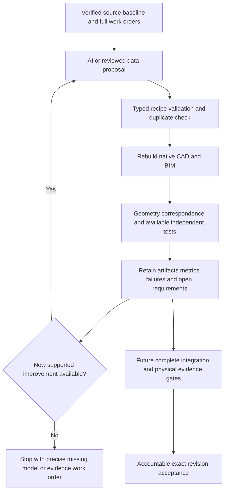

# AI CAD and BIM authoring and the Baghdad twin completion workflow

Reviewed 17 October 2026. This extends the [generative systems review](generative-systems-review.md) and the [federated Baghdad design twin](baghdad-engineering-twin-2026-10-17.md).

Use **FreeCAD and IfcOpenShell/Bonsai as the editable engineering foundation**, with an AI proposal interface above them and independent geometry, physics and software checks below them. Evaluate Zoo and Onshape as optional authoring accelerators on the same benchmark. Retain native definitions, neutral exports and test evidence locally so that the railway can be maintained and manufactured without dependence on one AI vendor.

The available AI tools can generate useful editable parts, propose alternatives and perform some assembly operations. They do not establish complete rolling stock, civil works, control software, manufacturability or physical correlation by themselves. The repository now has an executable proposal/feedback controller and a work-order tree; its current adapters cover research examples. Complete railway acceptance and authenticated physical evidence ingestion remain work to implement.

## Current options and their practical role

These are capability comparisons, not procurement quotations. Confirm installed version, commercial entitlement, export rights, data location and unattended API limits before adopting a hosted product. “Available” below describes the cited vendor capability, not a configured integration in OpenSourceRail. Cloud pricing and token costs are excluded because a comparable licensed configuration has not been specified.

| Option | Authoring capability and availability | Best use for OpenSourceRail | Boundary and decision |
| --- | --- | --- | --- |
| FreeCAD native Python plus a community MCP bridge | Existing local Python authoring can generate exact solids and assemblies. The third-party FreeCAD MCP project exposes model creation/editing, document inspection, Python execution and FEM; it requires an addon and server. | Canonical vehicle parts, assembly geometry, drawing projections and reproducible scripted recipes. | **Use native API now.** The MCP bridge is optional, community maintained and not installed here. Treat its arbitrary Python execution as authoring, outside trusted acceptance. [Bridge source and licence](https://github.com/neka-nat/freecad-mcp). |
| Bonsai and IfcOpenShell / IfcMCP | Bonsai authors IFC in Blender. Upstream IfcMCP exposes IFC query/edit, shape generation, clash checks, schema validation and drawing tools. | Civil bays, stations, depots, factory layouts and model-based quantities tied to physical part identities. | **Use installed IfcOpenShell now.** Installed version is 0.8.5; the newer documented `ifcmcp` package and MCP client are absent. Test a pinned bridge separately. IFC validity does not establish structural resistance. [Bonsai](https://docs.bonsaibim.org/), [IfcMCP tools](https://docs.ifcopenshell.org/ifcmcp.html). |
| Zoo Design Studio / Zookeeper | Launched 5 February 2026. Natural-language design and editing produces parametric CAD with an editable feature tree. The vendor exposes Agent/Engine APIs and an MCP tool route. | Rapid component concepts and parameter/topology variants, then STEP correspondence and independent analysis. | **First optional cloud pilot.** Preserve the editable KCL/native definition, not only a mesh or screenshot. Vendor descriptions of manufacturing readiness need project-specific testing. Not configured here. [Launch and API description](https://zoo.dev/press/zoo-introduces-zookeeper). |
| Onshape FeatureScript MCP | The 8 September 2026 official guide describes generating, testing and refining custom parametric features through the Labs app. Subscription and account authorisation are required. | Reusable feature factories, configuration studies and collaboration in an established parts/assembly environment. | **Second optional pilot.** FeatureScript generation is available through Labs; broader AI agents are still labelled “Coming Soon” on the Labs page. Do not equate that roadmap with autonomous railway assembly design. [Connection guide](https://www.onshape.com/en/resource-center/tech-tips/connect-featurescript-mcp-server-claude-code), [Labs status](https://www.onshape.com/en/features/onshape-labs). |
| Siemens Designcenter and Solid Edge | Designcenter is the June 2026 name for former Designcenter NX, beginning with 2606. Solid Edge 2026 supplies AI mate placement, automatic drawing views and contextual assistance. | Detailed industrial assemblies, sheet metal, drawings and collaboration with suppliers already using Siemens. | **Supplier interoperability option.** Test the actual seat/modules and export round trip; AI mate suggestions and drawing views still need engineering checks. No local licensed adapter. [Naming and editions](https://www.siemens.com/en-us/technology/nx-cad/), [Solid Edge 2026 capabilities](https://news.siemens.com/en-us/siemens-designcenter-solid-edge-2026/). |
| Autodesk Fusion, Revit and Forma | Autodesk's 15 September 2026 announcement distinguishes generally available in-product Assistant capabilities from the expanded cross-product agent experience previewed at AU; the latter is not generally available and rollout is planned for 2027. | Optional supplier CAD/CAM and building authoring where the project already has compatible tools and licences. | **Use only demonstrated, version-specific operations.** Do not make the completion schedule depend on the 2027 agent roadmap. No Autodesk integration was executed here. [Availability statement](https://investors.autodesk.com/index.php/node/36251/pdf). |
| Dassault CATIA / 3DEXPERIENCE / SIMULIA / DELMIA | Current vendor pages describe AURA, LEO and MARIE companions, including CAD assistance, simulation setup and manufacturing workflows. The October 2026 SIMULIA community update reports availability on platform SaaS and token-based access. | An enterprise route for complex vehicle assemblies, PLM, simulation and manufacturing planning when an established delivery partner already uses it. | **Partner-led option.** Require a live part-to-assembly-to-manufacturing benchmark with the licensed competencies. Marketing claims do not supply Baghdad project evidence. No local integration. [Companion functions](https://www.3ds.com/industrial-ai/virtual-companions), [SIMULIA availability and functions](https://3dswym.3dexperience.3ds.com/wiki/simulia-community/what-s-new-generative-experiences-virtual-companions_TOQIdX4qRNufakAMi8fSJw). |
| Bentley OpenRail / OpenRoads / iTwin | The June 2026 OpenRail/OpenRoads session describes rail/civil authoring improvements and a preview of Copilot for information and guidance. | Civil alignment/corridor modelling and partner interchange; federation with the asset record. | **Civil partner option.** The cited Copilot preview does not establish complete automated structural detailing or train design. Product authoring and operational federation need separate verification. [2026 release session](https://www.bentley.com/en/webinars/whats-new-in-openroadsopenrail-2026/). |
| Speckle AI | The 31 August 2026 release describes read-only AI queries over published model data, version comparisons and reports, with viewer interaction. | Cross-model review, quantities, issue discovery and change-impact reporting. | **Review layer.** This AI query capability does not author manufacturing part geometry. No connector configured. [Release description](https://speckle.systems/updates/speckle-ai-a-new-3d-viewer-new-integrations-and-more/). |
| Hypar | Current documentation includes space planning and AI placement suggestions. | Factory, station and depot space-plan alternatives and clearance studies. | **Early layout option.** A test fit does not supply structural detailing, equipment installation design or vehicle assemblies. [Documentation](https://docs.hypar.io/). |
| NVIDIA Omniverse / OpenUSD | Libraries, APIs and scene tools support physical AI applications and agent workflows using OpenUSD. | Optional visual federation, manufacturing-cell simulation and sensor simulation after engineering models exist. | **Later simulation/view layer.** Keep engineering BRep/IFC and solver results authoritative. No GPU stack installation is required by the current controller. [NVIDIA documentation](https://docs.nvidia.com/omniverse/). |

Code-first CAD remains valuable even without a new AI product. Agents can propose versioned recipes for the existing kernels; native reconstruction and round-trip checks then provide stronger evidence than a plausible image. Adding a conversational bridge changes how operations are requested, not the quality threshold for accepting them.

## What recent assembly research contributes

Three 2026 preprints offer useful architectural ideas: ArtiCAD plans connectors and joints before generating parts and supports rollback; AssemCAD describes typed parts, geometry-backed ports and deterministic mate transformations; Embodied CAD describes typed operations with kernel feedback and repair. These are research results, not demonstrated complete railway design systems. Adopt the principles of explicit interfaces, executable geometry and retained failures rather than their headline claims of readiness. [ArtiCAD](https://arxiv.org/abs/2604.10992), [AssemCAD](https://arxiv.org/abs/2607.05123), [Embodied CAD](https://arxiv.org/abs/2606.31252).

For this project an agent should first propose function, loads, interfaces, manufacturing route and competing concepts. It should then create exact parts, assemble them against controlled datums and ask tools to test its assumptions. A failed test becomes a structured revision task. A web page can suggest a new idea or product; accepting its properties requires an exact supplier configuration and evidence record.

## The completion contract

The inherited baseline has **63 work packages, 345 controlled source items, 414 reference instances, 545 reference interfaces and 1,219 open requests**. The 345 items are source-qualified allocations, not an exhaustive manufactured-parts BOM. The baseline also records 1,157 unresolved reference allocations. Expanding that inventory into the actual installed train and civil/software configuration is a completion task.

Use the following successive states for each leaf and each parent assembly. Preserve unknown values until evidence exists.

| Stage | Required engineering record | Advance condition |
| --- | --- | --- |
| Requirements and configuration | Accepted duty, loads/combinations, environment, site datum, interface ownership, hazards and limits | The configuration and requirements owner accepts the exact baseline; missing six-car or Baghdad ground inputs remain open |
| Parts and assembly | Editable geometry; native and neutral representations; physical part identity; dimensions, mates, fasteners, welds, fittings, cable/pipe routing and access envelopes | Rebuild/reopen succeeds; parts map to the BOM; volume/mass/CG/inertia reconcile; no unexplained collisions; motion and tolerance allocations are checked |
| Manufacturing definition | Issued dimensioned drawings or accepted PMI; material/process/finish specifications; make/buy BOM; cutting/bending/welding/curing/assembly routes; tooling and inspection plans | Supplier/manufacturer confirms configured process capability, tolerances, access and traceability; fabrication and maintenance routes are feasible |
| Independent analysis | Applicable strength, stiffness, dynamics, fatigue, thermal, fire, EMC, electrical and software verification reports | Independent fixtures and numerical checks pass the adopted limits, with convergence, load balance and uncertainty recorded |
| System integration | Frozen vehicle/civil/energy/control configuration and interface matrix | Parent requirements pass with actual child configurations, configuration-specific mass/inertia and interface loads; rejected and missing children cannot disappear |
| Physical correlation | Identified prototype/as-built asset, calibrated instruments, observed loads/states and held-out validation cases | Prediction errors meet predeclared acceptance limits over the required operating envelope; fitting data alone is insufficient |
| Acceptance and operational twin | Accountable exact-revision acceptance, as-built/software inventory, telemetry mapping, maintenance/change controls | Authorised engineering and project owners accept the dossiers; live records identify actual assets and remain synchronised with changes |

Whole-system completion requires **all required leaves, interfaces, parent requirements and evidence gates** to close for one integrated baseline. A lower mass score, an IFC schema pass or a working viewer cannot bypass a failed safety or manufacturing requirement. A measured operating twin additionally needs the installed asset connection, calibration, uncertainty and change history. An accepted design model before construction has a different status.

The controller deliberately has no command that sets `design_complete` or physical/manufacturing release to true. It does not yet implement an authenticated acceptance importer, complete BOM expansion or all domain solvers. Those integrations must be reviewed and tested before any completion promotion is enabled; editing JSON flags is not a valid substitute.

## Executable workflow delivered

Entry point: [`tools/automation/twin-completion.py`](../../tools/automation/twin-completion.py). Implementation: [`engineering/twin_workflow`](../../engineering/twin_workflow). All commands below run from the repository root.

```bash
tools/automation/osr-python tools/automation/twin-completion.py init \
  --workspace /home/hayder/.local/state/opensourcerail/twin-workflow/my-run
tools/automation/osr-python tools/automation/twin-completion.py seed \
  --workspace /home/hayder/.local/state/opensourcerail/twin-workflow/my-run
tools/automation/osr-python tools/automation/twin-completion.py run \
  --workspace /home/hayder/.local/state/opensourcerail/twin-workflow/my-run \
  --steps 12 --wall-seconds 1200 --max-output-mib 512 --reserve-gib 5
tools/automation/osr-python tools/automation/twin-completion.py verify \
  --workspace /home/hayder/.local/state/opensourcerail/twin-workflow/my-run
```

`init` verifies the current federated packet, binds engineering sources and creates `work-orders.json`. Every controlled item retains its exact source/pointers, required detail sections and parent relationships; all baseline requests remain present. `seed` submits nine explicit research designs, including a deliberately weak control policy and an assembly with revised carrier wall thickness. It is a reproducible benchmark seed set, not an LLM invocation.

`run` executes each new design once, records actual results and returns failures to the proposal interface. Current adapters are:

| Adapter | Executed work | Remaining scope |
| --- | --- | --- |
| `mechanical-cleat`, `civil-steel-beam` | Compile exact subtractive geometry; FreeCAD BRep/STEP; native mass properties; Gmsh meshes at two sizes; CalculiX elastic solves; reaction balance, displacement refinement and independent cantilever benchmark | Ideal support/loading only; bolt/contact, strength, fatigue and physical qualification remain open |
| `vehicle-interface` | Reconstruct the existing 14-part interface; check actual part solids, placements, material properties and collisions; native reopen, STEP volume and TechDraw projection | Simplified fasteners, connecting details, supplier equipment and issued toleranced drawings remain open |
| `civil-bay` | Generate a 77-part research bay; native assembly checks; IFC4X3 exact material volumes and EXPRESS/schema validation | Full reinforcement/anchorage, foundation/ground response, adopted loads, detailed resistance and construction acceptance remain open |
| `controlled-assembly` | Accept a pure-data assembly definition with up to 128 parts and 32 primitives per part; rebuild/check native geometry, mass/inertia, collisions and inspection projection | Agents can author new arrangements within the supported primitive contract; arbitrary feature code, new mate/solver families and qualification require reviewed adapters |
| `software-precharge` | Run a chosen existing policy against the same 19 adverse/healthy cases | Simulator policy selection only; generated target code, complete train software, SIL/HIL, real-time timing and hardware acceptance remain open |

Recipe geometry is editable through its controlled JSON and deterministic reconstruction. Native assemblies use `Part::Feature` solids and TechDraw projections; this is not a fully constrained sketch history or a complete kinematic mate solver. STEP is neutral geometry, not a substitute for preserving the source recipe. Inspection projections are not issued manufacturing drawings.

## Connecting a real AI proposer

The controller supports an operator-configured provider command. It sends JSON on standard input and requires exactly `{"proposals": [...]}` on standard output; diagnostic output belongs on standard error. `request` prints the same request so an interactive agent can work through the proposal-file route. No vendor account, LLM endpoint, credentials or commercial CAD session has been configured or invoked by this change.

```bash
tools/automation/osr-python tools/automation/twin-completion.py request \
  --workspace /home/hayder/.local/state/opensourcerail/twin-workflow/my-run
tools/automation/osr-python tools/automation/twin-completion.py submit \
  --workspace /home/hayder/.local/state/opensourcerail/twin-workflow/my-run \
  --proposals /absolute/path/reviewed-proposals.json
tools/automation/osr-python tools/automation/twin-completion.py run \
  --workspace /home/hayder/.local/state/opensourcerail/twin-workflow/my-run \
  --provider-argv /absolute/path/provider-command.json --steps 12
```

`provider-command.json` is a JSON argv array for a trusted, separately installed provider adapter. The controller does not execute a shell, run a command supplied inside a proposal, install an MCP bridge or send the repository to a vendor. The provider process itself is **not sandboxed** and runs with the operator's permissions. Configure credentials outside tracked files and review that adapter's data access before use.

A proposal has exactly these fields:

```json
{
  "schema": "osr-twin-proposal/1",
  "id": "cleat-thicker-lightened",
  "baseline_sha256": "COPY_THE_CURRENT_BASELINE_FROM_REQUEST",
  "kind": "mechanical-cleat",
  "parameters": {"thickness_m": 0.016, "topology": "lightened-web"},
  "rationale": "Compare the thicker lightened web under the unchanged load.",
  "sources": [],
  "expected_tests": ["native geometry", "elastic displacement", "mesh refinement"]
}
```

`submit` expects a JSON array of proposals. The provider response wraps that array in `proposals`. The agent request includes supported parameter domains, baseline identity, previous designs and actual results. `controlled-assembly` accepts `parameters: {"contract": ...}` using the existing `osr-engineering-representations/1` pure-data schema; evidence arrays must be empty and citations stay in `sources`. An agent cannot redefine loads or passing limits in the bounded solid-family recipes. A general assembly contract controls geometry correspondence only; its declared loads do not establish strength verification.

The completion programme needs agents to open new component families, not merely vary these seeds. New source-generating CAD or software proposals should use the existing isolated patch runner in [`agent_execution.py`](../../engineering/generative_design/agent_execution.py), with controller-owned acceptance files and allowed paths, followed by review and a new immutable baseline. That source-patch route is an existing separate tool, not yet automatically dispatched by this new controller.

## Iteration and stop behaviour



Each invocation has candidate, time, disk-reserve and output budgets. Provider calls have a 60-second maximum. Identical geometry/policy is deduplicated regardless of its name or rationale. Empty or duplicate-only provider responses stop the loop. A repeated unchanged provider request is not retried. `run` resumes the remaining queue; `submit` adds genuinely new supported proposals. A killed attempt with an existing unsealed run directory stops for review rather than overwriting its evidence. A retained failed attempt counts as evaluated; rerunning the same design does not silently change its result.

Changed engineering inputs or adapter source require a fresh workspace. Preserve the previous packet as historical evidence and re-evaluate affected revisions; do not edit the stored source hashes to make stale results appear current. Byte-level integrity checks identify changed retained artifacts. These hashes are not signatures and do not authenticate an engineering authority.

Outputs are limited to bounded local workspaces rather than whole repository copies. Keep raw native/solver outputs once per design, retain the failed designs needed to explain selection, and publish compact reports. Do not automatically erase acceptance evidence when a storage budget is reached.

## Expanding the adapters to complete the railway

Work both rolling stock and civil systems together, with integration and software checks from the first vertical slice. The following ordered work programme is the route beyond the implemented pilot. An unavailable model must generate an adapter/evidence task; it cannot be marked passed by a generic assembly check.

| Order | Scope to author and connect | Evidence needed before advancing |
| --- | --- | --- |
| 1 | Accepted train/site requirements; exact installed product structure, interface/load register, units and datums | Reconciled six-car mass/loading, Baghdad survey/geotechnical/environment inputs, requirements owners and exhaustive leaf inventory |
| 2 | Wheelsets/bearings, bogie frame, suspension, brake/traction interfaces, primary underframe and representative civil bay | Actual configured supplier geometry and laws; contact, weld, fatigue, stability and vehicle/track interaction models; construction-stage and foundation models |
| 3 | Carbody/panels, doors/interiors/accessibility, couplers, HVAC, battery/traction/electrical systems, harnesses/pipes | Stack-up and assembly/removal checks, fire/thermal/electrical/EMC evidence, process qualification, complete fittings/fasteners and service access |
| 4 | Track/guideway, piers/foundations, stations, drainage, utilities, power, depot and factory | Alignment/site coordination, full reinforcement/anchorage and connection detailing, quantities, temporary works, geotechnical response and equipment installation limits |
| 5 | Executable train and wayside controls, signalling/communications, energy control, diagnostic and maintenance software | Versioned interfaces, independent SIL/HIL, degraded/fault modes, target timing, cybersecurity and integrated hazard closure |
| 6 | Manufacturing release pack and first article for each assembly | Issued drawings/PMI, material certificates, qualified procedures, tooling/CAM or forming routes, first-article inspection and accepted process capability |
| 7 | Integrated prototype, as-built model and operating data | Instrumented correlation with held-out cases, calibrated instruments, serialised assets/software, accountable acceptance and telemetry/change management |

Prioritise British manufacture case by case in the manufacturing stage, as already requested. Bind machine envelope, workholding, power/utilities, lift limits, tolerance capability and service arrangements to the exact proposed supplier model. Record separately **UK manufacture**, UK supply/integration, and origin unconfirmed. A UK sales office, generic catalogue dimension or purchase price is insufficient to establish British manufacture or Baghdad installation suitability. Existing [UK factory supplier investigation](../commercial/baghdad-uk-factory-suppliers-2026-10-15.md) remains the procurement starting point.

The independent reviewer owns the acceptance fixture and adopted limits. The manufacturing engineer owns process capability; the discipline engineer owns design verification; the test authority owns physical correlation; the project owner owns the integrated requirements baseline. AI role names do not establish professional independence or authority.

## Benchmark and retained results

The reproducible pilot uses nine candidates across the six supported adapter types, including two geometry variants for each bounded solid family, a 14-part vehicle interface, a 77-part civil bay, a revised 14-part carrier assembly, and passing/failing software policies. Results are published separately in the [pilot report](ai-cad-bim-pilot-2026-10-17.md) with actual tool versions, checks and limitations. A real external provider should subsequently run the same benchmark and demonstrate a distinct, useful revision from the returned failures before it becomes the default proposer.

The minimum comparative authoring benchmark should add a toleranced drilled bracket, a welded frame with mate and access checks, a wheel/bearing/brake supplier assembly, a reinforced civil connection and a control component coupled to HIL. Score exact rebuild, export fidelity, editability, complete BOM coverage, tested interfaces, drawings/process detail, failures caught, engineering time, API cost and recoverability. Choose a proprietary extension only if it improves those results while preserving usable local engineering records.
