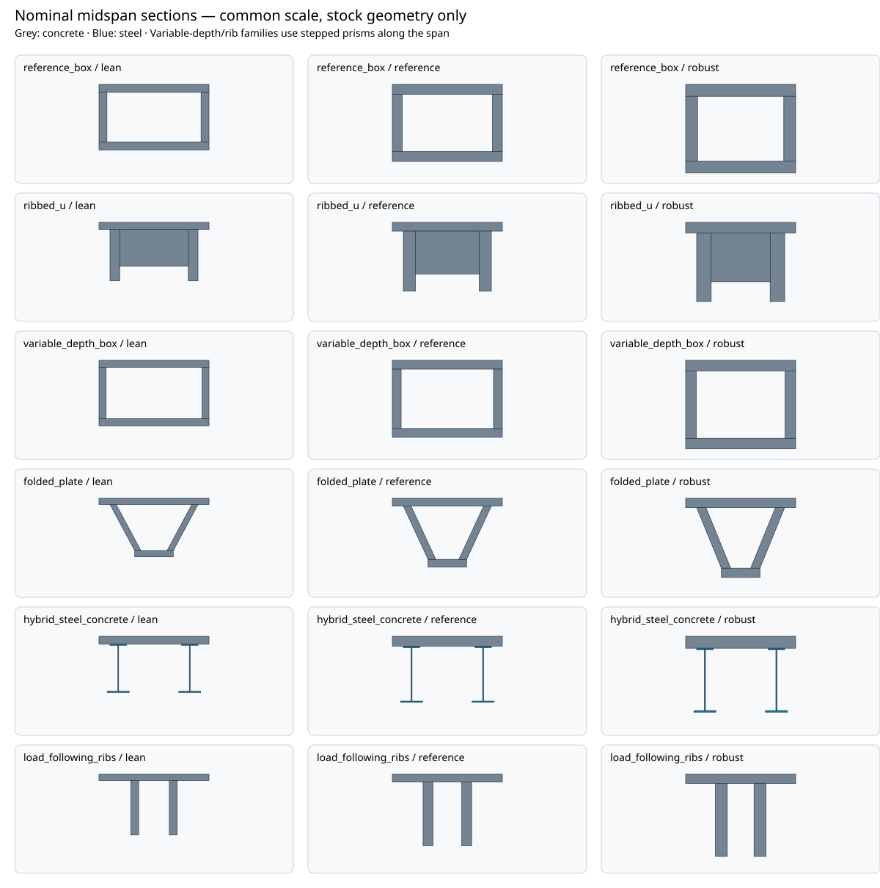

# Civil shape design portfolio

The 20 m span competition generates 18 physical candidates across 6 families and three profiles. Every candidate has explicit material geometry, calculated stock quantities, a provisional production route and low/base/high Class C delivery and lifecycle scenarios. All share a 2 m deck envelope. No structural loads have been evaluated or railway alternative selected.

| Family / profile | Nominal stock (t) | Factory hours (base) | Scoped installed estimate (IQD million, base) |
|---|---:|---:|---:|
| reference_box / lean | 41.79 | 139.5 | 93.18 |
| reference_box / reference | 54.72 | 164.5 | 96.25 |
| reference_box / robust | 68.64 | 191.0 | 99.53 |
| ribbed_u / lean | 30.05 | 114.4 | 89.90 |
| ribbed_u / reference | 42.51 | 143.1 | 93.20 |
| ribbed_u / robust | 56.18 | 172.6 | 96.67 |
| variable_depth_box / lean | 35.57 | 167.9 | 94.20 |
| variable_depth_box / reference | 46.35 | 190.7 | 96.89 |
| variable_depth_box / robust | 57.90 | 214.9 | 99.75 |
| folded_plate / lean | 24.51 | 135.1 | 90.68 |
| folded_plate / reference | 32.48 | 153.3 | 92.76 |
| folded_plate / robust | 41.19 | 172.8 | 95.01 |
| hybrid_steel_concrete / lean | 22.16 | 489.4 | 195.40 |
| hybrid_steel_concrete / reference | 28.37 | 637.2 | 232.51 |
| hybrid_steel_concrete / robust | 34.85 | 799.7 | 273.33 |
| load_following_ribs / lean | 22.45 | 136.2 | 90.31 |
| load_following_ribs / reference | 30.39 | 157.4 | 92.59 |
| load_following_ribs / robust | 39.27 | 180.2 | 95.07 |



Geometry and search

The families use box sections, ribbed U sections, varying-depth boxes, sloped folded plates, steel/concrete assemblies and load-following stepped ribs. Their actual polygons and cells determine material volume, stock mass, centroids, geometric second moments and exposed surfaces. Stepped depth/rib geometry is not a smooth organic surface or an optimised stress trajectory. Nominal stock omits unresolved reinforcement, prestress, connectors, bearings and installed equipment; complete installed mass remains unknown.

The descriptor-cell Pareto archive retains each family's partial-quantity alternatives. A separate cross-family front does not discard family diversity or establish feasibility. One cheap next-evaluator request per family is retained before expensive refinement. The frontier records resource budgets, source identities and required domain checks, and dispatches no native solvers.

Cost and production basis

Concrete uses the canonical dated Iraqi material/wage benchmarks. New forming, fabrication, tooling reuse, inspection, site-support, maintenance and renewal factors are explicit Class C assumptions in the versioned competition. Factory labour scales with concrete volume, contact surface, steel fabrication mass, reinforcement and unsized prestress reserves. Surface area is a tooling/contact proxy rather than a developed mould design. A single overhead uplift applies to the factory subtotal; transport, erection and site allowances are separate. Factory, delivered, scoped installed and lifecycle estimates have separate totals.

Production and civil work each use two 8-hour shifts. The worker-equivalent durations are labour-capacity diagnostics; curing, parallel teams, machine precedence, crane radius/capacity, concrete access, reinforcement details and site conditions require further evaluation. Prestress and supports remain explicitly priced reserves without credited structural capacity. Low/base/high values are scenarios, not statistical confidence intervals. There is no complete installed BOM or validated service life.

Reproduce

```bash
./osr design civil-portfolio plan
./osr design civil-portfolio build
./osr design civil-portfolio verify
```

Optional independent archive audit: install `engineering/design_search/requirements-search.txt`, then run `./osr design civil-portfolio audit-optimizers`. It uses pymoo nondominated sorting and separate pyribs single-objective categorical archives on the evaluated pool; it does not claim evolutionary generation or replace the multiobjective archive.

[Physical definitions](candidates.json.gz) · [Evaluations, cost lines and frontier](result.json) · [Source receipt](manifest.json)

All engineering, physical, manufacturing and operation approvals remain pending. The selected v0.6 reference is unchanged.
