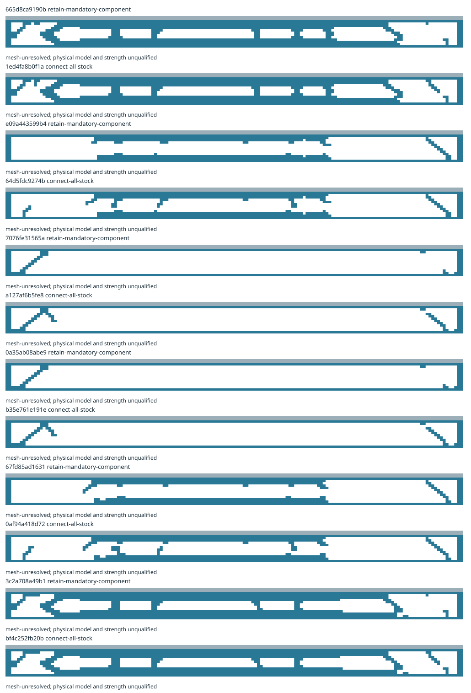

# Explicit physical revisions of steel-web topology experiments

Twelve bounded children retain or connect the stock of six failed original layouts. Every addition and removal is explicit, with immutable parent and child request, evaluation and physical identities. Original failed attempts remain unchanged in the [parent publication](../civil-topology/README.md). The selected six-car v0.6 railway is unchanged.

There are 12 terminal attempts, 10 distinct realized geometries and 4 geometries eligible for the next-experiment archive. Archive eligibility means connected geometry and both declared numerical residual gates; unresolved mesh sensitivity is retained. It is not an engineering pass.

8 attempts fail a declared numerical residual gate; 12 retain unresolved mesh sensitivity. All physical-model and material-strength requirements remain open.



| Child / strategy | Steel stock (kg) | Coarse maximum vertical displacement (mm) | Fine maximum vertical displacement (mm) | Refinement | Physical model / strength |
|---|---:|---:|---:|---|---|
| 665d8ca9190b / retain-mandatory-component | 4470.57 | 297.926 | 390.917 | mesh-unresolved | Unqualified |
| 1ed4fa8b0f1a / connect-all-stock | 4513.75 | 297.691 | 390.566 | mesh-unresolved | Unqualified |
| e09a443599b4 / retain-mandatory-component | 2853.48 | 3417.56 | 4419.29 | mesh-unresolved | Unqualified |
| 64d5fdc9274b / connect-all-stock | 2951.6 | 3418.6 | 4419.57 | mesh-unresolved | Unqualified |
| 7076fe31565a / retain-mandatory-component | 1534.67 | 12310.2 | 17651 | mesh-unresolved | Unqualified |
| a127af6b5fe8 / connect-all-stock | 1609.25 | 12310.1 | 17651.1 | mesh-unresolved | Unqualified |
| 0a35ab08abe9 / retain-mandatory-component | 1534.67 | 12310.2 | 17651 | mesh-unresolved | Unqualified |
| b35e761e191e / connect-all-stock | 1609.25 | 12310.1 | 17651.1 | mesh-unresolved | Unqualified |
| 67fd85ad1631 / retain-mandatory-component | 2869.17 | 3469.06 | 4522.47 | mesh-unresolved | Unqualified |
| 0af94a418d72 / connect-all-stock | 2971.22 | 3468.14 | 4520.14 | mesh-unresolved | Unqualified |
| 3c2a708a49b1 / retain-mandatory-component | 4423.48 | 306.127 | 394.401 | mesh-unresolved | Unqualified |
| bf4c252fb20b / connect-all-stock | 4458.8 | 305.887 | 394.046 | mesh-unresolved | Unqualified |

Maximum displacements include all 81 preserved representative cases without caps. They are demands from an unqualified linear elastic plane model, not allowable deflections. Large displacements can invalidate small-displacement assumptions. Both meshes remove void stiffness and retain floating-stock, point-contact and other failures. The three representative train positions do not bound every train position or an actual journey. Equal web sharing, finite mean bearing translations and finite wheel patches remain hypotheses; bearing contact, lateral/torsional response, buckling, fatigue, connections and material strength remain unqualified.

The SIMP density is original proposal evidence only. These children do not rerun SIMP or credit density as installed stock. A changed union has a new physical identity; subdivision of the same union preserves it. Refinement and evaluation identities remain separate. Failed, timed-out, rejected and unresolved attempts remain in the packet.

Scoped span prices are separate from whole-system costs. Every completed comparison preserves three vehicle-mass cases, three financial cases and all fourteen Class C scopes against the same six-kilometre, three-station service baseline. Complete ledgers, assumptions, rates, support-gravity calculations and receipts are retained. Production and civil work use two 8-hour shifts; operating hours and eventual two-to-three-shift operations remain distinct scenarios. Provisional gravity sizing does not qualify foundations or installed-mass closure.

The diversity archive ranks next experiments within material/manufacturing/solid-fraction cells. It grants no integrated selection, physical acceptance, manufacturing release or movement authority. The computational workflow can finish while physical obligations remain open.

Archival verification authenticates the original recorded tools and published parent artifacts, requires current producer sources, and recomputes proposals, geometry, quantities, support and complete costs. It performs no FE solve and does not require the CI host to possess the recorded binary paths. New worker execution and reuse retain the strict exact-tool contract. Resource receipts describe actual worker limits; no filesystem or network sandbox is claimed.

```bash
python -m engineering.design_search.topology_revision_publication publish --state build/runtime-civil-topology-revisions-v1
python -m engineering.design_search.topology_revision_publication verify
```

[Portfolio and every terminal outcome](result.json) · [Source, ancestry and payload manifest](manifest.json)
