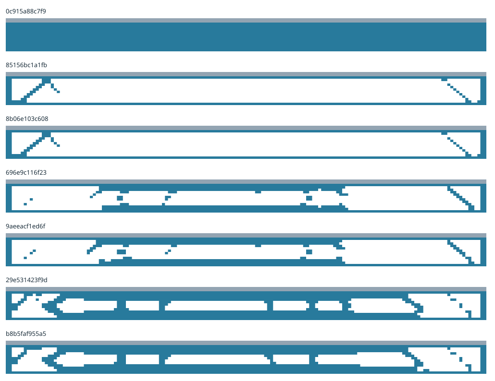

# Material-distribution experiments for a 20 m civil span

These experiments generate steel-web material layouts within a fixed two-web/concrete-deck envelope. They do not change the selected v0.6 railway. Each density optimization is thresholded into explicit cut stock and independently replayed with void elements removed. Failed, interrupted and disconnected results remain in their immutable attempt packages.

The bounded study contains 7 terminal attempts, 6 distinct realized geometries and 1 geometries meeting the declared replay residual request. Numerical completion does not establish a physical pass.



| Trial | Steel stock (kg) | Binary replay | Crowd/high mass model displacement (mm) | Refinement |
|---|---:|---|---:|---|
| 0c915a88c7f9 | 7536.0 | completed | 80.92 | two-mesh-comparison-within-declared-target |
| 85156bc1a1fb | 1573.9 | not-run: disconnected-or-corner-only-material | — | mesh-unresolved |
| 8b06e103c608 | 1573.9 | not-run: disconnected-or-corner-only-material | — | mesh-unresolved |
| 696e9c116f23 | 2912.3 | not-run: disconnected-or-corner-only-material | — | mesh-unresolved |
| 9aeeacf1ed6f | 2924.1 | not-run: disconnected-or-corner-only-material | — | mesh-unresolved |
| 29e531423f9d | 4490.2 | not-run: disconnected-or-corner-only-material | — | mesh-unresolved |
| b8b5faf955a5 | 4439.2 | not-run: disconnected-or-corner-only-material | — | mesh-unresolved |

The displacement values are demands in an unqualified elastic plane model. The two webs share load equally by hypothesis; concrete contributes gravity but no stiffness. Finite 250 mm wheel patches and three mean bearing translations preserve force and first moment without clamping end rotation. The three train positions are representative influence controls, not an all-position compliance, stress or journey envelope. Empty, normal and crowd-control loads cross three vehicle-mass and three span-mass cases (81 right-hand sides per binary mesh).

The physical stock identity excludes mesh, elastic modulus, density and prices. Refining the same occupancy preserves that identity exactly. The SIMP density field and minimum soft-void stiffness are numerical devices; neither becomes installed material or physical resistance. The mesh-change target is a research diagnostic, not a structural acceptance limit.

Manufacturing estimates count full purchased steel blanks, cut perimeters, pierces, provisional 5 m handling modules, splice ligaments, coating, QA, deck production, delivery and erection. No uncontracted offcut reuse is credited. Plant and tooling investment is charged separately from per-span process costs. Production and civil work retain two 8-hour shifts; operating hours and workforce remain separate assumptions.

Each realized alternative replaces the affected civil, plant, construction and lifecycle lines in the same six-kilometre/two-trackway, three-station Class C scenario. All fourteen cost scopes and both independent uncertainty axes remain visible in the raw package. Unchanged vehicle, propulsion and conditional service calculations are reused by exact identity. Site prices remain explicit proxies; gravity sizing areas do not qualify foundations. Shared baseline fastener and asset-renewal corrections are applied to both sides before comparisons and are not attributed to topology savings.

The diversity archive preserves nondominated designs in solid-fraction cells. Its cost and stiffness ordering is for the next experiment only. No candidate is accepted, adopted or released for manufacture or operation.

## Reproduce

```bash
./osr design topology plan
./osr design topology run --state build/my-topology --max-trials 1
# Resume the same state until all seven bounded attempts terminate.
./osr design topology publish --state build/my-topology
./osr design topology verify
./osr design topology verify --replay --state build/my-topology-replay
```

Each numerical worker has actual address-space and CPU limits and a coordinator wall deadline. Thread environment variables request one BLAS thread; receipts record observed threads and peak RSS. These controls do not provide filesystem or network isolation. Successful iterations and phases are checkpointed before later work; terminal failures are retained rather than silently retried.

The independent Python Q4/SIMP implementation follows the density/filter and optimality-criteria method described by the [Technical University of Denmark topology-optimization paper](https://www.topopt.mek.dtu.dk/-/media/subsites/topopt/apps/dokumenter-og-filer-til-apps/topopt88.pdf). It is not a TopOpt.jl integration. These experiments cover two-dimensional cut-plate layouts; arbitrary three-dimensional implicit surfaces and a validated full-railway topology evaluator remain open.

[Portfolio and comparison records](result.json) · [Source and payload manifest](manifest.json) · [Campaign parameters](../../../campaigns/civil-topology.toml)
