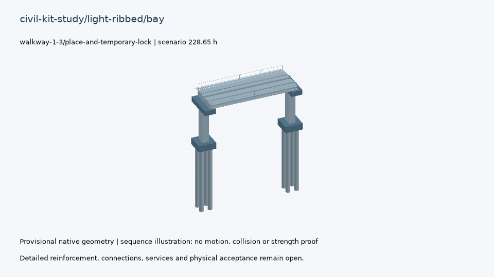
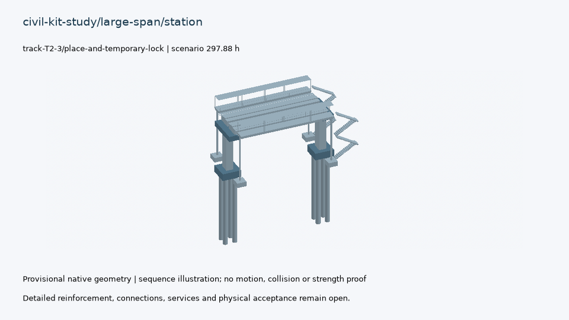
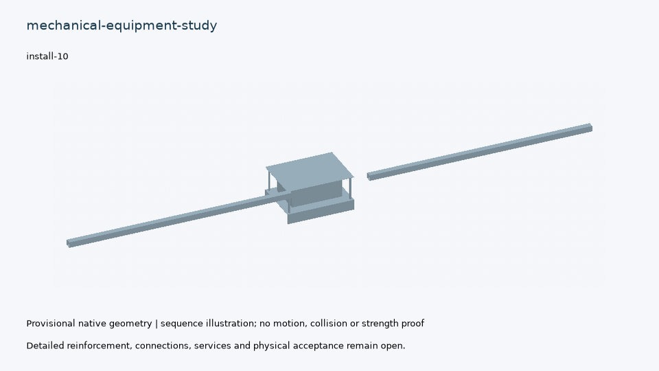
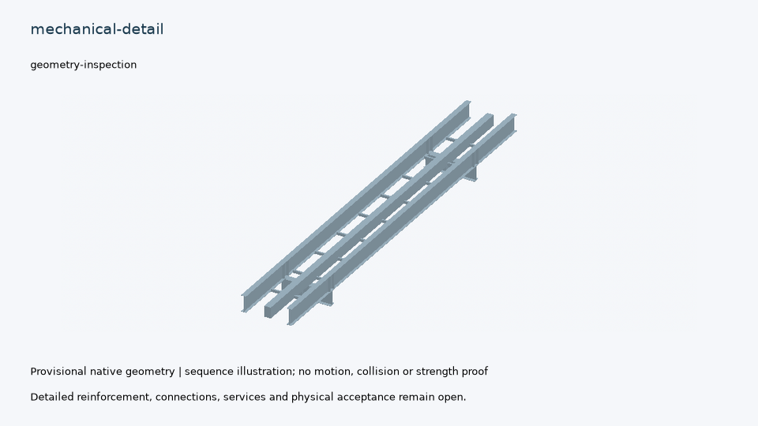

# Provisional continuous design delivery

Open [the illustrated review](index.html) for CAD pictures and short videos.

This package preserves selected source-bound research results, tests, native CAD, manufacturing/QA data and sequence visualisations. Full component and system completion remains open in [completion.json](completion.json); no physical or manufacturing release is claimed.

Verify offline from the repository root:

```bash
tools/automation/osr-python tools/automation/design-publish.py verify --package docs/design-engine/continuous-delivery --media
```

The portable evidence archive contains original receipts and all their retained files. Archive integrity is checked without rerunning physics. Publication-time eligibility is a snapshot, not a continuing acceptance claim. Assembly videos reveal retained solids at their final positions following evaluated operation/schedule events; they do not prove insertion paths, collision freedom or connection resistance. The underframe uses a camera inspection tour when no detailed assembly graph is present.

## civil-kit-study/light-ribbed/bay



[Eight-second construction-sequence video](models/civil-kit-study-light-ribbed-bay/assembly.mp4) · [Native CAD](models/civil-kit-study-light-ribbed-bay/model.FCStd) · [Metrics and open evidence](models/civil-kit-study-light-ribbed-bay/summary.json)

## civil-kit-study/large-span/bay


[Eight-second construction-sequence video](models/civil-kit-study-large-span-bay/assembly.mp4) · [Native CAD](models/civil-kit-study-large-span-bay/model.FCStd) · [Metrics and open evidence](models/civil-kit-study-large-span-bay/summary.json)

## civil-kit-study/segmental/bay


[Eight-second construction-sequence video](models/civil-kit-study-segmental-bay/assembly.mp4) · [Native CAD](models/civil-kit-study-segmental-bay/model.FCStd) · [Metrics and open evidence](models/civil-kit-study-segmental-bay/summary.json)

## civil-kit-study/large-span/station



[Eight-second construction-sequence video](models/civil-kit-study-large-span-station/assembly.mp4) · [Native CAD](models/civil-kit-study-large-span-station/model.FCStd) · [Metrics and open evidence](models/civil-kit-study-large-span-station/summary.json)

## mechanical-equipment-study



[Eight-second assembly-sequence video](models/mechanical-equipment-study/assembly.mp4) · [Native CAD](models/mechanical-equipment-study/model.FCStd) · [Metrics and open evidence](models/mechanical-equipment-study/summary.json)

## mechanical-detail



[Eight-second geometry-inspection video](models/mechanical-detail/inspection.mp4) · [Native CAD](models/mechanical-detail/model.FCStd) · [Metrics and open evidence](models/mechanical-detail/summary.json)
