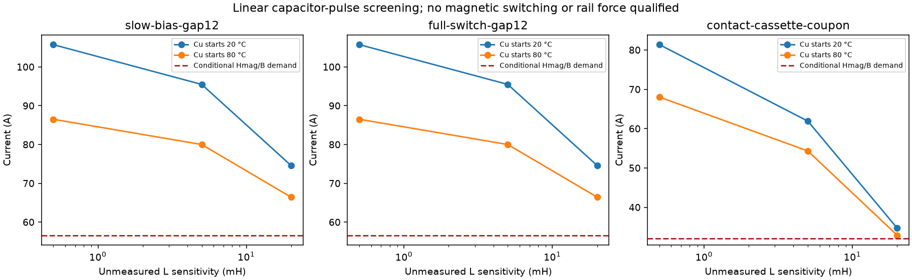

# Electropermanent next experiments

Three counted onboard EPM/Halbach coupons were screened with linear pulse circuits and explicit parallel-branch load lines. No switching, retained bias, lift or integrated train is accepted.

| Candidate | Added stock kg/module | Turns | Nominal pulse A | Conditional magnetizing A | Bank J/car |
|---|---:|---:|---:|---:|---:|
|slow-bias-gap12|7.991|380|95.48|56.60|518.4|
|full-switch-gap12|7.991|380|95.48|56.60|12441.6|
|contact-cassette-coupon|1.800|230|61.90|31.99|unknown count|

Nominal means 20 °C copper, assumed 5 mH, 20 ms. Demand covers both pulse directions and prescribed AlNiCo magnitudes 1.25 / 1.5 T at general 240 kA/m magnetizing guidance; these are not measured switching states. Capacitor/driver/protection/retention installation mass remains unknown.

[Machine results](study.json) · [Exact candidate stock](candidates.json) · [Pulse cases](pulse-cases.json) · [Load-line cases](loadline-cases.json) · [Source receipt](manifest.json)

The two 12 mm rail gaps substantially change the shared hard/soft magnetic load line. A 51 kA/m normal coercivity reference is neither a full magnetizing field nor an irreversible knee. Below that reference retention remains unknown; crossing it fails the stated positive-state necessary screen. No contact holding force is extrapolated to rail clearance.

Even with the wider endcaps, the declared zero-current/no-leakage circuit has no positive-AlNiCo-branch interval at 12 mm: the hard-Nd branch requires gap B ≥ 0.184 T while remaining above the normal-Hc reference requires B ≤ 0.134 T. This is a failed necessary model screen, not proof of physical irreversibility. A pole area ≥ 0.00661 m² or magnet length ≥ 0.0689 m is required merely to reopen that interval; neither change would qualify the unknown hysteresis, leakage or force.

Use EPMs as a candidate for slow load/bias adjustment. Active fast suspension remains necessary; its authority is not established here. Station, cassette and parking experiments have separate gap, wear and mechanical load interfaces; capture and door locks remain separate qualified mechanisms.

The next experiment measures protected positive/negative pulse current/voltage, flux minor loops and retention at several gaps and temperatures, plus hard-PM remanence before/after. Hysteresis/core/eddy losses, nonlinear L and switching rate require identification before any force/current map.

The pooled bank must recharge between modules. Timing records include 24 pulse slots and capacitor-reset energy at declared 1 kW / 90% charger assumptions; the parallel 24-bank comparison trades stored energy/hardware against programming latency. Residual inductor energy after 20 ms still needs a clamp/recovery circuit. Truncated pulse I²R is not complete-cycle heat or switching energy.

The discarded 10 mm rail endcap bridge would require 4.68 T to carry nominal Nd flux internally under the zero-external-flux hypothesis. The counted 40 mm endcaps reduce that necessary density to 1.17 T, with added steel. This fixes a cheap geometric bottleneck but does not prove an OFF state; steel MMF, leakage and AlNiCo state remain unresolved.

Sources: [Knaian MIT thesis](https://cba.mit.edu/docs/theses/10.06.knaian.pdf), [identified laboratory gravity-compensation study](https://doi.org/10.1016/j.ifacol.2023.10.180), [EA cast Alnico table](https://eamagnetics.com/product/alnico), [Arnold magnetizing guidance](https://www.arnoldmagnetics.com/products/alnico-magnets/). The laboratory 19 N/s result is not a rail actuator rate. Grade/data/PDF digests are retained in the source provenance.

| Application | Disposition | Missing evidence |
|---|---|---|
|steady lift / load trim|next-experiment|Identify retained bias and gap load lines; keep fast active suspension|
|lateral / yaw bias|unknown|Needs signed multidimensional force, moment and stability maps|
|propulsion flux setting|exploratory|Independent circuit only; never turn off shared support to regulate thrust|
|cassette / maintenance latch|bench-coupon|Positive retention, manual release, wear, EMC and inspection needed|
|parking clamp|unknown|Mechanical parking plus state/energy reserve proof; no automatic application on power loss assumed|
|semi-active MR damper|exploratory|Separate heat, loss, stability and failed-state evidence required|
|door retention|unknown|Magnetic retention is neither actuation nor a qualified door lock|
|HVAC|no benefit established|No inherent thermal benefit; winding/driver duty adds unresolved heat|
