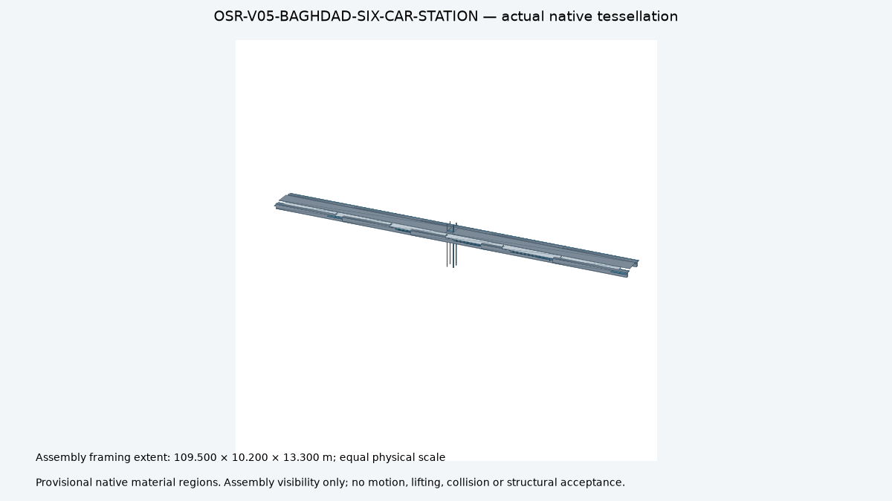

# Baghdad six-car native reference study

Generated by `engineering.ferrite_maglev.reference_assembly`.
Architecture: ferrite PM maglev. Configuration: V05-BAGHDAD-SIX-CAR-2.
Role: current provisional primary design. Financial scope: partial station
quantities; complete train and installed programme remain unpriced.

[Study and quantity ledger](study.json) · [Selected configuration](configuration.json) ·
[79 requirements and conditional applicability](requirements.json) · [Manifest](manifest.json)

[FreeCAD](station/model.FCStd) · [Compressed STEP](station/model.step.gz) ·
[Native reopen receipt](station/native-cad.json) ·
[Assembly visibility video](station/assembly-visibility.mp4)

Six 17 m bodies total 102 m. Assumed inter-car gaps give 104.5 m overall;
assumed end allowances give a 109.5 m platform. Coupling and stopping values
remain provisional. The centred lift floor is flush with the platform.
The 2.96 m arm envelope leaves a 0.255 m cabin-to-platform gap requiring
qualified bridge plates. Partial frames exclude the finished body and devices.

Pier heights 8/12/20/30 m propagate mass, gravity demand and geometric slenderness.
Wind, seismic, buckling, foundations, settlement and erection acceptance are open.
Emergency-energy phase accounting keeps missing deployment power and reserve open.
Gross partial entry-hardware mass is not the net installed chute mass.

Videos show part visibility at final positions; no motion or collision simulation.
Design completion, physical validation, manufacturing and physical release: false.
