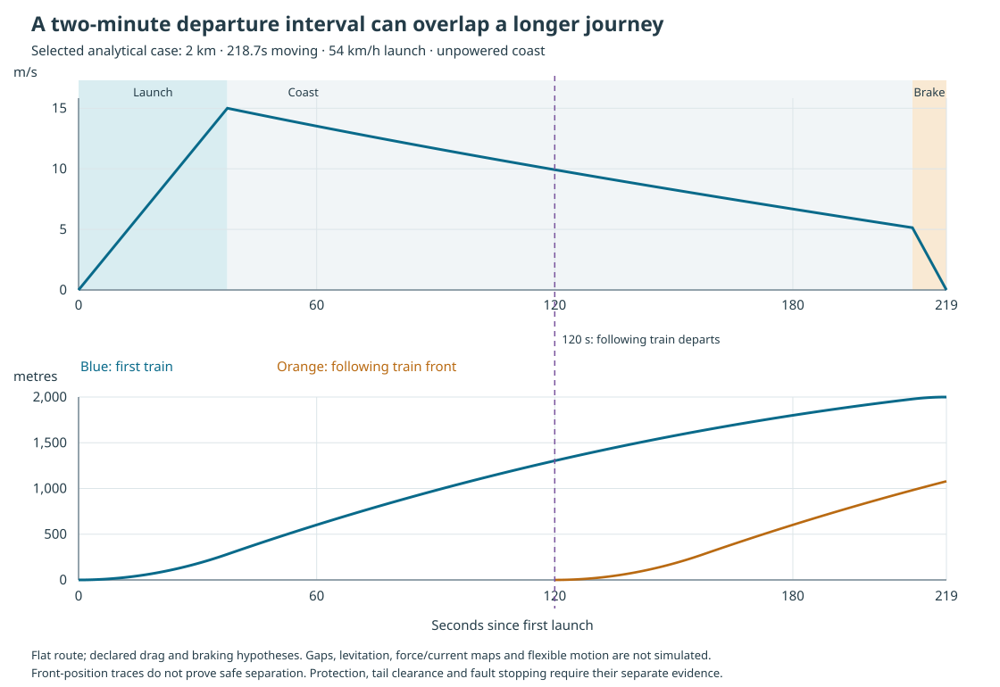

# Matched comfort train and two-minute service design

OpenSourceRail develops simple, locally maintainable trains on concrete beams with passive steel facings. All permanent magnets and suspension controls remain onboard; finite station windings launch and receive the trains. This dossier composes one seating/body/equipment proposal with its station, civil, power and service interfaces.

[System ethos and current evidence](../../../../README.md) · [Earlier component investigation](../comfort-options/README.md) · [Interactive design](../../../workbench/trip/readiness/comfort-design/)

**Selected design basis:** six 17 m cars; each has 44 fixed seats, two wheelchair places and no planned standing. Two doors are on one side. The service target is 120 seconds: 276 people/train, 30 trains/hour and **8,280 passengers/hour/direction**, with a 60-second mean wait under regular unsaturated service. The former 14,400 benchmark remains a comparison, rather than being relabelled as achieved.

The matched proposal accounts for **17.357t tare/car** and **20.807t at the 46-person cap**. Complete installed mass, full equipped CG/inertia and physical acceptance remain open. Counted material, supplier references and retained allocations are distinguished; an unlocated allocation is not turned into a uniform solid.

## Vehicle design and assembly

The body uses an aluminium extrusion frame with retained GFRP side/end structure, the selected aluminium-skin floor, a revised sandwich roof on the retained ribs, explicitly fitted paired/single seats, deeper door panels and retained laminated-glass references. The original added-crossrail roof is preserved as a rejected interference control. Polycarbonate remains an alternative until stiffness, retention, optics and emergency release are established.

The component definitions, material quantities, occurrences, transforms, assembly dependencies, retained interfaces, missing equipment and installation clashes are in [the complete dossier](design.json.gz). Native CAD and portable geometry represent their declared material/reference scope; equipment envelopes are labelled and do not invent the mass distribution of unweighed assemblies.

[Engineering BOM and unresolved inventory](engineering-bom.json.gz) · [Assembly/construction plan](assembly-plan.json) · [Matched station and civil definitions](station-civil.json). These are candidate-bound research/manufacturing-planning inputs; fabrication release remains held.

The section drawing retains a 12 mm magnetic-coupon reference, not an accepted operating gap. That PM state produces strong excess upward force for this lighter vehicle. Samples at 28/35.338 mm require a different relative car/facing pose; an eventual operating gap also determines the boarding-height datum. The required equilibrium, current authority and installed multiaxis map must be solved before any drawing pose becomes an operating configuration.

## Two-minute service, station resources and fleet

**A 120-second nominal service is a viable next software/resource prototype under the declared assumptions. Physical operation is not yet qualified.** Six cars carry 276 people at the proposed cap, giving **8,280 passengers/hour/direction**. The regular-interval mean wait is 60 seconds for unsaturated, uniformly arriving demand; denied boarding and service disruption can increase it.

### Motion and station design basis

The selected 2 km case launches at **54 km/h**, coasts without propulsion and enters braking at **18.5 km/h**. Motion takes **218.7 seconds** before the 35-second dwell. Acceleration is 0.4 m/s² and service deceleration 0.6 m/s²; jerk, grades, flexible-body motion and measured force/current maps are not included.



A leg taking longer than 120 seconds does not itself rule out two-minute departures. Trains can follow through separately protected resources. Reserving the whole interstation leg for one train would impose a different, longer interval. The receiving platform, tail clearance, stopping authority and powered section allocations still have to be available.

| Retained-drag comparison | Launch | Enter braking | Moving time | Smallest full-engagement station library option |
|---|---:|---:|---:|---:|
| 1 km | 54 km/h | 43.9 km/h | 101.7 s | 600 m |
| 1.5 km | 54 km/h | 33.1 km/h | 148.5 s | 600 m |
| 2 km | 54 km/h | 18.5 km/h | 218.7 s | 450 m |

The chosen station uses **one shared 450 m winding per direction**, spanning -147.6 m to +302.4 m relative to the stopped train nose. This is not an independent 450 m launch winding plus a second 450 m receiving winding. The 104.5 m formation and each 12 m car propulsion band are included in the overlap calculation. Two directions require 900 direction-metres, or 1800 motor-face-metres with two faces per direction.

The proposed routing has **36 separately addressed 12.5 m sections per direction and two independent train phase/current branches per direction**. A departing train and a receiving train may use different sections only when ownership, phase, current capacity and isolation permit it. One current/phase command cannot simply serve two differently positioned trains. Real switching, protection, bus ratings, thermal duty and bank-failure isolation remain unqualified.

Shorter interstation legs can produce faster arrivals and require more receiving length. The station library therefore retains 350/450/600 m choices; a 450 m design fitted to the 2 km case is not automatically sufficient at every shorter stop. The full city proposal counts its different winding lengths separately.

### Coasting and resistance uncertainty

The coast solves `dv/dt = -(C + Q v²)/m`, using the actual candidate comparison mass. It does not keep speed constant while claiming the motors are off. The campaign contains 144 primary combinations: 1/1.5/2 km spacing, 10/12/15/20 m/s launch caps, 30/35/45/60 second dwells, and 250/500/1,000 N per-car constant-resistance hypotheses; `Q = 1.8 N/(m/s)²` per car. These are resistance scenarios, not measured magnetic-drag data.

**16 cases coast to rest before reaching the receiving station.** In particular, 12 m/s cannot complete 2 km under the retained 1,000 N/car hypothesis. The selected 15 m/s case reaches the station, with 1696.7 m of unpowered coast. At fixed speed and a fixed force-drag hypothesis, reducing train mass also reduces stored kinetic energy; a lighter train need not coast farther.

Calculated mechanical energy per six-car leg is 4.46 kWh supplied during launch and at most 0.42 kWh recoverable during receiving. These exclude actual inverter/converter losses and passenger-services electricity. No supplier electrical-efficiency or regenerative grid-acceptance claim follows from them.

### Station occupancy, dwell and disruption

With one exclusive lease for the entire winding, the selected nominal station interval is 113.99 seconds: only 6.01 seconds remain at a 120-second target. With separately addressed sections and the platform checked independently, the largest nominal occupancy is 84.76 seconds, leaving 35.24 seconds. This improvement requires the additional section/phase hardware and verified releases.

| Resource architecture | First-train dwell extension | Minimum gap in the prescribed timetable | Result |
|---|---:|---:|---|
| Addressed sections + platform | +0 s | 35.24 s | No resource conflict in the declared event model |
| Addressed sections + platform | +15 s | 20.24 s | No resource conflict in the declared event model |
| Addressed sections + platform | +60 s | -24.76 s | Conflict: hold/recovery required |
| One exclusive whole winding | +0 s | 6.01 s | No resource conflict in the declared event model |
| One exclusive whole winding | +15 s | -8.99 s | Conflict: hold/recovery required |
| One exclusive whole winding | +60 s | -53.99 s | Conflict: hold/recovery required |

The event model follows three trains through three arrivals each and releases a resource after the complete train tail clears it. A 15-second dwell extension fits the addressed-section proposal; a 60-second extension does not. These checks are a finite timing experiment, not a guarantee that every departure remains exactly 120 seconds apart.

**Recovery cannot be an arbitrary time shift of a coasting train.** Before a departure is committed, dispatch can propose holding at a powered platform and retiming following departures, subject to fresh authority. A train already coasting may have to brake within its owned authority. Restarting it then requires a qualified powered holding/restart location or a located rescue system. The retained-authority Rust braking fixture demonstrates the declared stopping-method response; it does not establish a physical restart or restoration of two-minute service after that disruption.

The separate native packet checks the existing progressive protection implementation with actual Rust execution. Its detector, integrity and independent-brake readiness assertions are synthetic, and its healthy-gap fixture remains 6–8 mm. Those virtual inputs do not establish the new NdFeB suspension response. Guaranteed brake curves, support-power loss, receiving-power loss, latency and installed phase/current handoff remain operating gates.

### Passenger capacity and formation alternatives

The selected six-car comfort proposal is explicitly below the former 14,400 pphpd comparison. At 120 seconds, 10 comfort cars still fall short; 11 cars exceed that arithmetic target. Longer formations need their own platforms, winding overlap, fleet, evacuation and civil design. None silently replaces the six-car proposal.

| Cars | People/train | Capacity at 120 s | Formation length assumption |
|---:|---:|---:|---:|
| 6 | 276 | 8,280 pphpd | 104.5 m |
| 8 | 368 | 11,040 pphpd | 139.5 m |
| 10 | 460 | 13,800 pphpd | 174.5 m |
| 11 | 506 | 15,180 pphpd | 192.0 m |
| 12 | 552 | 16,560 pphpd | 209.5 m |

### Baghdad fleet and station consequences

The retained city plan contains 451 trainsets. Under the selected launch speed and retained resistance hypothesis, **9 of 14 lines have at least one mainline event that cannot reach the next stop**. Their revised retained-stop fleet is unknown, rather than being assigned zero or an invented journey time.

An explicit alternative splits longer events into passenger-stop intervals no longer than 2 km. It gives **1,206 trainsets and 120 additional proposed line-stop sites**, with a 12% operating-spare hypothesis and one cold reserve per line. New sites are fractions along retained stop pairs, not surveyed or adopted station locations. The terminal-loop timings are inherited and still need qualification for this train. Existing city maps, stops and headways remain unchanged.

| Line | Retained trainsets | Retained-stop result | ≤2km added-stop alternative | Additional proposed sites |
|---|---:|---|---:|---:|
| line-1 | 36 | Unreachable event(s) | 129 | 21 |
| line-2 | 48 | Unreachable event(s) | 134 | 14 |
| line-3 | 42 | Unreachable event(s) | 122 | 6 |
| line-4 | 36 | Unreachable event(s) | 106 | 7 |
| line-5 | 41 | Unreachable event(s) | 118 | 5 |
| line-6 | 44 | Unreachable event(s) | 134 | 16 |
| line-7 | 34 | Unreachable event(s) | 103 | 12 |
| line-8 | 51 | 119 trainsets | 120 | 2 |
| line-9 | 65 | Unreachable event(s) | 120 | 24 |
| line-10 | 12 | 23 trainsets | 23 | 0 |
| line-11 | 10 | Unreachable event(s) | 24 | 3 |
| line-12 | 10 | 24 trainsets | 23 | 3 |
| line-13 | 12 | 26 trainsets | 27 | 4 |
| line-14 | 10 | 22 trainsets | 23 | 3 |

The added-stop alternative requires 220 × 450 m and 466 × 600 m directional mainline windings (378,600 direction-metres). Terminal service windings are additional. These quantities expose the infrastructure consequence of the service proposal; they are not a priced or physically approved network.

### Cost comparison

**Low unit trainset cost remains an objective, not an established price.** At the same circuit time, changing 180-second service to 120 seconds requires 1.5 times as many active trainsets before rounding and reserves. Unit trainset price would need to fall to two-thirds of the comparison price just to keep fleet purchase cost unchanged.

The actual city scenario also changes travel time, stops and reserves. Its 1,206-versus-451 fleet comparison requires a unit trainset price no more than **37.4%** of the retained planning price to keep fleet purchase cost level. That excludes the new stations, longer windings, chargers, depot, staff, maintenance, energy, renewals and financing. Actual vehicle prices and complete CAPEX/OPEX remain unknown. No total-system saving is claimed.

Service evaluation: `c0fd7cd422fa8ce093e0078819de82efdf7f8145d72e846803547e8f873f3618`. Candidate: `957f7e4e2e0e98b575810fb0c568554968fc1eb0715fb673827a16bcf63d400b`. The station and scenario identities are retained separately. Physical operating release remains false.


### Whole-system alternatives to the shortest-winding prototype

The earlier 450 m/15 m/s selection is a next station/service prototype, not proof of the cheapest complete railway. This bounded comparison keeps the same vehicle, 46-person cap, six cars, 120-second departure target, 35-second dwell and retained drag hypothesis while changing launch speed, stop spacing and counted station windings. No new native protection or physical train simulation is credited to these alternatives.

At 20 m/s (72 km/h), the 2 km analytical journey takes **151.9s**, versus 218.7 s at 15 m/s. Arrival speed is 14.27 m/s. The full-engagement station bound is 784.1 m, so the 800 m shared-winding diagnostic **passes** that necessary geometry screen. Required peak mechanical power is 1205 kW per train; this is required power, not demonstrated motor capability.

| Launch | Stop plan | Fleet | Additional proposed line-stop sites | Directional winding | Mainline motor coverage | Overlapping intervals | Result |
|---|---|---:|---:|---:|---:|---:|---|
| 54 km/h | Retained stops | unknown | 0 | unknown | unknown | 0 | Hold: 9 lines have unreachable events or station screens fail |
| 54 km/h | ≤2 km | 1,206 | 120 | 378.6 km | 36.2% | 0 | Conditional analytical survivor |
| 54 km/h | ≤3 km | unknown | 0 | unknown | unknown | 0 | Hold: 9 lines have unreachable events or station screens fail |
| 72 km/h | Retained stops | 906 | 0 | 390.5 km | 36.7% | 4 | Conditional analytical survivor |
| 72 km/h | ≤2 km | 1,035 | 120 | 640.1 km | 61.1% | 4 | Conditional analytical survivor |
| 72 km/h | ≤3 km | 906 | 0 | 390.5 km | 36.7% | 4 | Conditional analytical survivor |

Each reachable arrival selects the shortest full-engagement station option from 350/450/600/800/900/1,000 m. Directional winding quantities exclude terminal-loop windings and other unclosed scope. Mainline coverage is the union of winding intervals clipped to retained chainages; overlapping intervals do not become free shared hardware. New line-stop sites are chainage proposals, not approved locations. Ordinary passive-guideway length must not be described as though long station motors occupy no route.

Across these proposals the interval calculation finds 12 adjacent motor-interval overlaps. Their phase/hardware sharing, attachment, electrical isolation and additional drag remain unqualified. Higher speed and longer powered sections also require new current, voltage, thermal and protection evidence; the old 20 m/s field point is not transferred as available thrust.

The Pareto set retains alternatives that cannot improve fleet, added sites and directional winding together. Prices remain unknown. For any comparison with extra winding, the train-only break-even threshold is `saved trainsets × assumed unit trainset price / extra directional metres`; excluded station savings are unpriced, not assigned zero. The complete equations and explicitly hypothetical unit-price sensitivities are retained in the machine-readable record.

| Alternative versus 54 km/h, ≤2 km plan | Trainsets saved | Proposed sites avoided | Extra directional winding | Hotel saving coefficient |
|---|---:|---:|---:|---:|
| 72 km/h, retained stops | 300 | 120 | 11.9 km | 1,602 |
| 72 km/h, ≤2 km | 171 | 0 | 261.5 km | 918 |

The hotel coefficient is kWh saved per operating hour for each 1 kW of actual per-car services load. Multiply by measured load and declared hours at this service; electricity tariff and lifetime present-value assumptions are additional parameters. Mechanical launch and potentially recoverable braking energy are reported separately from electrical energy, with terminal-loop energy still unknown. Faster service may reduce fleet and auxiliary energy while increasing stator quantities and mechanical/aerodynamic demand; no complete cost saving is established.

Adjunct evaluation: `e5efc6df6fef80db5c2086b25f977ab3a1c6c009233fa0ba9f0d88b2cc338065`. All operating and physical acceptance flags remain false.


## Coupled electrical, support and civil design

# Matched electrical, protection and civil design interfaces

This dossier uses the exact comfort vehicle and selected shared station-winding geometry. It specifies counted parts and numerical requirements while preserving physical acceptance gates.

Vehicle `957f7e4e2e0e98b575810fb0c568554968fc1eb0715fb673827a16bcf63d400b`; body `1eca1897b983bf62ec315cdc39aca2e2387f93ad6ab0c195bc278e14c8fb120b`; PM component `397ddf033ab98afaea053acaa3047249a3329f542f1f5e52a6eb1b466b9662e0`.

| Gate | Necessary result | Remaining evidence |
|---|---|---|
| mass | unknown | Equipped mass, CG and inertia retain unlocated allocations/references and unresolved installation stock. |
| suspension | unknown | Zero-current component samples have unresolved contour disagreement; no installed3D multiaxis current map, equilibrium or damping proof. |
| control | unknown | Actual current authority, supply bandwidth, gap/tolerance envelope and essential-power fault response are unqualified. |
| HVAC-electrical | unknown | Actual50C capacity/COP/fresh air, compressor phases and complete bus/charging duty remain unqualified. |
| roof-hot-core | fail | The retained0.5solar-absorptivity/900Wm2/50C unshaded hypothesis exceeds the H60 continuous70C limit; measured finish/shading or material revision is required. |
| body-clearance | unknown | Revised roof on retained ribs,61mm doors, floor inserts, seat restraints and magnetic attachments need native swept fit and joined-body analysis. |
| civil | unknown | New2.26m steel-facing envelope and spreaders need anchors, concrete/rebar, prestress, moving loads, magnetic shadow and site evidence. |
| capture-energy | fail | The retained eight-shoe undamped linear source model exceeds the source force/compression bounds in the required drop cases; alternatives need counted geometry and measured force/stroke. |
| onboard-braking | unknown | Retained clamp stock has declared force/friction/thermal sensitivities, but actual wet/hot friction, independent deployment and guideway load paths are unqualified. |
| recovery | unknown | A stopped off-zone train needs located powered or winch recovery and essential energy. Contact-supported towing can exceed the retained rope bound; time shift is not restart thrust. |
| operations | unknown | A nominal120s resource screen cannot establish support, guaranteed braking, receiving-power-loss protection or actual dwell distribution. |
| economics | unknown | Trainset unit price, priced BOM coverage, labour, tooling, station power, fleet and whole-life costs are incomplete. |

## Support and hot-weather services

The smaller retained zero-current 28 mm/80°C force sample exceeds 1.3× accounted comfort load by 1463 N/module. The two contours differ by 2035 N/module. This is not a converged force-map bound or stable hover.

At 15 A RMS, known copper loss is 8.370 kW/car. Maintaining 80°C copper against 50°C air requires at least 11.626 W/K per module before other losses. Actual heat rejection and RMS duty are unknown.

The matched aluminium-skin/45 mm H60 roof and floor thermal sensitivities give 35.1–72.5 kW thermal/car at 46 people. Glazing solar values and bridge losses are hypotheses; actual 50°C HVAC capacity, phase count, COP, input power and N−1 ventilation remain unknown. Same-car door recurrence is journey plus dwell, not the line headway.

The unshaded retained solar-absorptivity0.5 scenario puts the outer H60 core at 77.9°C, above its70°C continuous reference. Under the declared1D films/conduction, aged roof absorptivity must be at most 0.363; ≤0.30 is a design target. Actual finish/coating mass, shading by HVAC and condenser recirculation are unknown, so no thermal or mass credit is applied.

## Receiving, charging and protected two-minute service

The selected coast model arrives slower than launch speed. Normal receiving energy uses the actual arrival state; the independent fault brake must still stop from peak speed at any coast position. The retained 20 m/s force coupon is not transferred to new speeds/current states.

| Shared winding per direction | Sections/direction | Independent train branch sets, both directions | Peak/arrival speed | Required launch mechanical energy | Required receiving mechanical energy |
|---|---:|---:|---:|---:|---:|
| 450 m | 36 | 4 | 15.00/5.14 m/s | 4.465 kWh | 0.421 kWh |

Section-addressed operation requires independently protected phase/current banks, interlocked routing and identified full-tail clearance. Four branch sets across two directions are a minimum functional count, not a proven converter BOM. Their current/voltage, switching, cooling and price remain unknown. Hotel charging uses explicit 20/40/60 kWe HVAC and 20/30/45-second charger scenarios; actual input power and battery/charger mass remain unknown. No regenerative saving is credited.

## Independent brakes and capture

Four retained clamp allocations, their hangers and two cross-ties remain counted in the vehicle. New wear/capture surfaces are counted in the civil proposal. Coulomb force/heat scenarios preserve three/four active units, wet/hot friction hypotheses, grades and the 160-person +2t control. They are requirements, not measured guaranteed braking.

The retained eight-shoe linear model fails: at comfort load a 5 mm drop produces 8.21 mm compression and 82.1 kN/shoe, against source 8 mm/50 kN bounds. At 160 people +2t, it produces 11.14 mm and 111.4 kN/shoe.

| New capture design target at 160 people +2t | Required stroke | Required force/shoe | Energy/force/stroke screen |
|---|---:|---:|---|
| 12 shoes; 20 mm maximum; 50 kN maximum | 24.66 mm | 61.6 kN | fail |
| 12 shoes; 25 mm maximum; 50 kN maximum | 29.91 mm | 59.8 kN | fail |
| 16 shoes; 20 mm maximum; 50 kN maximum | 19.35 mm | 48.4 kN | pass |
| 16 shoes; 25 mm maximum; 50 kN maximum | 23.34 mm | 46.7 kN | pass |

Those are new force-law specifications. The old 8 kg shoe mass is not transferred; actual long-stroke hardware, upper-gap retention, hangers, reinforcement and contact/damping evidence remain required before updating the vehicle.

## New steel-faced concrete beam proposal

Two 0.50 m-wide, 35 mm-thick facings at y=±0.88 m span 2.26 m across. The plates alone count 6.869 t per 25 m. New crossmembers, risers, baseplates, anchor stock and brake/capture surfaces bring counted steel to 21.627 t; adding the reference prismatic concrete gives 64.127 t before reinforcement, prestress, end blocks, bearings and other unresolved work.

The existing −1.60 m beam-top datum is retained. Lower crossmembers, outside-PM risers and top caps support the working faces; new inner vertical wear strips and capture caps match the retained protection coordinates. Extra magnetic steel and joints invalidate any assumption that the isolated-coupon field map is the complete installed interface.

The 40 kN local member fixture passes the declared 1 mm elastic-component target; the 70 kN escalation fails it. Neither value is a qualified magnetic-collapse force bound. Welds, anchors, concrete breakout/rebar, global prestress/torsion, pier/foundation loads, erection and site quantities still need the matched design. Old L-return rail prices and the former 61.9 t beam are not transferred.

## Build and qualification sequence

- **body-jig**, after design release: Survey floor/body datums and magnetic mounting frames; Inspect exact frame members, galvanic isolation and bond preparation. Release evidence: Fixture calibration; Material/lot identity.
- **floor**, after body-jig: Bond/fasten selected tiled floor panels with counted edge closures and inserts; Keep seat, wheelchair and battery hardpoint interfaces accessible. Release evidence: Core/skin bond witness coupons; Concentrated floor and insert loads.
- **roof**, after body-jig: Fit revised thicker-skin/45mm-core roof on retained ribs and counted bearing shims; Inspect rejected crossrail clashes and new panel/lap/roof datums before HVAC ducts. Release evidence: Panel/bearing and retained-rib joint inspection; Roof/duct/passenger headroom clash review.
- **door-window**, after body-jig: Install 61mm door leaf proposal and retained glass references; Resolve exterior slide/plug parking, seal lines, track recession and emergency release. Release evidence: Open/close swept clearance; Entrapment/interlock and egress test.
- **seat-restraints**, after floor, door-window: Fit the exact paired and single-seat fixtures from the selected vehicle to qualified floor hardpoints; Fit two wheelchair restraint bays and preserve access paths. Release evidence: Vertical/backrest/restraint and fatigue tests; Occupied accessibility and evacuation trials.
- **HVAC-services**, after roof: Fit five package references, drains, ducts, wiring and fresh-air paths; Separate essential support power from shed-able comfort loads and coordinate compressor starts. Release evidence: 50C capacity/COP/airflow and N-1 test; Electrical isolation, heat rejection and EMC.
- **magnets**, after floor, HVAC-services: Use restrained magnetic tooling to fit24 exact modules at surveyed transforms; Install independent retained capture and support isolation paths. Release evidence: Polarity and retention inspection; Matched gap/current/force map and controller test.
- **civil-factory**, after design release: Cast reference beam only after new facing-anchor/rebar design; Fit steel facings and spreaders in datum jig with working face unobstructed. Release evidence: Concrete release strength; Anchor/fatigue and magnetic shadow evidence.
- **erection**, after civil-factory: Approve crane/transport configuration, foundation and temporary stability; Install, survey and lock facing adjustment with thermal joints. Release evidence: Signed lifting plan; Loaded alignment/deflection survey.
- **station**, after erection: Install the actual selected shared winding length and protected electrical groups; Configure receiving path, battery charging, dump resistor and independent protection. Release evidence: Same-candidate force/voltage/heat duty; 120s dwell, tail-clearance and fault cases.
- **acceptance**, after seat-restraints, magnets, station: Weigh equipped car and measure CG/inertia; Confirm hover before any physical journey; test full train and faults. Release evidence: Authenticated physical evidence; Independent acceptance.

## Off-zone stop and retrieval

A stopped coasting train has no arbitrary restart thrust. For the 2000 m leg, reaching a powered station can require 1000 m of retrieval and 1050 m of cable including tail: 6.468 t of the retained38mm rope reference. The old500m nearest-node reach does not by itself prove a complete handoff to a powered berth.

Levitated towing and contact-supported sliding are separate cases. Wet/hot contact drag can exceed the retained rope design bound; source drum, portal, anchors, foundations and access require resizing. The rescue plan needs a powered receiving location, proved tow/coupling path and controller reconciliation, not an animation time shift.

Essential energy preserves incoming hotel duty, deployment and actual retrieval time under30/50/60kWh pack hypotheses. Installed pack mass/capacity, full cooling during a15kW critical mode and physical recovery are unqualified. Normal120-second service is not promised during retrieval.


Labour hours, tooling, supplier lead times, actual unit trainset price and whole-life installed cost remain unknown. Lower-cost vehicles cannot justify extra service frequency without the station, fleet, energy, renewal and financing comparison.

Interface evaluation `8db3149e4e065a0260959736066eb57b7e7921f5cdf45426eeeef3ccc17c57a1`. Physical, manufacturing and operating release flags remain false.


## Executed native evidence

Actual FreeCAD and STEP export/reopen checks passed for **20,776 material primitives**, representing **10,198.351 kg of defined material**. This is a subset of the accounted tare, with its own material-only CG/inertia; complete installed mass and CG remain unknown. The revised roof has zero native intersection volume with the checked primary longitudinal members; a full-body interference or structural release is not claimed.

The current candidate-bound Rust package independently verifies **6 executed controls**: nominal/journal 120-second departures and retained-authority receiving/brake/gap/integrity fault responses. Its healthy support and brake inputs remain explicit protocol fixtures. The native receipts, requests and logs are retained in the linked archives.

## Qualification and remaining work

A complete design dossier is not an accepted complete engineering design. The native geometry and protection-protocol executions below have their declared method scope. Static PM-force samples do not establish stable hover; virtual healthy-gap inputs do not establish the new magnetic controller; assumed braking floors do not establish emergency stopping hardware. A physical-force 2 km journey remains gated rather than animated with invented support.

1. Finish the joined-body, seat/door/roof interfaces and exact equipped mass/CG/inertia; correlate material/joint loads and modes.
2. Converge the installed 3D PM/steel/current maps, guidance/damping and fault-control envelope for this body and new guideway facings.
3. Qualify hot-weather HVAC, support cooling, essential battery, bus, charging and receiving/dump duty.
4. Establish measured independent braking, capture, train integrity and receiving-power-loss behaviour at every coasting location.
5. Confirm native station-group switching, worst-case dwell and protected 120-second operation, then feed supplier/site evidence into the selected guideway and cost model.

The lower passenger cap is a design/boarding-control requirement. The 160-person crowd/control and asymmetric load cases remain visible until revised structural loads and cap enforcement are qualified. Low-cost trainsets remain a cost objective; the dossier compares fleet and price sensitivity without assigning an unknown unit price zero.

## Reproduction

```bash
python -m engineering.comfort_design verify
python -m pytest --import-mode=importlib -q engineering/comfort_design/tests
```

[Compact results](summary.json) · [Source/payload receipt](manifest.json) · [Native FreeCAD model](vehicle.FCStd) · [Compressed STEP](vehicle.step.gz) · [Vehicle overview](vehicle-overview.svg) · [Coasting profile](service-profile.svg) · [Matched train/guideway section](interface-section.svg) · [Native CAD evidence](vehicle-artifacts.tar.gz) · [Rust method evidence](service-artifacts.tar.gz)

Candidate: `957f7e4e2e0e98b575810fb0c568554968fc1eb0715fb673827a16bcf63d400b`. Study: `a42bc05e0766161ddd1d14b610158e12fe0cc2a2537bbf615cdecf7c55e89c43`. Parent: `f0946b699376699b408df6e9a1f04a657f74022b`. Engineering, manufacturing, operating and physical release flags remain false.
