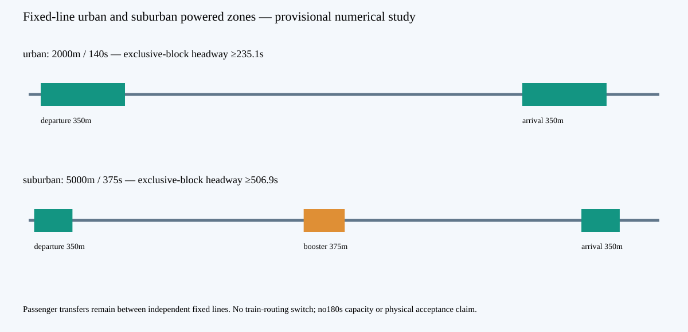

# Fixed-line urban and suburban operational studies

[Urban moving geometry](urban-motion.mp4) · [Suburban moving geometry](suburban-motion.mp4) · [Raw executed evidence](result.json.gz) · [Receipt](manifest.json)

Two separate exact profiles are executed:2km/140s urban and5km/375s suburban with a finite midpoint LSM booster and96s suburban dwell. Both use350m station windings; booster extent covers all three load cases. The faster300s AW3 suburban benchmark retains its AW0/AW2 speed-limit failures. The booster is an installed nonpassenger asset; passenger transfers occur between independent fixed lines. The1km/88s packets remain explicit benchmarks.

Three rigid-body moving confirmations per profile retain nominal stiffness and reduced-E/signed sensor bias. The previous2.2m failure and lighter2.4m comparison remain visible. Actual Rust controls evaluate finite electrical sections, warm-up, phase/current/voltage/copper bounds and resource holds.900V, booster/grid/resistor, delayed handover, stale sensing and uncommitted cases are executed.50/60kWh packs and240/400/600kW charging alternatives retain60kW/car hotel load and ten-minute reserve.

Rigid-body inertias remain independent unqualified hypotheses (roll20,000kg·m² and pitch600,000kg·m²), even when the exact battery mass changes. No measured pack position, CG or complete mass distribution is claimed.

**Held:**180s capacity under exclusive whole-leg arrival reservations. Geometry confirmation is a bounded linear/ideal-force numerical result; measured magnet/winding maps, new converter ratings, flexible bodies, lateral/torsion, soil/joints/fatigue, rescue hardware, alignment and physical acceptance remain open. No manufacturing or physical release is claimed.
