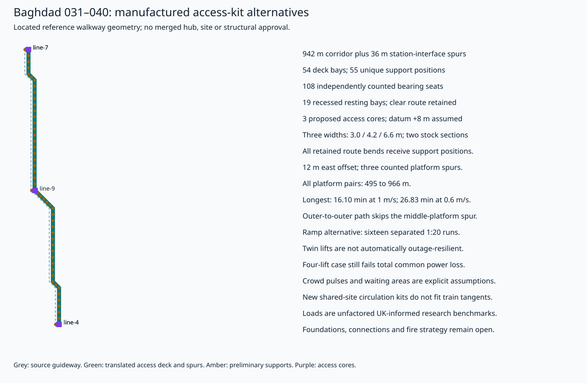
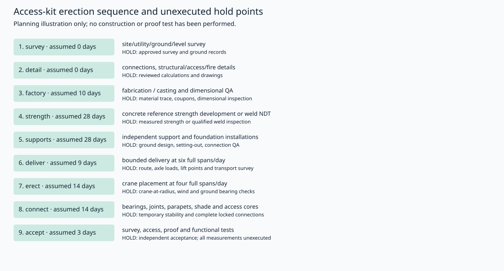

# Baghdad physical interchange access-kit study

The 031–040 / line 9 midpoint alternative retains 941.83 m of geographically defined reference corridor. Its two reference arms remain approximately 471 m each. An independent deck is translated 12 m east of that train alignment, and three counted 12 m platform-interface spurs add 36 m: 977.83 m total. The middle-to-outer walks are approximately 495 m, while the outer-to-outer walk is approximately 966 m before vertical movement. The latter uses both corridor arms and two outer spurs; it skips the middle-platform spur rather than adding the two advertised arm walks. The guideway-separation screen uses an assumed envelope; the spurs still require approved side-platform/level geometry and the site is unchecked. 54 preliminary deck bays, 55 support positions and 108 bearing seats are explicitly placed. Every retained bend receives a support. The common central bearing group has no qualified foundation or cost credit. No hub is selected and the current city reference is unchanged.

All three platform-pair shortest paths are solved over the placed deck-unit/support graph. The longest transfer is about 16.10 minutes at 1 m/s or 26.83 minutes at 0.6 m/s, before rests, vertical access, queues, heat or service waiting. One additional recessed resting bay is counted at the central junction so that the two independent 50 m arm patterns do not leave a 100 m rest gap. Rest-spacing calculations include every path and its counted interface spurs; they do not establish an accepted accessible route.

| Platform pair | Shortest physical walk m | At 1 m/s min | At 0.6 m/s min | Rest bays on path | Maximum rest/endpoint gap m |
|---|---:|---:|---:|---:|---:|
| line-9 ↔ line-4 | 494.91 | 8.25 | 13.75 | 10 | 50.00 |
| line-9 ↔ line-7 | 494.92 | 8.25 | 13.75 | 10 | 50.00 |
| line-4 ↔ line-7 | 965.83 | 16.10 | 26.83 | 19 | 50.00 |

Three clear widths and concrete twin-I / steel twin-RHS stock sections are compared. Quantities include clear deck, recessed resting bays, shade, parapets, stock mass and full-span lifting weights. Gross elastic demand, wind/uplift and handling reference loads are calculated. Concrete cracking/reinforcement/prestress, steel local buckling, crowd vibration, fatigue, seismic, joints, foundations, lifting and erection stability require separate acceptance. A gross section result does not close these gates.

Three separate ground/platform access cores use an assumed +8 m datum. A 1:20 ramp is physically laid out as 16 separate parallel runs with landings: approximately 220.2 m surface length and 912.0 m² bounding footprint per core. Land and obstructions have not been checked. Lift alternatives have one, two or four cars per core plus independent stairs. Stairs alone do not provide a step-free route. An operating lift is not presumed to be an evacuation lift.

Deterministic queues retain 120/240/480-person, 60-second transfer pulses, repeated at 180/360-second headways. Shared two-way capacity is a declared benchmark, not an observed Baghdad demand. Waiting-area quantities are additional to unobstructed circulation. FIFO wheelchair-party lift scenarios include one-car outage and complete common power loss. A second lift does not guarantee that the surviving car clears a burst; the complete power-loss case is inaccessible without an independent route. These tests are fluid/queue calculations, not agent-based crowd or fire simulations.

| Clear width m | Deck including rest bays m² | Support positions | Lowest partial target USD | Highest partial target USD |
|---:|---:|---:|---:|---:|
| 3 | 2,990.5 | 55 | 2,074,799 | 10,636,789 |
| 4.2 | 4,163.9 | 55 | 2,400,480 | 12,018,525 |
| 6.6 | 6,510.7 | 55 | 3,051,841 | 14,781,997 |

Every rate is an unquoted sensitivity. The $3,075,000 station-electrical target credit is kept separate. Additional queue-gallery area is priced for a stated 240-person/360-second, one-lift-outage scenario at every core; four finite bursts do not prove long-term stability or repair an inaccessible route. Removed station civil, ramps/stairs, actual core/gallery connections, land, actual foundations, utilities, fire/power systems, construction access, renewals, passenger time and financing remain outside the partial total. A negative partial delta does not establish savings.

Seven shared-site concepts now have explicit concourse bounds, level-separated platform interfaces, lift/stair interfaces and computed internal horizontal walks. These are independent circulation layouts with assumed levels. They do not fit the required 350 m train tangents, preserve former boarding access, qualify train clearances or inherit old guideway civil prices.

[Complete calculations](study.json.gz) · [Physical geometry units](geometry.json) · [Source/payload receipt](manifest.json)

UK primary references inform research assumptions only; Iraqi accessibility, structural and fire acceptance remains open:

- [DfT Inclusive Mobility, December 2021](https://assets.publishing.service.gov.uk/government/uploads/system/uploads/attachment_data/file/1044542/inclusive-mobility-a-guide-to-best-practice-on-access-to-pedestrian-and-transport-infrastructure.pdf): UK best-practice reference: two-way width, 1:20 preferred gradient, level landings after 0.5 m rise and resting places no more than 50 m apart. Not Iraqi acceptance.
- [DfT/Transport Scotland Design Standards for Accessible Railway Stations, version 04, March 2015](https://assets.publishing.service.gov.uk/government/uploads/system/uploads/attachment_data/file/415638/design-standards-accessible-stations.pdf): UK reference lift dimensions, through access, clear landings, shelter and seating. Actual cabin capacity, disability impact assessment and outage provision require design.
- [Network Rail Station Capacity Planning NR/GN/CIV/100/03, December 2021](https://www.networkrail.co.uk/wp-content/uploads/2022/02/Station-Capacity-Planning-Design-Manual-NRGNCIV10003.pdf): UK flow and 0.93 m2/person queue-space benchmarks; source peak-minute demand, two-way circulation and local queues still need observation.
- [National Highways CS 454 version 1.1.0, October 2022](https://www.standardsforhighways.co.uk/tses/attachments/96569268-6c26-4263-a1f7-bc09a9e3977f): 5 kN/m2 short-loaded-length pedestrian UDL is a preliminary load reference only. No full Eurocode combination, dynamics, fatigue, accidental, wind or Iraq-code verification is implied.
