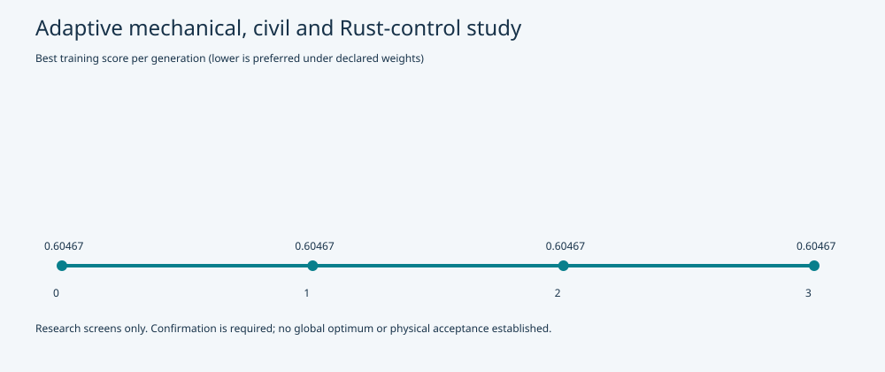

# Adaptive mechanical, civil and software design study

24 exact candidates evaluated over 4 generations; 18 passed training screens. Termination: bounded-stagnation.

The generator uses the preceding results to create differential and local mutations of beam sections/spans, body and equipment mass allocations, and actual Rust controller gains. Each viable proposal runs passenger-load and compliant-guideway scenarios plus replay/invalid-gap protection controls. Shortlisted candidates face separate three-second holdout scenarios; failed confirmation disqualifies that revision.

The selected study is identified in [recommendation.json](recommendation.json). [Full candidate, ancestry, scenario and confirmation evidence](result.json.gz) is source-bound by [manifest.json](manifest.json). Cache receipts permit exact-source restart; changed sources or binaries create another epoch.

Manufacturing screens are declared project bounds and bare-lift checks. Body mass reductions are unqualified allocations, with no automatic procurement or local-content credit. Required ferrite, batteries, passenger equipment, capture and reserves remain in the comparison. Inertias are assumed to scale with mass; they are not recovered from a complete body model.

The comparison retains fallback walkway scope. Removing it remains conditional on qualified onboard evacuation and route acceptance. Candidate beam geometry is not automatically promoted into city defaults.

**Engineering acceptance remains open.** This study does not prove a global optimum, complete manufacturability, actual magnetic performance, a whole-train dynamic model or hardware timing.
