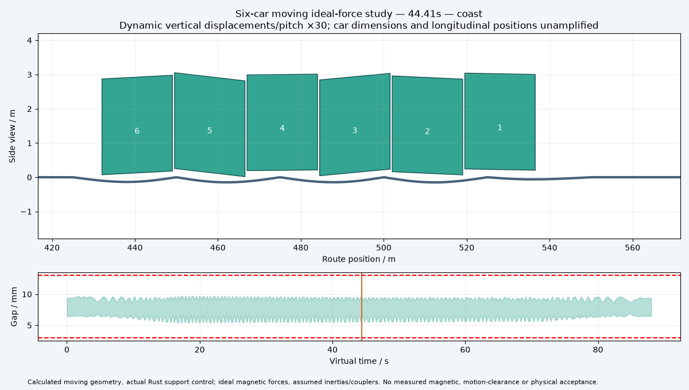

# Moving six-car ideal-force numerical twin

[Retained numerical results/traces](result.json.gz) · [Moving geometry video](moving-train.mp4) · [Source receipt](manifest.json)

The selected provisional 25m-span candidate completes 88s with six separate rigid car states and actual Rust 24-module controllers. Gap range: 5.362–9.719mm. The original reference remains recorded with study_pass=False; failed evidence is not promoted.

Station launch/coast/brake positions come from the exact jerk-limited longitudinal model. Per-car spring/damper corrections are integrated using midpoint dynamics; thrust is allocated by actual band overlap. Coupler energy/internal force, moving point-load closed form/refinement, span-boundary continuity, virtual work, Rust replay/invalid gaps and feedback disconnection are checked.

The common configured candidate must also pass 15% reduced stiffness and signed ±0.5mm sensor biases. Bias is applied to actual Rust sensed gaps; independent physical model gaps must stay within the original guard. A larger bias counterexample is retained. The short-span family and failed original reference remain available for comparison; no configuration is automatically promoted by this packet. The video uses exact recorded positions and beam states with declared vertical/pitch amplification.

**Open:** measured electromagnetic force/loss maps and shared-field phase/current feasibility, flexible bodies, torsion/lateral dynamics, rail joints/contact/soil, full construction and fatigue acceptance, emergency stopping/recovery, guideway alignment and sensor calibration acceptance, and hardware timing. The signed scalar sensor-bias screen is a provisional tolerance-budget calculation, not an accepted route alignment budget. Initial stationary settling, uniform car masses, assumed inertias, pinned linear spans and ideal independently allocated support/thrust remain modelling assumptions. No manufacturing, engineering or physical release is claimed.
