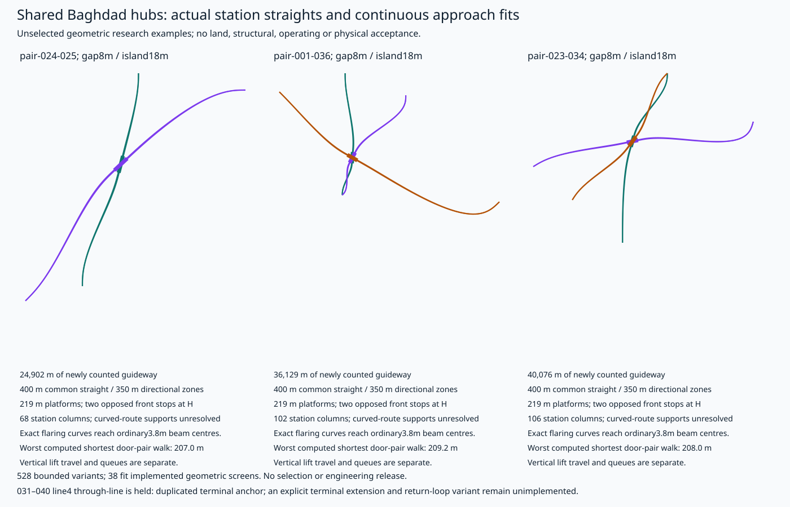
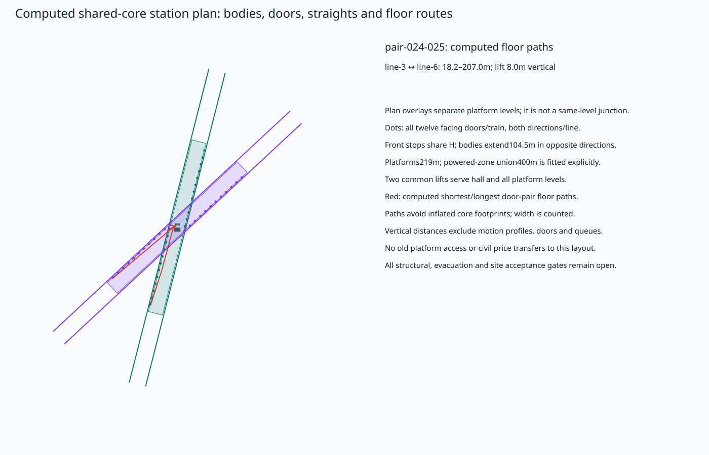
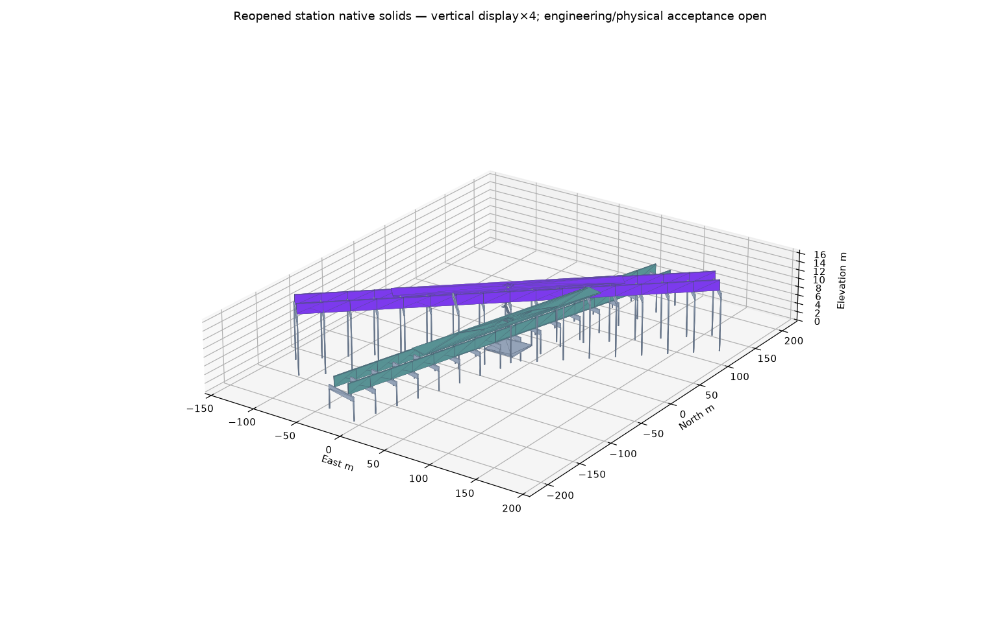

# Baghdad shared-hub station and approach geometry

528 explicitly bounded alternatives fit continuous transitions, directional beam flaring, station straights, levels and circulation. These include seven original source concepts and 4 explicit projected-anchor repair concepts. 38 pass the implemented geometric screens. The retained examples are research representatives; no hub is selected and no city geometry, inherited civil price or access approval is changed.

Off-line source anchors remain rejected against the5m projection limit. A separate repair family relocates each affected connection to the exact retained-polyline projection/chainage and records original/projected coordinates and displacement. Its directional approaches are fitted and counted afresh. The source controls, former access records and unaccepted connection/land implications remain visible; the projection limit is not relaxed.

H is the front stop of the leading car in both directions. Six17m bodies plus five0.5m coupling gaps give104.5m consists extending on opposite sides of H. Exact body-local door offsets are−4.5/+4.5m, giving twelve island-facing doors/train and twenty-four door locations per independent line. The two-direction platform envelope is219m, including10m stopping allowance. Forward powered limits[−150,+200] and reverse[−200,+150] require400m of common straight; a nominal350m centreline alone would omit part of the opposite powered zone.

Each physical directional beam has its own quintic approach/exit curves: tangent direction and zero endpoint curvature match the retained anchor and station straight. The station beam separation follows the actual2.65m cabin width,75mm assumed door gap and island width; curved approaches continuously flare from the separately declared3.8m ordinary beam centres. A conservative Bernstein-polynomial numerical screen bounds curvature over each retained transition; this is not a formally rounded interval certificate or engineering acceptance. Forward control-polygon, extent, detour, grade and vertical-radius screens reject sharp, looping or unbounded solutions. These are geometry limits, not a qualified maglev operating-speed or coasting result.

The common multi-level lift/stair core is represented by actual obstruction footprints. Visibility paths stay inside the oriented platform and avoid footprints inflated for the adopted passage width. Every exact boarding-door pair is evaluated, with representative routes retained in full. Reported horizontal min/max include door-edge and lift-entry ingress; lift vertical distance is separate. Shared lift throughput, queues, outages, fire operation, detailed stairs and physical platform interfaces remain unaccepted.

| Example | New physical beams m | Straight m/line | Island m | Platform m | Station columns | Door-pair horizontal range m |
|---|---:|---:|---:|---:|---:|---|
| pair-024-025/anchors-projected-repair/heading0/east25/radius250/gap8/island18 | 24,902.0 | 400 | 18 | 219 | 68 | 18.2–207.0 |
| pair-001-036/anchors-source-exact/heading0/east25/radius250/gap8/island18 | 36,129.0 | 400 | 18 | 219 | 102 | 13.6–209.2 |
| pair-023-034/anchors-projected-repair/heading0/east25/radius250/gap8/island18 | 40,075.9 | 400 | 18 | 219 | 106 | 14.4–208.0 |

The031–040 source concept assigns line4 the same terminal endpoint before and after H. Its A–H–A construction is rejected as a through-line. This does not prove the entire shared hub impossible: an explicit terminal extension, paired arrival/return beams and a counted unswitched turnback loop still need their own fit. That alternative is unimplemented and receives no loop, land or cost credit.

Station columns are located outside every lower station envelope, and cap/vehicle and hall/beam vertical clearances are checked against stated assumptions. All approach lengths and flaring are counted afresh. Curved/graded beam fabrication, every transition-pier position and clash, station portal strength, foundations, erection, seismic and measured site constraints remain open. Raw quantity totals and native solids are partial geometry evidence. No complete installed cost or engineering release is claimed.

[Full bounded calculation](study.json.gz) · [Geometric definitions](geometry.json) · [Source/payload receipt](manifest.json)

[Native FreeCAD station assembly](model.FCStd) · [Compressed STEP](model.step.gz) · [Native reopen receipt](native-cad.json). The export covers the bounded straight-station, portals, platforms and common core. Long curved approaches remain analytic geometric definitions, not released curved-beam fabrication.

- [RSSB RIS-7016-INS issue2, June2022, consultation copy](https://consultations.rssb.co.uk/_entity/sharepointdocumentlocation/a667694a-5b5e-ec11-8f8f-000d3ab597d8/2ab10dab-d681-4911-b881-cc99413f07b6?file=08.+RIS_7016_INS+issue+2.pdf): UK comparator supporting straight platform interfaces and explicit stepping-distance/gauge assessments. Not a maglev or Iraqi approval basis; proposed curvature/grade limits remain study assumptions.
- [Office of Rail and Road: Station and platform safety](https://www.orr.gov.uk/guidance-compliance/rail/health-safety/passenger-safety/station-and-platform-safety): Platform gap and impaired-mobility access need route-specific assessment. No acceptance is inferred from this schematic.
