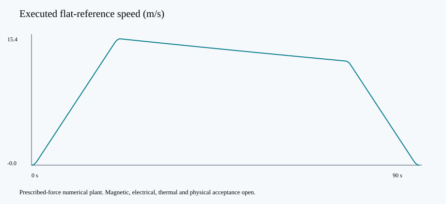
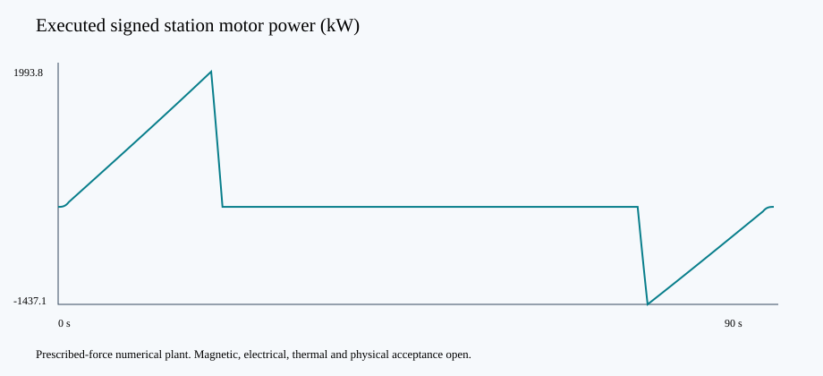

# Station-powered maglev study

The six-car flat 1 km reference takes 90 s and demands 2.346 MW peak traction input at assumed 85% efficiency. The train coasts 732.0 m without commanded propulsion.

At 45 s connected charging in 60 s dwell, the services battery supplies 105 s per cycle. Replacement is 10.50 kWh/train; the connected interface needs 1.20 MW before losses. The present 190 s schedule yields 13,642 normal passengers/hour/direction.

The winding screen uses six actual rectangular magnetic bands and provisional force per overlap metre. The 200 m winding is a conditional layout, with no accepted magnetic force reserve or drive rating. Gradient failures remain recorded holds. Cost topologies are additional station scopes and unquoted targets.

The result retains analytical segments, energy balance, traces, exact assumptions and source hashes. No hardware I/O is present. Design completion, physical validation, manufacturing release and physical release are false.
