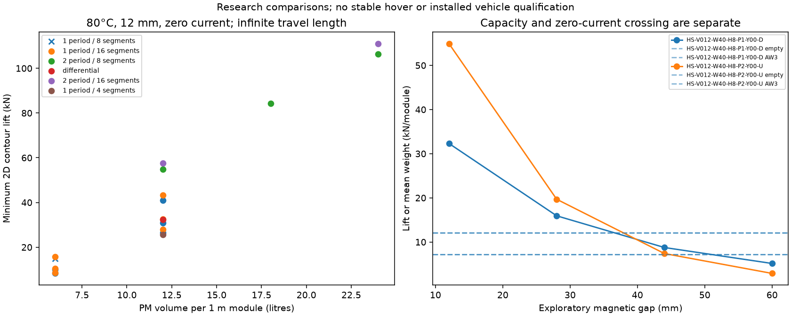

# Larger Halbach arrays and lighter rolling stock

OpenSourceRail compares larger onboard neodymium arrays, alternative magnetic layouts and lighter vehicle equipment together. The six-car, 17 m context retains 120 normal / 160 AW3 passengers per car, four 1.4 × 2.1 m doors and the 14,400 passengers/hour/direction requirement. Ordinary guideways remain concrete with passive steel facings; all permanent magnets and support/guidance coils stay onboard.

**These are engineering research calculations. No replacement train, complete installed mass, stable hover or physical qualification is established.**

[Project introduction](../../../README.md) · [Complete comparison](comparison.json) · [Gap and temperature profiles](operating.json) · [Finite 3D results](finite.json) · [Source receipt](manifest.json) · [Exact run inputs, meshes and logs](artifacts.json)

## Executed scope

The frozen transverse campaign contains **36 physical geometries**, **40 started field solves**, and **504 composed magnetic/body comparisons**. The operating profile requests 16 additional points; completed and interrupted records remain explicit. Three-dimensional and postprocess-only diagnostics have their own identities and are never counted as extra physical designs.

PM volume grows from the 0.006 m³ control to 0.012, 0.018 and 0.024 m³ per 1 m module. Width, four/eight/sixteen segments, one/two periods, back iron and split differential windings are compared against the same 0.50 × 0.035 m passive facing. Every added magnet, copper conductor and backing/yoke is counted. No proportional-force scaling substitutes for a field solve.

The old uniform-coil control remains as a failed winding-fill example. New packs use declared spacing/insulation geometry; insulation mass and qualification remain unknown. Differential coils use opposite winding senses around phase-shifted half-arrays, with an explicitly counted central slot and end turns. Signed ±15 A trials retain the original 3.75 A/mm² continuous conductor screen. I²R is reported, but cooling and fast-control qualification remain open.

## Selected next experiments

Selection is for the next experiment only. It favours the smallest counted PM volume meeting 1.3 AW3 support in the +2 tonne unclosed-mass sensitivity, requires local member checks at the largest observed magnetic force, rejects known nominal hot-cooling failures, then compares lower accounted mass and fewer PM pieces. Unknown or failed local members cannot win through a fallback. Unknown cost, global body/brace strength, thermal derating and actual installation never become zero.

| Purpose | Magnetic recipe | Body/equipment option | Accounted AW3 t/car | Hot 12 mm 2D lift kN/module | +2 t / 1.3 support demand kN/module |
|---|---|---|---:|---:|---:|
| controlled | HS-V012-W40-H8-P1-Y00-D | 6082-six-cell-deep-40kn/bus-ul700-electric-five-proposal | 29.634 | 32.318 | 16.804 |
| topology-comparator | HS-V012-W40-H8-P2-Y00-U | 6082-six-cell-deep-70kn/bus-ul700-electric-five-proposal | 29.680 | 54.931 | 16.828 |

The 0/1/2/3 tonne values are **additional unknown-mass sensitivities**, not actual equipment, confidence bounds or a completed vehicle inventory. The mass figure is an accounted retained-allocation/material comparison. It is not a rigorous bound on the actual installed train.

## Lighter body and equipment consequences

The deep six-cell 6082 extrusion frame counts every wall/web, 130 member-end connections, 520 bolts, spreaders and isolation material. It replaces only the 260 exact old frame-stock IDs; panels, collectors, hardpoints and other equipment remain. The compact alternative is retained as a stiffness failure. Larger arrays also overload the original lightweight roof/spreader at small gaps: reinforcement is counted separately, with 40/70 kN per-module design hypotheses. These are observed-load comparisons, not proven bounds on faults or unsampled currents/gaps. Local section/roof/spreader screens do not establish global body, joints, fatigue or bracing; the unbraced 17 m Euler case remains a failed sensitivity.

| Body option | Counted frame kg/car | Removed stock kg/car | Necessary member disposition |
|---|---:|---:|---|
| 6082-six-cell-compact | 1024.09 | 1224.02 | 1.3 × 35 t mean weight: fail stiffness/member screen |
| 6082-six-cell-deep | 1072.00 | 1224.02 | 1.3 × 35 t mean weight: pass local screens; global held |
| 6082-six-cell-deep-40kn | 1220.83 | 1224.02 | 40 kN/module hypothesis: pass local screens; global held |
| 6082-six-cell-deep-70kn | 1367.86 | 1224.02 | 70 kN/module hypothesis: pass local screens; global held |

After reinforcement, the 40 kN frame saves only **3.19 kg/car** against the removed frame stock; the 70 kN frame adds **143.84 kg/car**. Earlier unreinforced frame savings are not transferred to these alternatives.

Lighter door leaves and solar-control glazing retain the passenger openings and disjoint old door/window removal accounts. Passenger heat and fresh-air loads do not fall with structural mass. The two- and three-UL700 controls fail the severe humid 60-second door-load scenario even against nominal capacity. The five-unit proposal counts 960 kg and 165 kW nominal thermal capacity; its real 50°C rating, electrical input, roof fit, ventilation and installation remain unqualified. Old two-unit installation bands are not transferred to five units.

## Operating gap and control

A larger array can over-support an empty vehicle at 12 mm. The 12/28/44/60 mm, 20/80°C profiles therefore compare mean weight crossings separately from the 1.3 reserve screen. A sampled crossing is neither a solved stable equilibrium nor an accepted operating gap. Larger gap travel has boarding-height, sensor, curve, capture and support-arm consequences that remain unresolved. Log-interpolated proposed states receive no force credit until the separate finite solve evaluates them. Reinforcing the body changes proposed gaps; the table below preserves the actual evaluated component poses and reports their force/load residuals against the revised mass rather than relabelling them as newly solved poses.

The 1.3 reserve comparison above uses the **12 mm capacity sample**. It does not establish actuator reserve at the larger proposed operating gap. Signed-current samples, lateral/yaw stiffness, damping, voltage reserve, repeated heating, mechanical gap travel and fault control still need to agree in one operating envelope.

## Finite 3D confirmation

| Case | Gap mm | Numerical disposition | Full source | Fz contour 1 / 2 kN |
|---|---:|---|---|---|
| case-00 | 12.000 | completed | True | 30.790 / 31.509 |
| case-01 | 35.473 | interrupted | False | unevaluated |
| case-02 | 36.079 | interrupted | False | unevaluated |

| Case | Actual / currently proposed gap mm | Fz minus revised mean AW3 weight kN, contours 1 / 2 | Minimum Fz minus +2 t / 1.3 demand kN |
|---|---:|---|---:|
| case-00 | 12.000 / 12.000 | +18.682 / +19.400 | +13.987 |
| case-01 | 35.473 / 35.338 | unevaluated | unevaluated |
| case-02 | 36.079 / 35.915 | unevaluated | unevaluated |

| Selected composition | Largest sampled absolute force kN/module | Local member screen at that load and +2 t mean reserve |
|---|---:|---|
| controlled | 38.343 | pass necessary checks; global held |
| topology-comparator | 65.335 | pass necessary checks; global held |

The finite solver includes all magnetic steel in the declared component, including onboard back iron, with exact material-volume and closed-domain checks. Nearby vehicle joints, reinforcement, wiring, body deformation and the assembled field interaction remain unevaluated. Pose, candidate and evaluation identities remain distinct. The 80°C / zero-current continuation must reach full source before numerical force credit. Mesh, material, contour, local peak and current-map uncertainty remain separate. The steel curve is the retained unvalidated isotropic 50 Hz proxy, not a measured DC or temperature-dependent law.

Postprocess-only checks on the previous converged solution increase face quadrature density without rerunning its field solve. Those diagnostics can separate sampling effects from field-mesh error; they do not make the original candidate or new candidates qualified. [Quadrature diagnostics](quadrature.json).

Reproduce with `python -m engineering.halbach_scaling --help`. Stages use immutable fresh directories, bounded ordinary workers and explicit source/solver IDs. Independent differentiation, analytical field/force, geometry/accounting, source/tamper and interruption fixtures accompany the implementation. All accepted physical configurations remain unchanged.
