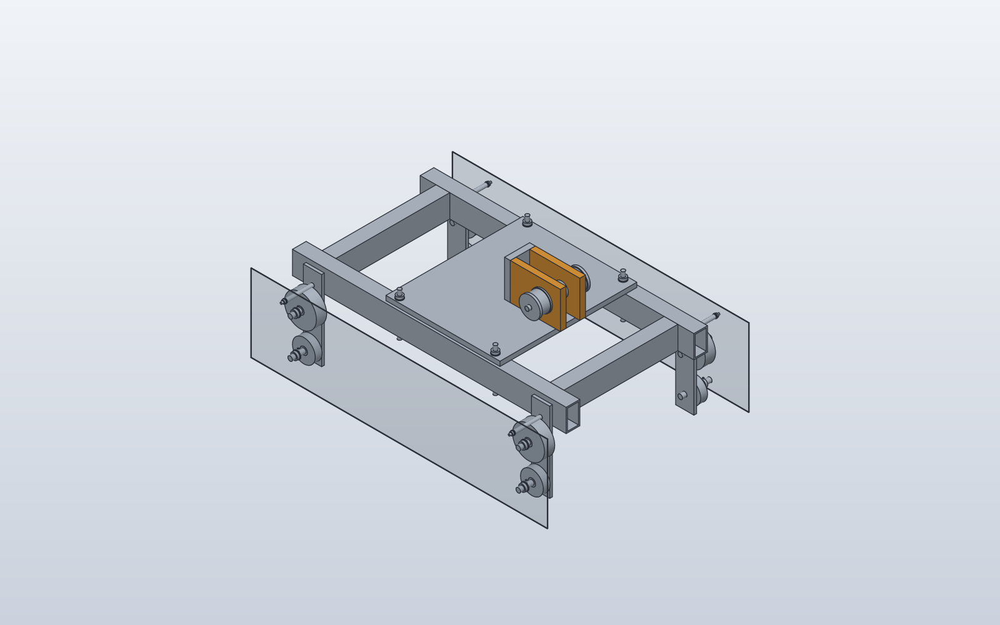
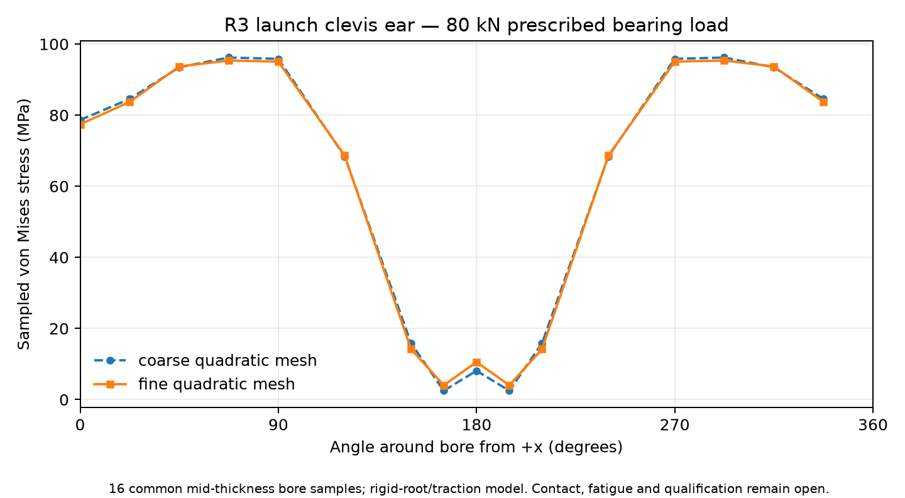

# Detailed station launch shuttle — research assembly

This dossier connects actual parametric CAD, a counted assembly and part-level
factory estimate to a matched structural analysis. It is a separate research
candidate, not an installed propulsion selection or passenger-operating approval.



Actual generated CAD: the side guards are shown at 18% opacity to reveal the
running and capture rollers. No exploded/display offsets change part positions.
[Native SolidCraft design](assembly.sc) · [STEP assembly](assembly.step) ·
[Assembly and interfaces](assembly.json) · [Material-region BOM](bom.csv) ·
[Component BOM and routings](manufacturing.json) · [Cost assumptions](factory-cost.json).

## What is detailed

The 122 material bodies represent 120
counted nominal components: real hollow frame sections, bored clevis ears and
backplate, a 60 mm pin, positive end caps, separate retaining screws, bushes,
running/capture wheels, axles, crush sleeves, spacers, washers, studs and guards.
Head/shank CAD regions do not become duplicate purchased screws. Frame and
analysis coordinates and rigid transforms are explicit. Finite travel, tool and
removal envelopes, jacking/unloading order, lift-fixture hold, wiring allowance,
fit assumptions, welding routes and inspection operations remain in the assembly.

Nominal located stock mass is **190.62 kg**.
The **187.61–193.62 kg**
component allowance is provisional: threads, fillets, welds, grease, sensors and
flexible wiring are not a complete measured installation. The actuator and
energy store are outside this component scope.

## Engineering feedback changed the design

The previous 40 mm pin had a 2.2–3.4 kNm simply-supported bending envelope under
the 160 kN research requirement. Its nominal 350–541 MPa bending stress could exceed
the declared 355 MPa material proxy even before combining shear. Its valid CAD and
ear calculations remain previous-candidate evidence; it was not approved.

The current candidate uses a 60 mm pin and 220 × 160 × 25 mm ears. The 160 kN load is a
**requirement** from 160,000 kg × 1 m/s², not measured available thrust. Speed and
powered length are unselected. The pin's conservative non-coincident combined
stress envelope is about 123–173 MPa before impact/contact/concentration/fatigue
allowances. The 1.5 multiplier is a revisable research screen, not a railway
proof-test prescription or approved allowable.



Native .sc and STEP reopening retain source body names. Independent FreeCAD
reimport loses them to generic product labels; exact volume/centroid/bounds
correspondence is retained separately and does not claim native name retention.

The FEM model evaluates **one ear with 80 kN**, distributed radial half-bore
traction, a rigid root and an uncertified isotropic material hypothesis. Coarse
and fine meshes contain 256 and 1,024 quadratic hex20 elements. FieldCraft and
CalculiX agree in displacement to their printed precision. Two-mesh displacement
change is 0.175%; sampled bore-stress change is 0.902%. These sensitivities do not
establish general mesh independence or physical validation. FieldCraft's sampled
nodal bore stress and CalculiX's global integration-point maximum are different
quantities and must not be treated as matching stress fields.

[Compact numerical results](summary.json) · [Original FEM result seal](fem-evidence.json)

## Calculated factory cost

| One shuttle, committed batch of 1 | Low | Base | High |
|---|---:|---:|---:|
| Calculated factory USD/unit | $592 | $1,644 | $5,263 |

This is a Class C component estimate. It uses dated China commodity proxy floors
plus explicit grade/form or bronze alloy/stock-conversion premiums, cut yield,
landing, 12/24/48 labour-hours, machine cash costs, QA and one overhead uplift.
One batch fixture is counted once; already-wholesale prices receive no extra
blanket discount. Copper is not presented as a bronze quote, nor Q235 as
qualified S355. Labour and process rates are declared estimates. No supplier
quotation, complete factory investment or station installed/lifecycle price is
claimed. The whole actuator, storage, guideway and installation are excluded.

## Open evidence and independent checking

Actual pin contact/clearance/friction, cap bending and thread engagement, weld
and deck flexibility, bolt preload/slip, bearing PV/wear, guideway retention,
fatigue/load reversal, materials, train compression dynamics, jerk, repeated duty,
controls and independent braking remain open. No native tool establishes release.

The CAD and FEM records retain distinct assembly-definition IDs because an
advisory explanation was added after the FEM input snapshot. The complete
physical definitions and load interfaces are identical; both original sealed
records are retained. No old receipt or solver input is patched.

Generate a fresh selected package from existing immutable executions:

```bash
python -m engineering.design_search.craft_backends.launch_detail_publication publish --evidence /path/to/city-cost-and-detail-20261106 --output /path/to/fresh-dossier
python -m engineering.design_search.craft_backends.launch_detail_publication verify --output /path/to/dossier
```

Publication verifies private native evidence before copying selected artifacts.
Public verification checks this selected package and numerical/identity consistency;
it is not a new solve or a replay of every private output. Full immutable logs,
meshes and native outputs remain identified by hashes in the evidence manifests.

Candidate: `3e1d592fd88893ce11c83cfbc51b95253355b6dc45bb4bbc4aa1536151d77ab7`  
Clevis geometry: `bba173ba0f59948ff70441c02a949ed037074050beeebbccc55e5839881dfadd`
