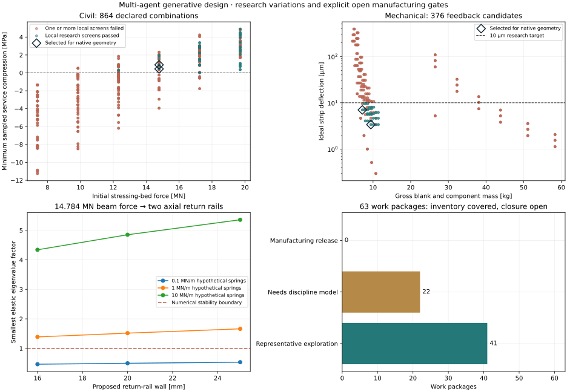

# Multi-agent design campaign: executed variations and manufacturing gaps

The [review package](generative-campaign/index.html) contains an executed
multi-agent campaign, rather than only a proposed workflow. Civil and mechanical
workers developed separate feedback searches; a scope worker assigned every
inventory item, then independently challenged the proposals and integration
code. The coordinator integrated and executed the controlled evaluators.
[Scenario and completion rules](multi-agent-design-scenario-2026-10-16.md) ·
[Runner and reproduction commands](../../engineering/generative_design/README.md).



The figure is generated from the final campaign's actual candidate records.
Its [receipt](multi-agent-design-variations.json) binds those input hashes and
the [plotter](../../tools/automation/plot-generative-campaign.py). Colours describe
local research screens; selected markers identify proposals taken to native
geometry verification. Neither indicates a complete manufacturable railway.

## Executed scope

| Investigation | Actual execution | Termination / evidence |
| --- | ---: | --- |
| Pi20/Pi25 geometry, prestress and handling | 864 combinations; 105 conditional local passes | Declared finite space exhausted; both spans evaluated in each combination |
| Locator cassette fit, access, stiffness and machine envelope | 376 candidates; 64 conditional local passes | Reachable feedback frontier exhausted; not the entire Cartesian space |
| Changed beam force into stressing-bed rails | 18 sensitivities | Two selected beams × three rail walls × three assumed spring values |
| Existing common charters | 57 candidates in 15 source-bound jobs | Bounded one-coordinate screens, plus the two native finite domains below |
| Cleat and steel cantilever native domains | 6 + 6 candidates, included in the 57 | All declared alternatives actually confirmed with CAD, meshing, CalculiX and independent controls |
| Selected new geometry | 2 beam + 2 tooling models | All four FCStd/STEP exports reopened; beam models have 105 objects each, tooling models 12 |

All failed candidates, unknown checks, parent IDs, generations and mutation
reasons remain in the [civil](generative-campaign/civil/search.json) and
[mechanical](generative-campaign/mechanical/search.json) reports. Source hashes,
actual numerical-library identities, common parent manifests and toolchain
identities bind the execution. Full native FEM meshes, decks and logs remain
in sealed local common jobs; the repository review is a compact projection.

## Selected civil proposals

These proposals clear the declared sampled zero-tension, geometric cover/grip
and handling lower-bound screens for the retained three-car diagnostic. They
retain the existing unqualified modulus/loss assumptions and full-force straight
tendons. **Accepted six-car loading and concrete compression limits are absent.**

| Candidate | Depth / stem width, m | Strands | Minimum sampled service compression, MPa | Maximum compression demand, MPa | Pi25 hook equivalent lower bound, t |
| --- | --- | ---: | ---: | ---: | ---: |
| `civil-6bfe8bc1a468` | 1.155 / 0.300 | 96 | +0.899 | 32.343 | 105.811 |
| `civil-9a5e1151e1a2` | 1.155 / 0.360 | 96 | +0.442 | 28.791 | 114.191 |

The retained 48-strand seed still shows −8.121 MPa service compression
(tension). Increasing strand count addresses that local research screen, but
both final proposals double initial bed force from 7.392 to **14.784 MN**.
Their compression demand, transmission/end zones, reinforcement, shear,
fatigue, camber/deflection, inserts and complete handling mass still need design.
No material resistance or installed crane capacity is inferred.

The [coupling record](generative-campaign/bed-coupling.json) propagates half
that force to each symmetric return rail. A 16 mm wall with 0.1 MN/m assumed
springs has a minimum elastic factor **0.464**, failing numerical stability;
1 MN/m gives **1.389**. These are ideal-pinned axial rail sensitivities,
not accepted support stiffness, structural resistance or a staged spatial
strongback design. Larger strand patterns, changed eccentricity, head plates,
grips/jack access, splices, anchors and foundations remain open.

The native beam models contain gross concrete and overlapping strand clearance
envelopes. They do not include reinforcement, actual strand voids, inserts or
mould details. End diaphragms obstruct longitudinal intrados-tool withdrawal;
split/collapsible tooling and demould trials remain a specific manufacturing
task rather than a passed draft/access check.

## Selected mechanical proposals

| Candidate | Plate, mm | Worst-case diametral fit, µm | Underside access, mm | Ideal strip deflection, µm | Gross blank/components, kg | Setup with assumed workholding, kg |
| --- | --- | --- | ---: | ---: | ---: | ---: |
| `mechanical-508b6a0beb69` | 180 × 100 × 25 | 6–14 | 100 | 6.998 | 7.152 | 42.152 |
| `mechanical-14246ef91d01` | 180 × 120 × 30 | 6–14 | 100 | 3.375 | 9.420 | 44.420 |

The geometric model uses the same plate, bore, rail pitch, pin and fastener
envelopes as the checks. Actual steel-subset interference is checked in FreeCAD.
Blank/clamp reservations fit the published CV5 workpiece envelope, but actual
tool sweep, clamping, load, temperature, joint/preload, retention and precision
capability remain unqualified. A 1.5 kN load and 10 µm strip-deflection target
are explicit research assumptions; nominal stress is demand, not resistance.

The [manufacturer's CV5 page](https://www.mazak.com/uk-en/products/cv5/) identifies
Worcester manufacture and the 500 mm diameter, 320 mm height and 200 kg workpiece
limits used in the enquiry basis. This supports British-manufacture priority;
an offered machine's exact origin, configuration, utilities, foundation, Baghdad
service and installed price still need supplier evidence. Enquiries remain unsent.

The separate common cleat search selects a 12 mm lightened web at approximately
0.918 kg and 0.921 mm native loaded-face deflection under its fixed synthetic
500 N load. The steel cantilever search selects an 8 mm I-section at 30.521 kg
and 6.663 mm under its fixed 10 kN load. The 10 mm cleats and several thin steel
sections retain failed service checks. These verified finite-domain rankings
apply to those synthetic functions, not an actual carbody joint or viaduct.

## Whole-system closure and next agent tasks

The [inventory audit](generative-campaign/inventory-audit.json) checks actual
source IDs: 120 vehicle products, 26 assemblies, 50 station products and 19
civil types, together with release packages, production-data products,
interfaces and equipment. Every item is allocated across **63 work packages**.
**41** have representative computational investigations; **22** require further
discipline models. **Zero** are declared complete engineering/manufacturing
releases. The catalogue's LM3 three-car and metro-six-car research architectures
remain separate until their configuration, axle loads and interfaces reconcile.

The [per-package closure ledger](generative-campaign/closure-ledger.json) retains
all load, material, manufacturing and evidence predicates. The
[agent work queue](generative-campaign/work-queue.json) assigns the next action,
dependencies and required inputs. It covers supported and unsupported systems,
including complete vehicle structures and supplier systems, stations,
foundations, factory buildings/MEP, handling and integrated production.

Continue by resolving the configuration and design basis, developing the missing
discipline adapters, and feeding controlled manufacturing/site/supplier evidence
into affected packages. Re-run changed packages and their dependent interfaces
in fresh source-bound campaigns. The runner has stopped at its stated finite
limits; no background agent or unbounded search is running. Completing those
remaining designs requires real inputs and validated models, followed by
manufacturing detail, physical first articles and independent acceptance.

## Reproduce

```sh
./osr design campaign run --output build/generative-design/my-final-campaign \
  --civil-budget 2048 --mechanical-budget 4096 --native --common native
./osr design campaign verify --output build/generative-design/my-final-campaign
./osr design campaign verify-snapshot --destination docs/design-engine/generative-campaign
```

The original nine factory models and all earlier snapshots remain unchanged.
Integrity checks do not rerun physics; current-source verification and a fresh
numerical/native campaign are separate operations.
