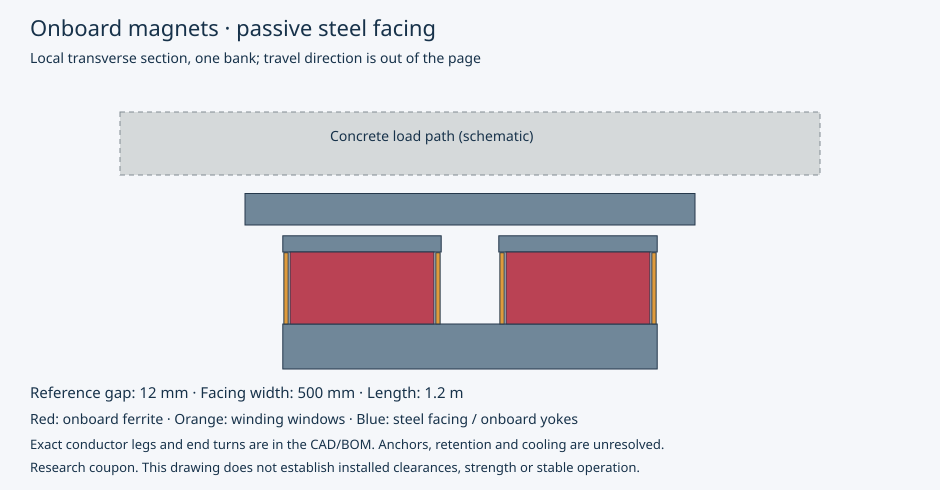

# Onboard magnets and passive steel facings

OpenSourceRail aims for simple construction, low whole-life cost and high passenger throughput. This study keeps all permanent magnets, suspension/guidance coils and their controls on the train. The ordinary guideway is a concrete beam with attached passive steel facings. Powered launch and receiving equipment belongs to separate station zones.

**Result: research progress; no integrated suspension or replacement train configuration adopted.** 12 physical proposals were executed through a new transverse finite-element evaluator, with counted stock, material-replacement mass feedback and explicit curve/attachment checks. The six-car, 17 m Baghdad context remains: 120 normal passengers per car, 14,400 passengers/hour/direction and 180-second headway.

[Project ethos](../../../README.md) · [Earlier carrier/beam interpretation](../design-search-interpretation.md)

[Machine-readable results](summary.json) · [Numerical method benchmarks](method-benchmarks.json) · [Publication integrity](manifest.json) · [Source and experiment plan](plan.md) · [References and applicability](references.json) · [BOM](bom.json) · [Assembly/measurement plan](assembly.json)



## What was compared

A retains an unresolved separate-guidance reference. B asks whether the finite facing and onboard pole geometry provide useful shared alignment. C adds a counted onboard shunt winding. D adds counted compliant-carrier stock. Each has narrow/wide facing variants; a segmented-PM comparison and three B revisions investigate magnetisation, overlap, module length, pole area and ferrite thickness. Unknown installed equipment remains unknown, so these are stock comparisons rather than complete cost or vehicle-mass rankings.

| Sample | Known onboard stock, t/car | Reference lift, N/module | 1.3 AW3 material-floor demand, N/module | Numerical state |
|---|---:|---:|---:|---|
| A/edge-facing | 5.717 | 7,475 | 17,461 | converged |
| A/wide-facing | 5.717 | 7,320 | 17,461 | converged |
| B/edge-facing | 5.717 | 7,475 | 17,461 | converged |
| B/wide-facing | 5.717 | 7,320 | 17,461 | converged |
| C/edge-facing | 5.857 | 7,476 | 17,536 | nonconverged |
| C/wide-facing | 5.857 | 7,319 | 17,536 | nonconverged |
| D/edge-facing | 6.378 | 7,475 | 17,813 | converged |
| D/wide-facing | 6.378 | 7,325 | 17,813 | converged |
| B/segmented-edge-facing | 5.717 | 4,531 | 17,461 | nonconverged |
| B/revised-overlap | 5.717 | 7,343 | 17,461 | converged |
| B/revised-longer-module | 6.854 | 8,812 | 18,066 | converged |
| B/revised-area-and-ferrite | 10.035 | 14,737 | 19,755 | converged |

The reference point is 12 mm gap, 20°C and zero coil current, for one local two-pole module on one facing bank. There are 24 such modules per car. The material floor replaces only the canonical counted support-module stock, retaining all other allocations and propulsion stock. Anchors, retention, wiring, protection and complete cooling/carrier equipment prevent a complete installed mass, CG, inertia or price from being claimed.

## Selection and limits

The declared policy selected **B/revised-area-and-ferrite** for a next experiment: [Candidate](candidates/2697c09c542b6e5a2279746ff67bc1782cb4cdeee30076a2370acf6c55bf6370.json). It weighs reference support ratio and counted onboard stock, retaining Pareto alternatives. It does not minimise complete installed cost; that quantity is unknown. The independent integrated-selection gate selected **no candidate**. Selection is reproducible across these bounded samples, with no global optimum claim.

The field solves use an explicit provisional constant-permeability steel assumption, finite transverse width and infinite travel length. The same selected physical geometry also receives a retained nonlinear-material sensitivity calculation. Neither material hypothesis is a proven universal force bound. Mesh, boundary, contour and derivative checks have separate dispositions in the raw records. A numerically converged field is not a measured material model. Three-dimensional ends, joints, demagnetisation correlation, saturation, magnetic drag, eddy/hysteresis loss, roll, multiple supports and faults still need work. Longitudinal invariance in a 2D equation does not establish zero travel drag.

The map-bound control analysis is **held**. Its exact disposition is in `summary.json`. A zero-current force balance, when present inside a valid map, still requires active stabilisation. Nonconverged or unresolved derivative maps receive no equilibrium or control credit. Checked point forces may bracket a necessary load balance over two sampled gaps; those intervals are reported separately and do not establish an equilibrium or stability. The centred map tangent is not a finite-displacement guidance demonstration; additional ±6 mm points at 50°C are retained separately. The material-temperature samples do not establish a repeated hot-weather thermal equilibrium. Zero mean current is not zero RMS heating. An added resistor winding cannot supply static stability; useful damping requires validated signed flux gradients, inductance, resistance and thermal duty. The C reference point has zero shunt current and receives no passive-damping credit.


| Material temperature, °C | Declared load | Point-force gap bracket, mm |
|---:|---|---|
| 20 | tare-material-floor | None in checked points |
| 20 | AW3-material-floor | 8–12 |
| 20 | 1.3-AW3-material-floor | 4–8 |
| 50 | tare-material-floor | 12–20 |
| 50 | AW3-material-floor | 8–12 |
| 50 | 1.3-AW3-material-floor | None in checked points |

These are zero-current brackets of checked force samples only. Missing brackets do not justify extrapolation. The full empty-to-loaded range and hot reserve therefore remain open, alongside the unresolved lateral/cross-coupled derivatives. No closed-loop or passive-damping performance is claimed from this map.

## Manufacturing, route and next test

The simple steel-facing reference uses factory datums and static shim adjustment, with final survey after beam placement. Magnetic attraction loads the underside facings downward, through tensile attachments into the concrete. The attachment screen calculates demands and simple strip bending; anchor/concrete capacity and fatigue remain open. Capture, emergency braking and parking remain separate functions.

The two bank positions are proposals within the vehicle envelope. A matching concrete cross-section and installed attachment geometry have not been generated; existing guidebeam mass and capacity are not transferred to this arrangement. The native coupon includes no concrete beam.

Short blocks attached to one rigid 17 m frame retain that frame's curve error. The D stock can only receive independent-carrier geometry credit if its required yaw and translation can actually be supplied. The 150/250/500/1,000 m radius cases are explicit route alternatives, not adopted changes to Baghdad. Lower speed or closer stations cannot repair inadequate stationary lift. Gravity assistance is a later route comparison and supplies no net energy on a return to the same elevation.

For the selected coupon, the necessary overlap margins after the declared 6 mm lateral displacement are **150 m radius: -82.4 mm; 250 m radius: -34.8 mm; 500 m radius: 0.7 mm; 1000 m radius: 18.3 mm**. Positive overlap alone does not prove adequate lateral force, damping or fault retention. Its two passive facing banks require **271.6 kg of facing steel per route metre (6.790 t per selected span)**, excluding anchors, grout, shims and corrosion allowance. This makes the rail/route consequences visible alongside the vehicle stock; complete installed cost remains unknown.

Next, correlate one representative onboard assembly against a finite steel-faced test section: lift, lateral/roll stiffness, coil authority, signed flux linkage, damping, drag and stationary hot-weather heat. Use the recorded datum, stock and measurement plan. No physical test has been executed by this campaign. Native coupon execution: **executed**. [FreeCAD](native/model.FCStd) · [STEP](native/model.step) · [Native reopen/volume receipt](native/native-cad.json)

The native export is one module and one same-length steel-facing coupon. It contains actual counted conductor legs/end turns and magnet blocks; it is not a complete train, concrete beam, carrier installation or manufacturing release.

## Reproduce

```bash
OPENBLAS_NUM_THREADS=1 .venv/bin/python -m engineering.passive_suspension.campaign run --output build/passive-suspension/replay
OPENBLAS_NUM_THREADS=1 .venv/bin/python -m engineering.passive_suspension.campaign verify --output build/passive-suspension/replay
.venv/bin/python -m pytest -q engineering/passive_suspension/tests
```

The immutable registry resumes only exact candidate, source, environment and settings identities. Use a fresh output directory after source/specification changes. Publication verifies source bindings and retained outputs; numerical execution and physical acceptance stay separate.

Campaign `6dee31092fd30c9f9c72245ecd30fd2ebc3d945309aaec9d2671ed1e03e74d81`. All engineering acceptance, adoption and physical-release flags remain false.
