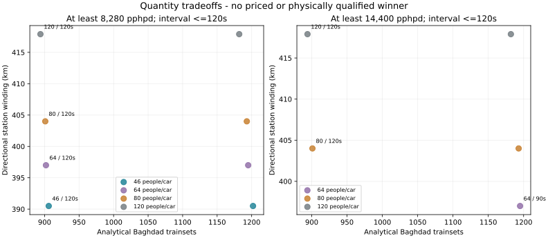

# Coupled physical feasibility and whole-system review follow-up

OpenSourceRail seeks simple, low-cost, locally maintainable transport. This bounded research round tests the hardware and system consequences highlighted by the 26 October review. The selected six-car comfort design remains the starting candidate; no alternative here is a qualified or economic replacement.

[Selected development baseline](../current/README.md) · [Engineering ownership](../../../engineering/README.md) · [Maturity by subsystem](maturity.json) · [Source and payload receipt](manifest.json)

## What was executed

- 168 one-city service/load/zone alternatives, with equal-service comparisons at 8,280 and 14,400 pphpd and maximum 120 s headway.
- 432 counted guideway variants, each with 40/70 kN local load fixtures; 46 conditional necessary survivors and zero physically qualified replacements.
- 208 capture cases and 56 roof cases under declared material/thermal hypotheses.
- Four new native GetDP PM/steel field solves and one independent finer-mesh check. These have no 3D coil-current source and do not establish stable hover.

## Suspension and control: weight is only one part of the gap

At 40 mm/80 C with the retained 35 mm facing, the two air contours calculate 7.494 and 9.147 kN/module. The normal-load mean weight is 8.502 kN/module, between those values. The independent finer mesh gives 7.256/9.420 kN; contour spread grows from 18.1% to 23.0%. A solved PDE is therefore insufficient to credit a reliable force map.

| New scalar-PM state | Contour Fz, kN | Local steel peak, T |
|---|---:|---:|
| 40 mm, 80 C, 35 mm facing | 7.494 / 9.147 | 1.057 |
| 50 mm, 80 C, 35 mm facing | 4.315 / 6.326 | 0.942 |
| 40 mm, 80 C, 20 mm facing | 7.429 / 9.286 | 1.664 |
| 40 mm, 20 C, 35 mm facing | 8.702 / 10.621 | 1.138 |

Reducing the facing from 35 to 20 mm gives similar lift at the sampled 40 mm/80 C state, within the numerical disagreement, but raises the local steel peak to 1.664 T. This exceeds the civil study's declared 1.6 T screen ceiling. It cannot be treated as a validated thinner replacement.

Retained same-state 2D diagnostics indicate that approximately 1 mm of gap disturbance can consume roughly 14–16 A of the entire±15 A sampled common-current range. Opposed-current lateral authority is about 2.35 N/A at the retained 80 C state, while the installed 3D roll/pitch/yaw derivatives and coupled controller remain unknown. A passenger cap reduces required steady support; it does not establish guidance, control reserve or fault stability.

The current native 3D kernel is scalar potential without a free-current winding source. The next decisive model is a benchmarked current-capable 3D formulation ([GetDP vector-potential example](https://www.getdp.info/doc/texinfo/getdp.html#Magnetostatic-3D-vector-potential-formulation)) with actual closed coils, followed by force/moment maps and control/thermal tests. Wider-gap force crossings are next-experiment diagnostics, not operating gaps.

## Civil structure: count the material traded away

The retained reference counts 21.627 t steel and 42.5 t prismatic concrete per 25 m span before remaining structural/site quantities. The continuous concrete-ledge family reduces counted steel to about 11.495 t but adds 32.815 m³ of concrete: the counted subtotal grows to about 136.0 t/span. Steel savings alone would conceal a worse span-mass result. Discrete-crosshead variants are included below as the next bounded physical revision.

| Rejected quantity-frontier control | Steel t/25 m | Added concrete m³/25 m | All support anchors/25 m |
|---|---:|---:|---:|
| concrete-ledges | 11.495 | 32.815 | 408 |
| embedded-edge-stiffeners | 13.329 | 31.690 | 308 |
| dual-use-steel-box | 13.713 | 28.865 | 276 |
| embedded-edge-stiffeners | 14.281 | 10.922 | 344 |
| dual-use-steel-box | 14.103 | 5.646 | 276 |

The lightest counted discrete alternative uses 18 integralRCcrossheads,35 mm facings and a dual-purpose steel box. It counts 14.103 t steel,5.646 m³ extra concrete and 276 support anchors per 25 m: about 70.718 t subtotal, still 10.3%heavier than the old 64.127 t reference. Factory welding is about 246.8 m/span. No price or global-strength winner is established. These are parametric local necessary bounds, not global beam/prestress/anchor-fatigue approval. Facing, brake/capture connections, extra concrete, reinforcement and changed manufacture are counted where defined; piers, erection, strength details and installed prices remain open. Passing the single-return flux bound does not establish the native local peak field.

An independent six-case native CalculiX face fixture also ran. At ideal 0.5 m line supports,20 mm steel under 40 kN reaches 2.060 mm maximum deflection and fails the 1 mm target;35 mm reaches 0.390 mm at 40 kN and 0.683 mm at 70 kN. Refinement from 8 to 16 longitudinal elements changes mean deflection by under 0.005%. This does not qualify real anchors, RC heads or whole beams. [Native decks/logs/results](civil-native-evidence.tar.gz) · [Independent readback](civil-native-readback.json).

**Independent fit check: all five quantity-frontier alternatives fail the selected-car material-box test at the stated reference pose.** Continuous variants intersect 102 parts each; the discrete embedded variant intersects 48; the lightest discrete box variant intersects 20. Positive solid-box overlap is a known collision, not a passing envelope screen. The remaining cylinders and all motion states are unqualified. These alternatives need a joint body/carrier/beam rearrangement before any integrated selection. [Coupled proposal eligibility](proposal-eligibility.json) · [Exact collision counterexamples](civil-clearance.json) · [Geometry check source and receipt](civil-clearance-proof.tar.gz).

## Capture and roof: promising changes retain their costs and limits

The 16-contact precrushed-target cartridge adds 143.5 kg and passes 16/24 material/load/contact sensitivities. The 32-contact target passes 24/24, but adds 432.8 kg and produces about 2.41 g net upward acceleration in the nominal normal-load first arrest. These are declared crush-law targets; occupant limits, actual curves, rebound latch and body/beam load paths remain unknown. Magnetic pull-in toward the steel is a separate, unevaluated energy case. No capture gate is closed.

A counted [KARNAK white coating](https://www.karnakcorp.com/product/529-renu-white) adds 47.8 kg/car. Under the same new radiation model, the reference core temperature falls from 76.44 C to 60.08 C. The original sol-air control remains 77.91 C; that different model is retained separately. An aged-coating, low-convection/warm-surroundings case still reaches 72.85 C and fails the 70 C core limit. The 126.3 kg canopy proposal passes 11 local cases only over its 17.40 m 2 non-HVAC patch; temperatures beneath the HVAC/condenser regions remain unknown.

[Capture/roof summary](capture-roof-summary.json) · [Exact264-case record](capture-roof-result.json.gz)

## Equal-service economics and capacity

The exact current one-city case reproduces **906 trainsets and 390.5 km directional winding**. Holding the same comfort car and 20 m/s proposal at 240 s reduces the requirement to 468 sets, but also halves capacity to 4,140 pphpd. The old 451 set fleet is not an equal-service alternative to the new 120 s plan.

At 46 people/car,14,400 pphpd requires 69 s departures. None of the comfort-only cases meets 14,400 under this bounded 120 s-or-better resource comparison. The 80-person/120 s load-layout hypothesis produces 14,400 pphpd,901 sets and 404.0 km winding, but it requires a new verified interior/admission policy and carries more load. It does not silently replace the comfort layout.



Every actual whole-life price remains unknown. Missing train, guideway, motor, station, depot, labour, energy and renewal prices never become zero. The continuous-traction reference is an ideal-kinematic fleet lower bound (862 sets at the default frequency), not a designed/priced wheel-rail train. The linked equations expose what quotations and actual equipment designs are needed for an equal-service comparison.

[168-scenario summary and Pareto IDs](whole-system-summary.json) · [Detailed one-city results](whole-system-results.json.gz)

## Complete vehicle and model maturity

[Installed-stock accounting](vehicle-stock-summary.json) distinguishes counted material, supplier references and unlocated allocations. The exact selected material CAD remains a 10.198 t subset of the 17.357 t accounted tare. Complete installed stock, CG/inertia and joined-body modes remain unknown. No empty/normal/crowd journey is invented from the missing interfaces.

Maturity is recorded per subsystem using concept, analytical, numerically_converged, cross_solver_confirmed, prototype_correlated, physically_qualified and manufacturing_released. A native software/solver method does not promote every subsystem. The global default is a starting candidate; each city still needs demand, terrain, grade, climate, station, access, ground, procurement and cost validation.

## Repository and evidence storage

The read-only audit confirms **10,295 tree entries and 5.319 GB file content** at `c1abd724`; cities contain 82.57%. These are HEAD contents, not packed-history or clone-transfer measurements. No published history or source-bound city payload was deleted.

This packet keeps compact results, manifests, input/solver logs and reproduction code in Git. Full new native mesh/field packages are content-addressed in a local artifact store, recorded in [the artifact catalogue](artifacts.json). No remote durable store is configured, so raw download is explicitly unavailable from a fresh checkout. Full raw verification requires that object or re-execution. The compact results do not masquerade as a complete solver archive.

[Footprint audit and largest objects](footprint.json) · [Compact native inputs/logs](native-execution-proof.tar.gz)

## Next physical work and verification

1. Confirm force integration with independent method and mesh/domain/contour studies, then implement a benchmarked 3D current source and stronger controllable guidance geometry.
2. Develop discrete/changed-interface civil candidates jointly with those magnetic maps; compare global structure, factory work, erection and prices.
3. Test actual crush and rebound/pull-in hardware, aged roof finish/core/HVAC regions and complete installed vehicle stock.
4. Only then run the same-candidate hover,1.5/2 km journey, receiving-power loss and support-power loss cases.
5. Compare equal-service whole-life cost against a fully specified conventional rail alternative before adopting an economic reference.

Fast P0 regression checks and nightly native Chrono/GetDP/composite method jobs are configured. Cloud-green status is not inferred from local results; no Actions run was returned for the reviewed `c1abd724` HEAD. Physical qualification remains independently reviewed measured evidence.

```bash
python -m engineering.design_search.whole_system run --output build/reproduce/whole-system
python -m engineering.design_search.guideway_tradeoff run --output build/reproduce/guideway
python -m engineering.thermal_closure.comfort_fixes run --output build/reproduce/capture-roof
python -m engineering.suspension_closure.operating_point run --output build/reproduce/support --getdp /path/to/getdp
python tools/automation/publish-physical-round.py verify --output docs/design-engine/physical-feasibility-round
```
