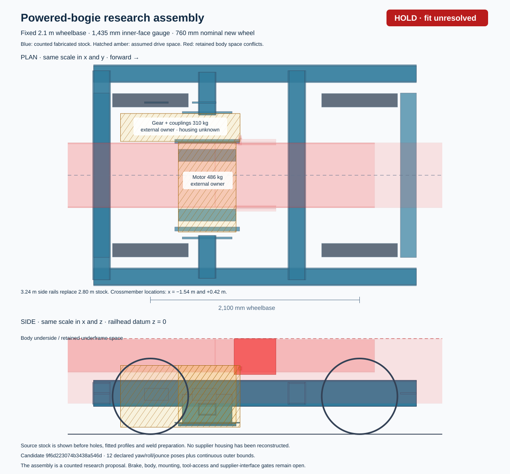

# Powered-bogie research detail — HOLD

The counted assembly and its stock CAD are reproducible. **The powered bogie does not yet fit the retained body and brake allocations, and actual supplier interfaces are unknown.** This child research configuration does not replace the passive v0.6 development reference.



[3D assembly](bogie.glb) · [STEP stock subset](assembly.step) · [SolidCraft source](assembly.sc) · [Manufacturing schedule](manufacturing.csv) · [Geometry and access findings](geometry.json) · [Sealed body](body.json.gz) · [Full source/run archive](source-and-run.tar.gz)

## What was generated

Two proposals use the same fixed gauge, 2.1 m wheelbase and 760 mm new-wheel geometry: the retained-frame control and one extended 3.24 m fabricated frame/cradle. The control and every failed allocation remain in the archive. There were no extra physical variants, FEM solves or train-dynamics runs.

The revised six-car body contains 668 component types and 122,422 counted occurrences. Its 22 new part types define side rails, crossmembers, ties, removable motor plates, outriggers, torque-reaction plates/bushes, retention straps/stops, weld deposit, fasteners, cables, bonding and a flexible ventilation provision. Materials, stock sizes, quantities, process allowances, inspection and workshop removal sequences are included. Gross stock before fitted holes and profiles is distinct from finished geometry.

SolidCraft generated **34 stock primitives**, and independent FreeCAD import agrees on their volumes, centroids and bounds. RHS is represented by four occupied walls with an open void. This checks the declared stock geometry; it does not verify finished joints, supplier geometry, weld strength or an installed assembly.

## Fit and movement findings

The motor's required-space intersections with retained frame stock reduce from six to two. Two further proposed mount-stock intersections remain. The gear retains three wheel/brake and five underframe allocation conflicts, alongside frame/mount conflicts. These counts concern intersected stock primitives and assumed equipment boxes, not measured supplier-housing contact. No clearance pass is inferred from unknown shapes.

Twelve explicit yaw/roll/jounce poses per proposal are accompanied by conservative continuous swept-box bounds. Body/battery space, primary gear motion, coupling movement, socket approach, motor drop stroke and service-loop length are reported. Necessary cable and duct length checks pass under the hypotheses, but actual routed volume, tool access, connectors and ventilation/thermal performance remain unverified.

The [TSA application catalogue](https://tsa.at/tsa-referenzen/tsa-traction-drive-for-siemens-type-x-metro-for-wiener-linien-copy/) supports the 486 kg motor and 310 kg gear/coupling masses, not OSR housing dimensions or mounting holes. It lists 840/716 mm new/worn wheels, while the current OSR geometry is 760/680 mm. A possible 716–760 mm research maintenance range is identified but **not selected**; wear rate and renewal life have not been invented. Internal supplier bearing counts remain bounded and are already mass-owned inside the catalogue equipment.

## Mass and calculated factory cost

| Six-car change | Low | Base | High |
| --- | ---: | ---: | ---: |
| New counted body stock delta, kg | 2,441.268 | 2,446.255 | 2,456.191 |
| Explicit BOP now counted inside body, kg | 1,649.037 | 1,690.024 | 1,759.960 |
| Remaining positive external BOP reserve, kg | 850.963 | 2,309.976 | 6,240.040 |
| Net integrated mass delta after exact BOP partition, kg | 792.231 | 756.231 | 696.231 |
| Direct parts/process cost delta, USD | -651 | 18,691 | 77,016 |

Exactly twelve motors and twelve gear/coupling units, totalling 9,552 kg, remain externally owned. Their split centres replace the old 796 kg axle points; they are not added to the body BOM. Explicit mounts/services partition the previous 2.5/4/8 t reserve once, leaving a positive unknown remainder. The factory-cost change uses declared low/base/high material, yield, labour, processing and QA assumptions; it is not a quotation or complete train price. A mass partition does not justify an automatic proportional reduction of an unrelated price allowance.

## Installation and remaining gates

The repair plan uses positive retention, electrical isolation, supported body/bogie fixtures, a workshop drop table, a proposed 1 t hoist and a finite 0.60 m motor lowering stroke. It retains the need to remove an axle-mounted gearbox with its wheelset. Hoist/eye ratings and actual shaft disengagement are open.

Next work requires dimensioned supplier housings and interfaces; resolved brake/body/mount space; coupling and shaft retention; frame and mount strength/fatigue; actual suspension travel; wheel/rail profiles; cooling duty; and verified installation/removal paths. None of these is accepted by the stock CAD comparison. Physical, manufacturing and operating release remain false.

## Reproduction and identities

```bash
.venv/bin/python -m unittest discover -s tests -p test_powered_bogie.py -v
.venv/bin/python -m engineering.powered_bogie.run /private/new-run --cad
.venv/bin/python tools/publish_powered_bogie_detail.py /private/new-run /private/new-publication
```

The final six regression tests passed in 35.749 s. The frozen private run completed in 44.80 s; one SolidCraft regeneration and one FreeCAD check were used, each under the existing 2 GiB / 120 s wall / 122 s CPU wrapper request. The full run was approximately 4 MB. Native execution receipts and before/after source hashes are preserved. The worktree is isolated by convention and integrity checks; the source filesystem was not OS-enforced read-only.

* Input body: `c89556f453e39448a8f3e9bf2d0d4d008f97cd20d252ac417284e40965e261b3`
* Research body: `9f6d223074b3438a546d5b3d71cd9b970807387ef0542023bed79bef46dbdeba`
* Body evaluation: `dfb48ca3fac6ee9b702ae13b2e5e4e0c112d734263750deefb25ad5718fdb272`
* Geometry evaluation: `101189f515a91fb340d95e4b03620046b9a7b26252c63cce2e9de87eb003e81f`
* Native proof envelope: `bd04cbe4c33c5f530fd7a696ff53f0eeacadfc9d4d9735adfd9c2729bd63e2d2`
* Source commit: `2af9058b372fdc3e4f26e45d41f7615e796d0381`
* Run manifest: `31860aa4237d4e76df71b4b5e81e6766078229075f96bce6203c59b6eaad374b`

[Machine-readable publication](packet.json) contains all artifact hashes and source identities. [Native verification](native-verification.json) is retained unchanged and enclosed by the new producer's exact source context in [native-result.json](native-result.json).
