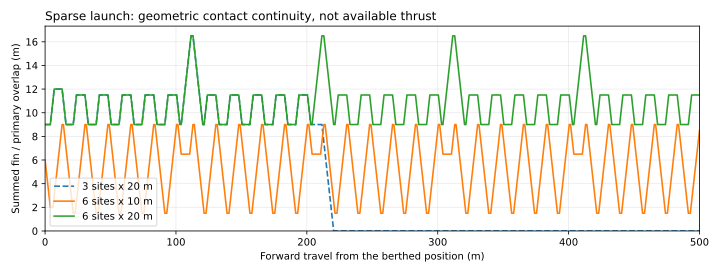

# Simpler propulsion: powered bogies and sparse accelerators

This study develops the user's two proposals: **one supercapacitor-powered bogie
per three-car group**, and **three short accelerator sites near the station**.
It retains those seeds and investigates revisions when a necessary bound fails.
The selected six-car wheel/LIM reference, its images and physical evaluation
remain unchanged. No new materialized train or economic winner is selected.

[Generated findings](comparison-summary.md) give the current counts and numerical
results. [The complete packet](comparison.json.gz) retains failed bounds,
mass-feedback iterations and capacitor sizing trials. [Its manifest](manifest.json)
binds the input and output bytes.

[The quotation scope](quotation-scope.json) lists component quantities and missing
installed-price/duty evidence. It is an unsubmitted draft, with no live business
records, quotation currency, monetary totals or cheapest-railway claim.

## What is compared

The [campaign](../../../campaigns/simple-affordable-propulsion.toml) compares
two to twelve powered bogies, 57.6/72 km/h, 0.15/0.25/0.4 m/s², level/2% uphill
routes, and launch/coast versus sustained wheel traction. Normal passenger
loading is used for propulsion requests. Crowd structural/braking verification,
accessibility and independent protection remain mandatory and open.

The 2 km profiles are prescribed motion requests at counted/scenario mass;
they are not force-map-driven railway journeys. The full-route alternative
counts powered cruising and grade work rather than sizing an uphill store from
the launch pulse alone. Conditional fleet floors use a 6 km directional ring
and the same 120 s departure target. Safe headway, complete fleet and failure
recovery are not established.

Sparse comparisons use the actual departure alignment: rear at 0 m, nose at
104.5 m, sites at the platform rear/front and then every 100 m beyond the front.
Three through six sites and 10/12.5/20 m banks are examined. The six 9 m fins
have 4 m setbacks and 17.5 m pitch. Exact edge events and contact envelopes
replace the assumption that the full train is continuously reactive.



*Geometric overlap only. Curves neither scale thrust with overlap nor demonstrate
a moving-entry motor map, safe handoff or a completed train journey.*

## Count hardware before claiming simplicity

The catalogue references are **supplier leads**, not approved parts:

- [Skeleton module input](../../../engineering/design_search/data/skeleton-102v94f-catalogue.json): current bytes identify a 102 V, 94 F grid-module draft, although the URL retains an older product name. Bare module mass, resistance, thermal conditions and document hash are recorded. Authenticated railway release, installed price and lifetime in this duty are absent.
- [TSA drive lead](../../../engineering/design_search/data/tsa-type-x-drive-lead.json): a 180 kW motor and gearbox/couplings provide a concrete catalogue mass comparison. Wheel sizes, mounts and operating interfaces differ. Nominal power alone is not a torque/speed/current/thermal envelope.

The capacitor is represented by an ideal capacitance with series resistance.
Low-voltage terminal power uses `P = (Voc - IR) I`. Discharge losses are
conservatively bounded by the low-voltage peak current over the powered duration;
charging restores the resulting worst-case energy with bounded constant current.
Both charging and discharge are screened against continuous thermal arithmetic,
not the catalogue's one-second peak-current number. The specified airflow remains
an unproven installation requirement.

At 50°C intake and a 60°C catalogue maximum, only 10°C temperature rise remains.
Twice beginning-of-life resistance follows the supplier's system-design note;
80% capacitance retention is explicitly an analyst hypothesis. Constant thermal
parameters and resistance do not constitute an approved hot-duty curve. This
deliberately conservative screen is not a minimum practical capacitor bank.

The study uses two seven-series banks with a 98-to-49 V/module internal window.
The donor's 533 V AC rating cannot be equated to that capacitor DC voltage.
A separate boost/inverter interface is required and remains unweighed; an
800 V inverter-bus target is a hypothesis. Actual voltage control, charger and
motor maps are missing.

Catalogue capacitor-management consumption is added to the service-energy
account. New cooling and conversion installations remain unresolved; the
reported energy bound covers the declared model, not a complete purchased-energy
estimate.

Bare capacitor mass and the donor motor/gear account feed back into vehicle
mass before demand is recalculated. Positive installation and extra rotor-inertia
hypotheses are visible, not accepted installed quantities. The inherited passive
secondary account is not silently subtracted. Every final counted iteration
uses the same module count as the mass that produced its demand.

Powered-wheel contact force includes translational demand and unpowered wheel
rotation. Driven-wheel and motor rotation are accounted separately in shaft
effort. Axle loads are provisionally uniform; real component positions, load
transfer, wheel slip control and coupler forces still need candidate geometry.

## Whole-life scope remains explicit

Fewer motors or fewer metres of primary stock do not by themselves establish
lower railway cost. Compare all of the following at the required service:

- Vehicle motors/gears, inverter channels, capacitor cabinets, boost conversion, charging contacts, protection, cooling, wiring, mounts, fasteners and removal access.
- Launch and receiving installations, feeders, switchgear, cooling, civil interfaces, alignment and protected maintenance access.
- Independent brakes, service energy, charge interruption, lost drive/site, stuck thrust, stranded-train rescue and evacuation.
- Priced manufacture, assembly labour, tools, inspection, spares, energy, maintenance, renewal life, fleet and downtime.

Supplier prices, origin, complete installed mass, actual purchased energy and
whole-life cost remain unknown. The reported grid-energy bound covers its
declared model only: additional converter/cooling hardware and duty still need
data. A capacitor lifetime claim at one catalogue condition cannot become a
railway renewal interval. Primary-bank length is a launch-only geometric quantity;
it is not comparable with the reference's 900 m shared launch/receiving allowance
without completing the receiving and protection scope.

The [manufacturer capacitor source](https://www.skeletontech.com/hubfs/01-DS-211228-SKELMOD-102V88F-1F.pdf?hsLang=en)
and [drive source](https://tsa.at/tsa-referenzen/tsa-traction-drive-for-siemens-type-x-metro-for-wiener-linien-copy/)
support catalogue facts only. No supplier has approved the proposed installation
or provided its price or operating maps.

## Reproduce

```bash
./osr design railway plan
.venv/bin/python -m engineering.design_search.propulsion_layout plan
.venv/bin/python -m engineering.design_search.propulsion_layout compare
.venv/bin/python -m engineering.design_search.propulsion_layout publish
.venv/bin/python -m engineering.design_search.propulsion_layout verify
```

The inherited [practical launch study](../practical-launch/README.md) and P1–P7
contracts remain reproducible. This new study uses separate physical option,
evaluation and source identities. The existing requirement policy keeps missing
safety and acceptance evidence unknown. Component declarations, geometric
coverage and scalar convergence do not admit a native propulsion model or
authorize manufacturing or movement.

Completed and interrupted invocations retain immutable input-source and result
packages under `build/propulsion-layout/runs/`. Budget interruption retains
pending requests and does not replace the published complete packet. Source
files are edited in an isolated checkout; source integrity checks do not provide
an operating-system sandbox.
