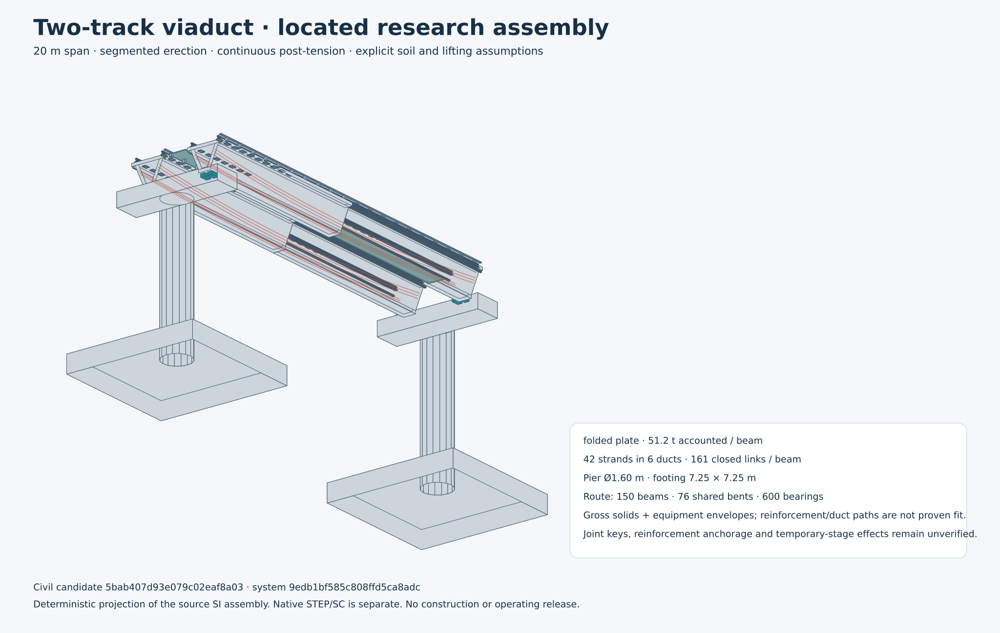

# Reconciled railway research pilot

[Open the decision view](index.html) · [Download complete calculated study](study.json.gz) · [Manufacturing BOM](vehicle/bom.csv) · [Installed assembly model](vehicle/assembly.glb) · [Manufacturing tasks and business-review draft](delivery/README.md)

**Calculated outline complete under explicit assumptions. Engineering evidence pending.**
One physical bundle connects a six-car research body, counted drive/interface additions, axle reactions, civil quantities, terminal layout, counted fleet, causal energy-store simulation and all fourteen lifecycle scopes. The passive v0.6 reference remains unchanged; this powered-wheel research comparison does not select installed propulsion.

The underframe batch retains both failures and alternatives. A constant-depth girder clashed with the bogies. Shallow-end revisions were recalculated; the aluminium option failed its declared crowd roll target, so this packet details the eligible steel family. Joint stiffness/material properties and functional allocations remain provisional. No roof stiffness is credited. Every removed passive-secondary component is explicit in this separate research body.

The wheel/rail interface now carries an explicit inner-face gauge, nominal rail-head width and common contact-centre datum through vehicle placements, civil rails, fasteners and numerical load patches. Wheel envelopes have their axle direction along the track's transverse axis. These definitions correct the earlier inconsistent rail spacing and wheel-envelope orientation; actual tread/flange profiles and contact behaviour still require engineering verification.



| Headway / opposite departure phase | Recovery | Active+reserve trains | Arrivals | Moving jerk m/s³ | Complete pilot base capital | Nominal model screen |
|---|---|---:|---:|---:|---:|---|
| 200s / phase90s | on | 3+1 | 16/16 | 0.320 | $39.28m | pass |
| 200s / phase90s | off | 3+1 | 16/16 | 0.320 | $39.28m | pass |
| 210s / phase90s | on | 3+1 | 16/16 | 0.320 | $39.28m | pass |
| 210s / phase90s | off | 3+1 | 16/16 | 0.320 | $39.28m | pass |
| 200s / phase0s | on | 4+1 | 16/16 | 0.320 | $42.45m | pass |
| 200s / phase0s | off | 4+1 | 16/16 | 0.320 | $42.45m | pass |
| 210s / phase0s | on | 4+1 | 16/16 | 0.320 | $42.45m | pass |
| 210s / phase0s | off | 4+1 | 16/16 | 0.320 | $42.45m | pass |
| 210s / phase60s | on | 3+1 | 16/16 | 0.320 | $39.28m | pass |
| 210s / phase60s | off | 3+1 | 16/16 | 0.320 | $39.28m | pass |
| 210s / phase90s | on | 4+1 | 16/16 | 0.320 | $42.45m | pass |
| 210s / phase90s | off | 4+1 | 16/16 | 0.320 | $42.45m | pass |

The 1.5km pilot has two stations and two running tracks. Additional platform, pocket and crossover track, four turnouts, station access, grid feeds, backup chargers, depot, rescue, land/utilities and renewals are priced explicitly. No extra blanket bulk discount or uncommitted future-order credit is applied. Manufacturing versus purchasing compares declared setup scopes, not supplier quotations. Financing, taxes, customs and FX remain separate project-finance layers.

Energy stores start empty in nominal cases. Release substitutes for independently available grid traction with finite slew; it cannot add free force. Shared-bank collisions or unready stores bypass recovery. Actual train identities, reverse stopping offsets, route occupancy and full-grid thermal proxies carry through the timetable. Faults remain visible. Finite-run energy extrapolation, terminal maneuvers, voltage/loss/cooling assumptions and electronics allowances are disclosed in the full study; they do not establish qualified daily operation.

The study has a new whole-railway identity. The **exact current normal-base load and corrected wheel/rail interface** have a source-bound three-mesh elastic comparison. Rotation-free bearing lines give 13.9141mm fine-mesh deflection, refinement changes 0.0067% / 0.0301%, passing the unchanged5% target. FieldCraft and CalculiX agree closely. [Complete compact proof](civil-native/civil-native-current-6c4a9d6e5886.tar.gz) includes raw inputs, meshes, solver outputs, resource logs and sources. Earlier mismatched-gauge and biased support-patch results remain historical; their evidence is not inherited. Rotation-free line supports, gross elastic concrete and one native load pose do not verify real bearing contact, segment joints, cracking, prestress, fatigue or high/crowd3D cases.

Full installed motor shapes, joints, fatigue, emergency braking, station mechanical force/flow maps, hot electrical characteristics and site conditions remain open.

The body-only mass subtotal and full driven train are separate accounting scopes. The decision view itemises counted body, installation/payload, external drives, remaining BOP and capture-interface reserves; a body subtotal is never presented as the integrated loaded train.

All original part origins are retained or explicitly superseded, with materials, quantities, process/assembly plans, proposed locations and positive reserves. Stock blanks and equipment envelopes are distinguished from finished solids. These are research manufacturing drafts, not released production drawings or work orders.

No city is silently repriced from this pilot. [Remaining engineering tasks](frontier.json) identify the exact work needed before city-specific adoption or physical qualification. [Mandatory requirement context](requirements.json) keeps unsupported obligations open.

```bash
./osr design closure run --output /path/to/fresh/private/run
./osr design closure publish --run /path/to/private/run --output /path/to/fresh/dossier
./osr design closure verify
```

Study `c30f4bc42edc151edb9cdbcae1faf11167326d77c43475340f7dfd0fe70fc4a4`. Whole bundle `f9aa3afa47a297da855b2741c9e0fde0d77ad3e3211df500f32f901cfadb1877`.
Physical acceptance, manufacturing and operating release are false.
